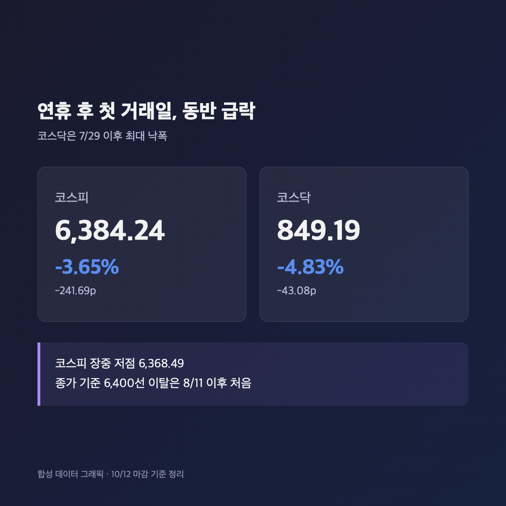
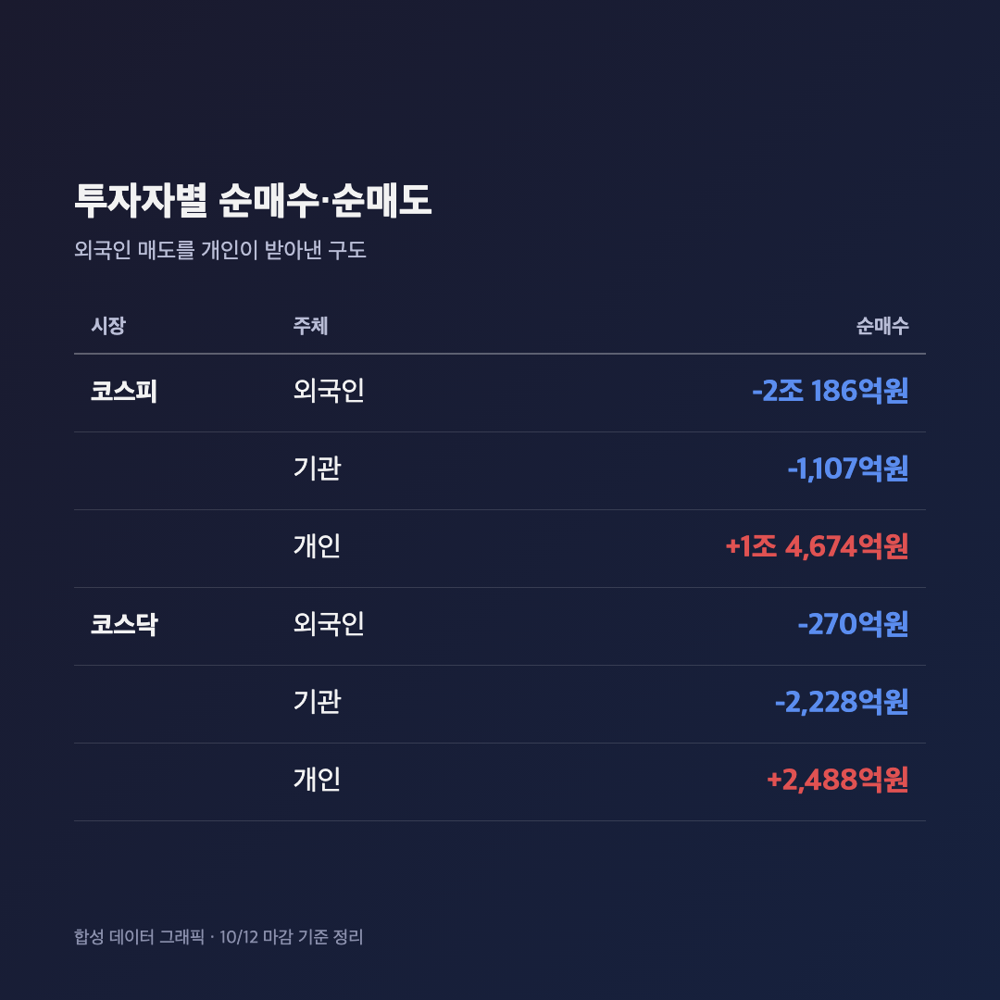
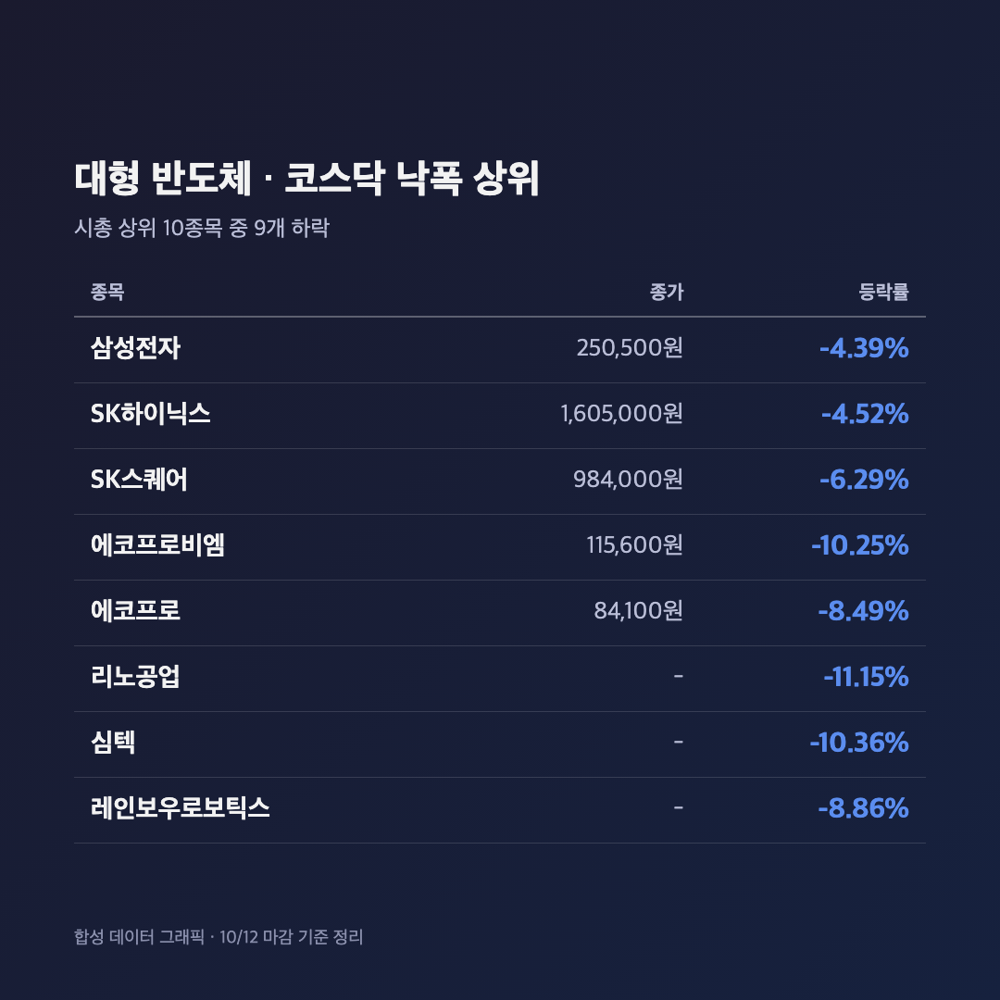
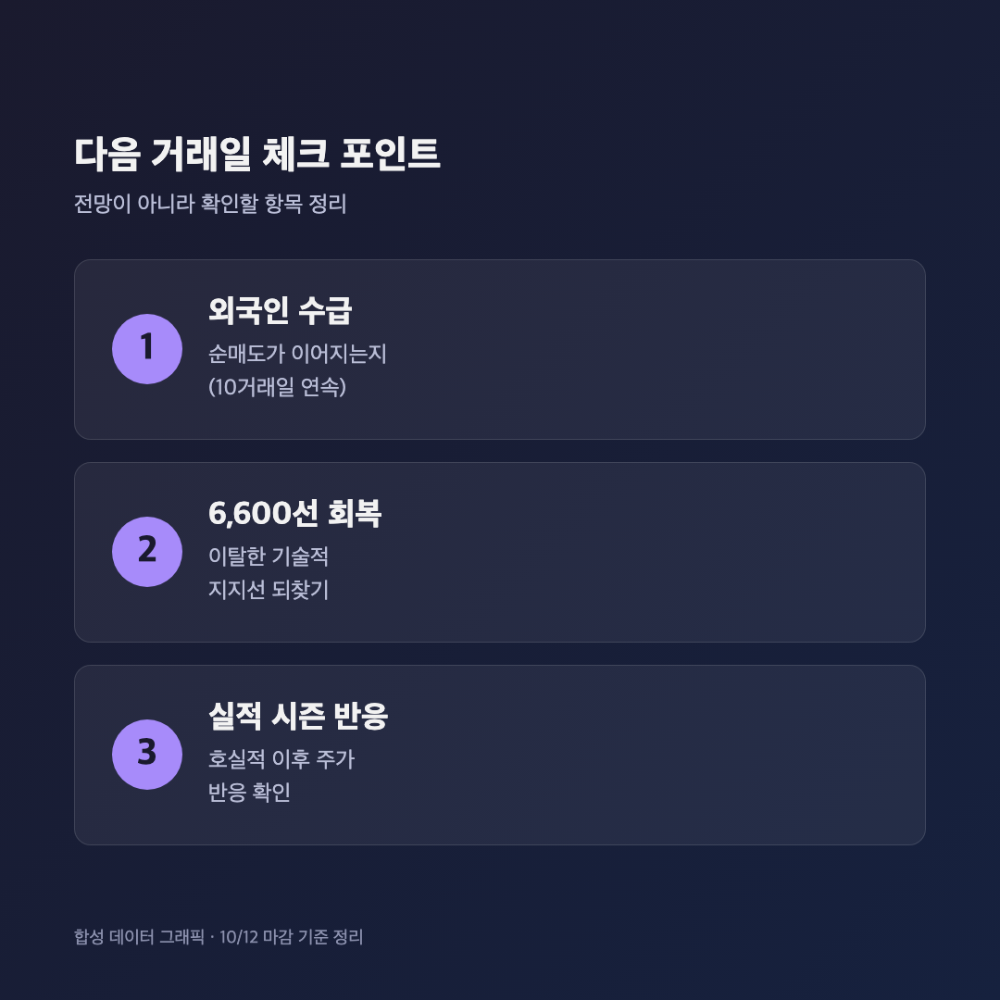

# [내일도 주린이] 코스피 3.65% 급락, 6,400선 두 달 만에 붕괴…연휴 끝나자마자 외국인 2조 매도 (10/12)

사흘 쉬고 돌아왔는데 반겨주는 게 파란불이었어요. "연휴 동안 충전했으니 반등하겠지" 했던 제 생각이 장 시작 몇 분 만에 증발했습니다.

참고로 10/9(금)은 한글날 휴장이었고, 오늘(10/12)이 연휴 후 첫 거래일이에요. 그러니까 오늘 글은 진짜 오늘 마감 기준입니다.

---

## 📉 코스피 6,384.24 (-3.65%), 코스닥은 -4.83%로 더 크게 밀렸어요

> **코스피 6,384.24 (-241.69포인트, -3.65%) / 코스닥 849.19 (-43.08포인트, -4.83%)**

코스피는 6,578.17로 출발해서 6,500선, 6,400선을 차례로 내줬고 장중 저점은 6,368.49였어요. 종가 기준으로 6,400선 아래는 8/11 이후 약 두 달 만이고, 4거래일 연속 하락이기도 합니다. 코스닥은 7/29(-6.12%) 이후 가장 큰 낙폭이었고요.

"코스피가 이 정도면 코스닥은 좀 버티겠지" 했는데 오히려 코스닥이 더 빠졌어요. 이번엔 대형주보다 중소형 기술주 쪽이 더 얻어맞은 날입니다.

---

## 💸 외국인이 2조원 넘게 던지고, 받아낸 건 또 개인

> **외국인 -2조 186억원 / 기관 -1,107억원 / 개인 +1조 4,674억원 (코스피)**

코스피에서 외국인이 2조 186억원을 순매도했어요. 글로벌이코노믹 보도로는 이게 10거래일 연속 순매도입니다. 기관도 1,107억원 팔았고, 개인이 1조 4,674억원을 사서 받아냈어요. 코스닥은 개인 +2,488억원, 기관 -2,228억원, 외국인 -270억원이었습니다. (스트레이트뉴스는 코스피 기관·개인 수치를 -1,175억원, +1조 4,741억원으로 조금 다르게 집계했는데, 머니투데이·블록미디어가 공통으로 낸 수치 기준으로 적었어요.)

솔직히 개인이 받아내는 장면은 이제 너무 익숙해서 무서워요. 이번에도 개인 매수 대 외국인 매도 구도였고, 원·달러 환율은 1,335.1원(주간거래 종가 대비 -7.7원)으로 마감했어요.

---

## 🏭 삼성전자 -4.39%, SK하이닉스 -4.52%…호실적 뒤에도 이틀째 약세

> **삼성전자 250,500원 (-4.39%) / SK하이닉스 1,605,000원 (-4.52%) / SK스퀘어 984,000원 (-6.29%)**

시총 상위 10종목 중 9개가 내렸고 KB금융만 보합이었어요. 삼성전자 25주를 들고 있는 저는 "3분기 영업이익 107조 얘기가 나온 지가 언제인데 아직도 빠지냐" 하고 한참 화면을 쳐다봤습니다. 이틀 연속 빠진 거라 체감 타격이 더 컸어요.

코스닥은 더 심했어요. 리노공업 -11.15%, 심텍 -10.36%, 에코프로비엠 -10.25%(115,600원), 레인보우로보틱스 -8.86%, 에코프로 -8.49%(84,100원)가 크게 빠졌고, 알테오젠 -3.94%, HLB -2.74%도 약세였습니다. 키움증권은 지난 거래일(10/8) 강세였던 소재·부품·장비, 기판 관련주에 차익실현이 몰렸다고 봤어요.

---

## 🔍 왜 빠졌나 – 증권가는 "외부 악재보다 국내 수급" 쪽에 무게

이유는 증권사마다 포인트가 조금 달랐어요.

- 키움증권 한지영 연구원: 나스닥 선물과 마이크론 시간외 주가에 큰 변화가 없었고 미국 10년물 금리도 약보합이었다며, 외부 악재보다는 국내 요인으로 봤어요. 6,600선 이탈로 기술적 추세 우려가 커진 데다, 삼성전자 호실적에도 주가가 빠지면서 실적 시즌 경계감이 커졌다는 설명이에요.
- 유안타증권 이재원 연구원(글로벌이코노믹 인용): 지금 시장의 가장 큰 고민은 반도체 실적이 아니라 외국인 수급이라고 했어요. 실적과 메모리 가격은 견조한데 외국인 순매도가 계속 부담이라는 거죠.

참고로 연휴 중인 10/9(현지) 뉴욕은 3대 지수가 올랐고 반도체지수만 약세였어요(서울데이터랩 기준 나스닥 +0.64%, 필라델피아 반도체 -0.41%. 치킨스탁은 -0.69%로 집계해서 소스마다 숫자는 조금 달라요). 그 전날 10/8에는 필라델피아 반도체가 -3.39% 급락했다고 해요. 미국 CPI 같은 일정은 이번엔 제가 확인하지 못해서 따로 단정하지 않을게요.

---

## 🔮 이제 뭘 봐야 하나 – 외국인 매도가 멈추는지

한지영 연구원은 이틀 연속 급락이 과도한 측면이 있고, 실적 시즌 초입에서 시장을 낮게 보기는 이르다며 낙폭을 일부 되돌릴 가능성도 열어뒀어요. 반대로 외국인 순매도가 이어지면 부담이라는 시각도 있고요. 둘 다 전망일 뿐이라 내일 결과는 달라질 수 있습니다.

저는 당분간 외국인 순매수 전환 여부, 6,600선 회복 여부, 그리고 실적 시즌 반응 이 세 가지만 체크해보려고 해요.

---

## 마무리하며

정리하면 연휴 후 첫 거래일인 오늘 코스피는 6,384.24(-3.65%), 코스닥은 849.19(-4.83%)로 마감했고, 외국인이 2조 186억원을 순매도했어요. 삼성전자는 250,500원, SK하이닉스는 1,605,000원까지 내려왔습니다.

솔직히 매수 버튼 누를 용기는 안 나는데요, 삼성전자 25주는 일단 그대로 두고 외국인 수급이 돌아서는지 지켜보려고 합니다. 오늘은 계좌 대신 마음을 비웠어요.

쉬고 오면 오르는 줄 알았던 주린이, 오늘도 한 수 배웠습니다 🌱
