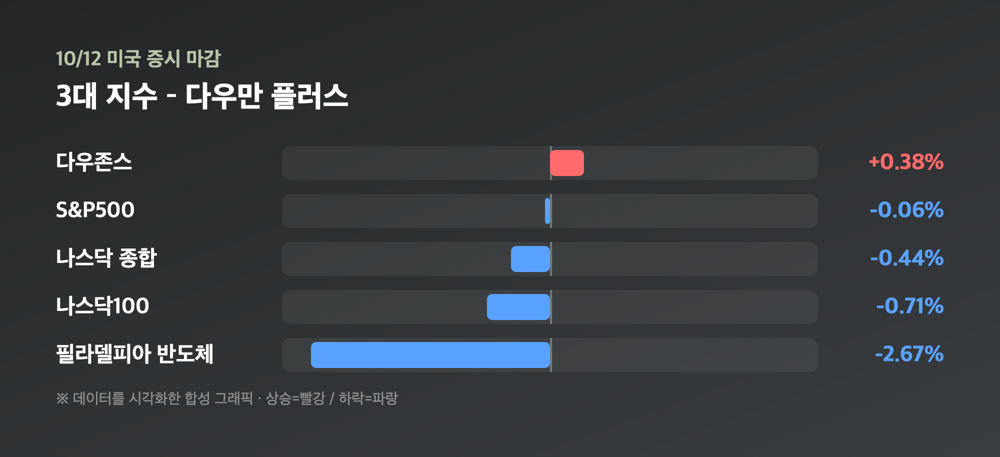
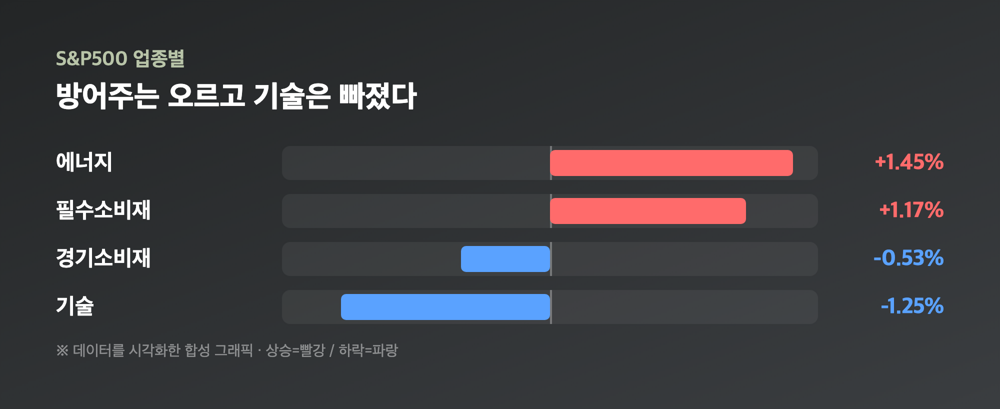
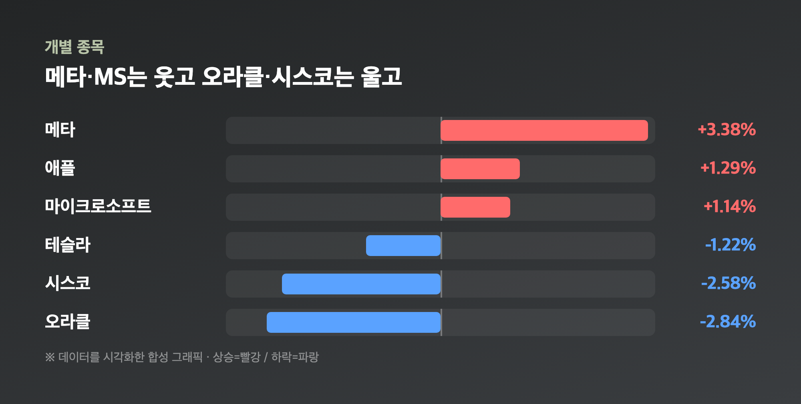

# [내일도 주린이] 반도체지수 2.67% 급락…다우만 웃은 컬럼버스 데이 미장 정리 (10/12)

SOX -2.67%. 이 숫자부터 보고 "아 오늘도 반도체가 문제구나" 했는데요, 지수 창을 열어보니 다우는 오히려 올라 있어서 한 번 더 놀랐습니다.

참고로 10/12(월)은 미국 컬럼버스 데이(연방 공휴일)였지만 주식시장은 정상 개장했어요. 쉬는 건 채권시장뿐이라 오늘 글은 진짜 10/12 정규장 마감 기준입니다.

---

## 🔀 다우만 올랐다 – 지수 세 개가 서로 다른 방향

> **다우존스 51,850.55 (+195.60포인트, +0.38%) / S&P500 7,807.24 (-4.30포인트, -0.06%) / 나스닥 27,245.90 (-120.27포인트, -0.44%)**

| 지수 | 종가 | 등락 |
|---|---|---|
| 다우존스 | 51,850.55 | +195.60포인트 (+0.38%) |
| S&P500 | 7,807.24 | -4.30포인트 (-0.06%) |
| 나스닥 종합 | 27,245.90 | -120.27포인트 (-0.44%) |
| 나스닥100 | 30,664.70 | -218.45포인트 (-0.71%) |
| VIX | 15.21 | +0.37 (+2.49%) |

S&P500은 사실상 보합이었고, 장중 범위도 7,796.94~7,821.67로 좁게 움직였어요. 52주 고점(7,844.52)이 코앞인데 막상 근처에서 머뭇거리는 모양새입니다. 참고로 일부 기사에서는 다우 51,654.95에 세 지수 모두 상승이라고 적어놨는데, 이건 금요일(10/9) 마감 수치와 똑같아서 헷갈린 걸로 보여요. 저는 서울데이터랩·이투데이·Motley Fool 등 여러 곳에서 같게 나온 위 수치로 적었습니다.

---

## 🔧 반도체가 다 같이 빠졌다 – SOX -2.67%, 메모리가 선두

> **필라델피아반도체지수 12,236.79 (-2.67%) / SK하이닉스 ADR -4.02% / 마이크론 -3.88%**

| 종목 | 등락률 |
|---|---|
| SK하이닉스 ADR | -4.02% |
| 마이크론 | -3.88% |
| 인텔 | -3.20% |
| AMD | -2.28% |
| TSMC ADR | -1.98% |
| 브로드컴 | -1.88% |
| 엔비디아 | -1.29% |

특히 메모리가 셌어요. 샌디스크는 6% 넘게 빠졌고, 마이크론과 SK하이닉스는 4% 가까이 밀렸습니다. 원인으로는 중국 CXMT(창신메모리)가 차세대 DRAM 기술 진전을 공개하면서 경쟁이 세질 거라는 우려가 꼽혔어요. (이 배경은 시장 요약 기사 기준이고 원문까지는 확인하지 못했어요. 기술주 전반 약세와 유가 상승도 같이 부담이었다고 합니다.)

그런데 이게 남 일이 아니에요. 오늘 국장에서 코스피가 3.65% 빠진 것도 이 메모리 이야기와 맞닿아 있고, 25주 들고 있는 제 삼성전자도 메모리가 주력이거든요. "아, 어쩐지 아침부터 파랗더라" 싶었습니다.

---

## 🛢️ 에너지·필수소비재는 강세 – 돈은 방어주로

S&P500 업종으로 보면 에너지가 +1.45%, 필수소비재가 +1.17% 올랐고, 기술은 -1.25%, 경기소비재는 -0.53%로 약했어요. 개별 종목도 엑슨모빌 +1.90%, 셰브론 +1.42%, 코카콜라 +1.98%, 월마트 +1.55%, 코스트코 +1.32%, 애브비 +1.68% 식으로 방어주 쪽이 줄줄이 올랐습니다. 금융도 이번 주 대형 은행 실적을 앞두고 비자 +0.99%, JP모간 +0.39%로 버텼고요.

유가는 소스마다 방향이 엇갈렸어요. 어떤 곳은 2주 만의 고점이라고 했고, 어떤 곳은 러시아-우크라이나 에너지 휴전 기대로 브렌트가 1.5% 내린 103달러 안팎이라고 했습니다(WTI는 대략 90달러대 초중반). 정확한 종가는 확인하지 못했지만, 에너지주가 확실히 올랐다는 건 변하지 않는 사실이에요.

---

## 📱 빅테크는 갈렸다 – 메타 +3.38%, 오라클 -2.84%

기술주가 다 빠진 건 아니었어요. 메타가 새 AI 모델 'Muse Wonder'를 공개하면서 3.38% 오르고, 마이크로소프트 +1.14%, 애플 +1.29%로 같이 올랐습니다. 반면 오라클 -2.84%, 시스코 -2.58%, 델 -1.59%, 테슬라 -1.22%, 아마존 -1.11%는 밀렸고요. "기술주=한 덩어리"가 아니라 반도체만 콕 집어서 팔린 날에 가까웠어요. 세일즈포스는 애널리스트 상향 소식에 올랐고, 샌디스크와 루멘텀(약 -10%)은 크게 빠졌습니다.

금은 0.64% 내린 4,167.56달러, 미 10년물 국채금리는 5.24%였는데요, 채권시장이 쉬는 날이라 금리는 큰 의미를 두기 어렵다고 봤어요.

---

## 🗓️ 이번 주 체크포인트

이번 주부터 대형 은행들의 3분기 실적이 나오고, 핵심 물가 지표도 대기 중이에요(정확한 날짜는 제가 확인한 소스에 없었어요). 올해 마지막 어닝 시즌이 사실상 이번 주에 시작되는 셈입니다. 그리고 오늘은 S&P500이 2022년 10/12 저점에서 반등을 시작한 지 딱 4주년이었는데, 그 사이 120% 넘게 올랐다고 하더라고요. 4년 전 저한테 "그때 샀어야 했다"고 한 마디 해주고 싶네요.

---

## 마무리하며

10/12 미장은 다우 +0.38%, S&P500 -0.06%, 나스닥 -0.44%로 엇갈렸고, 반도체지수가 -2.67%로 급락하면서 메모리주가 제일 크게 맞았습니다. 반대로 에너지·필수소비재 같은 방어주가 지수를 받쳐줬어요.

솔직히 삼성전자 물려 있는 입장에서는 메모리 얘기가 나올 때마다 심장이 쿵 하는데요, 일단 오늘은 중국 경쟁 이슈가 얼마나 오래 갈지 이번 주 실적과 함께 지켜보려고요. 오늘은 방어주 한 주가 없는 게 제일 아쉽네요 🌱
