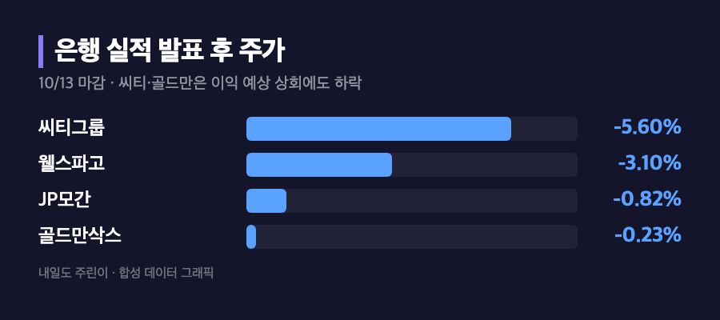
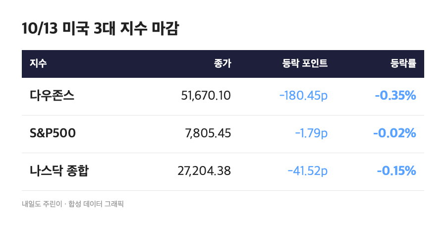
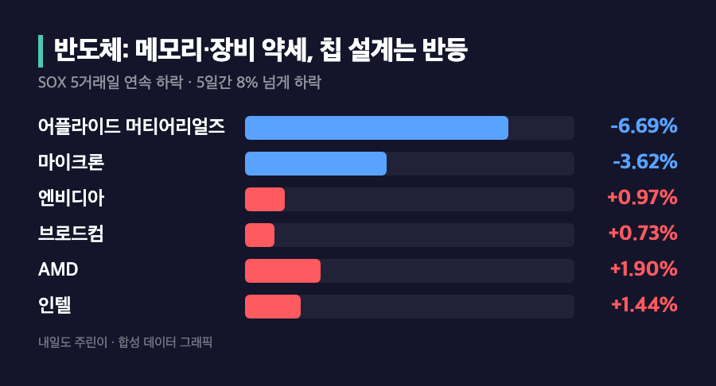
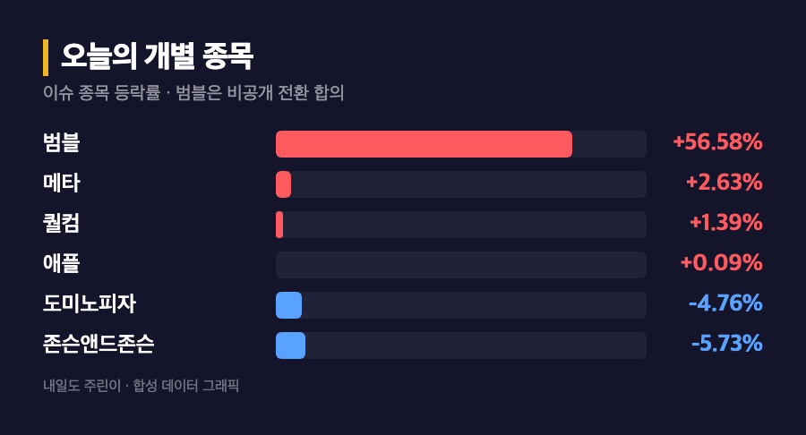

# [내일도 주린이] 반도체지수 5일 연속 하락…은행 실적 발표에 씨티 -5.60% 미장 정리 (10/13)

"어제 다우만 올랐으니 오늘은 좀 낫겠지" 했는데요, 이번엔 다우가 제일 크게 빠졌습니다. 은행 실적이 시작되자마자 이익이 좋아도 주가가 빠지는 이상한 장이었어요.

참고로 10/13(화)은 미국 정규장이 정상 개장한 날이고, 아래 수치는 현지시간 10/13 마감 기준입니다. 한국 기사에는 어제(10/12) 장 얘기도 섞여 있어서 날짜를 하나씩 확인했어요.

---

## 🏦 이익 내고도 떨어졌다 – 어닝 시즌 개막, 씨티 -5.60%

> **씨티그룹 -5.60% / 웰스파고 -3.10% / JP모간 -0.82% / 골드만삭스 -0.23%**

씨티와 골드만삭스는 이익이 시장 예상을 웃돌았는데도 주가는 내렸어요. 웰스파고는 순이자이익이 예상에 못 미쳤고, JP모간은 이례적으로 이익이 예상치를 밑돌았습니다. 그래도 JP모간·씨티·웰스파고 모두 3분기 대출 수익은 사상 최고였다고 해요. (JP모간 낙폭은 소스에 따라 -0.82%와 -0.86%로 갈리는데, 뉴스핌 기준으로 적었어요.)

"이익 잘 냈다는데 왜 빠져?" 싶으시죠. 저도 그랬는데요, 이미 기대가 높게 반영돼 있었다고 보면 이해가 쉬웠어요. 제이미 다이먼은 성장은 견조하다면서도 재정적자, 끈질긴 물가, 높은 자산 가격, 금리 상승, 지정학 위험을 같이 짚었다고 합니다.

---

## 📉 지수는 다 내렸지만 낙폭은 다우만 컸다

> **다우존스 51,670.10 (-180.45포인트, -0.35%) / S&P500 7,805.45 (-1.79포인트, -0.02%) / 나스닥 27,204.38 (-41.52포인트, -0.15%)**

S&P500은 사실상 보합이라 "조용한 날이네" 싶지만, 속은 꽤 시끄러웠어요. 업종으로는 에너지가 +1.74%, 커뮤니케이션 서비스가 +0.88% 올랐고 헬스케어가 -1.33%로 제일 부진했습니다. 금융도 -0.41%였고요. 존슨앤드존슨은 이익이 예상을 웃돌았는데도 5.73% 빠졌어요.

미 10년물 국채금리는 5.21%로 3.1bp 내렸고, 원/달러 환율은 1,341원(+0.42%)이었습니다. 유가는 WTI가 1% 올랐다는 곳도, 0.4% 올랐다는 곳도 있어서 정확한 폭은 소스마다 달랐어요.

---

## 🔧 반도체 5거래일 연속 하락 – 이틀째 중국발 메모리 충격

> **필라델피아반도체지수 5거래일 연속 하락(5일간 8% 넘게 하락) / 마이크론 -3.62% / 어플라이드 -6.69%**

| 종목 | 등락률 |
|---|---|
| 어플라이드머티어리얼즈 | -6.69% |
| 마이크론 | -3.62% |
| 엔비디아 | +0.97% |
| 브로드컴 | +0.73% |
| AMD | +1.90% |
| 인텔 | +1.44% |

어제는 반도체지수가 -2.67%였는데 오늘은 하루 낙폭이 -0.23%로 줄었어요. 대신 5거래일 연속 하락이 됐고, 6월 최고점 대비로는 약 17% 아래라고 합니다(그래도 연초 대비로는 아직 70% 넘게 올라 있어요). 중국 창신메모리(CXMT) 충격이 이틀째 이어졌고, 브로드컴 CEO가 반도체로 들어오는 일부 자금을 "카지노 도박"에 비유한 발언도 분위기를 흐렸다고 해요. 어플라이드는 웨이퍼 팹 장비 업계 전망치 발표를 보류하면서 크게 빠졌고요. SK하이닉스 ADR도 3% 이상 내렸습니다.

닉 퍼크린 애널리스트는 이번 하락이 단기 조정보다 AI 트레이드의 구조적 재평가에 가깝다고 봤고, 캐시 우드는 중국 기업의 생산 확대가 메모리 업황 변동성을 키울 수 있다고 경고했어요. 저는 25주 들고 있는 삼성전자 생각부터 났습니다. "메모리 얘기 또 나오네" 하고 한숨부터 나왔어요.

---

## 🍎 그래도 오른 애도 있다 – 애플 신고가, 범블 +56.58%

애플은 장중 348.15달러로 사상 최고가를 찍고 0.09% 오른 341.27달러에 마감했어요(시가총액 4조 9,800억달러). 메타는 새 AI 모델 공개 이후 2.63% 올랐고, 퀄컴은 ARM 라이선스 소송에서 유리한 평결이 나왔다는 소식에 1.39% 올랐습니다. (ARM은 자사가 이긴 부분이 더 많다고 반박했어요.) 범블은 13억달러 규모 비공개 전환 합의로 56.58% 급등했고, 도미노피자는 연 매출 전망을 낮춰 4.76% 빠졌습니다.

---

## 🗓️ 내일은 CPI – 연준 발언도 엇갈려요

9월 소비자물가지수(CPI)가 10/14에 발표돼요. 헤드라인은 휘발유 때문에 오르고, 근원 물가는 완화됐을 거라는 전망이 우세하다고 합니다. 윌리엄스 뉴욕 연은 총재는 올해 한 번 더 인상이 적절할 수 있다고 했고(와우TV는 "내년 추가 인상은 불필요"로 요약해서 표현이 엇갈려요), 월러 이사는 장기금리 상승이 이미 긴축 역할을 하고 있다고 봤어요.

참고로 S&P500은 올해 약 14% 올랐지만 중간값 종목은 5%도 안 올랐고, 200개 넘는 종목이 연초보다 내려 있다고 해요. 지수만 보면 좋아 보이는 장인데 체감은 다른 이유가 여기 있었네요.

---

## 마무리하며

10/13 미장은 다우 -0.35%, S&P500 -0.02%, 나스닥 -0.15%로 약하게 내렸고, 씨티 -5.60% 같은 은행주와 5일 연속 하락한 반도체가 발목을 잡았습니다. 반면 에너지와 애플은 버텼어요.

솔직히 메모리 이야기가 이어질수록 삼성전자 물려 있는 입장에선 불안한데요, 저는 일단 내일 CPI 결과부터 보고 움직이려고요. 이익 내고도 혼나는 장에서 저는 이익도 못 냈으니 더 혼나는 중입니다 🌱
