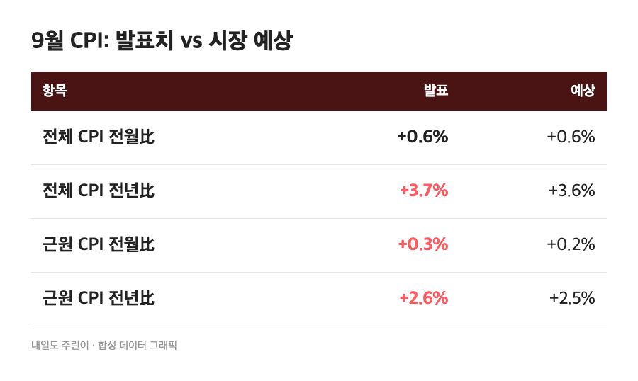
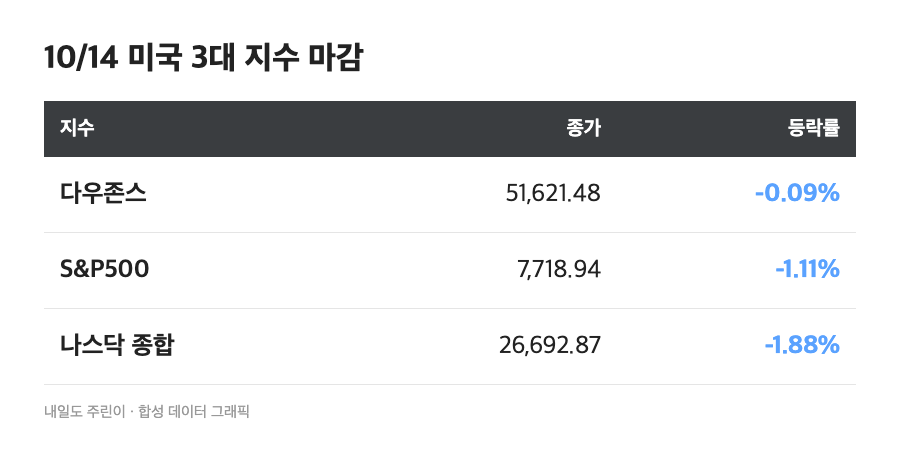
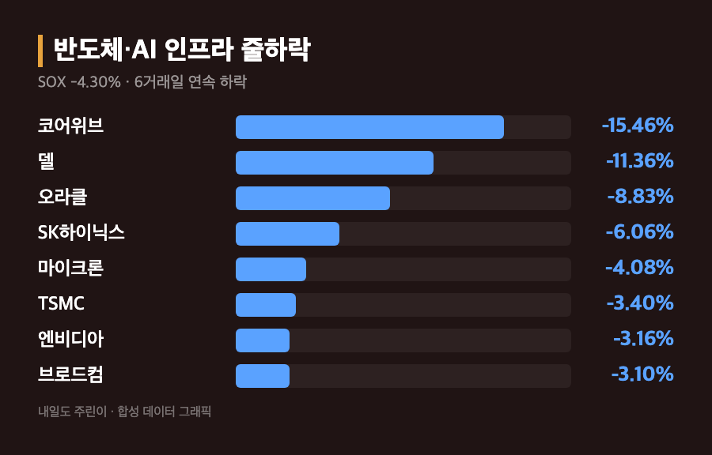
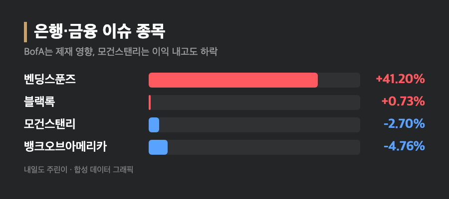

# [내일도 주린이] 9월 CPI 쇼크에 나스닥 -1.88%…반도체지수 6일 연속 하락, 미장 정리 (10/14)

삼성전자 25주 들고 있는 입장에서 "반도체 5일 연속 하락이면 이제 바닥 아닌가" 했는데요, 6일째가 왔습니다. 이번엔 물가 지표까지 같이 왔고요.

참고로 10/14(수)는 미국 주식시장이 정상 개장한 날이고, 아래 수치는 현지시간 10/14 마감 기준(한국 기사로는 10/15 새벽 보도)입니다. 10/13 장 얘기와 섞인 기사가 많아서 날짜를 하나씩 확인하며 정리했어요.

---

## 🔥 9월 CPI 예상 상회 – 전년比 3.7%, 휘발유가 끌어올렸어요

> **전체 CPI 전월比 +0.6% / 전년比 +3.7%(예상 3.6%) / 근원 CPI 전년比 +2.6%(예상 2.5%)**

전체 CPI는 전월보다 0.6% 올라 4월 이후 가장 크게 올랐고, 전년 대비로는 3.7%로 8월의 3.4%에서 뛰었어요. 휘발유가 전월 대비 9.1% 오른 게 가장 컸다고 합니다. 근원 CPI도 월간 +0.3%(예상 0.2%)로 에너지 밖으로 번졌다는 평가가 나왔어요. 미국 휘발유 평균가는 갤런당 4.33달러로, 1년 전 3.08달러와 비교하면 꽤 큰 차이입니다.

연준 베이지북에는 중동 전쟁발 유가 상승이 모든 지역 보고서에서 확인됐고, 경유값과 연료 할증료가 공급망을 타고 전가되고 있다고 적혔다고 해요. WTI는 95.09달러로 5거래일 연속 올랐고 브렌트는 106.06달러였습니다. "어제 CPI가 변수라더니 진짜 변수였네" 싶었어요.

---

## 📉 S&P500 -1.11%, 나스닥 -1.88% – 7월 말 이후 가장 큰 하루 낙폭

> **다우 51,621.48 (-0.09%) / S&P500 7,718.94 (-86.51포인트, -1.11%) / 나스닥 26,692.87 (-511.51포인트, -1.88%)**

팩트셋 기준으로 S&P500과 나스닥 모두 7월 말 이후 최대 일간 낙폭이었어요. 다우가 -0.09%로 버틴 반면 기술주 중심 나스닥이 크게 빠졌고, 11개 업종 중 8개가 내렸습니다. 정보기술이 -2.62%로 가장 많이 빠졌고 커뮤니케이션 서비스가 -1.73%였어요. (나스닥 종가는 소수점 단위에서 26,692.86~26,692.90으로 매체마다 조금 달랐는데, 다수 매체의 26,692.87로 적었습니다.)

연준 인상 기대도 움직였어요. 10월 FOMC(27~28일) 인상 확률이 전날 22.1%에서 32.7%로 올랐다는 보도가 있었고, 소스에 따라 35%, 37%로도 나왔습니다. 싱글리스트는 CPI 직후 한때 51.5%까지 갔다가 오후에 30%대로 내려왔다고 전했어요. 시점이 다 달라서 숫자가 갈리는 거라고 이해했습니다. 10년물 금리도 장중 5.33%까지 올랐다가 5.18%로 되돌렸다고 해요.

---

## 🔧 반도체지수 -4.30%, 6거래일 연속 하락 – 6월 고점 대비 약 20% 아래

> **필라델피아반도체지수 -4.30% / SK하이닉스 -6.06% / 엔비디아 -3.16% / 마이크론 -4.08%**

필라델피아반도체지수는 작년 5월 이후 가장 긴 연속 하락이고, 6월 고점 대비로는 약 20% 내려왔습니다. 종목별로는 SK하이닉스 -6.06%, 샌디스크 -5.33%, 마이크론 -4.08%, TSMC -3.40%, 엔비디아 -3.16%, 브로드컴 -3.10%였어요. (AMD, 인텔, 샌디스크는 소스에 따라 -2.28%~-5.73%처럼 폭이 달라서 서울경제 기준으로 적었어요.)

AI 인프라 쪽은 더 셌습니다. 코어위브가 -15.46%로, AI 확장을 위해 빚을 너무 많이 낸다는 우려에 회사채가 위험 신호 수준까지 내려갔다고 해요. 델은 -11.36%, 네비우스 -10.08%, HPE -8.06%, 오라클 -8.83%였고, 바클레이즈가 델과 HPE를 비중확대에서 중립으로 내렸어요.

저는 "금리 오르면 제일 먼저 맞는 게 빚으로 크는 AI 회사들이구나" 하고 이해했는데요, 삼성전자 물려 있는 입장에서는 메모리 얘기에 이어 금리 얘기까지 나오니 한숨이 두 배였습니다.

---

## 🏦 은행 실적 2탄 – BofA -4.76%, 모건스탠리는 이익 내고도 -2.7%

| 종목 | 등락률 | 한 줄 |
|---|---|---|
| 뱅크오브아메리카 | -4.76% | 매출 예상 하회, 자금세탁방지 위반 12억달러 이상 제재 |
| 모건스탠리 | -2.70% | 이익 예상 상회에도 하락 |
| 블랙록 | +0.73% | 3분기 이익 급증 |
| 벤딩스푼즈 | +41.20% | 버크셔 3억3,000만달러 추가 투자 보도 |

어제 씨티가 이익 내고 빠진 것처럼 오늘은 모건스탠리가 같은 길을 갔어요. (모건스탠리 낙폭은 -2.70%~-2.75%로 나왔고 블록미디어는 약 -4%라고 적어 소스마다 달랐습니다.) 벤딩스푼즈 +41.20%만 홀로 튀었네요.

대형 기술주도 메타 -3.27%, 테슬라 -2.15%, 마이크로소프트 -1.80%로 고루 내렸고, 애플은 시장이 빠지는 와중에 선방했다고 해요.

---

## 🗓️ 연준은 어디로 – 10월 동결 vs 12월 인상

오시악의 필립 블란카토는 이번 데이터로 12월 연준 결정이 다시 초점이 됐고, 유가발 근원물가가 내년 3%까지 갈 수 있다고 봤어요. 리겔캐피털은 10월 동결, 12월 인상 재개를 예상했고요. 프린시펄의 시마 샤는 이 정도로는 10월 인상을 되살리기 어렵다고 했고, 미셸 보우먼 부의장은 9월 인상에 대한 반응을 지켜볼 시간이 있다고 했습니다.

참고로 S&P500은 올해 12% 넘게 올랐지만 대부분 AI 관련주 덕이고, 중간값 종목은 4%쯤 올랐으며 200개 넘는 종목은 연초보다 내려 있어요. 지수가 멀쩡해 보여도 체감이 다른 이유가 이거였습니다.

---

## 마무리하며

10/14 미장은 다우 -0.09%, S&P500 -1.11%, 나스닥 -1.88%로 CPI 쇼크에 밀렸고, 반도체지수는 -4.30%로 6거래일째 내렸습니다.

솔직히 삼성전자 25주가 한국시간 아침에 어떻게 반응할지 겁나는데요, 저는 일단 오늘 밤 연준 발언부터 보고 움직이려고요. 인플레이션은 오르고 제 계좌는 내리는 중, 이거 반대로 가야 하는 거 아닌가요 🌱
