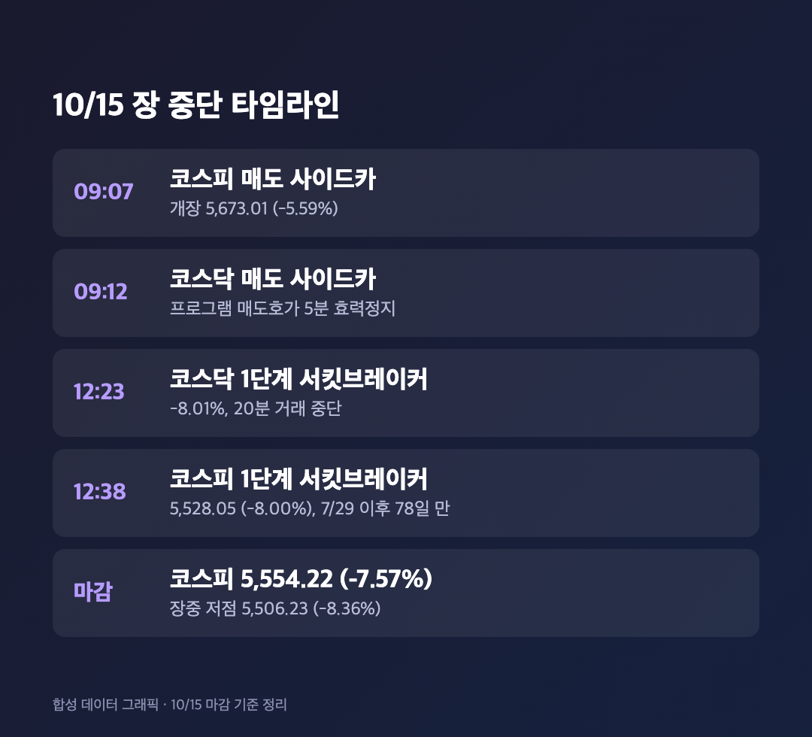
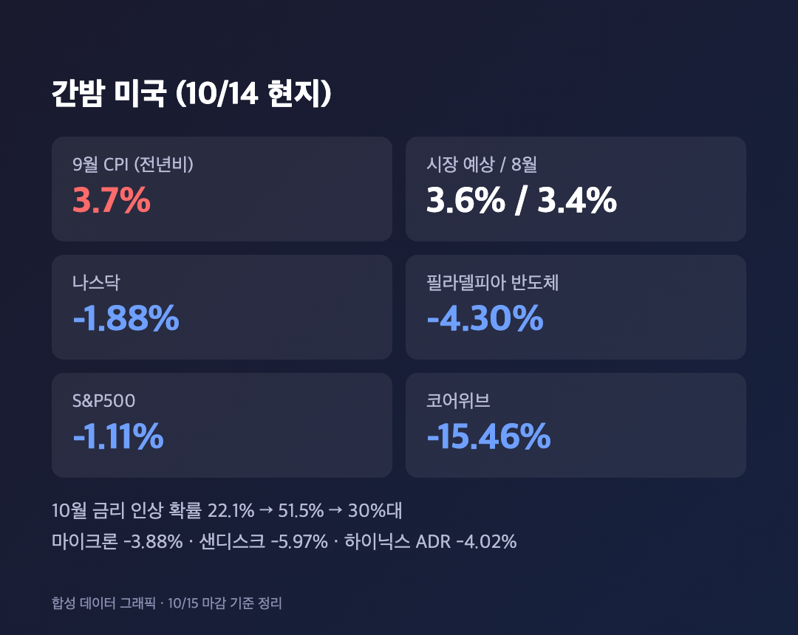
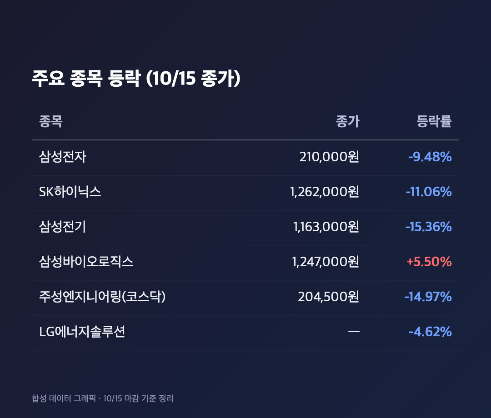
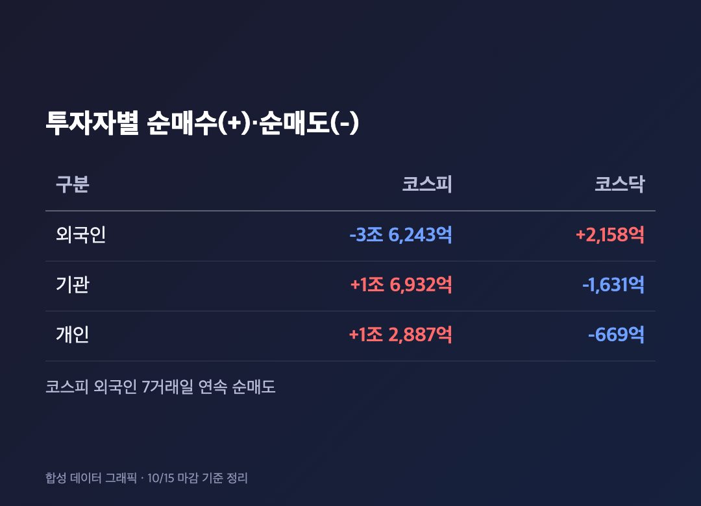

# [내일도 주린이] 코스피 7.57% 폭락, 서킷브레이커까지…삼성전자 -9.48%, 하이닉스 -11.06% (10/15)

"6,000선은 지켰네" 하던 게 바로 어제였는데요. 오늘은 그 6,000선이 아니라 5,600선까지 같이 내줬습니다. 네, 말이 안 나오는 날이에요.

참고로 오늘(10/15, 목)은 정상 개장일이었고, 아래 수치는 전부 오늘 마감 기준이에요.

---

## 🚨 코스피 5,554.22 (-7.57%) – 사이드카에 이어 서킷브레이커까지

> **코스피 5,554.22 (-454.59포인트, -7.57%) / 코스닥 760.82 (-63.06포인트, -7.65%)**

장 시작부터 심상치 않았어요. 코스피는 5,673.01(-5.59%)로 출발했고, 오전 9시 7분에 코스피, 9시 12분에 코스닥 매도 사이드카가 차례로 걸렸습니다. 그래도 "여기서 더 빠지겠어?" 싶었는데요, 낮 12시 23분 코스닥에 이어 12시 38분 코스피에도 1단계 서킷브레이커가 발동됐어요. 8% 이상 하락이 1분 넘게 이어지면 나오는 건데, 두 시장 모두 20분간 거래가 멈췄습니다.

코스피 서킷브레이커는 7월 29일 이후 78일 만이고 올해만 10번째라고 해요. 장중 저점은 5,506.23(-8.36%)까지 갔다가 마감은 5,554.22였습니다. 2달 반 만에 5,600선을 내줬어요. (코스피 종가는 아주뉴스가 5,554.27로 쓴 곳도 있는데, 대부분 매체는 5,554.22라서 이쪽으로 적었습니다.)

거래대금은 코스피 26조 8,660억원, 코스닥 6조 5,970억원이었고요. 코스피는 상승 112개, 하락 790개, 코스닥은 상승 110개, 하락 1,591개였어요. 사실상 다 파랬다는 얘기입니다.

---

## 🇺🇸 범인은 간밤 미국 – CPI 3.7%에 반도체 -4.30%

> **미국 9월 CPI 3.7% (예상 3.6%) / 나스닥 -1.88% / 필라델피아 반도체지수 -4.30%**

원인은 대부분 간밤 미국에서 왔어요. 미국 9월 소비자물가가 전년 대비 3.7%로, 8월(3.4%)은 물론 시장 예상(3.6%)도 웃돌았습니다. 근원 CPI도 2.6%로 예상보다 높았고요. 휘발유가 전월 대비 9.1% 뛴 게 컸다고 해요. 이 발표 직후 연준의 10월 금리 인상 확률이 22.1%에서 51.5%까지 튀었다가 30%대로 돌아왔다고 합니다.

여기에 AI 쪽 걱정이 겹쳤어요. 코어위브가 차입 부담 우려로 15.46% 급락했고, 마이크론(-3.88%), 샌디스크(-5.97%), SK하이닉스 ADR(-4.02%)까지 줄줄이 밀렸습니다. S&P500은 -1.11%, 나스닥 -1.88%, 다우는 -0.09%였고요. 달러지수는 장중 102.94까지 올라 18개월 최고 수준을 찍었다고 해요.

키움증권 한지영 연구원은 코스피가 6거래일 연속 하락해서 반등에 대한 시장의 자신감이 약해졌다고 봤어요. 외국인 수급이 녹록지 않은 상황에서 반도체를 포함한 코스피가 전저점을 지킬 수 있을지가 핵심이라고 했고요. 위키트리는 글로벌 경기 둔화 우려와 고금리 장기화, 지정학 리스크도 함께 거론했습니다.

---

## 📉 삼성전자 210,000원 (-9.48%), 하이닉스 -11.06% – 내 25주도 같이 갔어요

> **삼성전자 210,000원 (-9.48%) / SK하이닉스 1,262,000원 (-11.06%) / 삼성전기 -15.36% / 삼성바이오로직스 +5.50%**

어제 232,000원이던 삼성전자가 오늘 210,000원이 됐어요. 25주 들고 있는 저는 계산기를 켜봤다가 그대로 껐습니다. 한 주당 22,000원씩, 하루 만에 55만원이 증발했네요. "이 정도면 장중에 팔았어야 했나" 싶다가도, 장중 저점이 더 아래였다는 걸 생각하면 위로가 되는 건지 아닌 건지 모르겠어요.

SK하이닉스는 1,262,000원으로 -11.06%, SK스퀘어 -10.21%, 삼성전자우 -8.35%였고요. 삼성전기는 1,163,000원으로 -15.36%까지 빠졌습니다. 시총 상위에서 LG에너지솔루션은 -4.62%로 그나마 덜 빠진 편이었어요. 시총 상위 중 오른 건 삼성바이오로직스(1,247,000원, +5.50%) 하나뿐이었습니다.

코스닥도 장비주가 크게 밀렸어요. 주성엔지니어링 204,500원(-14.97%), 레인보우로보틱스 -9.44%, 에코프로비엠 -9.10%였습니다. 오늘 업종별 등락은 제가 확인하지 못해서 적지 않았어요.

---

## 💸 외국인 3조 6,243억원 순매도 – 개인·기관이 받아냈어요

> **외국인 -3조 6,243억원 / 기관 +1조 6,932억원 / 개인 +1조 2,887억원 (코스피)**

어제 1조 1,796억원이던 외국인 순매도가 오늘은 3조 6,243억원으로 세 배 넘게 불어났어요. 7거래일 연속 순매도입니다. 기관이 1조 6,932억원, 개인이 1조 2,887억원을 사들였지만 받아내기엔 역부족이었죠. (외국인 금액은 매체마다 3조 6,241억~6,243억원으로 조금씩 달랐는데, 다수 매체가 쓴 3조 6,243억원 기준으로 적었어요.)

코스닥은 반대로 외국인이 2,158억원 순매수였고 기관(-1,631억원)과 개인(-669억원)이 팔았어요. 프로그램 매매는 차익이 7,244억원 순매수, 비차익이 4,350억원 순매도였습니다.

---

## 🔮 환율 1,344.6원, 그리고 내일부터 볼 것

> **원·달러 환율 1,344.6원 (+6.3원, 오후 3시 30분 기준)**

환율은 어제 1,338.3원에서 6.3원 오른 1,344.6원이었어요. 증권가에서는 국내 수급이 약해진 상태에서 대외 환경이 단기간에 좋아지기 어렵다는 시각이 많았고, AI 수요 둔화 여부와 기업 이익 변화를 면밀히 봐야 하며 당분간 변동성이 클 거라는 전망이 나왔어요.

저는 이번 주 안에 오를 거라느니 바닥이라느니 하는 말은 못 믿겠어요. 확인된 건 숫자뿐이니까요. 내일 마감에서 5,500선 아래로 내려가는지, 외국인 매도가 줄어드는지 그것만 보려고요.

---

## 마무리하며

오늘 코스피는 5,554.22(-7.57%), 코스닥은 760.82(-7.65%)로 마감했고, 외국인은 코스피에서 3조 6,243억원을 순매도했습니다. 삼성전자는 210,000원, SK하이닉스는 1,262,000원이 됐어요.

솔직히 오늘은 뭘 더 쓸 말이 없는데요, 저는 일단 삼성전자 25주를 그대로 두고 추가 매수 버튼은 안 누르려고 해요. 물타기는 칼날이 떨어지는 걸 보고 하는 게 아니라 바닥이 보이고 나서 하는 거라고 믿고 싶거든요.

오늘은 손절도 익절도 못 한 채 구경만 했습니다. 내일은 제발 평범한 날이기를 🌱
