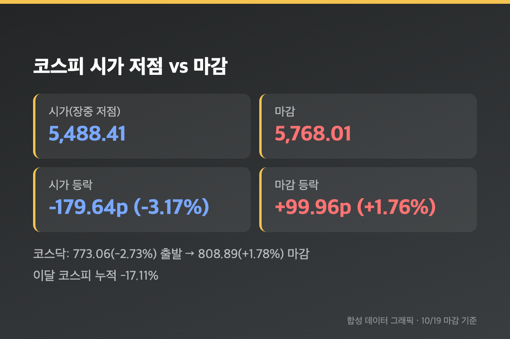
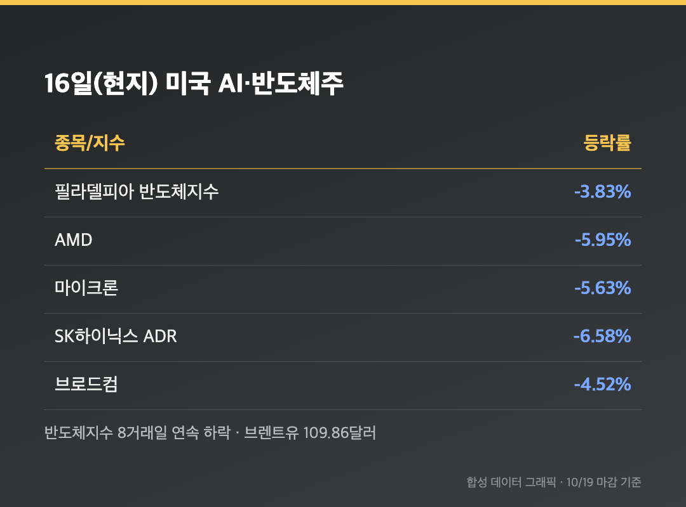
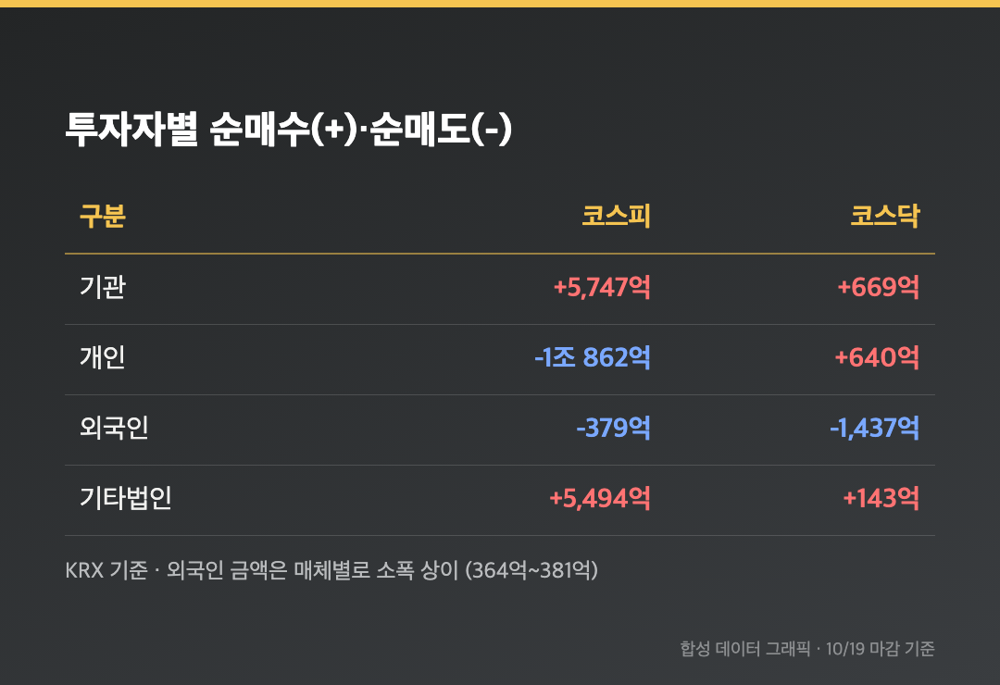
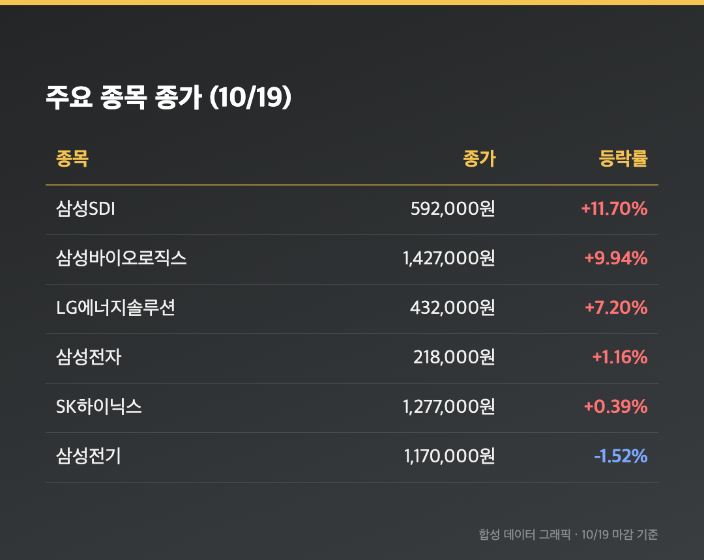

# [내일도 주린이] 코스피 -3% 출발 후 1.76% 반전 마감…기관 5,747억 매수에 5,768 회복 (10/19)

개장 직후 5,488.41. 시가부터 -3.17%였습니다. 주말 사이 미국 반도체주가 얻어맞았다는 건 알고 있었지만, 이 정도일 줄은 몰랐어요. 그런데 마감 버튼을 눌러보니 5,768.01, +1.76%. 이게 같은 날 맞나 싶었습니다.

참고로 오늘(10/19, 월)은 정상 개장일이었고, 아래 수치는 전부 오늘 마감 기준이에요.

---

## 🔄 코스피 5,768.01 (+1.76%) – 시가 저점에서 275포인트 끌어올렸어요

> **코스피 5,768.01 (+99.96포인트, +1.76%) / 코스닥 808.89 (+14.11포인트, +1.78%)**

코스피는 5,488.41(-179.64포인트)로 출발해서 오후로 갈수록 낙폭을 줄였고, 결국 장중 고가 근처에서 마감했어요. 코스닥도 773.06(-2.73%)에서 시작해 808.89로 끝났습니다.

최근 종가를 이어보면 10/13 6,035.35 → 10/14 6,008.81 → 10/15 5,554.22 → 10/16 5,668.05 → 오늘 5,768.01이에요. 급락 후 이틀 연속 올랐지만 이달 들어 코스피는 여전히 17.11% 빠진 상태라고 해요(서울신문). 52주 최고가 9,385.59였으니 아직 갈 길이 멉니다.

---

## 🌙 왜 -3%로 시작했나 – 금요일 밤 뉴욕의 AI·반도체 투매

> **필라델피아 반도체지수 -3.83% (8거래일 연속 하락) / 나스닥 -2%대 / 브렌트유 109.86달러**

16일(현지) 뉴욕에선 AI 인프라 투자의 수익성에 대한 회의론이 번졌어요. 마이크론 -5.63%, 브로드컴 -4.52%, AMD -5.95%, SK하이닉스 ADR -6.58%였고 공포지수 VIX는 22% 가까이 뛰었습니다. 여기에 브렌트유가 3.72% 오른 109.86달러까지 올라 인플레이션 걱정도 겹쳤어요.

반도체 지수의 8거래일 연속 하락은 2008년 이후 가장 긴 기록이라고 합니다. 삼성전자와 SK하이닉스는 장 시작 전에 6% 넘게 빠져 있었어요. 삼성전자 25주를 쥔 입장에선 월요일 아침이 꽤 길었습니다.

---

## 💪 반등의 주인공은 기관 – 개인은 1조 862억원을 던졌어요

> **코스피 기관 +5,747억원 / 개인 -1조 862억원 / 외국인 -379억원**

장 초반 급락을 받아낸 건 기관이었어요. 기관이 5,747억원, 기타법인이 약 5,494억원을 순매수했고, 개인은 1조 862억원을 순매도했습니다. 외국인은 소폭 순매도였어요.

(외국인 금액은 머니투데이가 364억원, 서울신문이 379억원으로 적어서 소스마다 조금 달랐어요. 넥스트레이드까지 합친 집계에선 외국인이 6,243억원 순매수, 개인이 1조 9,312억원 순매도로 아예 방향이 달라지기도 했고요. 저는 한국거래소 기준 수치를 적었습니다.)

---

## 🔋 오늘 주인공은 반도체가 아니었어요 – 삼성SDI +11.7%, 삼성바이오 +9.94%

> **삼성SDI 592,000원 (+11.7%) / 삼성바이오로직스 1,427,000원 (+9.94%) / LG에너지솔루션 432,000원 (+7.20%)**

반도체가 눌린 자리를 2차전지·바이오·자동차가 채웠어요. LG에너지솔루션은 시총 100조원을 회복했고, 기아 +5.26%, 현대차 +4.49%도 올랐습니다. 업종으로는 의약품 +5%대, 금속 +4%대, 엔터 +4%대였고 의료정밀기기만 -2%대로 밀렸어요. 코스닥에선 에코프로 +11.19%, 에코프로비엠 +8.33%가 눈에 띄었습니다.

그럼 제 삼성전자는요. 218,000원, +1.16%였습니다. 외국인 순매수 1위가 삼성전자(약 1,720억원)라는 점은 위안이 됐어요. 반면 SK하이닉스는 1,277,000원(+0.39%)으로 올랐지만 외국인 2,176억원, 기관 2,447억원이 팔았고 기타법인이 6,054억원을 받아줬습니다. 이달 1일부터 지난 금요일까지 삼성전자는 19.74%, SK하이닉스는 28.38% 빠졌다는 걸 생각하면, 오늘 숫자는 반등이라기보단 숨 고르기예요.

---

## 마무리하며

코스피 5,768.01(+1.76%), 코스닥 808.89(+1.78%), 환율 1,330.3원. 시가 5,488에서 마감 5,768까지 오른 하루였어요.

삼성전자 25주는 그대로 있고, 이번 주 제 체크리스트는 세 개입니다. 미국 반도체 지수가 연속 하락을 멈추는지, 외국인이 코스피에서 다시 순매수로 돌아서는지, 브렌트유 110달러 근처가 버텨지는지.

다들 월요일 수고하셨습니다.
