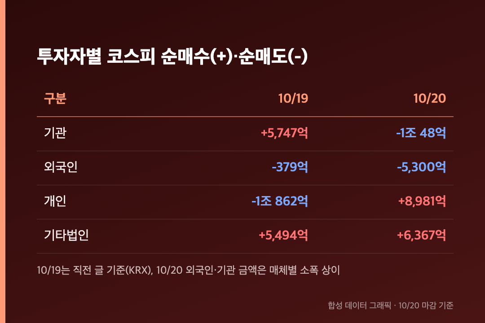
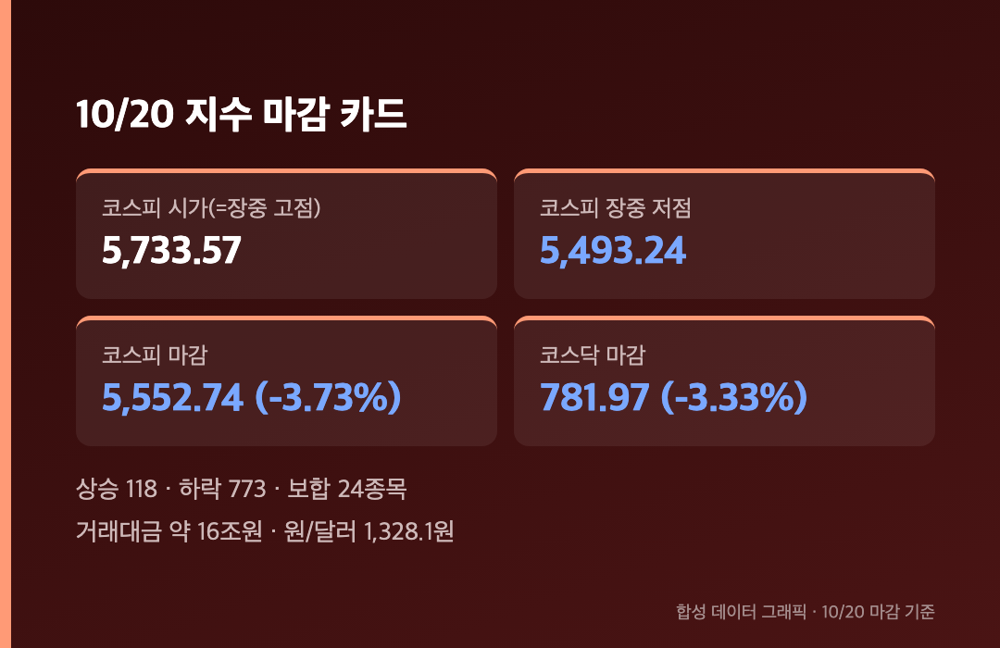
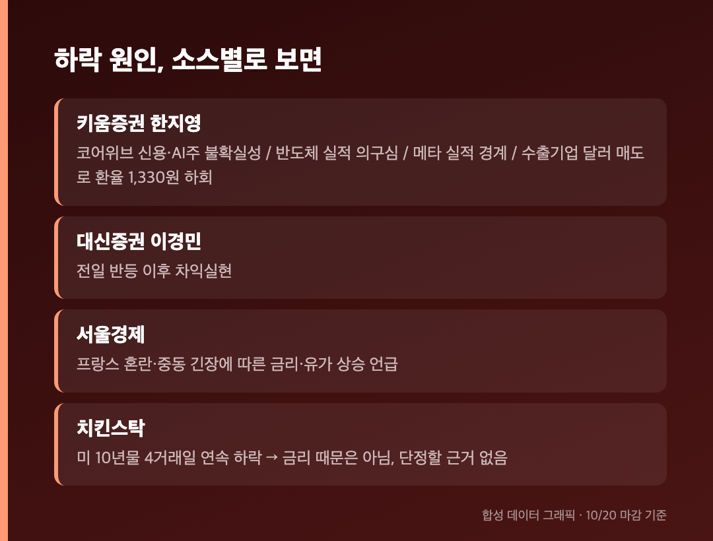
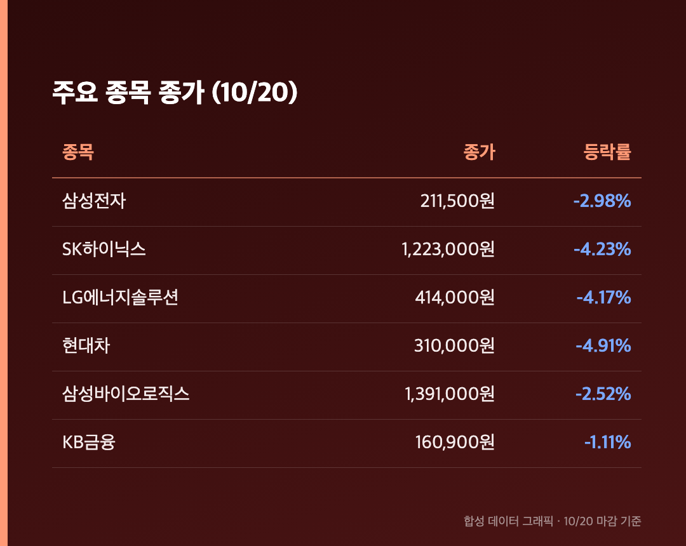

# [내일도 주린이] 코스피 3.73% 급락 5,552…기관 1조 매도, 이틀 반등이 하루 만에 사라졌어요 (10/20)

5,768에서 5,552로. 어제 올려놓은 215포인트를 오늘 고스란히 반납했습니다.

오늘(10/20, 화)은 정상 개장일이었고, 아래 수치는 전부 오늘 마감 기준이에요. 어제와 정반대로 기관이 팔고 개인이 받친 하루여서, 수급부터 짚고 시작해볼게요.

---

## 🔁 기관이 어제 5,747억 사고 오늘 1조 48억 팔았어요 – 수급이 통째로 뒤집혔습니다

> **코스피 기관 -1조 48억원 / 외국인 -5,300억원 / 개인 +8,981억원**

어제는 기관이 5,747억원을 사서 지수를 끌어올렸는데, 오늘은 같은 기관이 1조 48억원을 던졌어요. 외국인도 5,300억원 순매도라서 이틀 연속 팔았고, 코스피와 코스닥을 합친 외국인 순매도는 이틀간 약 5,647억원이라고 합니다(치킨스탁). 개인은 8,981억원을 순매수했고 기타법인도 6,367억원을 샀지만 역부족이었어요.

(외국인·기관 금액은 매체마다 조금씩 달랐어요. 외국인 5,300억원 vs 5,377억원, 기관 1조 48억원 vs 1조 11억원 정도 차이라 큰 흐름은 같습니다. 머니투데이·서울신문 기준으로 적었어요.)

---

## 📉 5,733에서 시작해 5,493까지 – 시가가 하루 중 가장 높았어요

> **코스피 5,552.74 (-215.27포인트, -3.73%) / 코스닥 781.97 (-26.92포인트, -3.33%)**

시가 5,733.57이 그대로 장중 고점이 됐고, 오전 10시 13분쯤엔 -4.09%까지 밀리며 5,500선도 잠깐 깨졌어요. 코스닥은 한때 -1.91%까지 낙폭을 줄였다가 다시 밀려서 800선 아래로 내려왔습니다. 상승 118종목 대비 하락 773종목, 거래대금은 약 16조원이었어요.

종가 5,552.74는 10/15 종가 5,554.22와 거의 같은 자리예요. 이틀 걸려 올라온 길을 하루에 내려온 셈입니다.

10/15 5,554.22 → 10/16 5,668.05 → 10/19 5,768.01 → 10/20 5,552.74, 이렇게 이어졌어요.

---

## 🧩 이유는 하나로 안 모여요 – AI 의구심, 원화 강세, 차익실현이 같이 왔어요

> **원/달러 1,328.1원 / 거래대금 약 16조원 / 하락 773종목**

원인 설명이 소스마다 달랐어요. 키움증권 한지영 연구원은 코어위브 신용·투자 사이클을 둘러싼 AI주 불확실성, 반도체 실적 의구심, 주 후반 메타 실적 발표 경계, 그리고 수출 기업의 달러 매도로 환율이 1,330원 아래로 내려온 점을 꼽았어요. 대신증권 이경민 연구원은 전일 반등 뒤 차익실현으로 봤고요.

서울경제는 프랑스 정치·재정 혼란과 중동 긴장에 따른 글로벌 금리·유가 상승도 원인으로 짚었는데, 치킨스탁은 미국 10년물 금리가 4거래일 연속 내렸다며 금리 때문은 아니라고 봤어요. 서로 반대라 저도 어느 쪽이 맞는지 단정은 못 하겠습니다. 한 가지 분명한 건 간밤 나스닥과 필라델피아 반도체지수가 올랐는데도 우리 증시는 따라가지 못했다는 점이에요.

---

## 🛡️ 방산·조선·원전이 제일 크게 빠졌고, 대형주는 줄줄이 -3~5%

> **삼성전자 211,500원 (-2.98%) / SK하이닉스 1,223,000원 (-4.23%) / 현대차 310,000원 (-4.91%)**

어제 강했던 방산·조선·원전이 오늘 낙폭 상위에 몰렸어요. 한화시스템 -13.90%, 현대로템 -13.70%였고, 업종 평균으로는 치킨스탁 기준 항공우주·방산이 -10.51%였습니다. 반면 아시아경제 기준으로는 운송장비·부품 -6.61%, 의료·정밀기기 -6.43%, 화학 -6.14%로 집계돼서 분류에 따라 숫자가 달라요. 서울경제는 상대적으로 반도체가 선방했다고 적었는데, SK하이닉스도 -4.23%였으니 "덜 빠졌다" 정도로 읽으면 될 것 같아요.

코스닥에선 에코프로비엠 -9.15%, 에코프로 -7.74%가 컸고, 시총 상위 중 오른 건 HLB(+0.12%) 하나뿐이었어요.

제 삼성전자는 어제 218,000원에서 211,500원으로 내려왔어요. 25주면 하루에 16만 2,500원이 빠진 계산입니다. 어제 +1.16% 오른 걸 기분 좋게 봤는데 오늘 그 몇 배를 돌려줬네요.

---

## 마무리하며

코스피 5,552.74(-3.73%), 코스닥 781.97(-3.33%), 환율 1,328.1원. 어제 기관이 사줬던 만큼 오늘은 기관이 팔았습니다.

키움증권은 과매도 구간이라 보유하며 3분기 실적 시즌을 지켜보자는 입장이에요. 저도 삼성전자 25주는 그대로 두고, 이번 주엔 외국인 순매도가 사흘째로 이어지는지, 메타 실적이 AI 투자 얘기를 어떻게 바꾸는지만 볼 생각입니다.

내일은 5,500선이 버텨줄까요?
