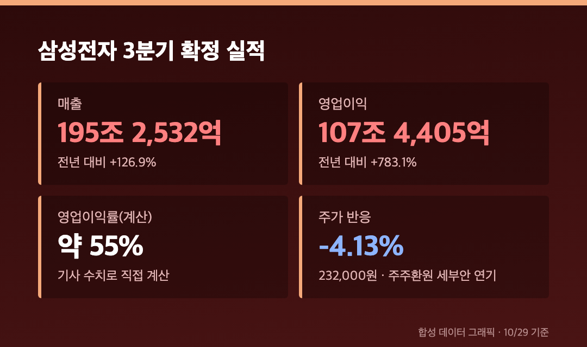
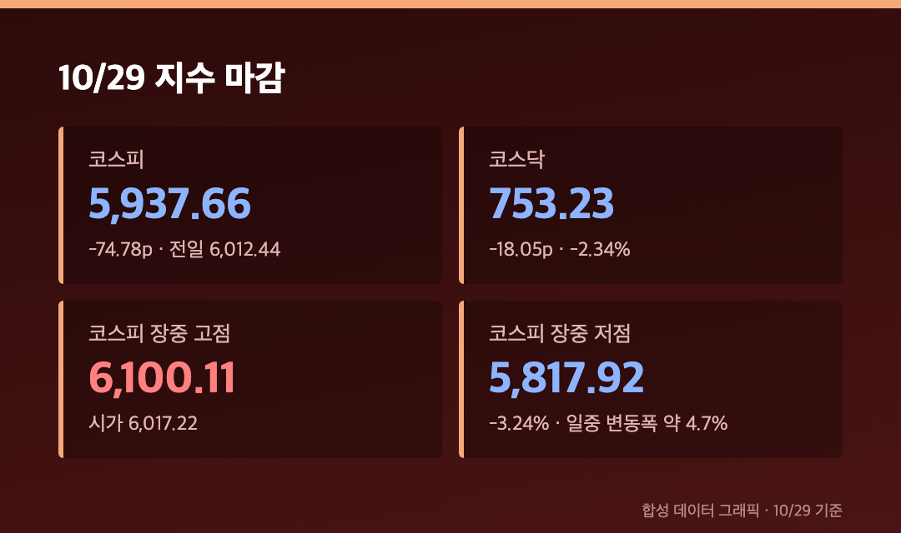
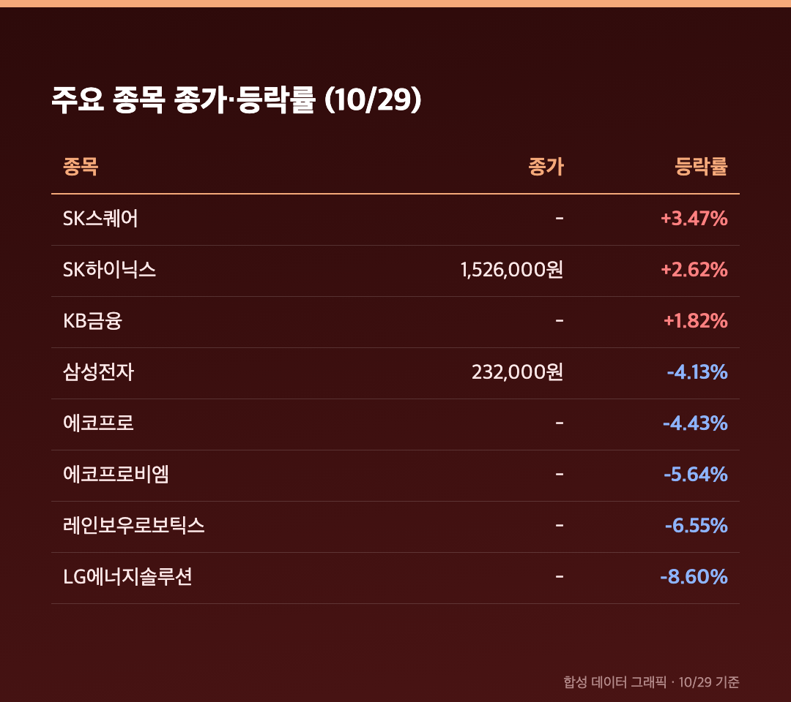
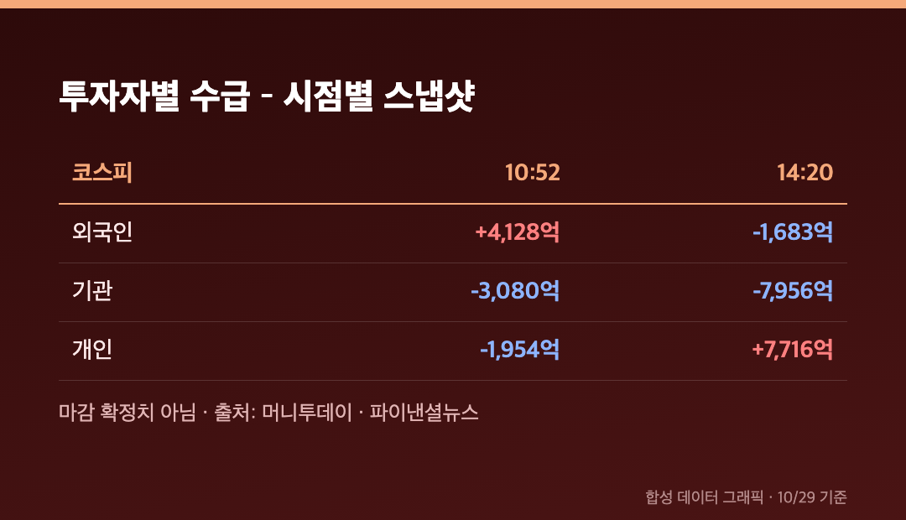
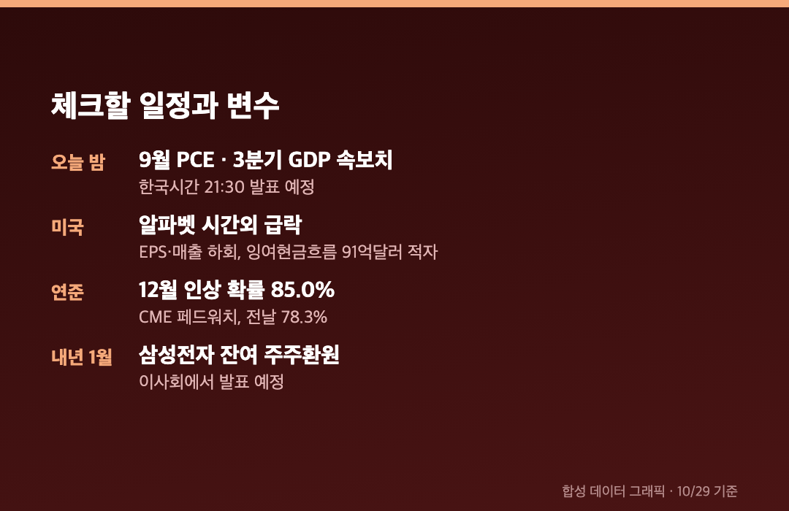

# [내일도 주린이] 코스피 1.24% 하락 5,937…삼성전자 4.13%↓, 코스닥 2.34%↓ 6,000선 반납 (10/29)

하루 만에 6,000선을 도로 내줬습니다. 어제 6.63% 오르면서 되찾은 자리인데요, 오늘 장중엔 5,817까지 밀렸다가 5,937에 마감했어요.

오늘(10/29, 목)은 정상 개장일이었고, 아래 수치는 마감 기준이에요. 다만 수급과 환율은 마감 확정치를 못 찾아서, 어디가 장중 수치인지 그때그때 적어둘게요.

---

## 📉 삼성전자 -4.13% 232,000원 – 사상 최대급 실적에도 팔린 이유

> **삼성전자 232,000원 (-10,000원, -4.13%) / 삼성전자우 -3.26%**

3분기 매출은 195조 2,532억원, 영업이익은 107조 4,405억원이에요. 전년 대비 각각 +126.9%, +783.1%입니다. 두 숫자를 나눠보면 영업이익률이 약 55%인데, 이건 기사에 적힌 수치가 아니라 제가 계산해본 값이에요.

영업이익은 시장 기대에 부합했고 매출은 컨센서스를 조금 밑돌았다고 해요. 여기에 추가 주주환원책이 이번에는 안 나왔어요. 잔여 재원 활용 방안은 내년 1월 말 이사회에서 발표될 예정이라고 합니다.

신한투자증권 강진혁 연구원은 이 점을 실망 매물의 배경으로 짚었어요. 미래에셋증권 김석환 연구원은 삼성전자가 상승으로 출발했다가, 기대보다 낮은 반도체 부문 영업이익을 확인하고 반락하면서 변동성이 커졌다고 설명했고요. 장중에는 -5%대까지 밀리기도 했는데, 마감에서 -4.13%로 낙폭을 조금 줄였어요.

저는 삼성전자 25주를 들고 있는데요, 25주에 1만원씩이면 오늘 하루 평가액이 25만원 줄었네요. 107조원을 벌었다는 기사 바로 옆에 파란색 숫자가 있으니 좀 어색했어요.

---

## 📊 코스피 5,937.66 – 장중 6,100에서 5,817까지 롤러코스터

> **코스피 5,937.66 (-74.78포인트, -1.24%) / 코스닥 753.23 (-18.05포인트, -2.34%)**

시가는 6,017.22, 장중 고점은 6,100.11이었어요. 거기서 저점 5,817.92(-3.24%)까지 약 282포인트가 빠졌다가 마감 직전에 낙폭을 상당히 되돌렸습니다. 일중 고저 변동폭은 약 4.7%였다고 해요(치킨스탁 리포트).

더 눈에 띄는 건 종목 수예요. 머니투데이가 오전 10시 52분에 집계한 숫자인데, 상승 111개 / 하락 775개 / 보합 26개로 하락 종목이 상승의 약 7배였어요. 이건 마감 수치가 아니라 장중 스냅샷이에요. 지수는 -1.24%인데 체감은 훨씬 나빴던 이유가 이거였나 싶어요.

코스닥은 시가총액 상위 10종목이 전부 하락했어요. 에코프로 -4.43%, 에코프로비엠 -5.64%, 레인보우로보틱스 -6.55%, 알테오젠 -1.35%(220,000원)입니다.

---

## ⚡ 삼성전자 말고도 터진 두 가지 – LG엔솔 -8.60%, 체코 원전 협상 종료

LG화학이 재무구조 개선을 위해 LG에너지솔루션 지분 약 2조 5,000억원어치를 매각한다고 발표했어요. 지분율이 79.38%에서 76.59%로 내려가고, 2030년까지 70% 수준을 목표로 한다고 합니다. 추가 매각 가능성이 수급 부담으로 읽히면서 LG에너지솔루션은 -8.60%로 대형주 중 낙폭이 가장 컸어요.

원전 쪽도 있었어요. 한수원 컨소시엄이 두산에너빌리티·대우건설과 체코 두코바니 원전 시공계약 협상을 끝냈다고 해요. 건설 규모가 1기에서 2기로 늘면서 공사대금 증액에 합의하지 못했다는 설명입니다. 두산에너빌리티는 장중 10%대, 대우건설은 19%대 하락으로 보도됐는데, 다른 기사에서는 대우건설이 22%대 하락이라고도 나왔어요. 시점 차이로 보이고 마감 수치는 제가 확인하지 못했어요.

반대편에는 SK하이닉스가 있었어요. 어제 60조원 규모 추가 주주환원책이 나온 뒤 오늘 1,526,000원(+2.62%)으로 마감했고, SK스퀘어는 +3.47%였어요. KB금융도 +1.82%로 올랐습니다.

---

## 💸 수급 – 외국인이 오전엔 샀다가 오후엔 팔았어요

마감 확정 수급은 못 찾았어요. 대신 두 시점의 스냅샷이 있는데 방향이 다릅니다. 오전 10시 52분엔 외국인이 약 4,128억원 순매수였고 SK하이닉스(4,359억원)가 1위였어요. 오후 2시 20분엔 외국인이 1,683억원 순매도로 돌아섰고요.

반대로 개인은 오전엔 1,954억원 순매도였다가 오후엔 7,716억원 순매수로 바뀌었어요. 기관은 두 시점 모두 팔았고, 오후엔 7,956억원 순매도까지 늘었어요. 시간에 따라 주체가 뒤집혔다는 점만 기억해두면 될 것 같아요.

치킨스탁 리포트는 외국인이 3거래일 연속 순매수(누적 약 1.48조원)라고 적었는데, 오늘 장중 흐름과는 시점이 다를 수 있다고 단서를 달아놨어요.

---

## 🇺🇸 간밤 미국과 오늘 밤 일정 – 알파벳이 변수

10/28 미국장은 S&P500 7,743.98(+0.28%), 나스닥 26,549.85(+0.27%)로 3대 지수가 3거래일 연속 올랐어요. 연준은 기준금리를 3.75~4.00%로 동결했는데, 표결이 10대 2였고 반대한 2명은 0.25%포인트 인상을 원했다고 해요. CME 페드워치 기준 12월 인상 확률은 85.0%로 전날 78.3%에서 올랐어요.

문제는 장 마감 후 알파벳이었어요. 매출 1,275억 8,000만달러, EPS 2.12달러로 둘 다 LSEG 전망치를 밑돌았고, 클라우드 매출이 +103%인데도 잉여현금흐름이 91억달러 적자라서 AI 투자 회수 우려가 커졌어요. 시간외 낙폭은 기사마다 7%대에서 10%대로 달라서 정확한 수치는 못 적겠어요. 오늘 삼성전기가 장중 -6%까지 갔는데, 이 소식이 배경으로 거론됐어요.

오늘 밤 9시 30분(한국시간)에는 9월 PCE 물가와 3분기 GDP 속보치가 나옵니다.

---

## 마무리하며

코스피 5,937.66(-1.24%), 코스닥 753.23(-2.34%). 어제 +374포인트를 오늘 75포인트 되돌린 셈이라, 방향보다 종목별 온도 차가 더 컸던 날이에요.

내일 볼 건 PCE 결과, 삼성전자가 232,000원을 지키는지, 그리고 외국인 수급이 어느 쪽으로 정리되는지예요. 이번 달은 숫자를 적는 손이 바쁘네요 😮‍💨
