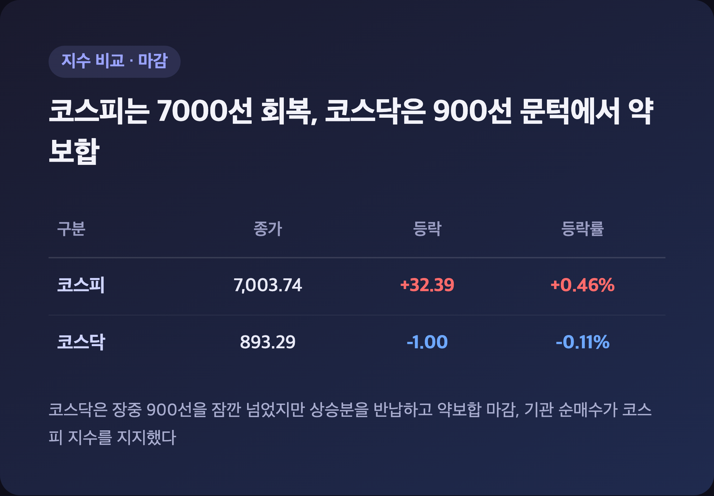
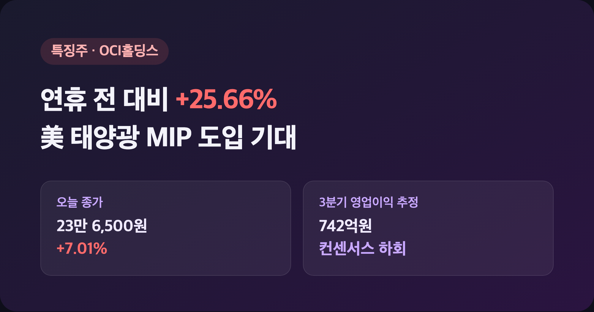
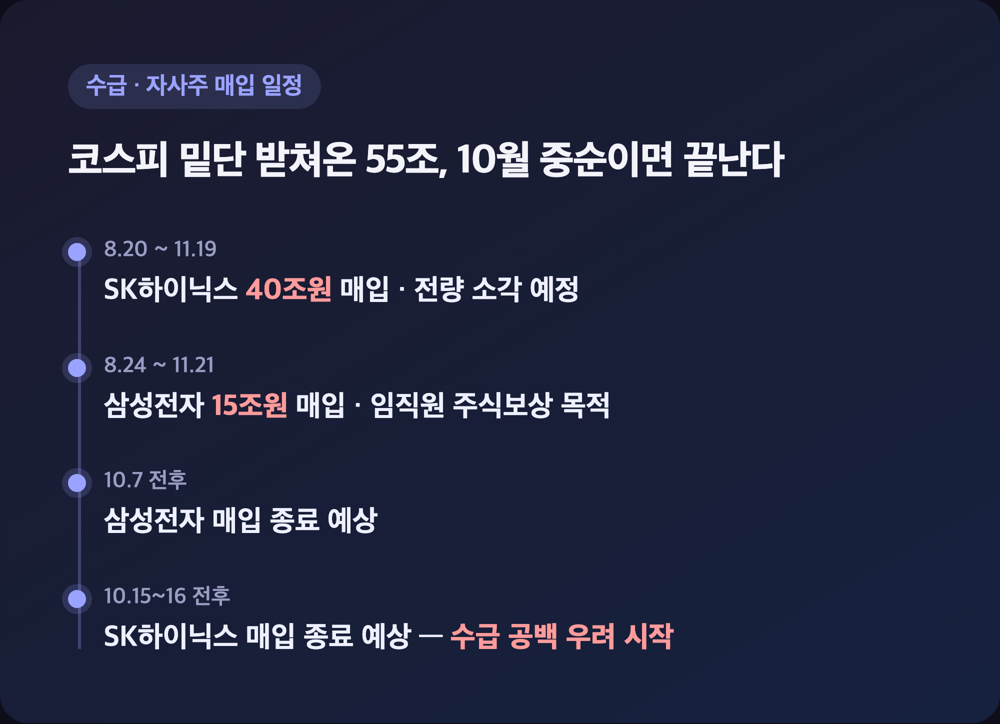
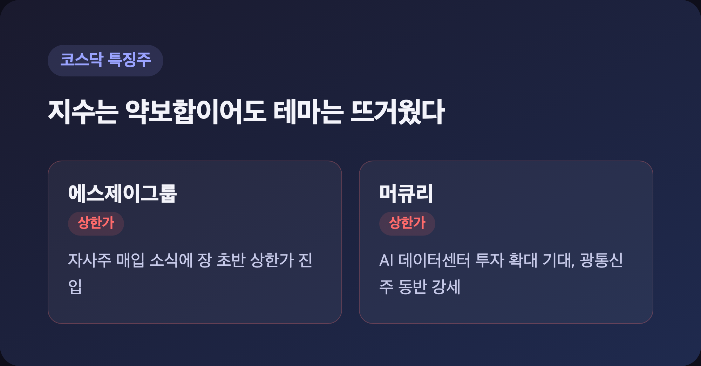

# [내일도 주린이] 코스피 다시 7,003…자사주 매입 끝나면 어쩌나 국장 정리 (10/2)

코스피 7,003.74. 숫자만 보면 "오 드디어 돌아왔네" 싶은데요, 속을 들여다보니 순수하게 반가워할 일만은 아니더라고요. 추석 연휴 끝나고 일주일 넘게 6,800~6,900선에서 맴돌던 지수가 오늘에서야 7,000선을 다시 밟은 10/2 국장, 하나씩 짚어보겠습니다.

---

## 🇰🇷 코스피 7,003.74(+0.46%) 7000선 회복 – 코스닥은 홀로 약보합

> **코스피 7,003.74 (+32.39포인트, +0.46%) / 코스닥 893.29 (-1.00포인트, -0.11%)**

| 지수 | 종가 | 등락 | 등락률 |
|---|---|---|---|
| 코스피 | 7,003.74 | +32.39 | +0.46% |
| 코스닥 | 893.29 | -1.00 | -0.11% |

코스닥은 장중에 900선을 잠깐 넘었다가 상승분을 다 반납하고 내려왔어요. "오 오늘은 코스닥이 더 잘 나가나" 했는데 결국 둘 다 애매하게 마감한 느낌이었습니다. 코스피는 기관이 3,814억원을 순매수하면서 지수를 받쳤고, 개인(-1조 7,206억원)과 외국인(-1,438억원)은 팔았어요. 원-달러 환율도 20여 일 만에 최저치를 찍었다고 하니, 달러 약세가 외국인 매도 부담을 그나마 덜어준 모양이에요.

제가 물려있는 삼성전자는 오늘 27만 6,000원으로 딱 보합이었어요. SK하이닉스는 +0.44%. 둘 다 크게 움직이진 않았는데, 삼성전기(+1.28%)·LG에너지솔루션(+2.91%)·KB금융(+0.84%)이 지수를 끌어올렸고 삼성바이오로직스(-4.51%)는 약세였습니다.

---

## 🔆 OCI홀딩스 +7.01% – 미국 태양광 정책 수혜, 연휴 전 대비로는 +25.66%

> **OCI홀딩스 23만 6,500원 (+7.01%, 연휴 전 대비 +25.66%)**

| 항목 | 내용 |
|---|---|
| 급등 배경 | 美 무역확장법 232조, 12월부터 폴리실리콘·웨이퍼 "최소 수입가격(MIP)" 도입 |
| 현재 비중국산 폴리실리콘 가격 | kg당 16~18달러 |
| MIP 책정가 | kg당 21달러 |
| 3분기 영업이익 추정 | 742억원 (전분기 대비 -31%, 컨센서스 1,064억원 하회) |

이 종목은 솔직히 오늘 리서치하다가 제일 눈에 띄었어요. MIP가 도입되면 지금 가격보다 높게 판가가 형성되는 구조라 주가가 선반영하고 있는 건데, 정작 3분기 실적은 컨센서스보다 안 좋을 걸로 예상된다고 하니 "호재는 호재고 실적은 실적이구나" 싶더라고요. 미국 중간선거에서 태양광 투자세액공제(ITC)가 되살아날지도 변수로 남아있고요. 이런 정책 모멘텀 종목은 저는 잘 모르는 영역이라 당분간 지켜보기만 할 생각입니다.

---

## 💰 삼성전자·SK하이닉스 자사주 매입, 10월 중순이면 끝난다

| 구분 | 매입 규모 | 기간 |
|---|---|---|
| SK하이닉스 | 40조원 (전량 소각 예정) | 8/20 ~ 11/19 |
| 삼성전자 | 15조원 (임직원 주식보상) | 8/24 ~ 11/21 |

지금 속도대로면 삼성전자는 10월 7일, SK하이닉스는 10월 15~16일쯤 자사주 매입이 끝난다고 해요. 사실 최근 코스피가 6,800선 밑으로 크게 안 밀리고 버텨온 데는 이 두 회사의 자사주 매입이 꽤 큰 역할을 했다고 하더라고요. "그럼 이거 끝나면 누가 받쳐주지" 싶은 게 솔직한 심정이에요. 10월 말 두 회사 3분기 실적 발표 때 추가 주주환원 얘기가 나올지가 다음 관전포인트인 것 같습니다. 저도 삼성전자 들고 있는 입장이라 이 부분은 좀 더 챙겨봐야겠어요.

---

## 📊 코스닥 특징주 – 자사주 매입·AI 데이터센터 테마가 상한가 주도

| 종목 | 상승 사유 |
|---|---|
| 에스제이그룹 | 자사주 매입 소식, 장 초반 상한가 |
| 머큐리 | AI 데이터센터 투자 확대 기대, 광통신주 상한가 |

코스닥 수급은 개인(+814억원)·기관(+938억원)이 순매수, 외국인(-1,731억원)만 팔았어요. 지수 자체는 약보합이었지만 개별 종목 장세였던 셈이죠. 코스피 쪽에서도 AI 데이터센터 관련 광통신주가 강세였던 걸 보면, 오늘 하루는 지수보다 테마가 먼저 움직인 날이었다 싶습니다.

---

## 마무리하며

오늘 코스피는 +0.46%(7,003.74)로 추석 연휴 전 수준을 되찾았고, 코스닥은 -0.11%(893.29)로 살짝 밀렸어요. 다만 이 반등이 기관과 자사주 매입에 많이 기댄 거라, 10월 중순 매입이 끝나고 나서도 이 흐름이 이어질지는 솔직히 잘 모르겠습니다.

저는 일단 삼성전자는 그대로 들고, 10월 말 실적 발표랑 주주환원 발표까지는 조급해하지 않고 지켜보려고요.

숫자는 7,000을 찍었는데 마음은 아직 반신반의, 그래도 오늘은 손절보다 관망 쪽이었습니다 🌱
