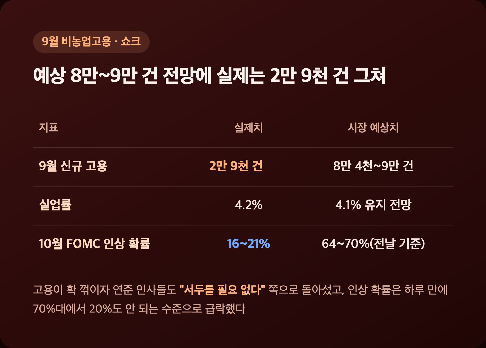
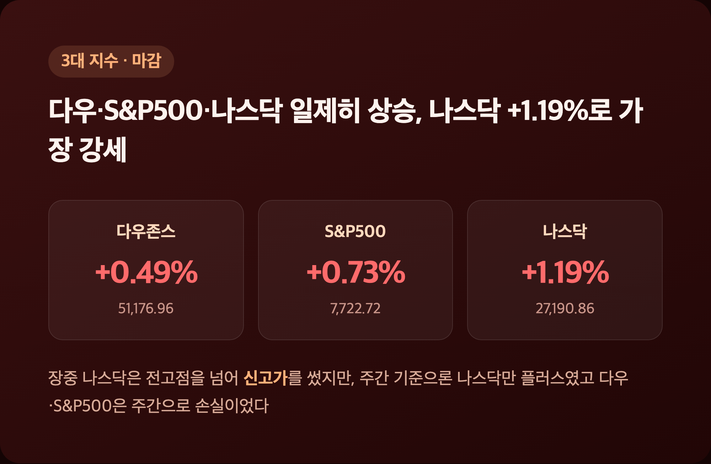
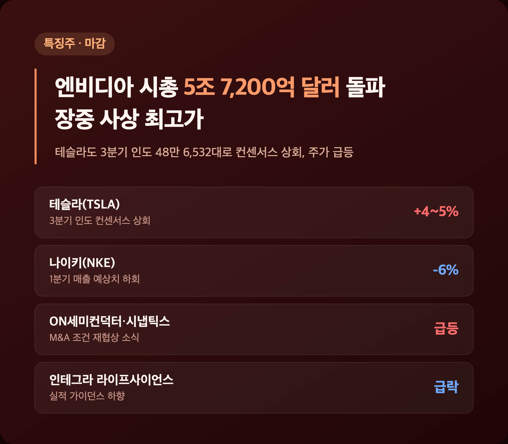

# [내일도 주린이] 9월 고용 쇼크에 금리인상 베팅 급락…나스닥 사상최고 미장정리 (10/2)

고용지표 하나에 10월 금리인상 확률이 하루 만에 70%대에서 20%도 안 되는 수준으로 쪼그라드는 거 보고 "와 이게 이렇게 바뀌나" 싶었어요. 그 와중에 나스닥은 장중 사상 최고치를 다시 썼고요. 숫자 하나로 시장 분위기가 통째로 뒤집힌 하루라, 오늘 미장 정리는 이 고용 쇼크 얘기부터 풀어볼게요.

---

## 📉 9월 고용 2만 9천 건 쇼크 – 금리인상 확률 64~70%→16~21%로 급락

> **9월 비농업 신규고용 2만 9천 건 (예상 8만 4천~9만 건 하회) / 실업률 4.2%(전월 4.1%)**

| 지표 | 실제치 | 시장 예상치 |
|---|---|---|
| 9월 신규 고용 | 2만 9천 건 | 8만 4천~9만 건 |
| 실업률 | 4.2% | 4.1% 유지 전망 |
| 10월 FOMC 인상 확률(CME 선물) | 16~21% | (전날 기준 64~70%) |

원래 이 시점 연준은 '인하'가 아니라 '인상' 사이클을 논의하던 국면이었다고 해요. 그런데 고용이 이렇게 확 꺾이니까 "추가 긴축은 좀 자제해야 하는 거 아니냐"는 쪽으로 분위기가 급선회한 거죠. 뉴욕 연은 총재 윌리엄스는 "서두를 필요 없다"고 했고, 연준 부의장 제퍼슨도 "시간이 더 필요하다"고 했는데, 둘 다 10월 동결 쪽에 무게를 싣는 발언으로 해석됐어요. 저는 이 기사 저 기사 뒤지면서 숫자 확인하다가, 불과 하루 사이에 확률이 저렇게 뒤집히는 걸 보고 좀 놀랐습니다.

---

## 🇺🇸 다우·S&P500·나스닥 일제히 상승 – 나스닥 +1.19%로 가장 강세

> **다우존스 51,176.96(+250.40, +0.49%) / S&P500 7,722.72(+56.27, +0.73%) / 나스닥 27,190.86(+319.27, +1.19%)**

| 지수 | 종가 | 등락폭 | 등락률 |
|---|---|---|---|
| 다우존스산업평균 | 51,176.96 | +250.40 | +0.49% |
| S&P500 | 7,722.72 | +56.27 | +0.73% |
| 나스닥종합 | 27,190.86 | +319.27 | +1.19% |

장중 한때 나스닥은 전고점을 넘어서며 신고가를 썼다고 해요. 그런데 주간 기준으로 보면 분위기가 좀 다른데요, 나스닥만 주간 플러스였고 다우·S&P500은 주간으로는 오히려 손실이었습니다. 이번 주 초(9/30~10/1)에 국채금리가 급등하면서 주 중반까지 지수를 눌렀던 부담이 아직 다 안 풀렸다는 뜻이겠죠. 하루 치 상승만 보고 "다 괜찮아졌네" 하기엔 이르다는 생각이 들었어요.

---

## 🚀 엔비디아 시총 5조 7,200억 달러 돌파 – 테슬라도 인도량 서프라이즈

> **엔비디아 장중 237.87~237.88달러 사상 최고(시총 5조 7,200억 달러) / 테슬라 3분기 인도 48만 6,532대(컨센서스 상회)**

| 종목 | 이슈 | 결과 |
|---|---|---|
| 엔비디아(NVDA) | AI 반도체 수요 기대 지속 | 사상 최고가, 시총 5조 7,200억 달러 |
| 테슬라(TSLA) | 3분기 인도 48만 6,532대(컨센 약 46.3만대) | 주가 +4~5%대 급등 |
| 나이키(NKE) | 1분기 매출 예상치 하회 | 시간외 약 -6% |
| ON세미컨덕터·시냅틱스 | M&A 조건 재협상 소식 | 급등 |
| 인테그라 라이프사이언스 | 실적 가이던스 하향 | 급락 |

엔비디아가 시총 5조 7,200억 달러를 찍었다는 소식 보면서, 저는 솔직히 "저거 숫자가 너무 커서 체감이 안 되네" 싶었어요. 그래도 반도체 대형주 전반이 같이 신고가를 쓴 걸 보면, 제가 물려있는 삼성전자·SK하이닉스 쪽으로도 이 수요 훈풍이 넘어오지 않을까 하는 기대는 생기더라고요. 섹터별로는 산업재·경기소비재가 상승을 주도했고 에너지·금융서비스는 상대적으로 약세였다고 하니, 기술주·반도체가 이날 상승을 끌고 간 그림이었습니다.

---

## 💵 10년물 금리 5.27%대로 소폭 완화 – 유가·금은 동반 하락

> **10년물 국채금리 5.27~5.28%(주초 고점 5.34% 대비 완화) / WTI 91.24달러(-1.76%) / 금 4,141.21달러(-0.90%)**

| 자산 | 수치 | 전일 대비 |
|---|---|---|
| 10년물 국채금리 | 5.27~5.28% | 주초 5.34%(2002년來 최고)에서 완화 |
| WTI 원유 | 91.24달러 | -1.76% |
| 금(Gold) | 4,141.21달러 | -0.90% |

이번 주 흐름을 쭉 이어서 보면, "장중 국채금리 5.3%대 터치 후 되밀림 + 반도체 랠리 지속"이라는 패턴이 9/30(마이크론 실적)부터 10/1을 거쳐 오늘까지 사흘째 이어진 셈이에요. 오늘은 거기에 고용 쇼크라는 새 재료가 더해지면서 금리가 한 번 더 낮아지고 지수 상승폭도 커진 거고요. 유가·금이 같이 빠진 걸 보면 시장 전체가 "위험자산 선호"로 확 기울었던 하루였다 싶습니다.

---

## 🔮 다음 주 전망 – 4분기 계절성 vs 중간선거·금리 리스크

> **S&P500 연초대비 +13% / 1945년 이후 4분기 평균 +4.2%, 상승확률 85%**

| 전문가(소속) | 코멘트 |
|---|---|
| Tracie McMillion(Wells Fargo Investment Institute) | 중간선거(11/3)發 역풍 경계하면서도, 그 경우 오히려 매수 기회 될 수 있다고 언급 |
| Chuck Carlson(Horizon Investment Services) | "금리 상황이 가장 큰 역풍, 이 부분 완화가 필요하다" |
| Sam Stovall(CFRA) | 중간선거 있는 해 4분기는 평균 +6.4% 상승 경향 |
| Nelson Yu(AllianceBernstein) | 3분기 실적시즌 관전포인트로 "하이퍼스케일러 capex 수정 여부" 꼽음 |

다음 주는 ISM·S&P 서비스 PMI, 연준 9월 의사록 공개, 신규실업수당청구, 미시간대 소비자심리지수 예비치까지 지표가 줄줄이 나온다고 해요. 그 다음 2~3주차부터는 펩시코·델타항공을 시작으로 대형주 실적시즌이 본격화되고요. "금리만 좀 풀리면 4분기 계절성 호재 다 받을 수 있을 텐데"라는 게 솔직한 제 바람인데, 중간선거라는 변수가 끼어있어서 마냥 낙관하기도 애매한 느낌입니다.

---

## 마무리하며

오늘 3대 지수는 다우 +0.49%(51,176.96), S&P500 +0.73%(7,722.72), 나스닥 +1.19%(27,190.86)로 모두 올랐고, 9월 고용 쇼크가 금리인상 우려를 확 꺾어준 하루였어요.

솔직히 고용이 나쁘다는 소식이 증시엔 호재로 작용하는 거, 매번 봐도 좀 아이러니하다 싶은데요, 저는 일단 다음 주 FOMC 의사록 공개랑 미시간대 소비자심리지수까지 챙겨보면서 이 흐름이 이어지는지 지켜보려고요.

고용 쇼크 덕에 오늘은 한숨 돌렸지만 중간선거·금리라는 숙제는 그대로 남아있네요, 그래도 일단 오늘 치는 무럭무럭 자라볼게요 🌱
