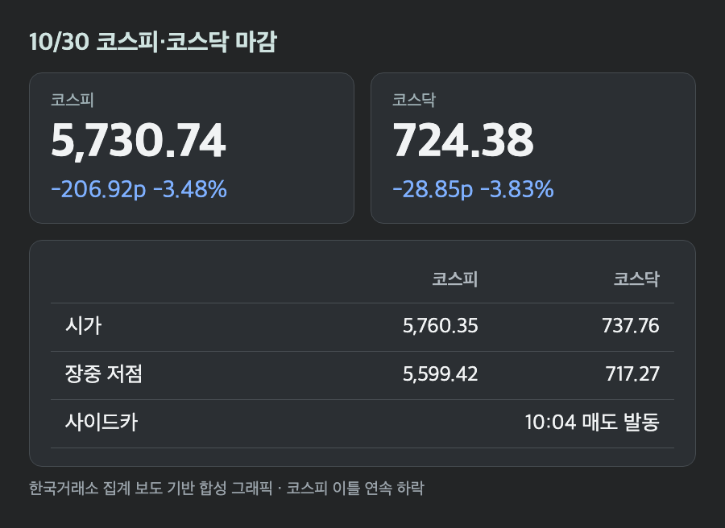
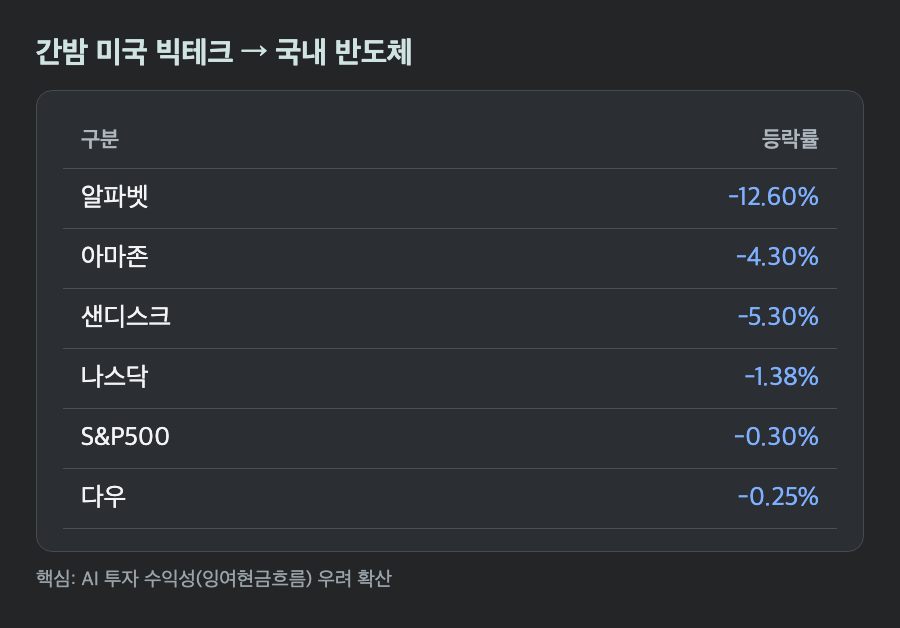
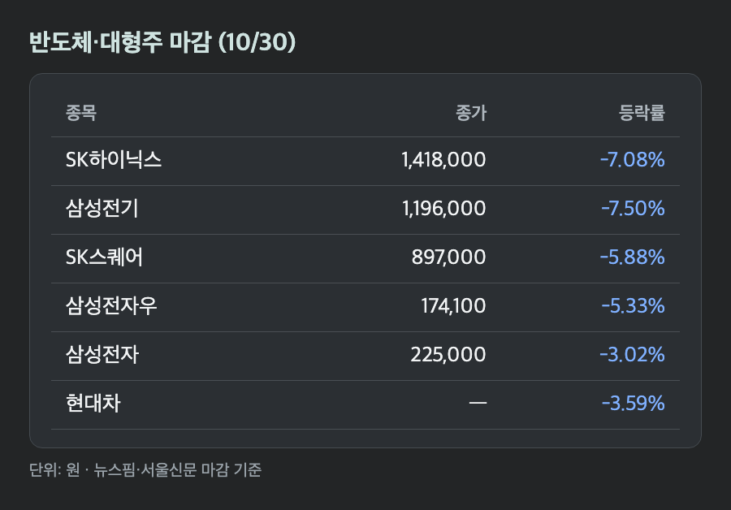
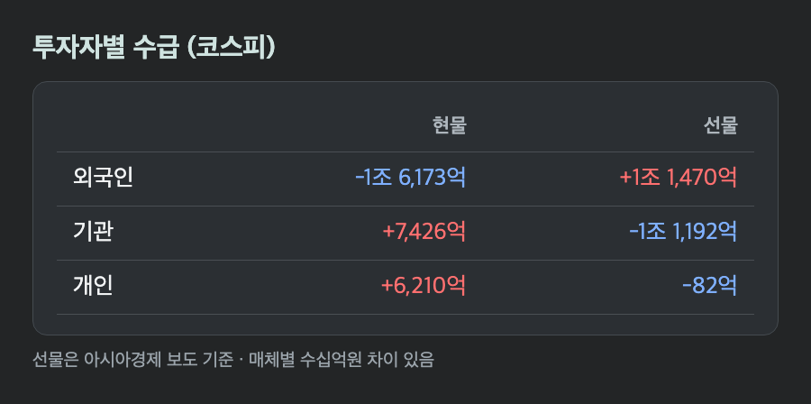
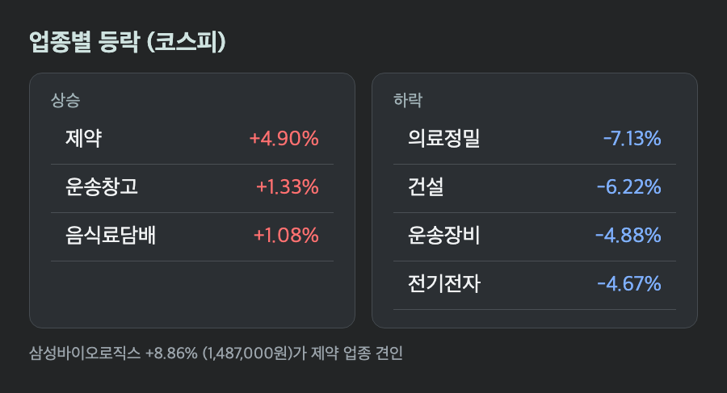

# [내일도 주린이] 코스피 3.48% 급락 5,730…SK하이닉스 7%↓, 외국인 1.6조 순매도에 사이드카까지 (10/30)

5,730.74. 이틀 전 6,012.44에서 282포인트가 사라졌어요. 오늘은 장 시작 5분 만에 숫자부터 확인하게 되는 날이었습니다.

외국인이 현물을 1조 6,173억원 던졌고, 오전 10시 4분쯤엔 매도 사이드카까지 발동됐어요. 하락 이유, 수급, 그리고 혼자 올라간 종목까지 순서대로 정리해볼게요.

---

## ⚡ 사이드카 발동, 장중 5,599까지 – 코스피 -3.48%, 코스닥 -3.83%

> **코스피 5,730.74 (-206.92포인트, -3.48%) / 코스닥 724.38 (-28.85포인트, -3.83%)**

시가는 5,760.35(-2.99%)였고 장중 고점이 5,784.98이었어요. 시작하자마자 이게 오늘의 최고점이었던 셈입니다. 이후 저점 5,599.42까지 밀렸고, 10시 4분쯤 매도 사이드카가 발동돼 프로그램 매도호가 효력이 5분간 정지됐어요.

그래도 마감은 저점보다 131포인트 높았어요. 초반 매도 우위였던 기관이 순매수로 돌아서면서 낙폭을 일부 되돌렸다고 해요. 거래대금은 약 19조 2,687억원, 코스피 상승 종목 234개 대 하락 656개였습니다.

코스닥도 장중 717.27까지 내려가 730선을 내줬어요. 원/달러 환율은 1,334원 안팎에서 마감했는데, 매체마다 전일 대비 하락폭이 2.5원, 5.3원으로 달라요(기준 시점 차이로 보여요).

---

## 🇺🇸 알파벳 -12.6%가 불씨 – AI 투자는 언제 돈이 되나

> **나스닥 -1.38% / 다우 -0.25% / S&P500 -0.30% (10/29 미국장)**

간밤 미국에서 알파벳이 -12.6%였어요. 실적이 기대에 못 미친 데다 잉여현금흐름이 나빠졌다는 게 이유예요. 아마존도 -4.3%, 샌디스크 -5.3%였고요. 아마존은 설비투자가 늘면서 잉여현금흐름이 적자를 이어가는 점이 부담이었다고 해요.

AI에 돈을 쏟아붓는 만큼 벌어들이느냐는 질문이 다시 나온 거죠. 신한투자증권 강진혁 연구원은 유동성이 얇은 상태에서 외국인과 기관의 초반 매도를 시장이 받아내지 못했다고 봤어요.

국내 반도체 쪽은 실적이 나빠서 빠진 게 아니라는 게 더 얄궂어요. 삼성전자는 3분기 실적이 기대를 웃돌았는데 남은 주주환원 재원을 어떻게 쓸지는 내년 1월에야 정한다고 해서 어제부터 실망 매물이 나오고 있어요. SK하이닉스는 역대 최대 실적과 대규모 주주환원 계획을 발표하고도 약세를 피하지 못했고요.

---

## 📉 SK하이닉스 -7.08%, 삼성전기 -7.50% – 반도체 대형주 성적표

> **SK하이닉스 1,418,000원 (-7.08%) / 삼성전자 225,000원 (-3.02%)**

어제 1,526,000원이던 SK하이닉스가 1,418,000원이 됐어요. 하루에 10만원 넘게 빠진 거예요. 삼성전기는 -7.50%(1,196,000원), SK스퀘어는 -5.88%(897,000원), 삼성전자 우선주는 -5.33%(174,100원)였습니다. 현대차 -3.59%, 삼성생명 -2.70%, KB금융 -0.83%도 같이 내렸고요.

저는 삼성전자 25주를 들고 있는데요, 어제 종가 232,000원에서 7,000원 빠졌으니 오늘 하루 평가액이 17만 5,000원 줄었어요. 어제도 4%대 하락이었는데 이틀 연속이라 계좌 앱을 열었다 닫았다 했습니다.

코스닥 쪽은 반도체 장비주가 크게 흔들렸어요. 심텍 -8.02%, 원익IPS -7.72%, 주성엔지니어링 -6.78%, 이오테크닉스 -6.39%입니다. 리노공업은 -8.91%라는 보도도 있었는데, 이건 한 매체에서만 확인돼서 참고만 해주세요.

---

## 💸 수급 – 외국인 현물 -1.6조, 선물은 +1.1조

> **외국인 -1조 6,173억원 / 기관 +7,426억원 / 개인 +6,210억원 (코스피 현물)**

외국인은 현물을 1조 6,173억원 순매도했고, 기관(+7,426억원)과 개인(+6,210억원)이 그 물량을 받았어요. 매체별로 수십억원씩 숫자가 달라서 한국거래소 집계를 인용한 기사 값으로 적었습니다.

재미있는 건 선물이에요. 아시아경제 보도 기준으로 외국인은 선물을 1조 1,470억원 순매수했고, 기관은 1조 1,192억원 순매도했어요. 현물은 팔면서 선물은 샀다는 건데, 이게 현물 매도를 헤지하는 건지 다른 의도인지는 기사만으로 알 수 없었어요. 프로그램 매매는 차익 +2,662억원, 비차익 +1,945억원 순매수였습니다.

코스닥은 개인 +1,688억원, 외국인 -267억원, 기관 -1,377억원이었어요. 코스피와 달리 기관이 팔았다는 점이 다르네요.

---

## 💊 혼자 오른 삼성바이오로직스 +8.86%, 제약 업종 +4.9%

> **삼성바이오로직스 1,487,000원 (+8.86%) / 제약 업종 +4.9%**

대부분 업종이 내리는 날에 제약만 +4.9%로 코스피 업종 중 가장 많이 올랐어요. 삼성바이오로직스가 1,487,000원(+8.86%)으로 끌었고, LG에너지솔루션도 359,500원(+0.98%)으로 올랐고요. 코스닥에서는 HLB가 +0.76%였습니다.

급등 이유는 이번에 찾지 못했어요. 올라온 기사들은 지수 얘기만 하고 개별 재료는 언급하지 않았어요. 아는 척하고 이유를 지어내기보다 여기서는 모른다고 적어둘게요.

반대로 하락 업종은 의료정밀 -7.13%, 건설 -6.22%, 운송장비 -4.88%, 전기전자 -4.67%, 증권 -3.5% 순이었어요. 소형주 쪽에는 진양화학과 형지엘리트가 상한가를 기록하기도 했습니다.

---

## 마무리하며

코스피 5,730.74(-3.48%), 코스닥 724.38(-3.83%). 10/28 종가 6,012.44와 비교하면 이틀 동안 약 4.7% 내린 거예요. 52주 고점 9,385.59와는 아직 거리가 한참 있고요.

오늘 밤 미국장에서 알파벳 충격이 이어지는지, 월요일 외국인 현물 수급이 어느 쪽으로 돌아서는지가 궁금하네요. 삼성전자 225,000원은 일단 지켜봐야겠습니다.
