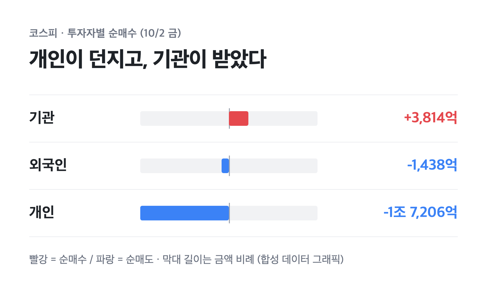
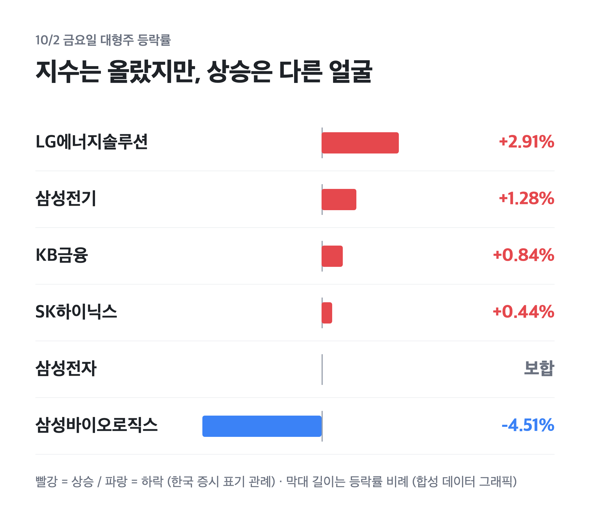
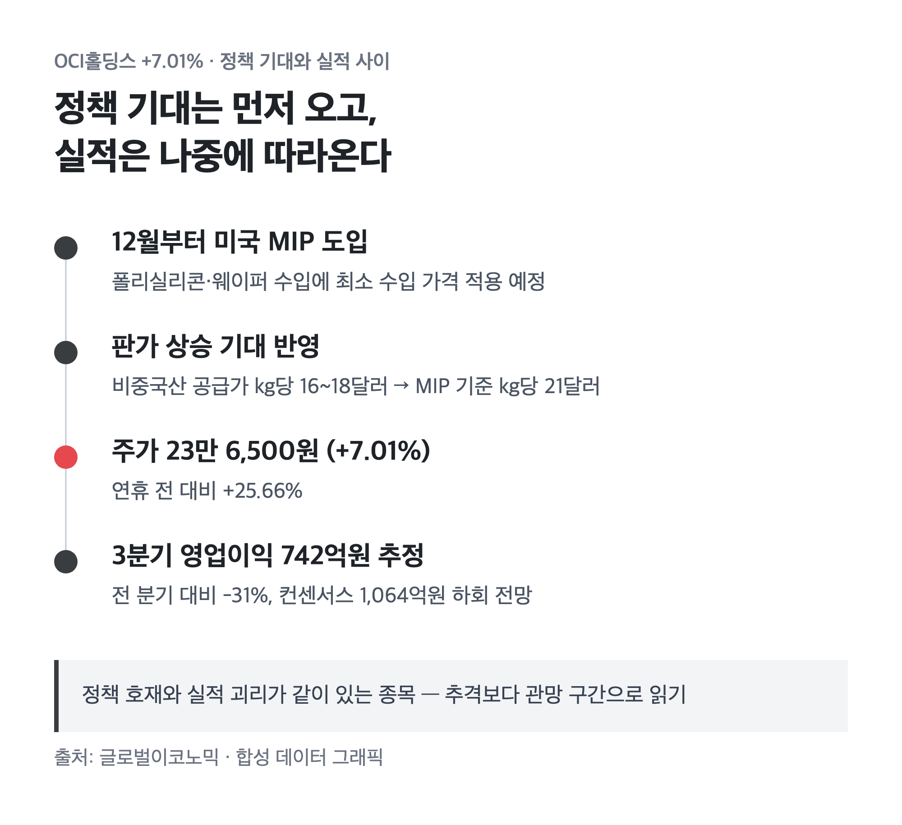

# [내일도 주린이] 연휴 직전 마지막 장, 기관만 버틴 코스피 7,000선…10/6 개장 전 체크 (10/5)

오늘은 달력에 빨간 날이 또 하나 있어서 국장이 쉬었어요. 개천절이 토요일이라 대체공휴일로 월요일이 통째로 빠진 거죠. 그래서 오늘 정리는 장 마감 얘기가 아니라 "지난 금요일 마감이 뭘 말하고 있었나"를 되짚는 글이에요.

---

## 🧾 10/2 금요일 마감 — 지수는 올랐는데 누가 던졌나

> **코스피 7,003.74 (+32.39포인트, +0.46%) / 코스닥 893.29 (-1.00포인트, -0.11%)**

지수만 보면 "7,000선 회복" 한 줄이면 끝나요. 그런데 수급을 펼쳐보니 얘기가 달라지더라고요. 기관이 3,814억원을 사서 지수를 받쳤고, 개인이 무려 1조 7,206억원을 팔았어요. 외국인도 1,438억원을 팔았고요. 개인이 던진 물량을 기관이 받아준 장이었던 셈이에요.

| 구분 | 코스피 순매수 | 코스닥 순매수 |
|---|---|---|
| 기관 | +3,814억원 | +938억원 |
| 개인 | -1조 7,206억원 | +814억원 |
| 외국인 | -1,438억원 | -1,731억원 |

코스닥은 장중 900선을 잠깐 넘었다가 상승분을 다 내주고 약보합으로 끝났어요. 지수 두 개가 같은 날 다른 방향을 보는 장이었죠. 지수 숫자보다 누가 샀는지를 먼저 봐야 하는 날이었어요.

---

## 🏭 대형주는 조용했고, 오른 건 다른 종목들

> **삼성전자 276,000원 (보합) / SK하이닉스 +0.44% / 두산로보틱스 73,100원 (+1.81%)**

제가 들고 있는 삼성전자는 27만 6,000원에 딱 보합이었어요. 장중에 한때 27만 1,500원까지 밀렸다가 다시 올라온 자리라 "떨어지지 않은 것"에 위안을 삼는 중입니다. 반도체 대형주가 지수 상승을 이끌지 못하고 삼성전기(+1.28%), LG에너지솔루션(+2.91%), KB금융(+0.84%)이 지수를 끌어올렸어요. 삼성바이오로직스(-4.51%)는 반대로 맞았고요.

두산로보틱스는 73,100원, +1.81%였어요. 제가 34주 들고 있는 종목이라 이 날 상승은 반가웠는데요, 로봇 테마 전체가 같이 움직인 흐름이고 이 날 나온 개별 호재 기사는 찾지 못했어요. 그래서 "내가 잘 골랐다"기보다 "테마가 살아 있다" 정도로 읽고 있습니다.

---

## 🔆 OCI홀딩스 +7.01% – 미국 정책 한 줄에 연휴 전 대비 25% 넘게

> **OCI홀딩스 23만 6,500원 (+7.01%, 연휴 전 대비 +25.66%)**

OCI홀딩스가 이날 상위권에 올랐어요. 이유는 미국이 12월부터 폴리실리콘·웨이퍼 수입에 최소 수입 가격(MIP)을 적용한다는 소식이었습니다. 비중국산 폴리실리콘 공급가 kg당 16~18달러 수준인데 MIP가 kg당 21달러로 잡히면서 판가 상승 기대가 붙은 거예요.

다만 여기서 한 박자 쉬어야 할 것 같아요. 3분기 영업이익은 742억원으로 추정돼서 전 분기보다 31% 줄고, 컨센서스 1,064억원도 밑돌 것이라는 전망이 있어요. 정책 기대는 주가를 끌어올렸는데 실적은 아직 따라오지 않은 상태라는 얘기죠. 저는 이런 괴리가 보이면 일단 추격보다 관망이 편해요.

---

## ⏳ 10/7·10/15 — 자사주 매입이 끝나는 날짜를 달력에 적었습니다

자사주 매입 얘기는 요즘 국장 수급의 핵심이에요. 삼성전자는 8월 24일부터 11월 21일까지 임직원 주식보상용으로 15조원 규모를 사고 있고, 현재 속도면 10월 7일쯤 끝날 것으로 보여요. SK하이닉스도 40조원 규모를 사서 전량 소각할 예정인데, 10월 15~16일쯤 끝날 것 같다는 관측이 나와요. 두 회사를 합치면 약 55조원이에요.

이 매입이 지난 몇 주 동안 지수 밑바닥을 받쳐준 건 맞는 것 같아요. 그러니까 매입이 끝나면 그 버팀목이 빠지는 거죠. 시장에서 "수급 공백"이라는 말이 나오는 이유예요. 다음 변곡점은 10월 말 3분기 실적 발표 때 추가 주주환원이 나올지 여부라고 해요.

---

## 🗓️ 10/6 화요일 개장 전에 볼 것

- **미국 증시**: 10/5 월요일은 미국이 정상 개장하니, 국장이 쉬는 동안 미장 흐름이 10/6 개장 분위기를 먼저 정해줄 거예요.
- **기관 수급**: 기관이 지수를 받친 날이 연휴 직전이었어요. 연휴 뒤에도 기관이 계속 받쳐주는지가 첫 체크포인트예요.
- **삼성전자 자사주 매입 종료 (10월 7일 전후)**: 수급 버팀목이 빠지기 직전이라 이 날짜 근처 주가 반응을 저는 따로 지켜볼 생각이에요.

솔직히 이번 주는 지수보다 수급이 더 궁금해요. 지수는 7,000선에 붙어 있는데 개인과 외국인이 계속 팔고 있다면, 그 힘이 언제 드러날지 모르니까요. 그래서 삼성전자 매입 종료 날짜 근처를 한 번 더 들여다볼 생각이에요. 연휴 끝나고 보자고요 🌱
