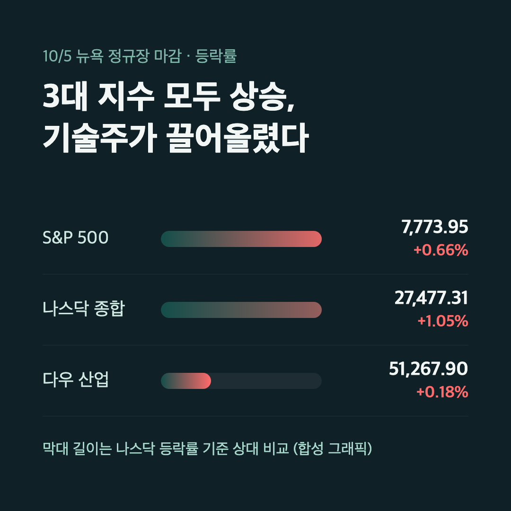
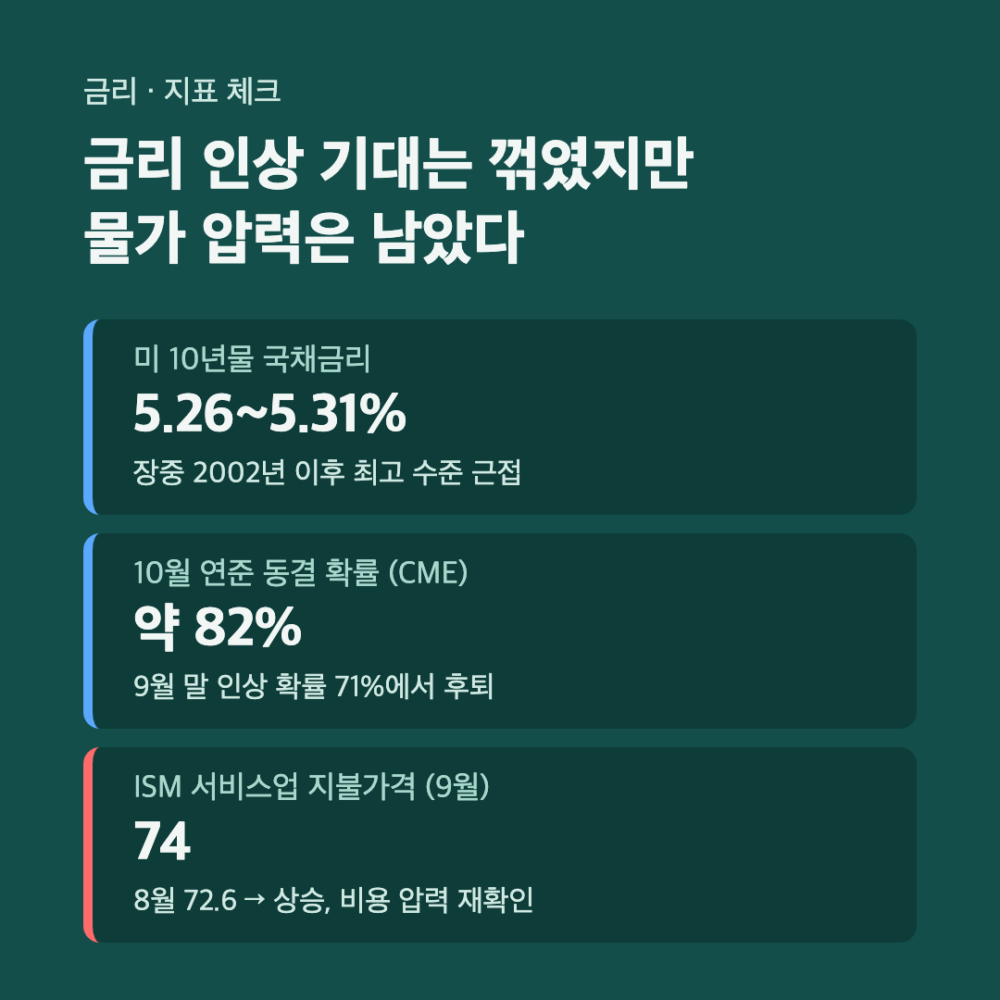
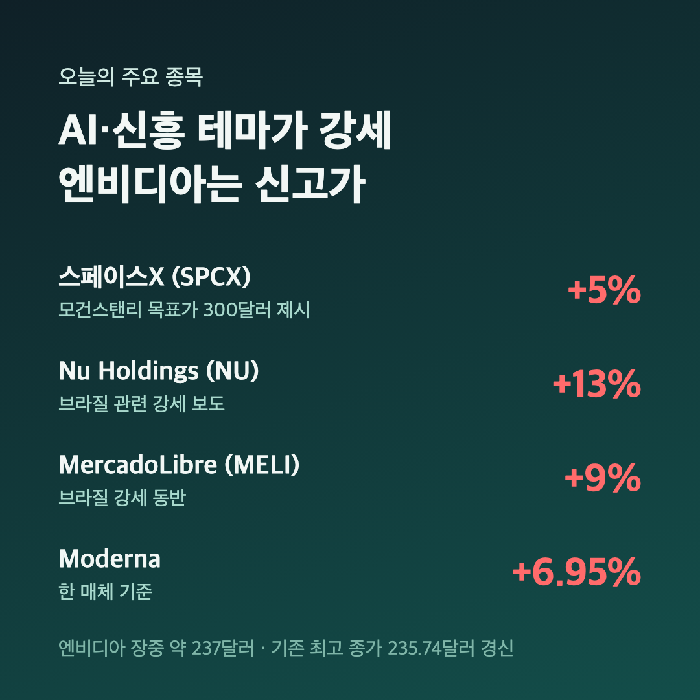

# [내일도 주린이] 국장 쉬는 날 나스닥 사상최고…금리는 5%대 미장정리 (10/5)

달력에 빨간 날이 겹쳐서 국장은 오늘 하루 쉬었어요. 개천절 대체공휴일이라 한국 시장은 문을 닫았는데, 미국 시장은 평소처럼 열렸더라고요. 그래서 오늘은 국장이 쉬는 동안 뉴욕에서 무슨 일이 있었는지 정리해볼게요.

---

## 🇺🇸 나스닥 사상 최고 마감 – S&P 500 +0.66%, 다우는 소폭 상승

> **S&P 500 7,773.95 (+51.23포인트, +0.66%) / 나스닥 27,477.31 (+286.45포인트, +1.05%)**

| 지수 | 종가 | 등락 |
|---|---|---|
| S&P 500 | 7,773.95 | +51.23포인트 (+0.66%) |
| 나스닥 종합 | 27,477.31 | +286.45포인트 (+1.05%) |
| 다우 산업평균 | 51,267.90 | +90.94포인트 (+0.18%) |

나스닥이 1%를 넘게 올라 종가 기준 사상 최고치를 찍었어요. 다우는 +0.18%로 거의 제자리였고요. 지수 숫자만 보면 "그냥 좋은 날" 정도인데, 어디서 올랐는지 보면 얘기가 달라집니다. 기술주 쪽이 지수를 끌어올린 날이었어요.

---

## 🏦 주가는 웃는데 금리는 5%대 고점 – 10년물 5.3% 안팎

> **미 10년물 국채금리 5.3% 안팎 / 장중 2002년 이후 최고 수준 근접**

지수가 오르는 날 금리가 같이 오르는 건 익숙한 장면은 아니죠. 이날 10년물 금리는 5% 중반 근처까지 올라서 2002년 이후 최고 수준을 다시 건드렸어요. 마감 수치는 자료마다 조금씩 달랐는데요, 5.26%로 본 곳도 있고 5.31%로 본 곳도 있어서 그 사이 범위로 적었습니다.

| 항목 | 수치 | 비고 |
|---|---|---|
| 미 10년물 국채금리 | 5.26~5.31% | 자료별 마감치 차이 |
| 10월 연준 동결 확률 | 약 82% | CME 페드워치 기준 |
| ISM 서비스업 PMI (9월) | 54.9 | 8월 55.4에서 둔화 |
| ISM 서비스업 지불가격 (9월) | 74 | 8월 72.6에서 상승 |

지난 금요일(10/2) 나온 9월 고용 지표가 너무 약해서 금리 인상 기대가 꺾였어요. 9월 말만 해도 10월 인상 확률이 70% 가까이 거론됐는데, 지금은 동결 쪽에 무게가 실린 상태예요. 그런데 금리가 여전히 높은 이유가 있습니다. ISM 서비스업 지불가격지수가 74로 오히려 올랐거든요. 물가 쪽 비용 압력은 아직 꺾이지 않았다는 신호죠.

여기에 브렌트유가 배럴당 100달러 위에서 버티고 있어요. 중동 분쟁이 끝나지 않으니 유가와 금리가 같이 발목을 잡는 구도예요. "금리 인상 확률이 떨어졌으니 괜찮겠지" 싶다가도, 지불가격 숫자를 보면 얘기가 달라져요.

---

## 💻 엔비디아 신고가, TSMC도 사상 최고가 부근 – AI 기대는 살아 있다

> **엔비디아 장중 약 237달러 (기존 최고 종가 235.74달러 경신)**

금리가 이렇게 높은데도 AI 쪽은 흔들리지 않았어요. 엔비디아가 기존 최고 종가 235.74달러(5월 14일)를 넘어 신고가를 기록했고, TSMC도 사상 최고가 부근에서 움직였습니다. TSMC는 일론 머스크가 "Terafab"이라는 반도체 관련 논의를 초기 단계로 확인했다는 소식이 같이 반영됐어요. 세레브라스는 샘 올트먼 오픈AI CEO가 "가까운 파트너"라고 다시 언급하면서 올랐고요.

| 종목 | 등락 | 주요 재료 |
|---|---|---|
| 스페이스X (SPCX) | +5% | 모건스탠리 목표가 300달러 제시 |
| Nu Holdings (NU) | +13% | 브라질 선거 관련 기대 보도 |
| MercadoLibre (MELI) | +9% | 브라질 관련 강세 동반 |
| Moderna | +6.95% | 한 매체 기준 |
| Visa | +2.53% | 한 매체 기준 |

스페이스X 얘기는 저한테 특히 와닿아요. 제 포트폴리오에도 우주 관련주가 있어서, 스페이스X 강세가 같은 테마 심리로 번질 수 있을지 눈여겨보고 있어요. 다만 같은 테마라고 해서 같이 간다는 보장은 없습니다.

---

## 🔭 다음 날 국장 전에 볼 것 – 금리와 AI 중 누가 이기나

- 연준 의사록(FOMC minutes) 공개가 가까워졌다는 보도가 있었어요. 금리 인상 기대가 다시 살아날지 확인할 포인트입니다.
- 10년물 금리가 5.3% 위에 머무는지, 아래로 내려오는지가 기술주 랠리 지속 여부를 가를 것 같아요.
- 엔비디아와 TSMC가 신고가 흐름을 이어가면 AI 쪽 믿음은 더 굳어지겠죠.

---

## 마무리하며

지수는 "나스닥 사상 최고"라는 좋은 숫자를 줬어요. 그런데 뒤에서는 10년물 금리 5%대와 여전히 높은 서비스업 물가 지표가 같이 있었습니다. 국장이 쉬는 동안 미장은 주가와 금리가 서로 다른 방향으로 당기는 날이었어요.

솔직히 오늘 같은 날은 주가만 보고 "좋다" 하기엔 찜찜한 구석이 남아요. 저는 내일 국장 개장 전에 금리 쪽 뉴스를 한 번 더 확인하고 들어갈 생각이에요. 🌱
