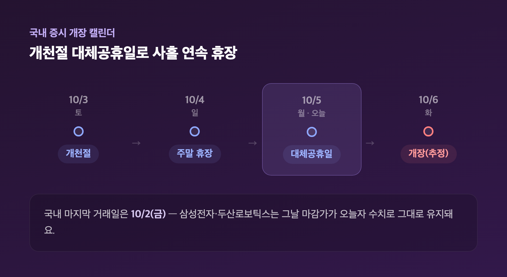
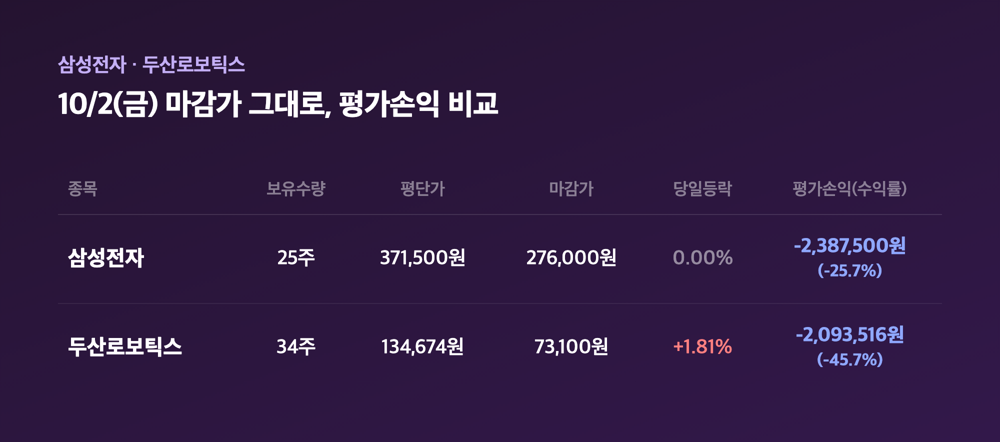
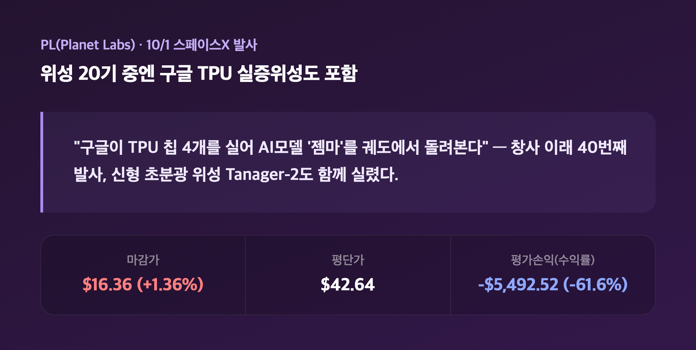
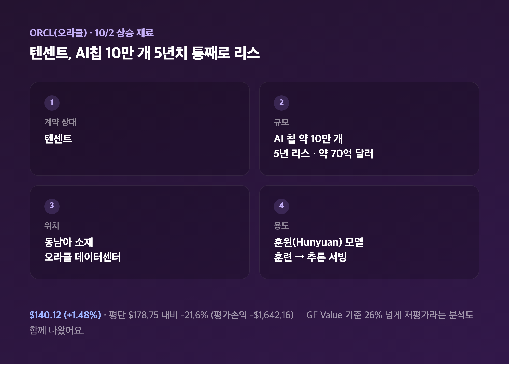
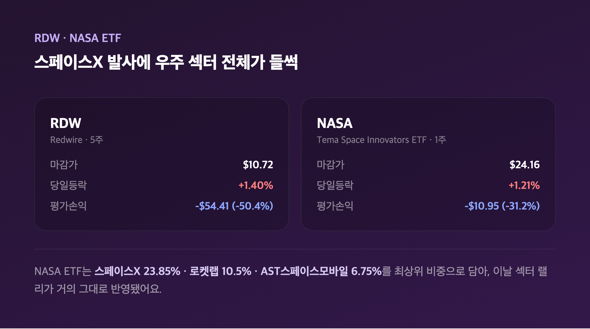
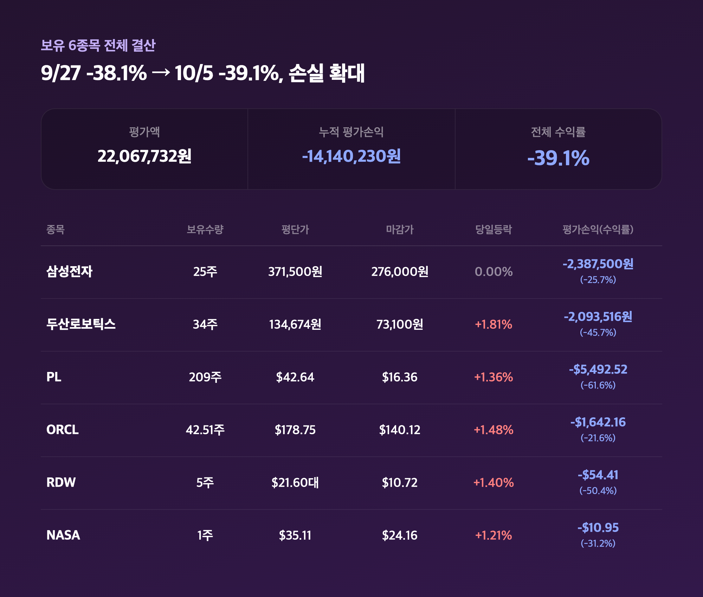

# [내일도 주린이] 포트폴리오 점검, 개천절 대체공휴일 휴장 속 손실 -39.1%로 확대 (10/5)

월요일 아침에 캡처 켜놓고 "아직 장 마감 전이라 숫자가 그대로겠지" 하고 리서치를 돌렸는데요, 알고 보니 이유가 완전히 달랐어요. 오늘(10/5)이 개천절 대체공휴일이라 국내 증시가 애초에 휴장이었던 겁니다. 그래서 오늘은 날짜 얘기부터 정리하고, 실보유 중인 6종목 손익을 하나씩 점검해볼게요.

---

## 🗓️ 오늘(10/5) 국내 증시가 쉬는 이유 — 개천절 대체공휴일

> **개천절(10/3 토) 대체공휴일 10/5(월) 지정 / 국내 마지막 거래일은 10/2(금)**

| 날짜 | 요일 | 국내 증시 상태 |
|---|---|---|
| 10/3 | 토 | 개천절 (주말과 겹침) |
| 10/4 | 일 | 주말 휴장 |
| 10/5 | 월 | 대체공휴일 (오늘, 휴장) |
| 10/6 | 화 | 다음 개장일(추정) |

올해 개천절이 토요일이라 대체공휴일이 오늘로 지정되면서, 주말까지 합쳐 사흘 연속 국내 증시가 쉬는 날이 됐더라고요. 그래서 삼성전자·두산로보틱스 두 국내 종목은 지난 금요일(10/2) 마감가가 그대로 "오늘자" 수치예요. 미국 쪽도 한국시간 월요일 오전엔 아직 개장 전이라, 미국 4종목(PL·ORCL·RDW·NASA) 역시 10/2(금) 정규장 마감이 가장 최신 데이터입니다. 참고로 이 미국 4종목은 제가 캡처한 등락률과 실제 10/2 정규장 마감 등락률 사이에 꽤 차이가 있었어요 — 예를 들어 PL은 캡처 기준 +1.36%였는데 실제 마감은 +8.43%였더라고요. 방향은 같은데 폭이 다른 거라 정확한 원인은 못 찾았고, 보유수량·평단가·평가손익 같은 실제 수치는 그대로 두고 등락률 차이만 짚어두고 넘어갈게요.

---

## 🇰🇷 삼성전자·두산로보틱스 — 10/2(금) 마감가 그대로

> **삼성전자 ₩276,000 (보합) / 두산로보틱스 ₩73,100 (+1.81%) — 둘 다 10/2(금) 마감가**

| 종목 | 보유수량 | 평단가 | 마감가 | 당일등락 | 평가손익(수익률) |
|---|---|---|---|---|---|
| 삼성전자 | 25주 | 371,500원 | 276,000원 | 0.00% | -2,387,500원 (-25.7%) |
| 두산로보틱스 | 34주 | 134,674원 | 73,100원 | +1.81% | -2,093,516원 (-45.7%) |

삼성전자는 10/2에 보합으로 마감했는데, "뚜렷한 모멘텀 부재"라는 평가가 나올 만큼 조용한 하루였다고 해요. 다음 주 3분기 잠정실적 발표를 앞둔 관망세가 짙었고, 증권사들은 영업이익이 전년 대비 800%대 급증할 걸로 보고 있다고 하니 실적 발표 전까지는 이런 눈치보기 장세가 이어질 것 같아요. 25주 들고 있는 입장에서 "오르지도 내리지도 않으니 차라리 다음 주 실적이나 기다려보자" 싶었습니다. 두산로보틱스는 +1.81% 오르며 그나마 선방했는데, 개별 호재보다는 로봇 테마 전반의 투자심리가 좋았던 덕으로 보여요 — 당일 개별 기사까지는 못 찾았습니다.

---

## 🛰️ PL(Planet Labs) — 구글 AI칩까지 실은 스페이스X 발사 훈풍

> **PL $16.36 (+1.36%) / 평단 $42.64 대비 -61.6% (평가손익 -$5,492.52)**

10/1(미국시간) PL 위성 20기가 스페이스X 팰컨9 라이드셰어 미션에 실려 발사됐는데, 그중에 구글의 "프로젝트 선캐처" 실증위성(궤도 내 첫 TPU 테스트)과 신형 초분광 위성 Tanager-2가 포함돼 있었다고 해요. 창사 이래 40번째 발사라는 점도 눈에 띄더라고요. 구글이 TPU 칩 4개를 실어 자사 AI모델 '젬마'를 궤도에서 돌려본다는 얘기를 읽으면서 "우주에서 AI 연산을 한다니, 이게 벌써 실험 단계구나" 싶었습니다. 다만 209주나 들고 있는 제 입장에서 이런 호재 하나로 -61.6%가 하루아침에 메워지진 않아요. 2026년 고점 대비 60% 넘게 빠진 장기 하락 추세는 여전히 그대로입니다.

---

## 💰 ORCL(오라클) — 텐센트가 AI칩 10만 개를 5년치 통째로 빌렸다

> **ORCL $140.12 (+1.48%) / 평단 $178.75 대비 -21.6% (평가손익 -$1,642.16)**

| 항목 | 내용 |
|---|---|
| 계약 상대 | 텐센트 |
| 규모 | AI 칩 약 10만 개, 5년 리스, 약 70억 달러 |
| 위치 | 동남아 소재 오라클 데이터센터 |
| 용도 | 훈윈(Hunyuan) 모델 훈련 → 추론 서빙 |

10/2 오라클 상승의 핵심 재료는 텐센트와 맺은 대규모 AI 칩 리스 계약이었어요. 미국의 대중 반도체 수출 규제 때문에 중국 내에서는 못 쓰는 칩들이라 동남아 데이터센터에 두고 쓴다는 구조인데, 텐센트가 해외 클라우드 업체와 맺은 최대 규모 리스 계약이라고 하더라고요. 같은 날 이사회 멤버의 장내 매수 공시도 있었다고 하니 경영진 자신감도 같이 읽혔습니다. GF Value 기준으로는 종가보다 26% 넘게 저평가됐다는 분석도 나왔는데, 저는 42.51주 들고 "저평가라는 말은 반갑지만 부채로 쌓은 AI 데이터센터 리스크가 해소된 건 아니니까" 하고 선을 좀 그어뒀어요.

---

## 🚀 RDW·NASA — 우주 섹터 전체가 들썩인 하루

> **RDW $10.72 (+1.40%) / NASA(Tema Space Innovators ETF) $24.16 (+1.21%)**

| 종목 | 보유수량 | 평단가 | 마감가 | 당일등락 | 평가손익(수익률) |
|---|---|---|---|---|---|
| RDW (Redwire) | 5주 | $21.60대 | $10.72 | +1.40% | -$54.41 (-50.4%) |
| NASA (Tema Space Innovators ETF) | 1주 | $35.11 | $24.16 | +1.21% | -$10.95 (-31.2%) |

이날 스페이스X가 팰컨9 라이드셰어 미션(PL 위성 포함)을 쏘아올리면서 스페이스X·로켓랩·AST스페이스모바일 같은 우주 관련주 전반이 동반 강세를 보였다고 해요. RDW는 개별 재료보다 이 섹터 전체 분위기에 묻어간 쪽으로 보이고, 8월 실적 발표 이후 나온 애널리스트 목표가 상향(Cantor Fitzgerald $9→$13.5 등) 모멘텀도 배경으로 깔려 있어요. NASA ETF는 스페이스X(23.85%)·로켓랩(10.5%)·AST스페이스모바일(6.75%)을 최상위 비중으로 담고 있어서 이 섹터 랠리가 거의 그대로 반영된 구조예요. 5주, 1주라 비중은 작지만 "그래도 둘 다 아직 -50%, -31%씩 물려 있다"는 건 변함없네요.

---

## 📊 보유 6종목 전체 총정리 — 누적 -39.1%로 손실 확대

> **누적 평가손익 -14,140,230원 / 평가액 22,067,732원 / 전체 수익률 -39.1%**

| 종목 | 보유수량 | 평단가 | 마감가 | 당일등락 | 평가손익(수익률) |
|---|---|---|---|---|---|
| 삼성전자 | 25주 | 371,500원 | 276,000원 | 0.00% | -2,387,500원 (-25.7%) |
| 두산로보틱스 | 34주 | 134,674원 | 73,100원 | +1.81% | -2,093,516원 (-45.7%) |
| PL (Planet Labs) | 209주 | $42.64 | $16.36 | +1.36% | -$5,492.52 (-61.6%) |
| ORCL (오라클) | 42.51주 | $178.75 | $140.12 | +1.48% | -$1,642.16 (-21.6%) |
| RDW (Redwire) | 5주 | $21.60대 | $10.72 | +1.40% | -$54.41 (-50.4%) |
| NASA (Tema Space Innovators ETF) | 1주 | $35.11 | $24.16 | +1.21% | -$10.95 (-31.2%) |

여섯 종목 다 더하면 평가액 22,067,732원에 누적 평가손익 -14,140,230원, 전체 수익률 -39.1%예요. 지난 9/27 점검 때가 -38.1%였으니 1.0%p 더 나빠진 셈입니다. "어, 분명 오늘 다섯 종목이 플러스였는데 왜 전체는 더 나빠졌지" 했는데, 평가액 자체가 줄어든 두산로보틱스·PL 비중이 커서 그런 것 같더라고요. 숫자로는 악화지만, 당일 기준으로는 두산로보틱스·PL·ORCL·RDW·NASA 다섯 종목이 플러스였다는 점은 그나마 적어두려고요.

---

## 마무리하며

정리하면 국내는 개천절 대체공휴일로 10/2 마감가가 그대로 걸려 있고, 미국 4종목은 각자 다른 호재(구글 위성 파트너십, 텐센트 AI칩 계약, 우주 섹터 동반 랠리)로 당일 기준 전부 플러스였어요. 그런데도 전체 수익률은 -38.1%에서 -39.1%로 오히려 더 떨어졌습니다.

솔직히 당일 등락률만 보면 "오늘은 나쁘지 않았는데?" 싶었는데, 누적 숫자를 보니 손실이 더 벌어졌다는 걸 받아들이는 게 쉽지 않더라고요. 그래도 당장 팔 생각은 없고, 10/6 국내 재개장 때 삼성전자·두산로보틱스가 어떻게 움직이는지부터 다시 체크해볼 생각입니다.

-38.1%에서 -39.1%, 숫자는 또 나빠졌지만 저는 오늘도 그냥 들고 갑니다. 버티는 것도 투자 전략이라고 믿어볼게요 🌱

#포트폴리오점검 #내주식포트폴리오 #두산로보틱스 #우주관련주
