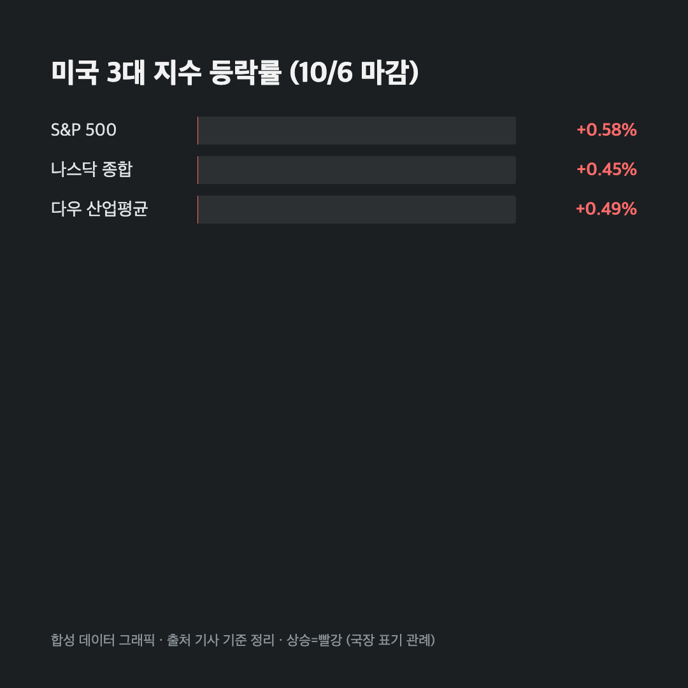
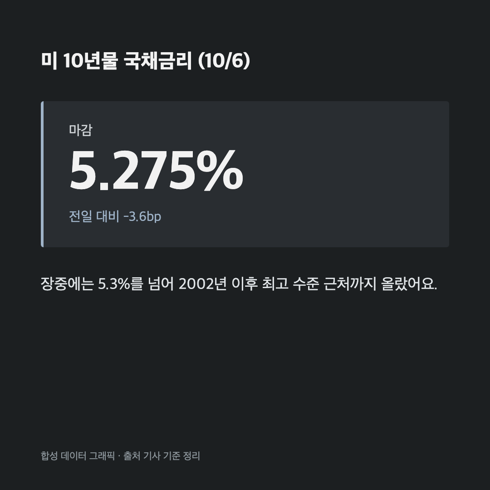
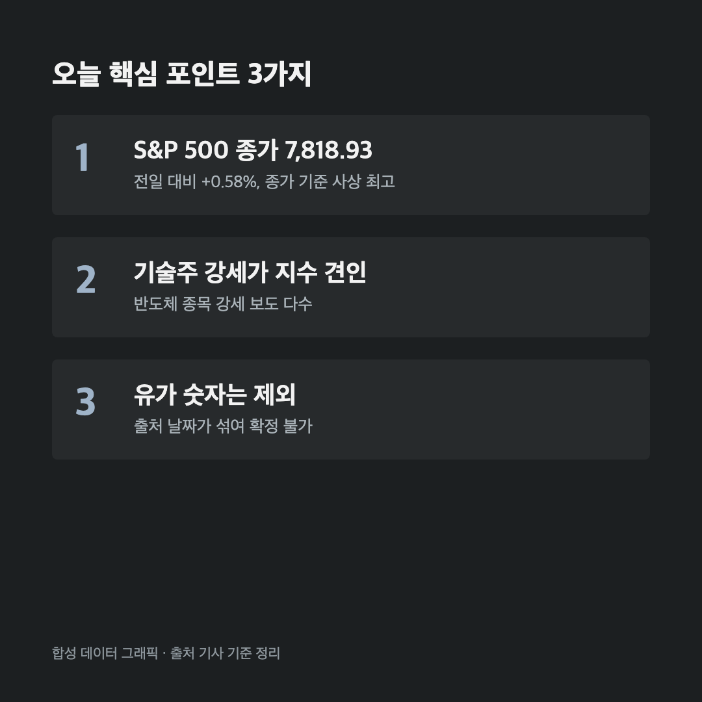

# [내일도 주린이] 미장 3대 지수 나란히 사상 최고 근처…10년물은 다시 5.3% 턱밑 (10/6)

어제 미장 얘기를 하면서 "금리가 5%대인데 주식은 왜 안 떨어지지" 했잖아요. 오늘도 같은 질문으로 시작하게 되네요. 지수는 또 올랐고, 금리는 살짝 내렸습니다.

---

## 🇺🇸 3대 지수 모두 상승, S&P 500은 사상 최고 마감

> **S&P 500 7,818.93 (+44.98포인트, +0.58%) / 나스닥 27,599.79 (+122.48포인트, +0.45%) / 다우 51,521.28 (+253.38포인트, +0.49%)**

| 지수 | 종가 | 등락 |
|---|---|---|
| S&P 500 | 7,818.93 | +44.98포인트 (+0.58%) |
| 나스닥 종합 | 27,599.79 | +122.48포인트 (+0.45%) |
| 다우 산업평균 | 51,521.28 | +253.38포인트 (+0.49%) |

세 지수 모두 올랐고, S&P 500은 종가 기준으로 사상 최고치를 다시 찍었어요. 한 기사에서는 S&P 500 상승률을 0.7%로 적었는데요, 종가 숫자로 다시 계산해보면 +0.58%가 맞더라고요. 그래서 여기서는 종가 기준 0.58%로 적었습니다.

다우는 상승률이 가장 낮았지만 그래도 250포인트 넘게 올랐어요. 지수 세 개가 다 같이 오른 날이었습니다.

---

## 🏦 금리는 2002년 이후 최고치 근처에서 한 발 물러남

> **미 10년물 국채금리 5.275% (전일 대비 3.6bp 하락) / 장중에는 5.3%를 넘겨 2002년 이후 최고 수준 근처까지 올랐어요**

장중에는 5.3%를 넘겼다가 마감에는 5.275%까지 밀렸어요. 하루 차이로 3.6bp라 숫자로는 작지만, 방향이 중요하다고 봅니다. 금리가 떨어지면 성장주 평가 부담이 줄어드니까요. 실제로 메가캡 기술주가 이날 지수를 끌고 갔어요.

그렇다고 "금리 걱정 끝"은 아니에요. 5% 중반 금리는 2000년대 초 이후 처음 보는 수준이라, 이 구간에서 시장이 얼마나 버티는지가 다음 주 포인트가 될 것 같습니다.

---

## 💻 기술주가 지수를 끌고 갔어요

엔비디아, AMD 같은 반도체 종목이 기술주 강세를 이끌었다는 보도가 여러 곳에서 나왔어요. 다만 엔비디아 주가는 기사마다 숫자가 완전히 달라서, 구체적인 가격은 여기서 적지 않을게요. 확인되지 않은 숫자를 적어놓으면 나중에 제 글부터 믿기 어려워지니까요.

한 가지 확실한 건, 반도체가 오르면 같은 주에 한국 시장도 같이 움직이는 경우가 많다는 거예요. 저는 삼성전자를 25주 들고 있어서, 오늘 밤 미장 반도체 흐름을 보고 내일 장이 어떻게 열릴지 자연스럽게 신경이 쓰일 것 같아요.

---

## 🛢️ 유가는 등락, 구체 숫자는 제외

원유 가격도 이날 움직였다는 헤드라인이 있었는데요, 출처마다 날짜가 섞인 가격이 돌아다녀서 정확한 종가를 확정하지 못했어요. 그래서 유가 숫자는 빼고 방향성만 짚어둘게요. 금리와 유가는 같이 시장을 흔드는 변수라서, 다음에 유가 숫자가 확인되면 따로 정리해볼 생각입니다.

---

## 📝 확인이 안 된 것들, 솔직하게 정리

- 엔비디아 주가: 출처마다 값이 크게 달라서 제외했어요.
- 일부 요약 기사의 다우 하락, 10년물 4%대 수치: 이날 종가와 맞지 않아 쓰지 않았어요.
- 원전 계약 관련 보도: 공식 확인이 안 돼서 이 글에서는 다루지 않았어요.

숫자가 흔들리는 날은 빼는 게 낫다고 생각해요. 확인된 것만 적는 게 제 원칙이라서요.

---

## 마무리하며

지수는 세 개 다 올랐고, 10년물은 5.275%로 살짝 내려왔어요. 오늘 얘기를 한 줄로 줄이면 "금리는 높은데 기술주가 버틴다" 정도가 될 것 같네요.

솔직히 저는 금리 5%대에서 지수가 이렇게 올라가는 게 아직도 낯설어요. 그래도 흐름이 이어진다면 삼성전자 쪽 반도체 기대도 같이 보려고 해요. 오늘은 여기까지 🌱
