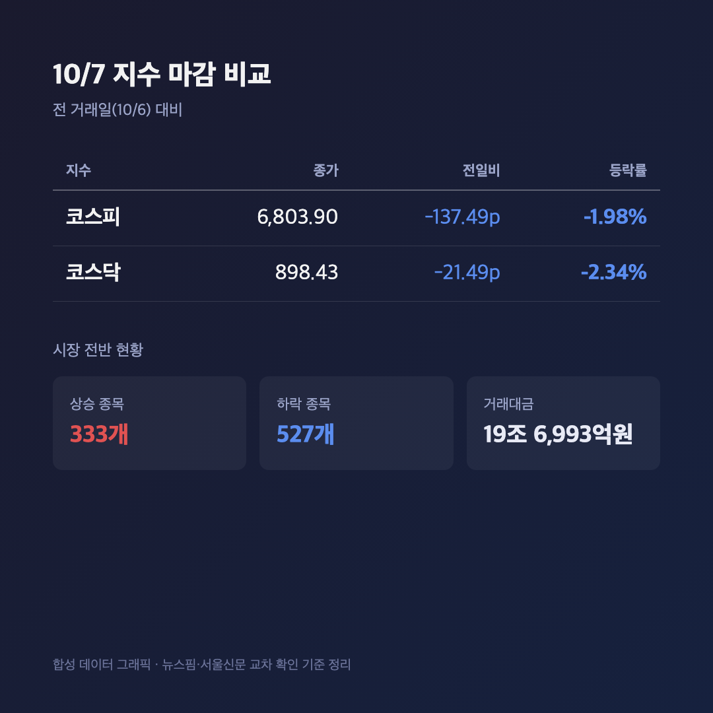
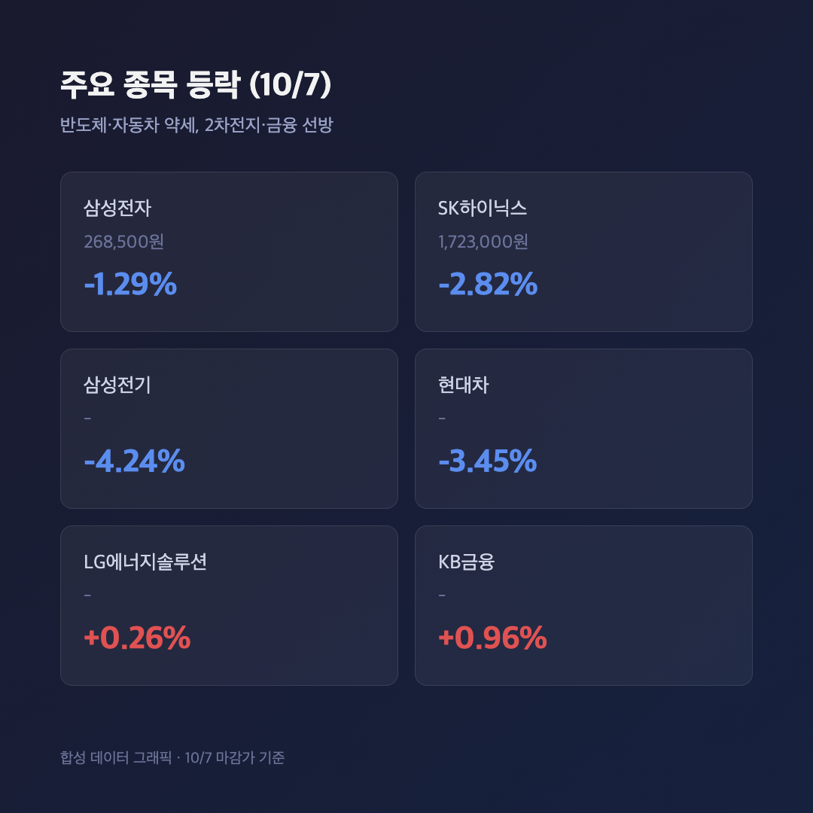
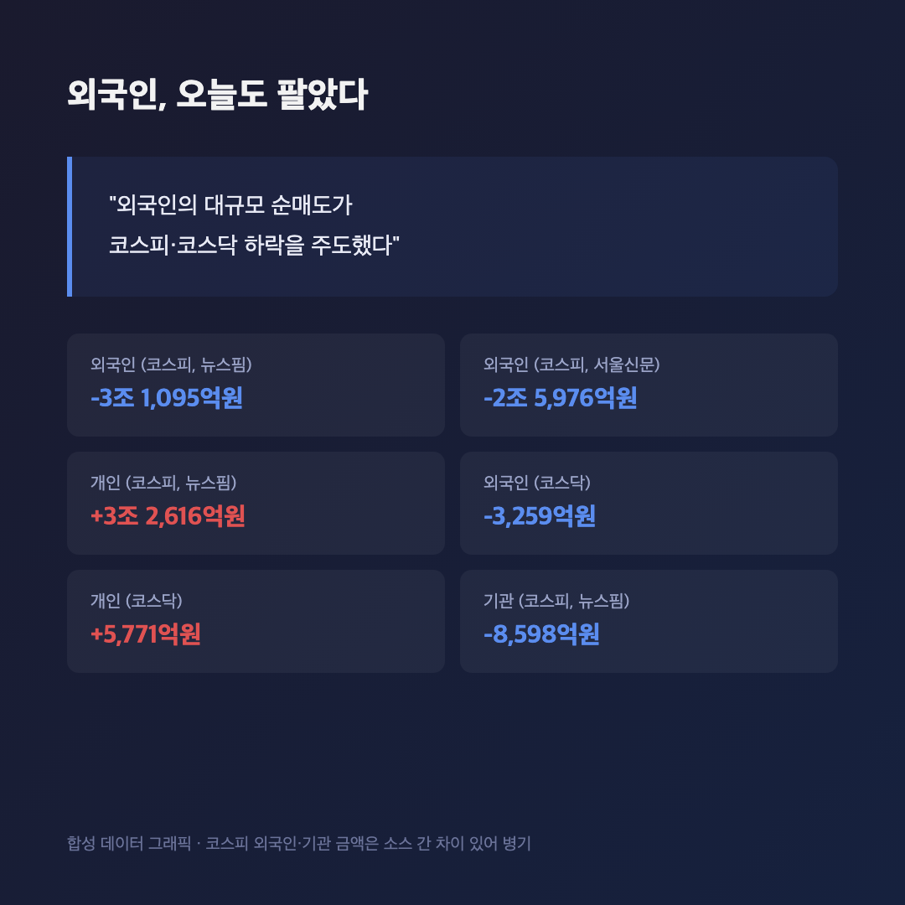

# [내일도 주린이] 코스피·코스닥 동반 2%대 하락, 삼성전자 실적 발표 하루 앞두고 다 같이 몸사리기 (10/7)

코스피 -1.98%, 코스닥 -2.34%. 둘 다 2% 넘게 빠진 날인데 "폭락"이라는 느낌보다는 "다들 일단 지켜보자"는 분위기가 더 강했던 하루였어요. 내일 삼성전자 실적 발표가 걸려 있으니까요.

---

## 📉 코스피 6,803.90 / 코스닥 898.43, 둘 다 빨간불 하나 없이 파란불

> **코스피 6,803.90 (-137.49포인트, -1.98%) / 코스닥 898.43 (-21.49포인트, -2.34%)**

전 거래일인 10월 6일 코스피가 6,941.39였으니 딱 137.49포인트 빠진 거예요. 코스닥도 919.92에서 898.43으로 21.49포인트 내렸고요. 이 숫자는 10월 6일자 기사와 10월 7일자 기사를 양쪽 다 찾아서 직접 빼봤는데 정확히 맞아떨어지더라고요. 숫자가 서로 맞아떨어질 때 묘하게 안심이 됩니다.

상승 종목은 333개, 하락 종목은 527개였어요. 오른 종목보다 내린 종목이 훨씬 많았던, 말 그대로 시장 전반이 가라앉은 날이었습니다. 거래대금은 19조 6,993억원으로 평소보다 딱히 적지도 많지도 않았어요. 거래량 자체는 멀쩡했는데 방향만 한쪽으로 쏠린 날이라고 보면 될 것 같아요.

---

## 🏭 삼성전자 -1.29%, SK하이닉스 -2.82%…저도 물린 그 종목이 또

> **삼성전자 268,500원 (-1.29%) / SK하이닉스 1,723,000원 (-2.82%) / 삼성전기 -4.24% / 현대차 -3.45%**

제가 25주 들고 있는 삼성전자가 오늘도 1%대 빠졌어요. SK하이닉스는 더 크게 밀렸고, 삼성전기는 4%대, 현대차도 3%대로 약세였습니다. 반대로 LG에너지솔루션(+0.26%)과 KB금융(+0.96%)은 소폭이지만 올랐고요.

반도체 두 종목이 유독 약했던 데는 이유가 있어요. 지난 10월 2일 기준 삼성전자는 임직원 주식보상용 자사주 매입 5,380만주를 채워서 당초 계획을 물량 기준으로 초과 달성했고, SK하이닉스도 매입 진행률이 76%를 넘어서 곧 마무리 단계였거든요. 두 회사 합쳐서 수십조원 규모의 매입이 그동안 지수 하단을 받쳐온 버팀목이었는데, 그게 끝나가는 시점이라 수급 부담이 커졌다는 분석이 나와요. 저는 이 자사주 얘기를 지난 10/5 글에서 "10월 7일쯤 끝날 것 같다"고 적었었는데, 딱 그 타이밍에 삼성전자가 또 빠지니까 괜히 뜨끔하네요.

---

## 💸 외국인이 또 팔았는데, 정확한 액수는 기사마다 달라요

이날도 외국인이 지수를 끌어내린 주체였어요. 다만 액수는 소스마다 차이가 좀 있습니다. 한 매체는 코스피에서 외국인이 3조 1,095억원, 기관이 8,598억원을 팔았다고 전했고, 다른 매체는 외국인 2조 5,976억원, 기관 6,684억원 순매도로 적었어요. 두 곳 다 "외국인이 가장 크게 팔았다"는 방향은 같은데 정확한 조 단위 숫자는 안 맞아서, 여기서는 두 수치를 다 적어둘게요. 개인은 코스피에서 3조 2,616억원을 순매수했다는 보도가 있었고, 코스닥에서도 개인·외국인 할 것 없이 흐름이 비슷했습니다(코스닥 외국인 -3,259억원, 개인 +5,771억원).

---

## 🇺🇸 같은 날 미국은 사상 최고치, 한국만 디커플링

같은 날 밤 미국 증시를 보면 더 묘해요. S&P 500은 +0.58%로 종가 기준 사상 최고치를 다시 썼고, 나스닥도 +0.45% 올랐거든요. AI 랠리가 이어지는 미국이랑, 반도체 대형주가 눌린 한국이 같은 날 정반대로 움직인 셈이에요. "미국이 오르면 다음 날 국장도 따라간다"는 공식이 이번엔 하루 안 통한 날이었습니다.

---

## 🔭 내일(10/8)은 삼성전자 실적 발표일

오늘 하락의 핵심 원인으로 두 매체 다 "삼성전자 3분기 잠정실적 발표를 하루 앞둔 관망 심리"를 꼽았어요. 숫자가 나오기 전까지는 사는 쪽도 파는 쪽도 확신이 없으니 일단 지켜보자는 쪽으로 쏠린 거죠. 컨센서스 구체적인 수치는 이번 글에서는 적지 않을게요 — 찾아본 자료들이 연도가 뒤섞여서 믿고 쓸 만한 숫자를 못 골랐거든요. 확인 안 된 숫자를 적느니 그냥 "내일 발표됩니다" 정도로만 남겨두는 게 맞는 것 같아요.

---

## 마무리하며

오늘은 코스피 -1.98%, 코스닥 -2.34%, 외국인 순매도, 반도체 약세까지 한 방향으로 깔끔하게 정리되는 날이었어요. 다만 그 배경이 "실적 공포"라기보다는 "실적 발표 전 대기 모드"에 가까워 보여서, 저는 내일 삼성전자 숫자가 나오는 거 보고 반응하는 쪽으로 가려고요. 25주짜리 제 삼성전자는 오늘도 물려 있지만, 어차피 내일이면 다음 국면이 열리니 미리 흔들리진 않으려고 합니다. 내일 숫자 보고 다시 올게요 🌱
