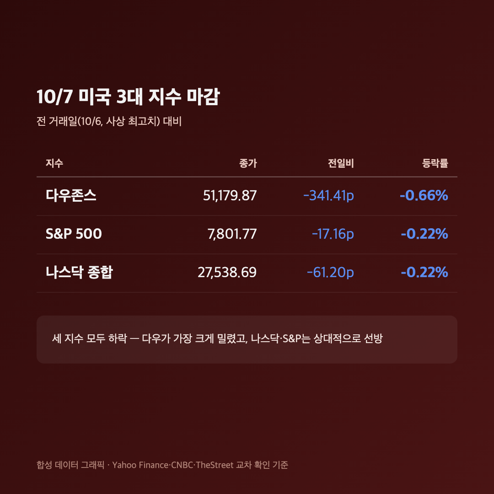
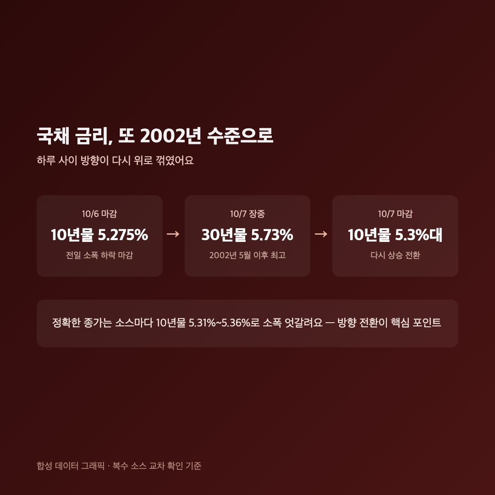
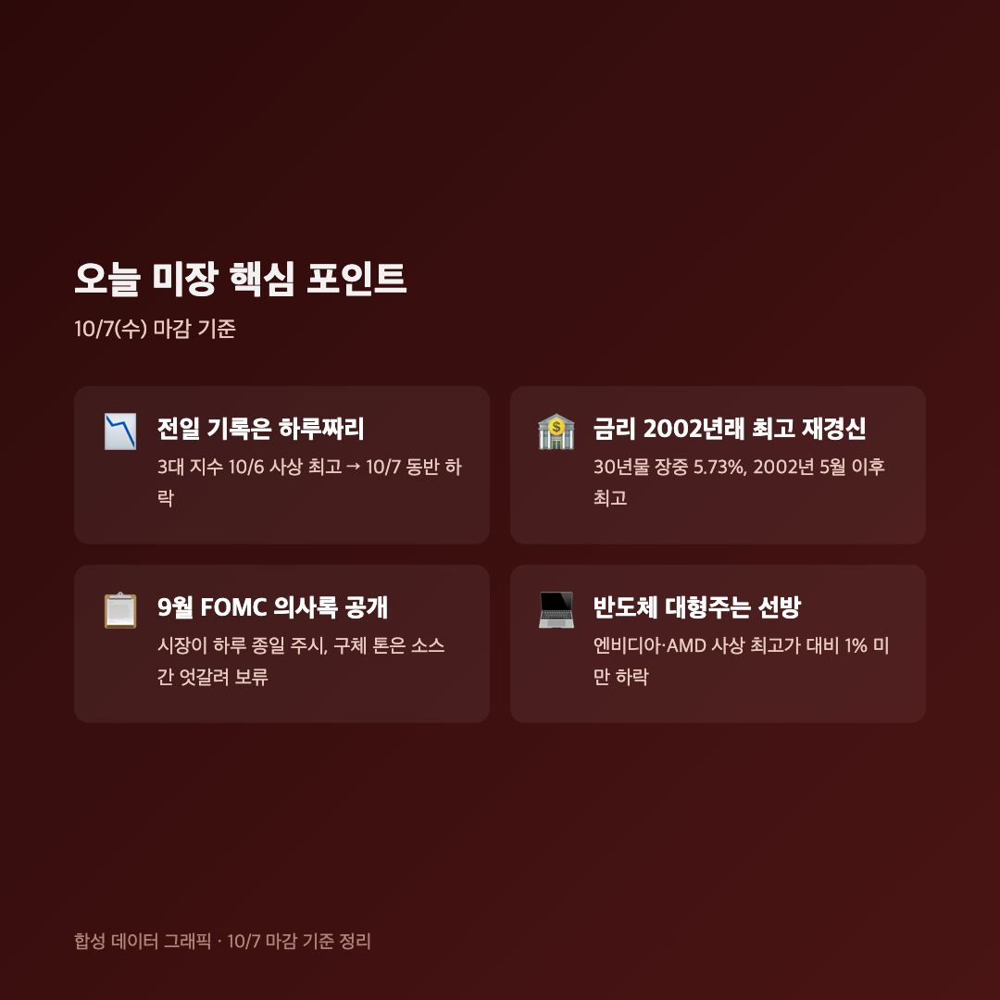

# [내일도 주린이] 다우 0.66%↓ 사상최고 하루 만에 꺾이고, 금리는 2002년 이후 최고치 또 경신 (10/7)

내일 삼성전자 실적 발표를 앞두고 국장이 다 같이 몸을 사렸다고 아까 적었는데요, 밤새 미장도 비슷한 공기였더라고요. 전날 사상 최고치를 찍었던 지수들이 하루 만에 동반 후퇴했습니다.

---

## 📉 다우·S&P·나스닥 모두 하락, 전일 기록은 하루짜리였네요

> **다우존스 51,179.87 (-341.41포인트, -0.66%) / S&P 500 7,801.77 (-17.16포인트, -0.22%) / 나스닥 종합 27,538.69 (-61.20포인트, -0.22%)**

| 지수 | 종가 | 등락 |
|---|---|---|
| 다우존스 | 51,179.87 | -341.41포인트 (-0.66%) |
| S&P 500 | 7,801.77 | -17.16포인트 (-0.22%) |
| 나스닥 종합 | 27,538.69 | -61.20포인트 (-0.22%) |

세 지수 다 빠졌는데, 떨어진 폭만 보면 다우가 제일 아팠고 나스닥·S&P는 상대적으로 덜 흔들렸어요. 전날(10/6)이 세 지수 모두 사상 최고치였던 걸 생각하면, "기록 경신 → 하루 쉬어가기"의 흐름이 또 반복된 셈이에요. 저는 이 정도 되돌림은 오히려 자연스럽다고 보는 편인데요, 문제는 그 배경이 단순 차익실현이 아니라 금리라는 점이에요.

---

## 🏦 국채 금리, 2002년 이후 최고 수준을 또 갈아치웠어요

> **미 10년물 국채금리 5.3%대 / 30년물 장중 5.73%까지 상승 (2002년 5월 이후 최고)**

어제(10/6) 글에서 "10년물이 5.3%를 넘겼다가 5.275%로 내려왔다"고 적었잖아요. 오늘은 그게 다시 올라서 30년물이 2002년 5월 이후 최고치까지 찍었어요. 하루 사이에 또 뒤집힌 거죠. 다만 정확한 종가 숫자는 소스마다 10년물 5.31%~5.36% 사이로 조금씩 다르게 나와서, 여기서는 "5.3%대"로만 적어둘게요. 숫자 하나 정확히 박아놓는 것보다, 방향이 또 위로 꺾였다는 사실이 더 중요하다고 봐요.

금리가 오르면 주식 쪽은 할인율 부담이 커지는 구조라, 이날 지수가 빠진 것도 이 흐름과 맞물려 있다고 보는 시각이 많았어요.

---

## 📋 연준 9월 의사록 공개 – 내용은 신중하게 보려고요

이날 오후(미 동부시간 기준) 9월 FOMC 의사록이 공개됐고, 시장이 이걸 하루 종일 주시하는 분위기였어요. 다만 의사록이 구체적으로 매파적이었는지 도비시했는지는 소스마다 전달하는 뉘앙스가 서로 어긋나서, 저는 이번 글에서는 "의사록이 나왔고 시장이 긴장하며 지켜봤다"까지만 적고 구체적인 톤 해석은 넘어갈게요. 확인 안 된 걸 확정적으로 쓰는 게 더 찜찜하더라고요.

한 가지 눈에 띈 건 엔비디아·AMD 같은 AI 반도체 대형주는 사상 최고가 대비 1%도 안 빠졌다는 점이에요. 지수 전체는 밀렸는데 기술주는 상대적으로 버틴 날이었던 거죠. 나스닥 하락률이 다우보다 작았던 것도 같은 맥락으로 보여요.

---

## 🧾 확인되지 않아 빼놓은 것들

- 비트코인 급락설, 특정 종목 20% 급락설, 유가 100달러 근접설 등은 검색 중에 보이긴 했는데 다른 소스로 교차검증이 안 돼서 이번 글에는 안 담았어요.
- 연준이 9월에 금리를 올렸다는 내용도 일부 보였는데, 그동안 쭉 나왔던 "금리 인하 기조" 보도들과 정면으로 어긋나서 신뢰하기 어렵다고 보고 제외했습니다.
- 숫자든 서사든 확신이 안 서면 일단 빼는 쪽으로 가는 게 제 나름의 원칙이에요.

---

## 마무리하며

정리하면 다우 -0.66%, S&P·나스닥 각 -0.22%, 금리는 2002년 이후 최고 수준을 또 찍은 하루였어요. 전날 기록 경신이 하루 만에 꺾인 걸 보니, 지금 장이 금리에 얼마나 예민하게 반응하는지 다시 확인한 느낌이에요.

25주짜리 제 삼성전자는 내일 실적 발표를 앞두고 있는데, 밤새 미장 반도체주가 비교적 선방한 걸 보고 나니 조금 안심이 되긴 하더라고요. 그래도 숫자는 숫자로 직접 확인하고 반응하려고요. 내일 실적 보고 다시 올게요 🌱
