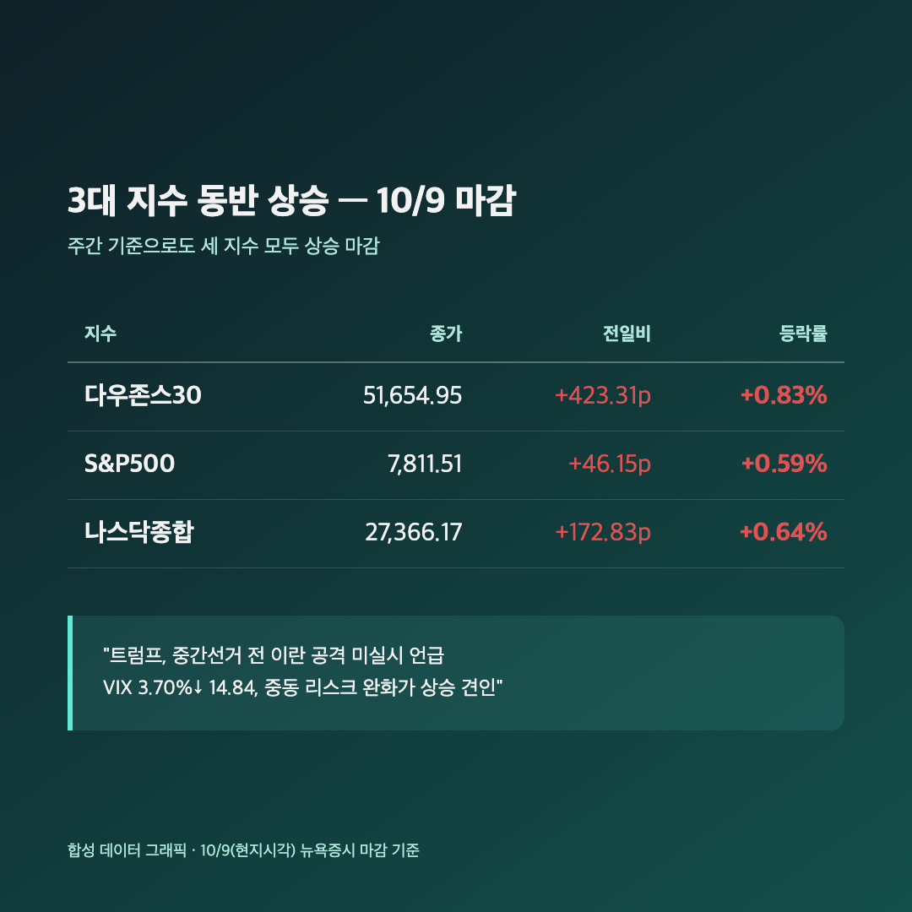
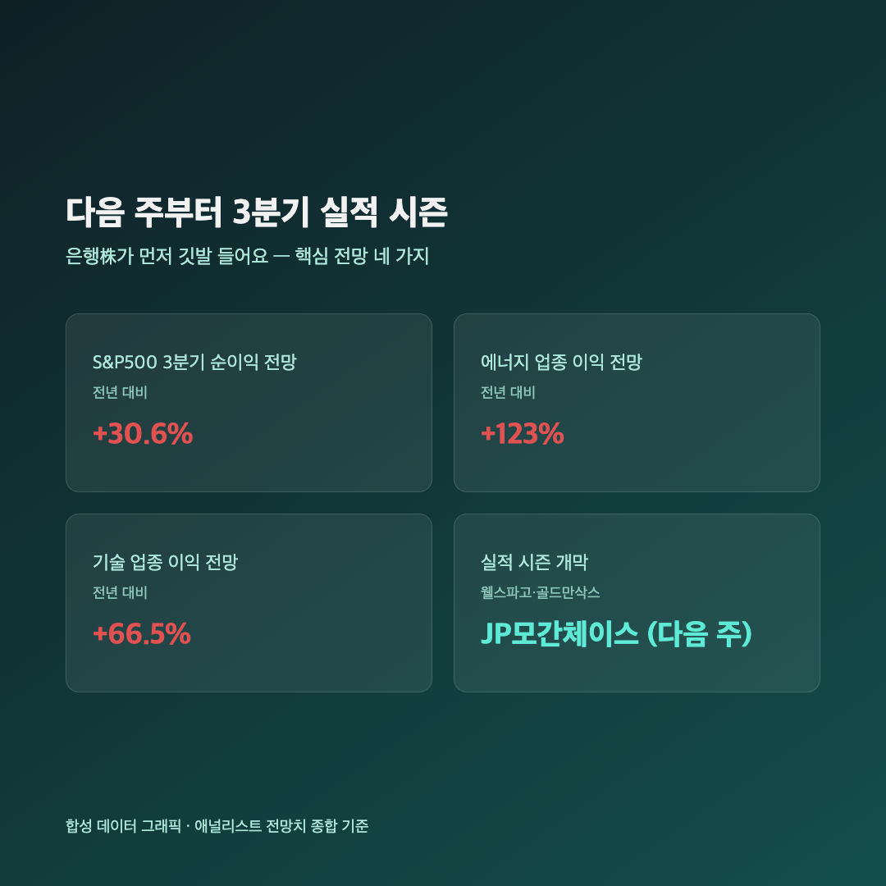
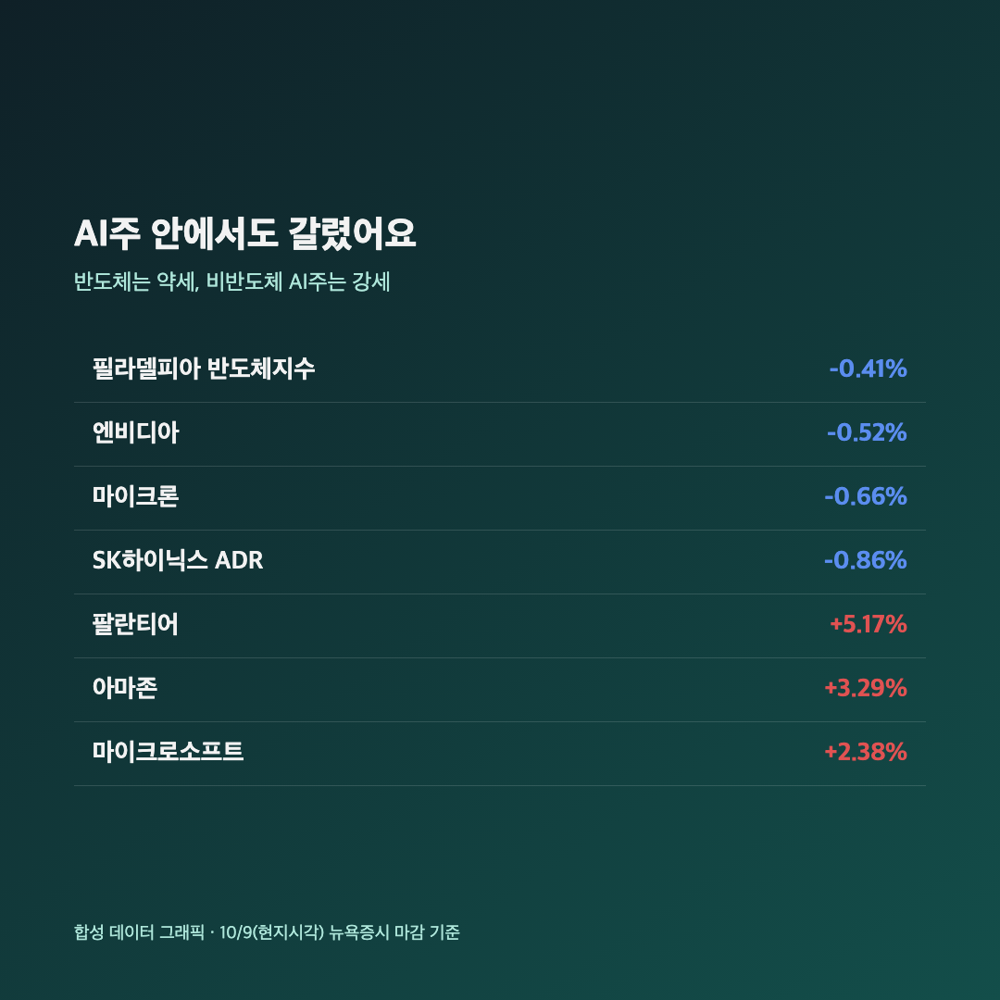

# [내일도 주린이] 오픈AI 쇼크 하루 만에 싹 반등…다우 0.83%, 이란 리스크도 숨죽였어요 (10/9)

어제 오픈AI 매출 쇼크로 나스닥이 1.25% 빠졌을 때 "내일은 또 얼마나 흔들릴까" 걱정했었는데요, 막상 밤새 지나고 보니 세 지수가 다 같이 올라있더라고요. "이게 뭔 상황이지" 싶으면서도, 한 주를 마무리하는 금요일답게 깔끔하게 웃으며 끝난 느낌이라 오늘은 그 반등 배경부터 짚어볼게요.

---

## 📈 3대 지수 동반 상승 – 다우 0.83%, VIX는 뚝

> **다우존스 51,654.95 (+423.31포인트, +0.83%) / S&P500 7,811.51 (+46.15포인트, +0.59%) / 나스닥 27,366.17 (+172.83포인트, +0.64%)**

| 지수 | 종가 | 등락 |
|---|---|---|
| 다우존스 | 51,654.95 | +423.31포인트 (+0.83%) |
| S&P500 | 7,811.51 | +46.15포인트 (+0.59%) |
| 나스닥 종합 | 27,366.17 | +172.83포인트 (+0.64%) |

세 지수 모두 상승했고 주간 기준으로도 전부 올랐다고 하니, 변동성 컸던 한 주를 웃으면서 마무리한 셈이에요. 트럼프 대통령이 "11월 중간선거 전에는 이란을 공격하지 않겠다"고 하고 이란과의 협상도 "생산적으로 진행 중"이라고 언급하면서 중동 확전 우려가 확 꺾였고요, 공포지수(VIX)도 3.70% 내려 14.84까지 떨어졌어요. 저는 이 VIX 숫자 보고 "아, 다들 진짜 안심했구나" 싶었습니다.

---

## 🏦 다음 주부터 3분기 실적 시즌 – 은행株가 먼저 깃발 들어요

다음 주부터 웰스파고·골드만삭스·JP모간체이스 같은 대형 은행들이 3분기 실적 발표를 시작하면서 본격적인 어닝시즌이 열려요. 애널리스트들은 S&P500 전체 순이익이 전년 대비 30.6% 늘 거라고 보는데, 업종별로는 에너지(+123%)랑 기술(+66.5%) 쪽 증가폭이 특히 크다고 하네요. 저는 이 숫자를 보면서 "결국 다음 주 실적이 지금 이 반등이 진짜인지 가짜인지 가려줄 거구나" 싶더라고요. 기대감만으로 오른 날이라서, 다음 주 실제 숫자가 더 중요해지는 구간인 것 같아요.

---

## 🔧 반도체는 오히려 약세 – AI株 안에서도 갈렸어요

> **필라델피아반도체지수(SOX) 12,572.4 (-0.41%) / 엔비디아 -0.52% / SK하이닉스 ADR -0.86%**

| 종목 | 등락률 |
|---|---|
| 필라델피아 반도체지수(SOX) | -0.41% |
| 엔비디아 | -0.52% |
| 마이크론 | -0.66% |
| SK하이닉스 ADR | -0.86% |
| 팔란티어 | +5.17% |
| 아마존 | +3.29% |
| 마이크로소프트 | +2.38% |

지수는 다 같이 웃었는데 반도체 대형주들만 따로 빠진 게 재밌었어요. 같은 AI 관련주인데도 팔란티어·아마존·MS는 올랐으니, "AI주=다 같이 움직인다"는 공식이 이제 안 먹히는구나 싶더라고요. 그리고 애플이 1.10% 빠진 이유도 눈에 걸렸는데요, 메모리 반도체 가격이 급등해서 아이폰18 프로 부품 생산을 줄였다는 소식 때문이었대요. 저한테는 이게 오히려 반가운 신호였습니다 — 메모리 가격이 그만큼 세졌다는 뜻이니까요. 25주짜리 제 삼성전자도 메모리가 주력인데, 애플 입장에선 부담이지만 삼성전자 입장에서는 오히려 호재로 읽힐 수 있는 대목이라 다음 주 국장 반응이 궁금해졌어요.

---

## 📡 통신주는 따로 급락 – 스페이스X가 주파수 사러 왔다

일론 머스크의 스페이스X가 전국 단위 저대역 주파수(스펙트럼) 포트폴리오를 인수하기로 하면서, T-모바일(-13.27%), AT&T(-9.85%), 버라이즌(-8.75%)이 하루 만에 와르르 빠졌어요. 위성 기반 통신이 기존 이동통신사 영역까지 들어올 수 있다는 우려가 바로 가격에 반영된 거라고 하네요. "지수는 올랐는데 통신주만 폭락"이라니, 오늘 미장은 업종별로 유독 결이 다 달랐던 하루였습니다.

---

## 마무리하며

오늘(10/9) 미장은 다우 +0.83%, S&P500 +0.59%, 나스닥 +0.64%로 세 지수 모두 올랐고, 이란 리스크 완화와 다음 주 실적시즌 기대감이 그 배경이었어요. 다만 반도체는 오히려 빠지고 통신주는 큰 폭으로 급락하는 등, 지수 숫자만 보면 놓치기 쉬운 업종별 디커플링이 꽤 뚜렷했던 날이었습니다.

저는 반도체 약세가 조금 걸리긴 하지만, 메모리 가격 강세라는 반가운 신호도 같이 왔으니 다음 주 삼성전자 쪽 반응을 느긋하게 지켜보려고요. 한 주 마무리는 지수가 웃으면서 끝내줬으니, 저도 오늘은 여기서 깔끔하게 마무리할게요 🌱
