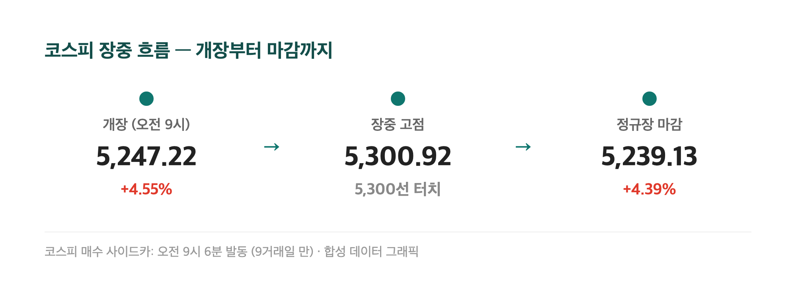
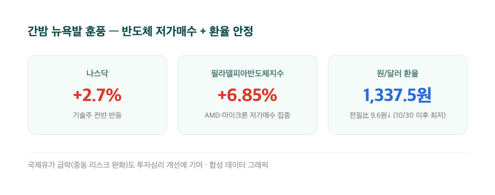
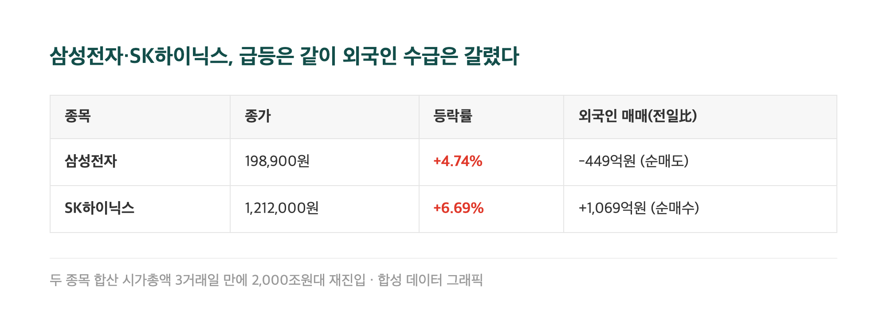
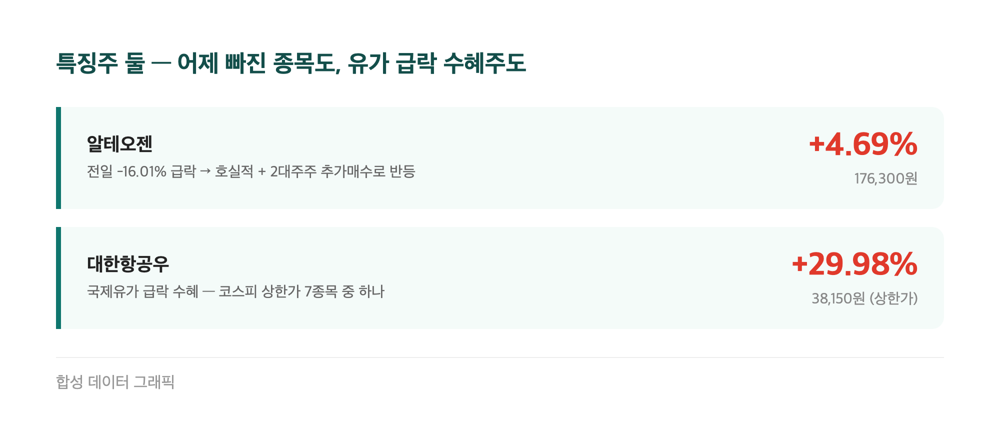
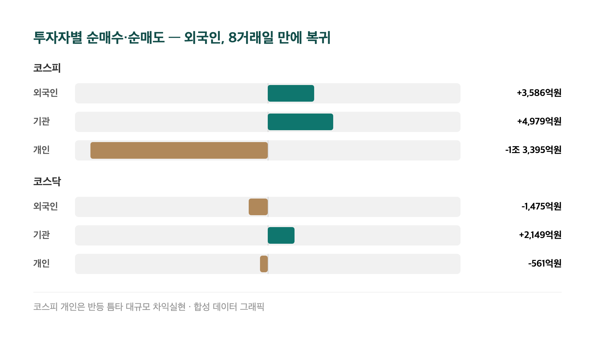

# [내일도 주린이] 코스피 4.39% 급등, 매수 사이드카까지 떴다…오늘 국장 정리 (11/10)

코스피가 오늘 하루 만에 +4.39% 올라 5,239.13에 마감했어요. 지난 3거래일(11/5, 11/6, 11/9) 동안 쌓인 하락분을 거의 다 걷어낸 숫자입니다. 저도 삼성전자 25주 들고 있는 입장이라, 계좌 색깔이 통째로 바뀐 날이었어요. 오늘 무슨 일이 있었는지 차근차근 정리해볼게요.

---

## 🚀 개장부터 매수 사이드카 – 5,300선까지 찍었던 코스피

> **코스피 5,239.13 (+220.28포인트, +4.39%) / 코스닥 667.61 (+28.64포인트, +4.48%)**

| 시점 | 코스피 | 등락률 |
|---|---|---|
| 개장 (오전 9시) | 5,247.22 | +4.55% |
| 장중 고점 | 5,300.92 | - |
| 정규장 마감 | 5,239.13 | +4.39% |

장이 열리자마자 급등세가 붙으면서 오전 9시 6분 코스피 시장에 매수 사이드카(프로그램매수호가 일시효력정지)가 발동됐어요. 지난달 28일 이후 9거래일 만이라고 하니 꽤 오랜만의 일이었죠. 4분 뒤인 9시 10분엔 코스닥 시장에서도 똑같이 매수 사이드카가 떴고요. 장중엔 5,300선까지 뚫었다가 상승폭을 살짝 반납하며 5,239.13으로 마무리됐는데, 그래도 4%대 상승을 하루 종일 지켜낸 셈이니 최근 며칠과는 완전히 다른 그림이었습니다.

---

## 🌏 왜 하루 만에 분위기가 바뀌었나 – 반도체 저가매수 + 중동 리스크 완화

지난 11/6 서킷브레이커(-6.02%)를 시작으로 11/9까지 3거래일 연속 급락했던 배경, 기억하시죠. 미국 중간선거에서 민주당이 압승한 이른바 '블루 쓰나미' 이후 AI 데이터센터 투자가 지연될 거라는 공포였어요. 그 공포가 오늘에서야 제대로 꺾였습니다.

간밤 뉴욕 증시에서 나스닥이 +2.7%대, 필라델피아반도체지수(SOX)는 무려 +6.85% 급등했어요. 낙폭이 컸던 AMD·마이크론 같은 반도체주에 저가 매수세가 몰린 거죠. 여기에 트럼프 대통령이 이란과의 군사적 긴장 완화·협상 진전을 시사하는 발언을 내놓으면서 국제유가가 떨어졌고, 중동발 인플레이션 부담 우려까지 같이 누그러졌습니다. 원/달러 환율도 전 거래일보다 9.6원 내린 1,337.5원으로 마감했는데, 지난달 30일 이후 가장 낮은 수준이라고 해요. 저가매수 재료 하나만으로는 이렇게까지 안 올랐을 텐데, 환율·유가·반도체가 동시에 맞아떨어진 날이었다고 보면 될 것 같아요.

---

## 📈 삼성전자·SK하이닉스 동반 급등, 시총 2000조원대 복귀

> **삼성전자 198,900원 (+9,000원, +4.74%) / SK하이닉스 1,212,000원 (+76,000원, +6.69%)**

제가 들고 있는 삼성전자 25주도 오늘 오랜만에 플러스 구간에서 하루를 마쳤어요. 두 종목 합산 시가총액은 3거래일 만에 다시 2,000조원대를 회복했다고 합니다. 다만 외국인 수급은 종목별로 좀 갈렸는데요 — 외국인은 삼성전자를 449억원어치 팔고 SK하이닉스는 1,069억원어치 샀습니다. 같은 반도체 대형주인데도 온도차가 있었다는 거죠. 그래도 두 종목 다 오른 건 변함없으니, 오랜만에 계좌 열어보기가 덜 무서웠던 하루였습니다.

---

## 🤔 그런데 정작 엔비디아는 하락했다 – 젠슨 황 리스크

재밌는 반전이 하나 있는데요, 오늘 국장을 끌어올린 미국 반도체 훈풍의 주인공은 엔비디아가 아니었어요. 같은 날 밤 뉴욕 증시에서 엔비디아 주가는 오히려 -4.27% 하락했거든요(178.67달러, 시총 약 260조원 증발). 이유도 실적이나 규제가 아니라 젠슨 황 CEO 개인 이슈였습니다 — 황 CEO가 중국 정보기관과의 연관 의혹이 제기된 여성 기업인과의 불륜 관계를 인정했고, 엔비디아 이사회가 외국 정보기관과의 연관성 여부를 직접 조사하겠다고 밝혔어요. 미국 로젠 로펌은 엔비디아와 황 CEO를 상대로 증권법 위반 집단소송까지 제기한 상태고요.

다만 이 악재가 반도체 업종 전체로 번지지는 않았어요. AMD·마이크론 같은 다른 반도체주가 저가 매수세를 받으며 오히려 지수를 끌어올렸으니, "엔비디아 혼자만의 악재"로 끝난 셈이죠. 전문가들도 이사회가 황 CEO에 대한 신뢰를 유지하고 있어 사임까지 가진 않을 거라고 보는 분위기였습니다.

---

## 💊✈️ 특징주 둘 – 알테오젠은 하루 만에 반등, 항공주는 상한가

> **알테오젠 176,300원 (+7,900원, +4.69%) / 대한항공우 38,150원 (+29.98%, 상한가)**

어제(11/9) 미국 약가협상 규정과 유럽 특허분쟁 이슈로 -16.01%까지 빠졌던 알테오젠이 오늘은 +4.69%로 반등했어요(장중 고가 181,900원, 저가 168,400원). 회사가 3분기 매출 1,198억원·영업이익 789억원이라는 호실적을 발표한 데다, 2대주주인 형인우 스마트앤그로스 대표가 이틀간 자사주 27,000주(약 46억원)를 추가 매수한 게 "어제는 과도하게 빠졌다"는 인식을 만든 것 같아요. 한편 국제유가 급락의 수혜를 받은 항공주는 아예 상한가로 직행했는데요, 대한항공우(+29.98%)·진에어(+29.92%)를 비롯해 코스피에서만 7개 종목이 상한가를 찍었습니다. 하락 재료였던 유가가 이렇게 다른 업종엔 반등 재료가 되는 걸 보면, 시장이란 게 참 퍼즐 같다는 생각이 듭니다.

---

## 💰 외국인, 7거래일 연속 순매도 끝에 돌아왔다

| 시장 | 외국인 | 기관 | 개인 |
|---|---|---|---|
| 코스피 | +3,586억원 | +4,979억원 | -1조 3,395억원 |
| 코스닥 | -1,475억원 | +2,149억원 | -561억원 |

외국인이 코스피에서 11/9까지 이어오던 7거래일 연속 순매도를 끝내고 8거래일 만에 순매수로 돌아왔어요(기사마다 "7거래일 연속 순매도 끝" 또는 "8거래일 만의 전환"으로 표현이 다른데, 마지막 순매수일로부터 8거래일째에 다시 산 거라 결국 같은 얘기예요). 재밌는 건 코스피에서 개인이 오늘 1조 3천억원 넘게 팔았다는 거예요. 반등 틈타 차익실현에 나선 거겠죠. 코스닥에서는 거꾸로 외국인이 팔고 기관이 받아내는 모양새였고요. 지수는 양쪽 다 급등했지만, 그 안에서 누가 팔고 누가 샀는지를 보면 하루짜리 축제로 끝날지 아닐지에 대한 힌트가 좀 더 보이는 것 같아요.

---

## 마무리하며

오늘 코스피는 +4.39%(5,239.13), 코스닥은 +4.48%(667.61)로 마감하면서 지난 3거래일의 급락분을 거의 되돌렸습니다. 반도체 저가매수, 중동 리스크 완화, 외국인 복귀까지 겹친 날이었는데요.

다만 오늘 하루로 모든 공포가 해소됐다고 보긴 아직 이른 것 같아요. 엔비디아發 노이즈가 어떻게 흘러갈지, 개인이 던진 물량을 외국인이 계속 받아줄지는 더 지켜봐야 할 것 같습니다. 일단 오늘 밤은 오랜만에 발 뻗고 잘 수 있을 것 같네요 🙌
