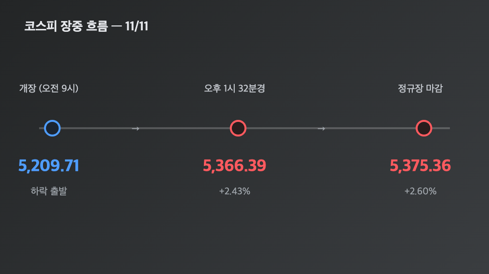
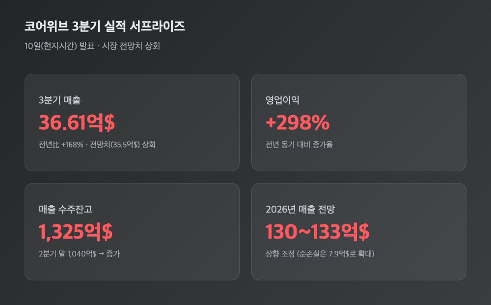
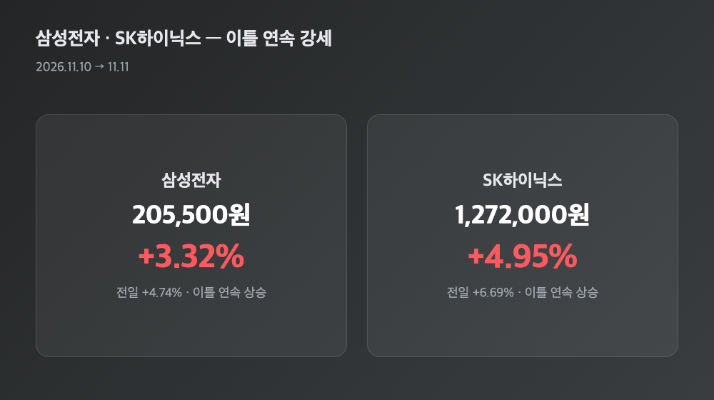
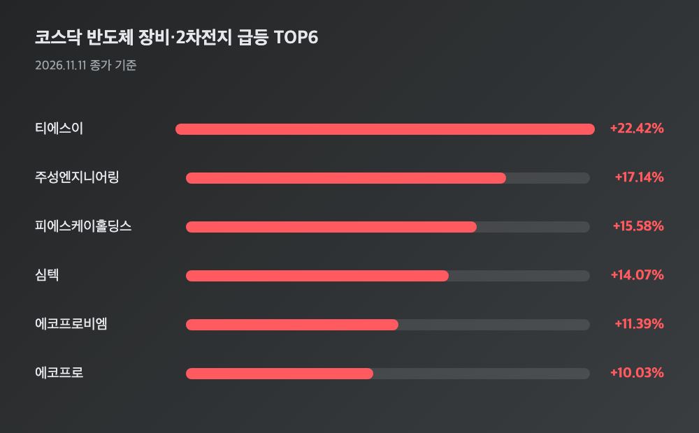

# [내일도 주린이] 코스닥 이틀 연속 매수 사이드카, 코스피는 5,375선…오늘 국장 정리 (11/11)

코스닥 700선. 이틀 연속 매수 사이드카. 오늘 국장은 이 두 줄로 요약이 됩니다. 어제(11/10) 급반등이 하루짜리 반짝 이벤트로 끝나지 않고, 오늘도 코스피·코스닥 둘 다 더 올랐어요. 저도 삼성전자 25주 들고 있는 입장이라 이틀 연속 계좌가 초록불인 게 아직 좀 낯섭니다. 오늘 뭐가 있었는지 정리해볼게요.

---

## 🇰🇷 하락 출발했다가 상승 전환 – 코스피 5,375선, 코스닥 700선 탈환

> **코스피 5,375.36 (+136.23포인트, +2.60%) / 코스닥 705.10 (+37.49포인트, +5.62%)**

| 구분 | 수치 |
|---|---|
| 코스피 개장 | 5,209.71 (하락 출발) |
| 오후 1시32분경 | 5,366.39 (+2.43%) |
| 코스피 종가 | 5,375.36 (+2.60%) |
| 코스닥 종가 | 705.10 (+5.62%) |

재밌는 건 오늘 코스피가 하락으로 문을 열었다는 거예요. 5,209.71로 시작했다가 오전 중 상승 전환하더니 오후까지 오름폭을 계속 키워나갔습니다. 코스닥은 아예 처음부터 더 세게 올랐고요, 오전 11시 28분 44초엔 코스닥150 선물·현물이 각각 +6.06%, +6.19%까지 오르면서 프로그램매수호가 일시효력정지(매수 사이드카)가 또 발동됐어요. 어제도 코스닥에서 사이드카가 떴었으니 이틀 연속입니다(올해 38번째). 코스피에서는 오늘 사이드카가 안 떴는데, 어제는 코스피·코스닥 둘 다 떴었거든요 — 코스닥 쪽 과열이 하루 더 이어졌다고 보면 될 것 같아요.

---

## 🤖 반등이 이틀째 이어진 이유 – 코어위브 깜짝 실적, 앤스로픽 상장 기대

어제 반등의 재료가 "반도체 저가매수 + 중동 리스크 완화"였다면, 오늘은 미국 AI 클라우드 인프라 기업 코어위브가 쐐기를 박았어요. 10일(현지시간) 장 마감 후 발표한 3분기 매출이 36억6,100만달러(약 4조9,200억원)로 시장 전망치(35억5,000만달러)를 웃돌았고, 전년 대비로는 +168%나 늘었습니다. 영업이익은 +298%, 수주잔고도 2분기 말 1,040억달러에서 1,325억달러로 불어났고요. 2026년 연간 매출 전망치까지 상향 조정했습니다(다만 순손실은 7억9,000만달러로 더 커졌어요).

여기에 앤스로픽 나스닥 상장을 앞두고 수요가 탄탄하다는 소식까지 겹치면서, 직전까지 시장을 짓눌렀던 "AI 투자 둔화·데이터센터 규제" 공포가 상당 부분 걷혔다는 평가가 나왔어요. 반도체 수요 자체가 꺾인 게 아니라 투자 시점·지역이 조정되는 정도라는 재평가인 셈입니다. 어제는 "일단 너무 빠졌으니 반등"이었다면, 오늘은 그 반등에 실적이라는 근거가 붙은 날이라고 봐도 될 것 같아요.

---

## 😵 그런데 엔비디아는 이틀째 더 떨어졌습니다

어제 글에서 "엔비디아 혼자만의 악재"라고 썼는데, 오늘 보니 그 악재가 하루 만에 끝난 게 아니었어요. 11/9 밤 -4.27%에 이어 11/10 밤(현지시간)에도 엔비디아가 추가로 5.47% 더 빠져서 168.89달러까지 내려갔습니다. 이틀 누적 하락률이 9.6~9.8%, 이틀간 증발한 시가총액만 약 4,300억달러(약 540조원)예요. 장중엔 6% 넘게 빠지면서 시가총액 기준 3위로 밀려나기도 했고, 4조달러선도 흔들렸습니다.

발단은 젠슨 황 CEO의 불륜 스캔들인데, 상대가 중국 정보기관과 연계 의혹이 있는 사업가라는 게 알려지면서 수출 규제 대상 AI 반도체의 중국 유입 의혹으로까지 번졌어요. 이사회가 독립 조사에 들어갔고 FBI 조사 여부도 거론되는 중이고, 로젠 로펌의 증권법 위반 집단소송도 진행 중입니다. 그런데도 오늘 국내 반도체·AI 관련주 반등 흐름 자체는 안 꺾였어요 — 코어위브라는 업종 전체 호재가 엔비디아 개별 이슈를 덮어버린 모양새입니다. "이 정도면 전염될 법도 한데" 싶었는데, 실제로는 안 그랬네요.

---

## 📈 삼성전자·SK하이닉스 – 이틀 연속 동반 강세

> **삼성전자 205,500원 (+3.32%) / SK하이닉스 1,272,000원 (+4.95%)**

어제(삼성전자 +4.74%, SK하이닉스 +6.69%)에 이어 오늘도 둘 다 올랐어요. 제 25주짜리 계좌도 이틀 연속 플러스를 보고 있는데, 어제보다 상승폭은 둔화됐어도 "또 올랐다"는 사실 자체가 주는 안도감이 있더라고요. 오후 들어 반도체 수출 호조 소식이 전해지면서 두 종목에 추가로 온기를 더했다는 평가도 나왔습니다.

---

## 🔋 코스닥 특징주 – 반도체 장비·2차전지 두 자릿수 급등 속출

| 종목 | 등락률 |
|---|---|
| 티에스이 | +22.42% |
| 주성엔지니어링 | +17.14% (178,400원) |
| 피에스케이홀딩스 | +15.58% |
| 심텍 | +14.07% |
| 에코프로비엠 | +11.39% (91,900원) |
| 에코프로 | +10.03% (73,500원) |

이오테크닉스(+8.43%), 레인보우로보틱스(+7.08%), 리노공업(+7.00%), 알테오젠(+4.08%, 전날 급반등 뒤 추가 상승) 같은 종목들도 줄줄이 올랐어요. 오늘 코스닥은 상승 종목이 1,278개로 하락 종목(399개)을 압도했습니다 — 몇몇 대장주만 튄 게 아니라 전반적으로 폭넓게 올랐다는 뜻이에요.

---

## 💱 수급과 환율 – 외국인 코스피 이틀째 매수, 원화도 4거래일째 강세

**코스피**
| 투자자 | 순매수·순매도 |
|---|---|
| 외국인 | +6,588억~7,761억원 (순매수, 소스별 차이) |
| 기관 | -4,216억~4,823억원 (순매도) |
| 개인 | -7,151억~8,931억원 (순매도) |

**코스닥**
| 투자자 | 순매수·순매도 |
|---|---|
| 기관 | +3,135억~3,180억원 (순매수) |
| 개인 | -1,856억~2,254억원 (순매도) |
| 외국인 | -1,032억~1,319억원 (순매도) |

(※ 기사마다 집계 금액이 조금씩 다른데, 방향성과 순위는 두 소스 다 동일해서 그대로 병기했어요.) 코스피에서는 어제 8거래일 만에 순매수로 돌아선 외국인이 오늘도 사자를 이어갔어요. 그런데 개인은 이틀째 급반등을 틈타 차익 실현에 나섰습니다 — 어제도 -1조3,395억원 순매도였으니, "지수는 오르는데 개인은 판다"는 그림이 이틀째 반복된 거죠. 코스닥에서는 반대로 외국인이 팔고 기관이 받아낸 게 특징이고요. 원/달러 환율은 전일 대비 3.9원 내린 1,333.6원으로 마감하며 4거래일 연속 강세·2주일여 만의 최저치를 기록했는데, 이것도 외국인 코스피 순매수 유입과 맞물린 흐름으로 풀이됩니다.

---

## 마무리하며

코스피 +2.60%(5,375.36), 코스닥 +5.62%(705.10)로 이틀 연속 상승 마감했고, 코스닥은 이틀 연속 매수 사이드카까지 떴습니다. 상승폭 자체는 어제보다 둔화됐지만, 어제 반등이 "일단 너무 빠졌으니"였다면 오늘은 코어위브 실적이라는 근거가 붙었다는 점이 다릅니다.

다만 엔비디아 리스크가 이틀째 안 꺾이고 있고, 개인이 이틀 연속 던지고 있다는 점은 계속 지켜봐야 할 것 같아요. 이 반등이 사흘째도 이어질지, 아니면 여기서 숨고르기에 들어갈지 — 내일 장 열리면 바로 답이 나오겠죠 🤞
