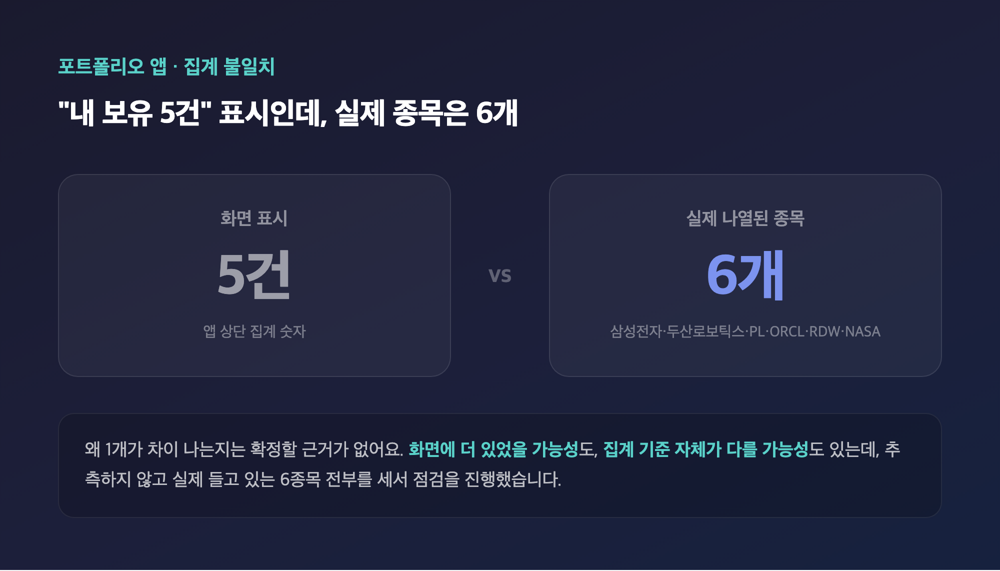
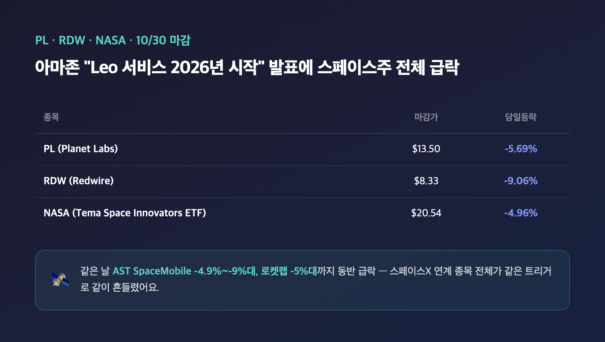
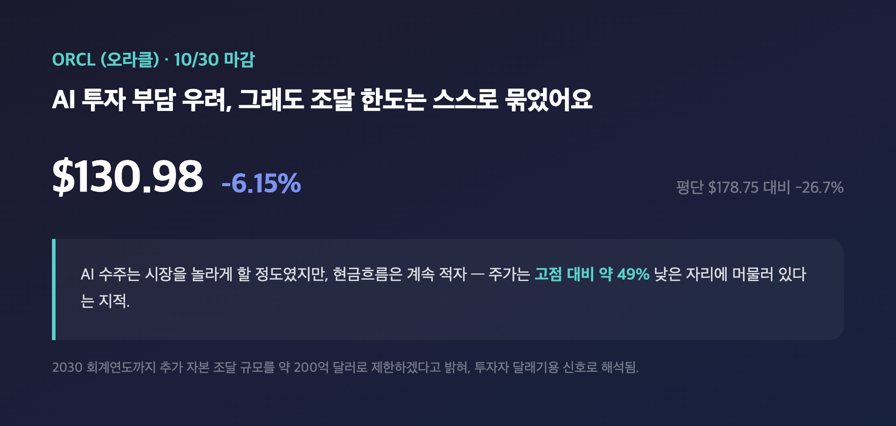
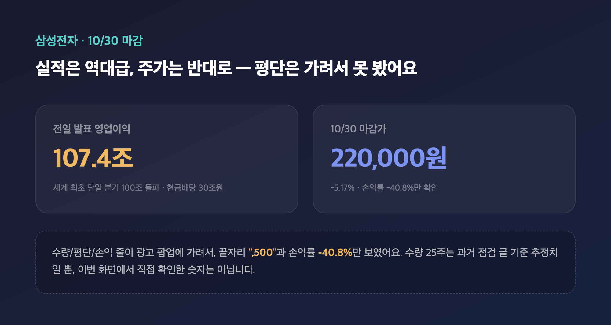
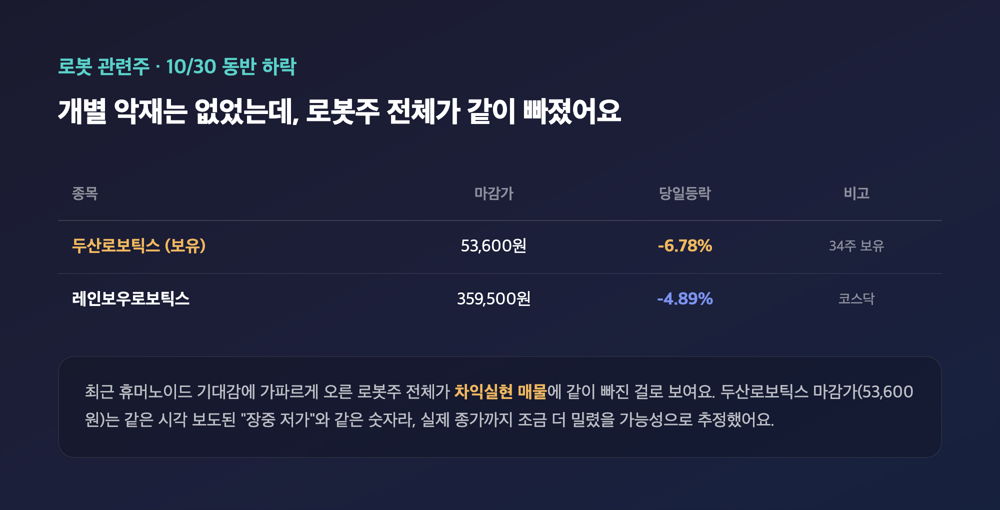
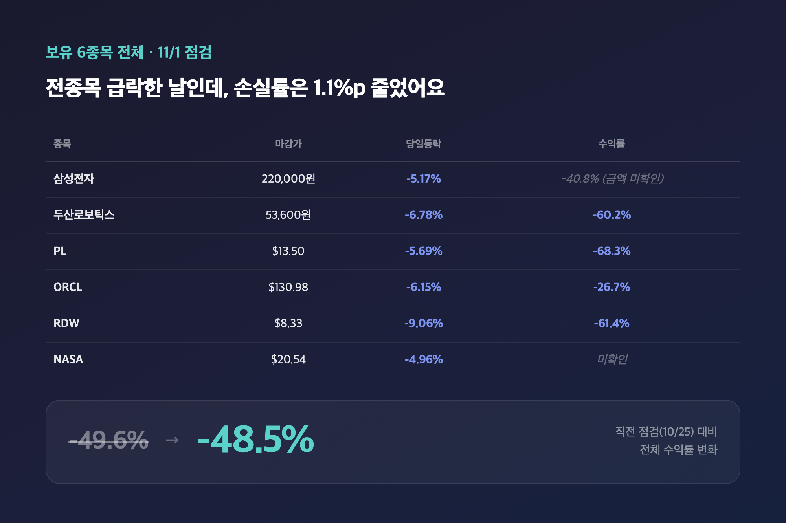

# [내일도 주린이] 포트폴리오 점검, 아마존 쇼크에 스페이스주 급락…손실률은 -48.5%로 오히려 줄었어요 (11/1)

포트폴리오 앱을 열자마자 눈에 들어온 숫자가 "내 보유 5건"이었어요. 그런데 화면을 내려보니 종목은 분명 6개가 찍혀 있더라고요. 숫자 얘기를 본격적으로 하기 전에, 오늘은 이 "5건" 먼저 짚고 넘어가야 할 것 같아요.

---

## 🧮 "보유 5건"인데 종목은 6개 — 집계부터 안 맞아요

> **누적 평가손익 -₩17,475,814 / 평가액 ₩18,577,857 / 전체 수익률 -48.5%**

| 화면 표시 | 실제 보이는 종목 수 |
|---|---|
| 내 보유 5건 | 6개 (삼성전자·두산로보틱스·PL·ORCL·RDW·NASA) |

왜 1개가 차이 나는지는 저도 모르겠어요. 화면을 더 내리면 종목이 더 있었을 수도 있고, "건수" 집계 기준이 "종목 수"랑 다를 수도 있는데, 확정할 근거가 없어서 추측은 안 하려고요. 일단 저는 실제로 들고 있는 걸 알고 있는 6종목을 다 세서 오늘 점검을 진행할게요. 위에 적은 전체 수익률(-48.5%)은 앱이 표시한 값 그대로 쓴 거라, 이 안에 6종목이 전부 어떻게 반영돼 있는지는 저도 100% 확신은 못 해요.

---

## 🛰️ PL·RDW·NASA — 아마존 한마디에 스페이스주 전체가 와르르

> **PL $13.50 (-5.69%) / RDW $8.33 (-9.06%) / NASA $20.54 (-4.96%)**

| 종목 | 보유수량 | 평단가 | 마감가 | 당일등락 | 평가(손익) |
|---|---|---|---|---|---|
| PL (Planet Labs PBC) | 209주 | $42.64 | $13.50 | -5.69% | -$6,091.12 (-68.3%) |
| RDW (Redwire) | 5주 | $21.60 | $8.33 | -9.06% | 평가액 $41.65 (-61.4%) |
| NASA (Tema Space Innovators ETF) | — | — | $20.54 | -4.96% | 수량·평단 확인 불가 |

세 종목 다 같은 날 같은 이유로 빠졌어요. 아마존이 자체 저궤도 위성 인터넷 서비스 "Amazon Leo"가 2026년 안에 초기 서비스를 시작할 거라고 밝히면서, 스페이스X 및 스페이스X와 연결된 종목 전체에 매도세가 번졌다고 해요. 같은 날 AST SpaceMobile -4.9%~-9%대, 로켓랩 -5%대까지 동반 급락했다고 하니, 209주나 들고 있는 PL의 -68.3%도 제 종목만의 문제는 아니었던 셈이에요. RDW는 평가손익 금액 자체는 화면에 안 보이고 손익률(-61.4%)과 평가액($41.65)만 보여서, 평단 기준으로 역산하면 약 -$66.35 정도로 추정되는데 이건 제가 계산한 값이라는 걸 밝혀둘게요. NASA는 ETF답게 스페이스X·로켓랩 비중이 커서 이 흐름을 그대로 받은 걸로 보이는데, 수량·평단이 화면 아래 잘려서 안 보였던 터라 정확한 평가손익은 이번엔 못 적었어요.

---

## 💾 오라클 — AI 투자 부담 우려에 또 밀렸어요

> **ORCL $130.98 (-6.15%) / 평단 $178.75 대비 -26.7% (평가손익 -$2,030.53)**

| 보유수량 | 평단가 | 마감가 | 당일등락 | 평가손익(수익률) |
|---|---|---|---|---|
| 42.51주 | $178.75 | $130.98 | -6.15% | -$2,030.53 (-26.7%) |

AI·데이터센터 투자에 들어가는 돈이 너무 크다는 우려가 계속 주가를 눌렀다고 해요. AI 수주 자체는 시장이 놀랄 정도로 좋았는데, 현금흐름은 계속 적자를 내고 있다 보니 고점 대비 약 49% 낮은 가격에서 거래되고 있다는 지적도 있었어요. 그나마 오라클이 2030 회계연도까지 추가 자본 조달 규모를 약 200억 달러로 제한하겠다고 밝힌 건 투자자 달래기용 긍정적 신호로 해석되더라고요. 저는 42.51주라는 애매한 수량을 보면서 "분할매수하다가 이렇게 끝자리가 남았나" 싶었는데, 클라우드 수주 잔고는 계속 늘고 있다니 당장 팔 생각은 없어요.

---

## 🇰🇷 삼성전자 — 107조 실적 발표 다음 날인데 평단은 못 봤어요

> **삼성전자 ₩220,000 (-5.17%) / 손익률 -40.8%만 확인, 평단·정확한 손익금액은 미확인**

| 항목 | 확인된 값 | 비고 |
|---|---|---|
| 마감가 | ₩220,000 | -5.17% |
| 손익률 | -40.8% | 화면에 보임 |
| 수량 | 25주 (추정) | 과거 점검 글들 기준, 이번 화면에서 직접 확인은 못함 |
| 평단가 / 정확한 평가손익 금액 | 확인 불가 | 광고 팝업에 가려서 끝자리 ",500"만 보이고 나머지는 못 봄 |

솔직히 이번엔 숫자를 다 못 가져왔어요. 삼성전자 수량/평단/손익 줄이 광고 토스트 팝업에 걸려서, 끝자리 ",500"이랑 손익률 -40.8%만 겨우 보였거든요. 수량은 제가 그동안 계속 25주라고 적어왔던 걸 참고한 추정치일 뿐이라, 이번 화면에서 직접 숫자를 센 게 아니라는 점 분명히 밝혀둘게요. 하락 배경은 뚜렷해요 — 바로 전날 삼성전자가 3분기 영업이익 107조 4,000억원(세계 최초 단일 분기 100조 돌파)에 현금배당 30조원까지 발표했는데도, 시장이 기대했던 추가 주주환원 세부안이 2027년 1월로 밀리고 외국인이 1조 6,000억원대를 순매도하면서 오히려 빠졌다고 해요. 실적은 역대급인데 주가는 반대로 가는 날, 들고 있는 사람 입장에서는 참 뭐라 말하기 어려운 하루였습니다.

---

## 🤖 두산로보틱스 — 로봇주 전체가 같이 빠진 하루

> **두산로보틱스 ₩53,600 (-6.78%) / 평단 134,674원 대비 -60.2% (평가손익 -2,756,516원)**

| 보유수량 | 평단가 | 마감가 | 당일등락 | 평가손익(수익률) |
|---|---|---|---|---|
| 34주 | 134,674원 | 53,600원 | -6.78% | -2,756,516원 (-60.2%) |

제가 찾은 기사에서는 같은 날 오후 3시 7분 기준 두산로보틱스가 54,000원(-6.09%, 장중 저가 53,600원)으로 보도됐더라고요. 제 앱 마감가(53,600원)는 정확히 그 "장중 저가"랑 같은 숫자인데, 실제 마감(15시 30분)까지 조금 더 밀려서 저가 근처에서 끝났을 가능성이 있어 보여요 — 완전히 같은 시각의 보도를 못 찾아서 추정으로 남겨둘게요. 뚜렷한 개별 악재는 없었고, 최근 휴머노이드 기대감에 가파르게 올랐던 로봇주 전체가 차익실현 매물에 같이 빠진 걸로 보여요. 같은 날 레인보우로보틱스도 -4.89%였다고 하니, 34주 들고 있는 저로서는 "오늘은 그냥 섹터 전체가 쉬어가는 날이었구나" 하고 넘기려고요.

---

## 📊 보유 6종목 전체 총정리 — -48.5%, 전종목 급락인데 오히려 줄었어요

> **누적 평가손익 -₩17,475,814 / 평가액 ₩18,577,857 / 전체 수익률 -48.5%**

| 종목 | 보유수량 | 평단가 | 마감가 | 당일등락 | 평가(손익/수익률) |
|---|---|---|---|---|---|
| 삼성전자 | 25주(추정) | 미확인 | 220,000원 | -5.17% | 손익률 -40.8% (금액 미확인) |
| 두산로보틱스 | 34주 | 134,674원 | 53,600원 | -6.78% | -2,756,516원 (-60.2%) |
| PL (Planet Labs) | 209주 | $42.64 | $13.50 | -5.69% | -$6,091.12 (-68.3%) |
| ORCL (오라클) | 42.51주 | $178.75 | $130.98 | -6.15% | -$2,030.53 (-26.7%) |
| RDW (Redwire) | 5주 | $21.60 | $8.33 | -9.06% | 평가액 $41.65 (-61.4%) |
| NASA (Tema Space Innovators ETF) | 미확인 | 미확인 | $20.54 | -4.96% | 미확인 |

여섯 종목 다 더한 앱 표시 값은 평가액 18,577,857원에 누적 평가손익 -17,475,814원, 전체 수익률 -48.5%예요. 직전 점검(10/25)이 -49.6%였으니 1.1%p 줄어든 거라, 이상하다고 느꼈어요. 오늘 하루만 보면 보유 종목 전부가 -5%에서 -9%대까지 동시에 빠졌는데, 2주 치 흐름으로 보면 오히려 손실률이 개선됐거든요. 아마 그 사이(10/25~10/30)에 며칠 반등 구간이 있어서 오늘 하루의 급락을 상쇄하고도 남았던 걸로 보이는데, 정확한 일별 흐름까지 전부 추적한 건 아니라 "그런 것 같다" 정도로만 적어둘게요.

---

## 마무리하며

오늘은 숫자를 다 가져오지도 못한 채(삼성전자 평단·정확한 손익 미확인) "보유 5건 vs 종목 6개"라는 집계 불일치까지 떠안은 점검이었어요. 그런데도 전체 손실률은 -49.6%에서 -48.5%로 소폭 개선됐다는 게 오늘의 제일 신기한 지점이에요.

전종목이 하루 만에 와르르 빠진 날에도 2주 단위로 보면 방향이 꼭 나쁜 쪽만은 아니라는 걸 다시 확인했어요. 다음 점검 때까지 지켜볼 건 삼성전자 평단을 제대로 캡처하는 것, 그리고 스페이스 3종목이 아마존 Leo 발 매도세에서 얼마나 회복하는지 두 가지예요.

숫자는 또 빠졌지만, 일단 계속 들고 가보겠습니다 🫠

#포트폴리오점검 #내주식포트폴리오 #두산로보틱스 #스페이스주
