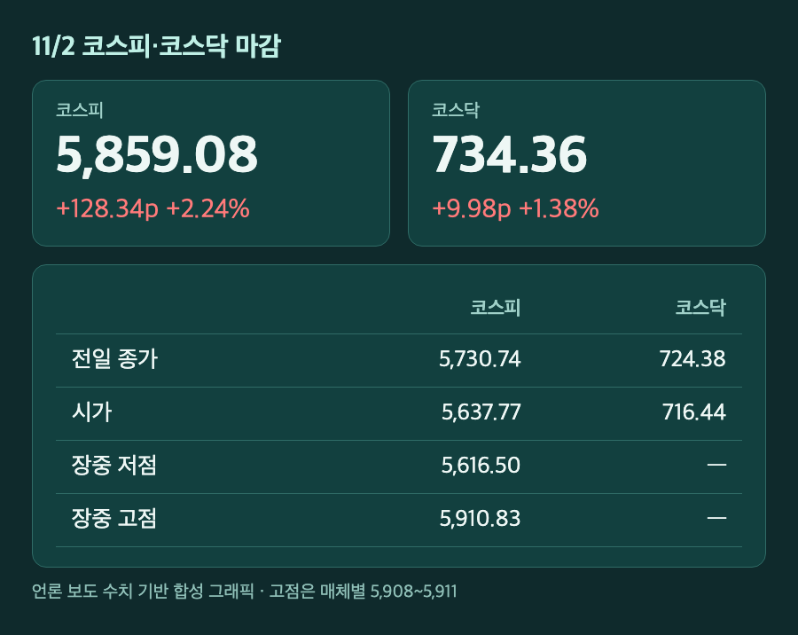
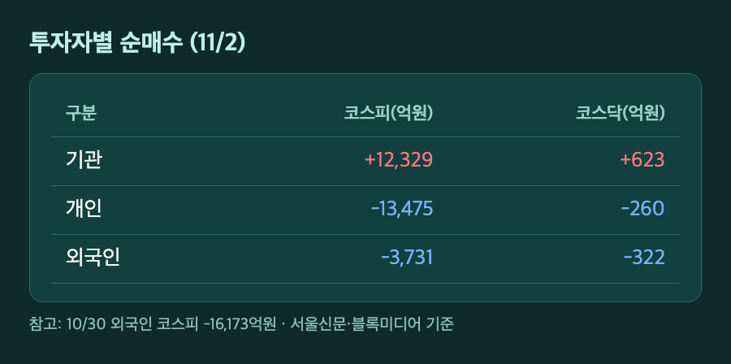
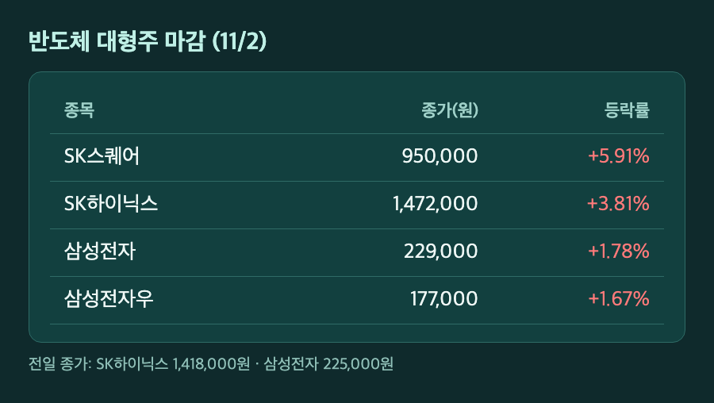
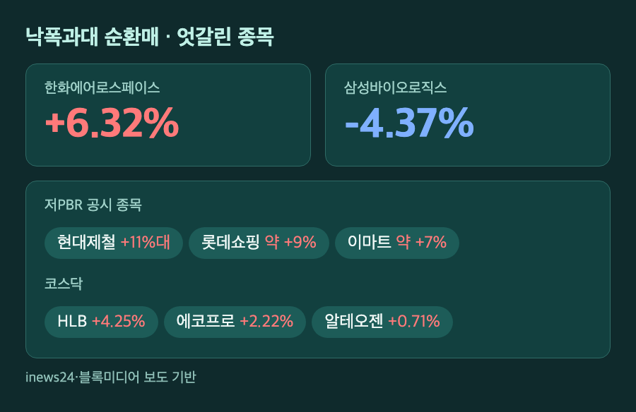

# [내일도 주린이] 코스피 2.24% 반등 5,859…기관 1.2조 매수에 SK하이닉스 3.81%↑, 삼성바이오는 -4.37% (11/2)

개장 직후 5,637. 금요일의 3.48% 급락이 월요일에도 이어지나 싶었는데, 마감 숫자는 5,859.08이었어요. 128포인트가 오른 하루였습니다.

장중 저점과 고점 차이가 300포인트 가까이 났던 날이라, 어디서 뒤집혔는지부터 순서대로 정리해볼게요.

---

## 📈 5,616에서 5,910까지 – 시가 -1.62%로 출발해 +2.24% 마감

> **코스피 5,859.08 (+128.34포인트, +2.24%) / 코스닥 734.36 (+9.98포인트, +1.38%)**

시가는 5,637.77(-1.62%)이었고 장중 저점은 5,616.50이었어요. 오전 10시쯤 상승으로 돌아선 뒤 5,910.83(서울신문 기준)까지 올랐습니다. 장중 고점은 블록미디어에서 5,908.14로 적어서 매체마다 조금 달랐어요.

주말 사이 미국 기술주가 전반적으로 빠져서 약하게 열릴 거라는 예상이 많았다고 해요. 그런데 금요일에 워낙 많이 빠졌다는 인식이 있었고, 그 자리에 저가 매수가 들어왔어요. 코스닥도 716.44(-1.10%)에서 출발해서 결국 올라 마감했습니다.

금요일 종가 5,730.74에서 128포인트를 되찾은 건데, 10/28 종가 6,012.44와는 아직 150포인트쯤 차이가 나요. 반등이긴 한데 원상복구까진 아닙니다.

---

## 🏦 기관 +1조 2,329억원이 받아냈다 – 개인·외국인은 동시 순매도

> **기관 +1조 2,329억원 / 개인 -1조 3,475억원 / 외국인 -3,731억원**

이날 수급은 기관 혼자 사고 나머지 둘이 판 구조예요. 코스피에서 기관이 1조 2,329억원 순매수, 개인이 1조 3,475억원, 외국인이 3,731억원 순매도였습니다. 코스닥도 비슷해서 기관 +623억원, 개인 -260억원, 외국인 -322억원이었어요.

금요일에 외국인이 1조 6,173억원을 던졌던 걸 떠올리면 매도 규모가 확 줄었어요. 대신증권 이경민 연구원은 AI 자금 조달 우려가 반도체에 이미 두 차례 선반영됐고, 외국인 매도 압력이 완화됐다고 봤어요. 반등을 끈 건 금융투자와 연기금 중심의 기관 매수라고 짚었고요.

개인이 1조 3,475억원어치를 팔았다는 게 눈에 들어와요. 저도 금요일에 "더 빠지기 전에 정리할까" 하는 생각이 들었던 사람이라, 이 숫자가 남 일 같지 않네요. 팔고 나서 오르는 건 정말 국룰입니다.

---

## 💾 SK하이닉스 +3.81%, 삼성전자 +1.78% – 하루 만에 되찾은 가격

> **SK하이닉스 1,472,000원 (+3.81%) / 삼성전자 229,000원 (+1.78%) / SK스퀘어 +5.91%**

SK하이닉스는 금요일 1,418,000원에서 1,472,000원이 됐어요. 5만 4,000원이 하루에 돌아온 셈이에요. SK스퀘어는 5.91% 올라 950,000원, 삼성전자우는 1.67% 올라 177,000원에 마감했습니다.

저는 삼성전자 25주를 들고 있는데요, 225,000원에서 229,000원이 됐으니 하루 평가액이 10만원 늘었어요. 4,000원 곱하기 25주. 금요일에 17만원 넘게 줄었던 걸 생각하면 반도체 한 번 오르는 날 치고는 소박합니다.

상승 이유로는 연기금 매수와 함께 자사주 관련 기대가 거론됐어요. 다만 소스마다 말이 달라요. 서울신문은 삼성전자의 주주환원 확대·자사주 매입·소각 방침을 언급했고, 글로벌이코노믹은 SK하이닉스 자사주 매입을 꼽았어요. 어느 쪽이 맞는지 제가 확인하지 못해서 여기서는 단정하지 않고 넘어갈게요.

블록미디어는 10월 반도체 수출 호조도 상승 요인으로 꼽았어요. 10월 1~10일 잠정치로는 반도체 수출이 122억 달러(+170.9%)였는데, 10월 월간 확정치는 제가 찾지 못했습니다.

---

## 🔄 방산·저PBR로 번진 저가 매수 – 삼성바이오로직스는 -4.37%

> **한화에어로스페이스 +6.32% / 현대제철 +11%대 / 삼성바이오로직스 -4.37%**

반등이 반도체에만 있었던 건 아니에요. 신한투자증권 강진혁 선임연구원은 연기금과 금융투자, 기타법인 매수가 지수를 받쳤고, 낙폭이 컸던 조선·방산·전력 인프라 업종으로도 저가 매수가 번졌다고 분석했어요. 한화에어로스페이스가 +6.32%였습니다.

저PBR 공시 종목도 강했어요. 현대제철이 11% 넘게, 롯데쇼핑이 약 9%, 이마트가 약 7% 올랐다고 합니다. 밸류에이션 개선 기대가 붙은 거라고 해요.

반대편에는 삼성바이오로직스가 있었어요. -4.37%로 1,422,000원에 마감했습니다. 하락 이유는 제가 본 기사들에 적혀 있지 않았어요. KB금융 -1.35%(153,400원), LG에너지솔루션 -0.97%도 내렸고요. 코스닥에서는 HLB +4.25%, 에코프로 +2.22%, 알테오젠 +0.71%였습니다.

원/달러 환율은 1,344원 안팎에서 마감했어요(서울신문 1,343.8원, 블록미디어 1,344.0원으로 0.2원 차이가 있어요). 전일 대비 8.2원 오른 수준이라고 합니다.

---

## 마무리하며

코스피 5,859.08(+2.24%), 코스닥 734.36(+1.38%). 기관 1조 2,329억원이 받아낸 하루였고, 외국인은 3,731억원 팔았지만 금요일보다는 훨씬 조용했어요.

앞으로 볼 건 세 가지예요. 외국인이 순매수로 돌아서는지, 미국 AI 기업들의 투자 수익성 우려가 다시 번지는지, 그리고 SK하이닉스가 1,472,000원을 지키는지. 6,000선 복귀는 그다음 얘기겠죠 🙌
