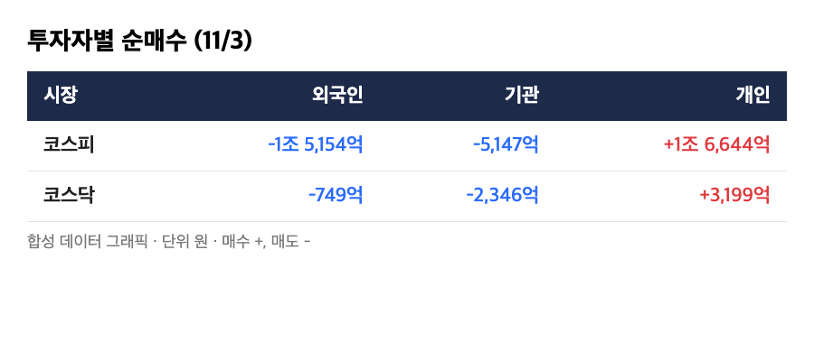
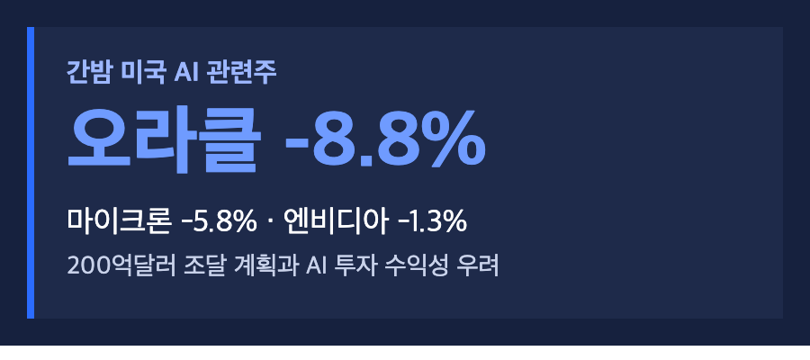
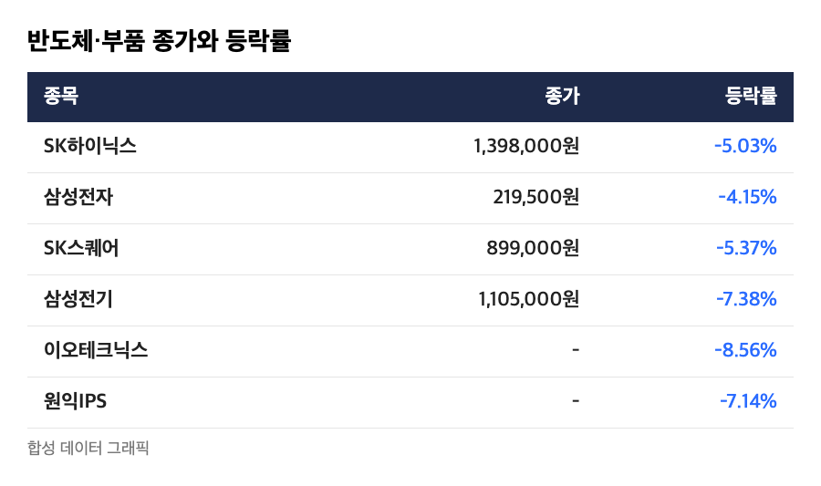
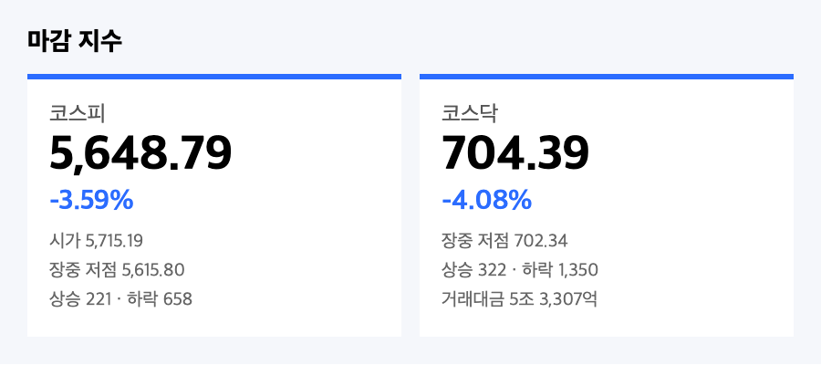
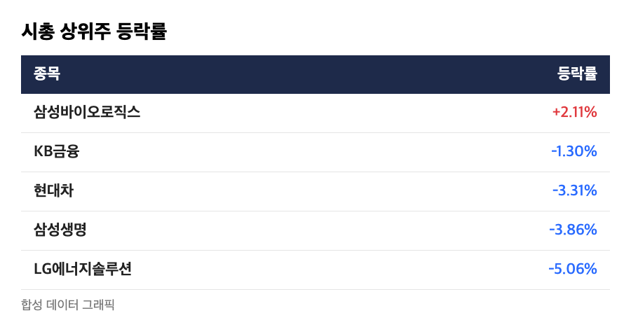

# [내일도 주린이] 코스피 3.59% 급락 5,648…반등 하루 만에 반납, 코스닥은 700선 턱밑 (11/3)

월요일에 되찾은 128포인트, 화요일에 어디까지 돌려줬을까요? 답은 전부, 그리고 조금 더였습니다. 5,859.08이던 코스피가 5,648.79가 됐어요.

외국인 매도, 미국발 AI 수익성 걱정, 개인 1조 6,644억원 순매수까지 순서대로 정리해볼게요.

---

## 🏦 외국인 -1조 5,154억원, 개인 +1조 6,644억원 – 이번엔 기관도 같이 팔았다

> **외국인 -1조 5,154억원 / 기관 -5,147억원 / 개인 +1조 6,644억원 (코스피)**

어제는 기관이 혼자 받아냈는데, 오늘은 외국인과 기관이 같이 팔았어요. 코스피에서 외국인이 1조 5,154억원, 기관이 5,147억원을 순매도했고 개인이 1조 6,644억원을 사서 버텼습니다. 프로그램 매매도 전체 -1조 1,052억원이었고, 대부분이 비차익(-1조 1,626억원)이었어요.

코스닥도 같은 그림이에요. 외국인 -749억원, 기관 -2,346억원, 개인 +3,199억원이었습니다.

월요일에 개인이 1조 3,000억원 넘게 팔았던 걸 떠올리면, 팔았다가 다시 사는 쪽이 오늘의 개인이었던 셈이에요. 저는 어제 반등을 보고 "이제 바닥이겠지" 하고 넘어갔던 쪽인데요, 그 생각은 하루도 못 갔네요.

---

## 🇺🇸 AI 투자 돈값 논쟁 – 오라클 -8.8%, 마이크론 -5.8%

> **오라클 -8.8% / 마이크론 -5.8% / 엔비디아 -1.3% (간밤 미국장)**

글로벌이코노믹에 따르면 오라클이 200억달러 규모 조달 계획을 내놓은 뒤 8.8% 떨어졌고, 마이크론은 5.8%, 엔비디아는 1.3% 내렸어요. 미국 중간선거를 앞둔 경계감도 같이 거론됐습니다.

iM증권 양현경 연구원은 AI 인프라 수요 자체는 유효하다고 봤어요. 다만 대규모 투자로 늘어나는 부채와 지분 희석에 시장이 민감하게 반응하고 있어서, 단기적으로 국내 반도체와 관련주에 부담이라고 했습니다.

벌어서 쓰는 게 아니라 빌려서 쓰는 모양새가 보이면 주가가 먼저 반응한다는 얘기죠. 이 이야기는 지난주 알파벳 때와 결이 같아요.

---

## 📉 SK하이닉스 -5.03%, 삼성전기 -7.38% – 반도체와 부품주가 앞장섰다

> **SK하이닉스 1,398,000원 (-5.03%) / 삼성전자 219,500원 (-4.15%)**

SK하이닉스는 어제 1,472,000원에서 1,398,000원으로 7만 4,000원 빠졌어요. 거래대금이 3조 1,047억원으로 삼성전자(2조 8,462억원)보다 많았습니다. SK스퀘어 -5.37%(899,000원), 삼성전기 -7.38%(1,105,000원), 삼성전자우 -3.05%(171,600원)도 같이 내렸고요.

장비·부품은 낙폭이 더 컸어요. 이오테크닉스 -8.56%, 주성엔지니어링 -7.68%, 원익IPS -7.14%, 심텍 -6.73%, 리노공업 -6.14%였습니다. LG에너지솔루션 -5.06%, 삼성생명 -3.86%, 현대차 -3.31%, KB금융 -1.30%도 파란색이었어요.

저는 삼성전자 25주를 들고 있는데요, 어제 229,000원에서 9,500원 빠졌으니 하루 평가액이 23만 7,500원 줄었어요. 어제 늘었던 10만원의 두 배 넘게 돌려준 거네요.

---

## 🔻 코스닥 -4.08%, 704.39 – 하락 종목 1,350개

> **코스닥 704.39 (-29.97포인트, -4.08%) / 코스피 5,648.79 (-210.29포인트, -3.59%)**

코스피는 5,715.19(-2.46%)로 시작해 장중 5,615.80까지 내려갔다가 5,648.79에 마감했어요. 코스닥 장중 저점은 702.34로, 700선 바로 위에서 멈췄습니다.

코스피는 상승 221개 대 하락 658개, 코스닥은 상승 322개 대 하락 1,350개였어요. 거래대금은 코스피 14조 894억원, 코스닥 5조 3,307억원이고요. 코스닥에서는 에코프로 -4.88%, 에코프로비엠 -4.89%였습니다.

비교해 보면 10/28 종가 6,012.44보다 약 6.05% 낮아요(제가 계산한 값이에요). 금요일 종가 5,730.74도 밑돌아서, 이번 흐름에서 가장 낮은 마감이 됐습니다.

---

## 💊 삼성바이오로직스 +2.11% – 혼자 올랐지만 이유는 못 찾았어요

시가총액 상위주 가운데 삼성바이오로직스만 +2.11%, 1,452,000원으로 올랐어요. 올라온 기사들은 상승 배경을 따로 적지 않았습니다. 그래서 이유는 모른다고 적어둘게요.

원/달러 환율은 15시 30분 기준 1,341.0원으로 전일 주간 종가보다 2.8원 내렸다고 합니다. 환율은 마감 확정치를 한 곳에서만 확인했어요.

---

## 마무리하며

코스피 5,648.79(-3.59%), 코스닥 704.39(-4.08%). 월요일의 반등분을 하루 만에 지웠고, 오늘 숫자는 금요일 저점보다도 낮아요.

볼 건 세 가지예요. 외국인 순매도가 이어지는지, 오늘 밤 미국 AI 관련주 흐름, 그리고 코스닥 700선. 일단 오늘은 계좌를 덜 열어보기로 합니다.
