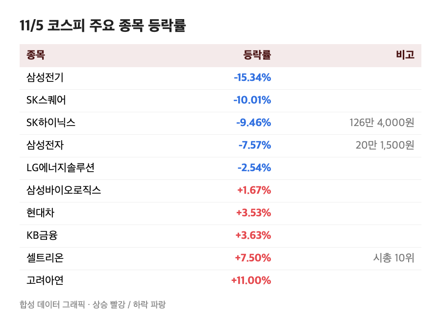
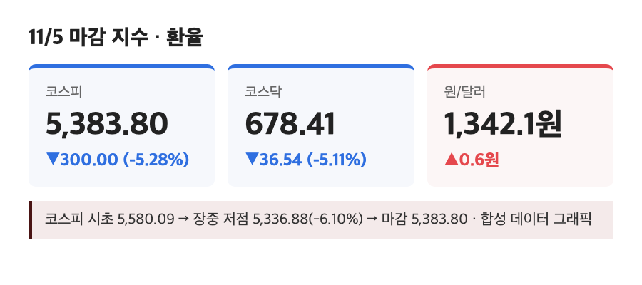
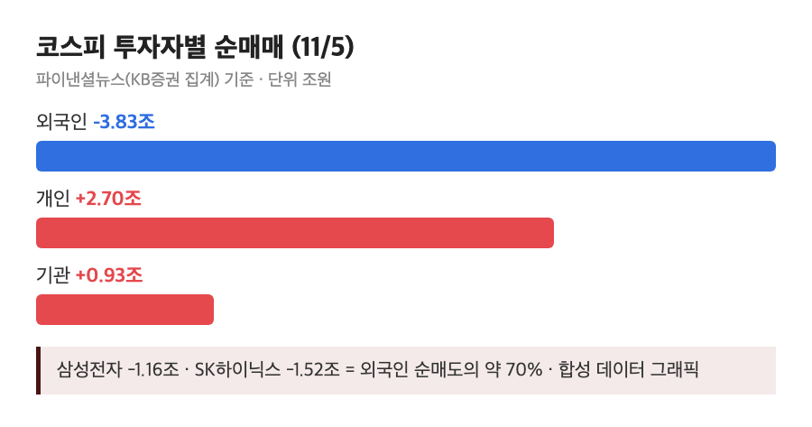

# [내일도 주린이] 코스피 5%대 급락 5,383…사이드카 두 번 터진 날, 외국인 5일째 순매도 (11/5)

삼성전자 20만 1,500원. 어제 218,000원이었으니까 25주 들고 있는 저는 하루 만에 41만 2,500원이 증발했네요. 계산기 두드리다가 그냥 덮었습니다. 오늘 장 순서대로 정리해볼게요.

---

## 🔌 삼성전자 -7.57%, SK하이닉스 -9.46% – 코스피를 끌어내린 두 종목

> **삼성전자 20만 1,500원 (-7.57%) / SK하이닉스 126만 4,000원 (-9.46%)**

오늘 낙폭의 대부분은 이 두 종목이 만들었어요. 외국인이 삼성전자를 1조 1,626억원, SK하이닉스를 1조 5,203억원어치 팔았는데, 이 둘이 코스피 전체 외국인 순매도의 약 70%였다고 해요(파이낸셜뉴스). 삼성전자는 장중에 20만원 선도 깨졌고요. 삼성전기는 -15.34%, SK스퀘어는 -10.01%였어요.

그런데 전부 빠진 건 아니었어요. 셀트리온이 +7.50%로 시가총액 10위에 들어왔고, KB금융 +3.63%, 현대차 +3.53%, 카카오 +10.65%, 네이버 +8.26%, 고려아연 +11.00%가 올랐습니다. 반도체에서 빠진 돈이 일부는 다른 데로 옮겨 탄 모양새예요. 저는 반도체밖에 안 들고 있어서 구경만 했지만요.

## 📉 코스피 5,383.80 – 5,400선이 무너진 하루

> **코스피 5,383.80 (-300.00포인트, -5.28%) / 코스닥 678.41 (-36.54포인트, -5.11%)**

코스피는 5,580.09로 출발할 때부터 -1.82%였고, 장중 저점은 5,336.88(-6.10%)까지 갔어요. 코스닥은 종가 기준으로 7월 30일 이후 처음 600대로 내려왔고요. 환율은 1,342.1원으로 0.6원 올라 거의 그대로였으니, 환율이 아니라 순수하게 주식 쪽 이슈였던 날입니다.

원인으로는 미국 중간선거 결과가 꼽혔어요. 데이터센터 건설이 몰린 텍사스와 조지아에서 민주당 후보가 이기면서 AI 데이터센터 규제가 세질 거라는 걱정이 커졌고, 어제 뉴욕에서 필라델피아반도체지수가 3% 넘게 빠진 것도 겹쳤다고 해요(한국경제TV). 다만 미국 증시 반응은 매체마다 서술이 달라서, 저는 "규제 우려로 외국인이 반도체를 팔았다"까지만 믿고 적어둘게요.

## 🚨 사이드카 두 번 – 10시 16분 코스피, 2시 27분 코스닥

> **코스피 매도 사이드카 10:16 / 코스닥 매도 사이드카 14:27 (코스닥150 선물 -6.07%)**

사이드카는 선물이 급락하면 프로그램 매도 호가 효력을 5분간 멈추는 장치인데요. 오전엔 코스피에서, 오후엔 코스닥에서 따로따로 발동됐어요. 오전에 한 번 터지고 끝난 게 아니라 오후에 코스닥까지 번졌다는 점이 오늘 분위기를 보여주는 것 같아요. 화면에 파란불이 가득한데 사이드카 알림까지 뜨면 손이 저절로 매도 버튼 근처로 가더라고요. 오늘은 참았습니다.

## 💸 외국인 5거래일 연속 순매도 – 3조원대를 개인이 받았다

> **외국인 -3조 8,316억원 / 개인 +2조 6,978억원 / 기관 +9,348억원 (코스피, KB증권 집계)**

외국인 순매도 규모는 소스마다 달랐어요. 파이낸셜뉴스(KB증권 집계)는 3조 8,316억원, 다른 매체는 3조 3,928억원으로 적었는데, 집계 기준 차이로 보여요. 그래서 "3조원 중후반대"로 이해하시면 될 것 같고, 위 박스는 파이낸셜뉴스 숫자입니다. 어느 쪽이든 개인이 2조원 넘게, 기관이 8천억~9천억원대로 받아냈다는 방향은 같아요.

업종은 의료·정밀기기 -11.48%, 전기·전자 -8.53%, 기계·장비 -5.36%가 크게 빠졌고, 반대로 제약 +4.12%, 통신 +2.44%, 음식료·담배 +2.40%는 올랐습니다. 코스닥에서는 주성엔지니어링 -12.21%, 심텍 -17.97%, 이오테크닉스 -16.21% 같은 반도체 소부장이 낙폭을 키웠어요.

KB증권 임정은 연구원은 외국인 수급이 개선되는지가 지수 방향의 관건이라고 봤고, 대신증권 이경민 연구원은 5,200선 지지 여부와 외국인 매도 진정, 반도체 투자심리 회복을 지켜볼 지점으로 꼽았다고 해요.

---

## 마무리하며

코스피 5,383.80(-5.28%), 코스닥 678.41(-5.11%), 외국인 순매도 5일째. 숫자 하나로 요약하면 삼성전자 -7.57%입니다.

내일 볼 건 세 가지예요. 5,200선이 버텨주는지, 외국인 순매도가 줄어드는지, 그리고 AI 데이터센터 규제 얘기가 말뿐인지 실제 발주 변화로 이어지는지. 오늘은 계좌를 안 열어보는 게 정신건강에 좋을 것 같아요. 😮‍💨
