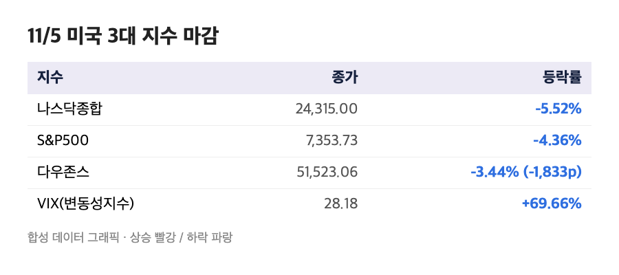
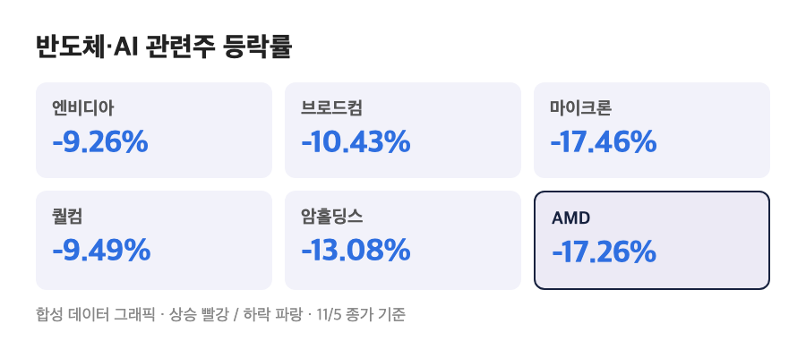
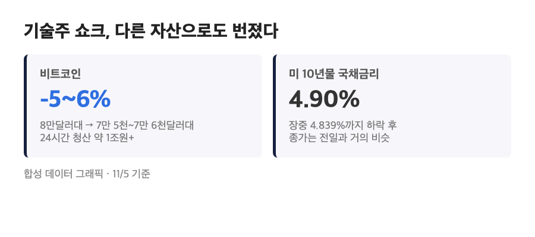

# [내일도 주린이] 나스닥 5.52% 급락, 다우 1,800p 빠졌다…반도체발 AI 밸류에이션 쇼크, 오늘 미장 정리 (11/5)

엔비디아 -9.26%, 브로드컴 -10.43%, 마이크론 -17.46%. 숫자만 나열해도 반도체 섹터에 무슨 일이 난 건가 싶은데요, 오늘(11/5, 목) 미국 정규장이 딱 이런 하루였어요. 삼성전자 25주 들고 있는 저로서는 내일 국장 열리면 어디부터 긁힐지 각오하고 오늘 미장 정리해볼게요.

---

## 📉 나스닥 24,315 – 하루 만에 correction 진입

> **S&P500 7,353.73 (-4.36%) / 나스닥종합 24,315.00 (-5.52%) / 다우 51,523.06 (-1,833.06포인트, -3.44%)**

S&P500은 2025년 4월 관세 충격 이후 최악의 하루였고, 나스닥은 이날로 고점 대비 10% 넘게 빠진 'correction' 구간에 들어갔어요(최근 18개월 내 최악의 하루라고 해요). 다우도 1,800포인트 넘게 빠졌으니 어느 지수를 봐도 빠져나갈 구멍이 없었던 날이에요. S&P 11개 섹터가 전부 마이너스로 마감했다고 하니, 특정 업종만 피하면 되는 수준이 아니었던 거죠. 변동성지수(VIX)는 전일 대비 69.66% 뛰어서 28.18로 마감했고, 반도체 ETF(SOXX)는 12% 넘게 빠지면서 2020년 3월 코로나 쇼크 이후 최악의 하루를 기록했어요.

바로 전날(11/4, 수)엔 장중 한때 플러스로 올라섰다가 결국 밀렸었는데, 오늘은 그 불안이 훨씬 큰 폭으로 터진 느낌이에요.

## 💥 반도체·AI주가 왜 이렇게 빠졌나

> **엔비디아 -9.26% / 브로드컴 -10.43% / 마이크론 -17.46% / 퀄컴 -9.49% / 암홀딩스 -13.08%**

원인은 지난 11/3(화) 중간선거로 거슬러 올라가요. 민주당이 상·하원을 모두 가져간 데다, 데이터센터가 많이 몰린 **텍사스·조지아 주지사 선거에서도 민주당이 이기면서** "AI 데이터센터 건설에 대한 규제가 강해질 것"이라는 공포가 시장에 번졌어요. 거기에 반도체 대형주들의 실적 가이던스가 기대만큼 깔끔하지 않았던 것도 겹쳤고요. 퀄컴은 1분기 가이던스가 약하고 휸드셋용 칩 매출이 미스였고, 암홀딩스는 실적 자체가 엇갈린 평가를 받았어요. 샌디스크(-22.26%), 아스테라랩스(-19.62%) 같은 2차 밸류체인 종목은 낙폭이 더 컸고, 데이터센터 운영주(IREN, Applied Digital, Nebius)도 다들 14% 이상 빠졌어요.

| 종목 | 등락률 | 비고 |
|---|---|---|
| 엔비디아 | -9.26% | AI 반도체 대표주 |
| 브로드컴 | -10.43% | AI 네트워킹 칩 |
| 마이크론 | -17.46% | 메모리(HBM) |
| 퀄컴 | -9.49% | 가이던스 미스 |
| 암홀딩스 | -13.08% | 실적 엇갈림 |

솔직히 마이크론 -17.46%는 좀 섬뜩한 숫자였어요. 메모리 쪽은 삼성전자·SK하이닉스랑 직결되는 부분이라, 내일 아침 국장 열자마자 이 숫자가 그대로 넘어올 것 같아서 마음의 준비부터 하고 있어요.

## 🪙 비트코인까지 끌려 내려갔다 – 안전자산 쪽도 조용하지 않았던 하루

> **비트코인 7만 5천~7만 6천달러대 (전일 고점 8만 800~8만 1,105달러에서 -5~6%) / 10년물 국채금리 4.90%**

기술주 공포가 코인 시장으로도 그대로 번졌어요. 비트코인은 전날 8만달러 위에 있었는데 하루 만에 7만 5천~7만 6천달러대로 밀렸고, 이더리움은 -7.80%로 2,233.79달러까지 내려갔어요. 레버리지 썼던 포지션들이 한꺼번에 청산되면서 24시간 동안 10억 9천만 달러(1조원 이상) 규모가 강제 청산됐다고 하니, 코인 쪽도 패닉에 가까웠던 거죠.

10년물 국채금리는 장중엔 안전자산 선호로 4.839%까지 내려갔다가 종가 기준으로는 거의 그대로인 4.90%로 마감했어요(장중 저점과 종가가 소스마다 좀 다르게 집계돼 있어서, "장중엔 떨어졌지만 종가는 큰 변화 없었다"로 정리하는 게 맞을 것 같아요). 12월 FOMC를 두고는 CME 페드워치 기준 '금리 인상' 쪽 확률이 고용지표 발표 전 81.2%에서 발표 후 68.7%로 내려왔다는 보도가 있었는데, 저도 "인하가 아니라 인상 얘기였어?" 싶어서 다시 찾아봤을 정도로 의외였어요. 이 부분은 다른 매체 보도와 좀 더 교차 확인이 필요해 보여요.

참고로 이날 발표된 주간 신규 실업수당 청구는 18만 9천건으로 오히려 예상보다 적었고(고용시장 자체는 나쁘지 않았다는 신호), ADP 민간고용도 10월에 8.6만명 늘었다고 해요. 고용은 괜찮았는데 반도체 공포가 그걸 다 덮어버린 하루였던 셈이에요.

## 🤔 좋은 실적을 내도 못 버틴 종목들

> **팔란티어 -7.55% (실적 서프라이즈에도) / AMD -17.26% (발표 직후엔 +4%대였는데)**

이 섹션이 오늘 가장 아이러니했던 부분이에요. 팔란티어는 11/2(월)에 3분기 매출 23.1억달러(예상 21.7억달러), EPS 0.44달러(예상 0.41달러)로 컨센서스를 웃돌았고 연간 가이던스도 올렸는데, 오늘은 -7.55%로 마감했어요. AMD도 11/3(화) 밤 발표 때는 데이터센터 매출이 97% 늘었다는 어닝 서프라이즈로 발표 직후 4% 넘게 올랐었는데, 이틀 뒤인 오늘은 반도체 전체가 같이 빠지는 분위기에 -17.26%까지 밀렸어요. "실적이 좋아도 업종 전체가 흔들리면 못 버티는구나"를 하루 사이에 두 번 본 셈이죠. 반대로 앱러빈은 전날 밤 발표한 깜짝 호실적(EPS 4.30달러, 예상 4.04달러)에 힘입어 오늘도 혼자 +31.04% 급등했으니, 이날 시장이 '업종' 대 '개별 모멘텀'으로 꽤 갈라져 있었다는 걸 보여주는 사례들이에요.

---

## 마무리하며

오늘 숫자만 다시 적어보면 S&P500 -4.36%, 나스닥 -5.52%(correction 진입), 다우 -3.44%, 그 중심엔 반도체가 있었어요. 호실적을 낸 팔란티어·AMD도 못 버틴 걸 보면, 지금 시장이 숫자보다 'AI 투자 속도가 느려질까'라는 공포 자체에 더 흔들리고 있다는 느낌이에요.

내일 국장이 이 숫자를 그대로 받을 텐데, 삼성전자·SK하이닉스 쪽 반응부터 눈이 갈 것 같네요 😬
