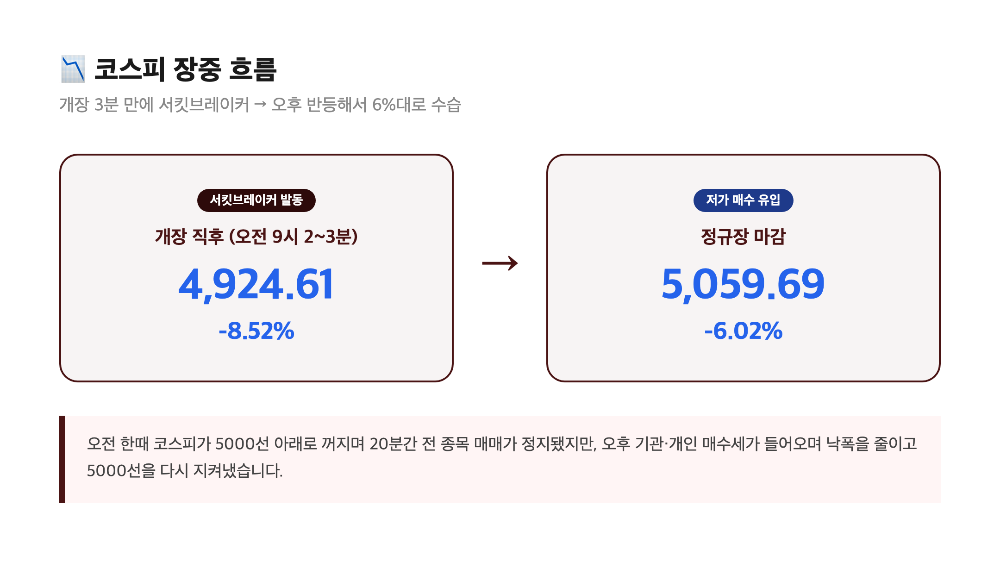
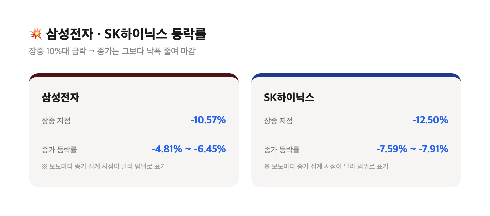
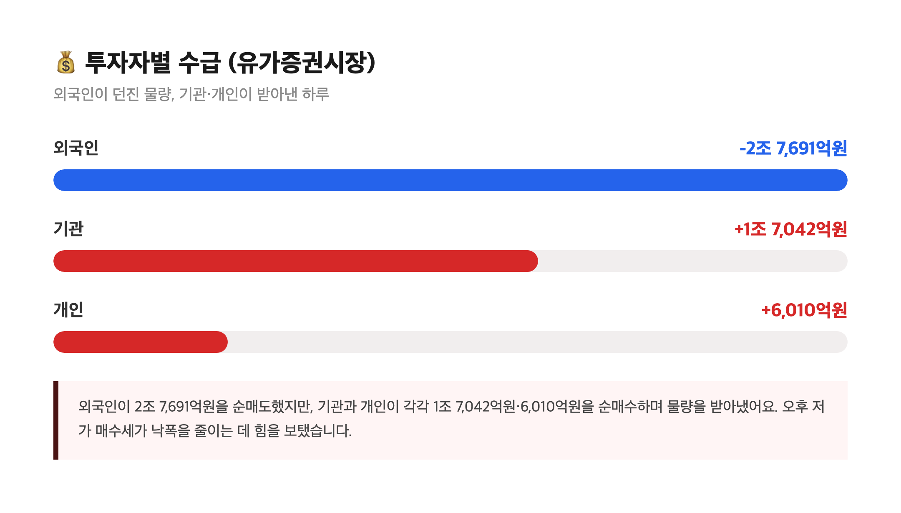
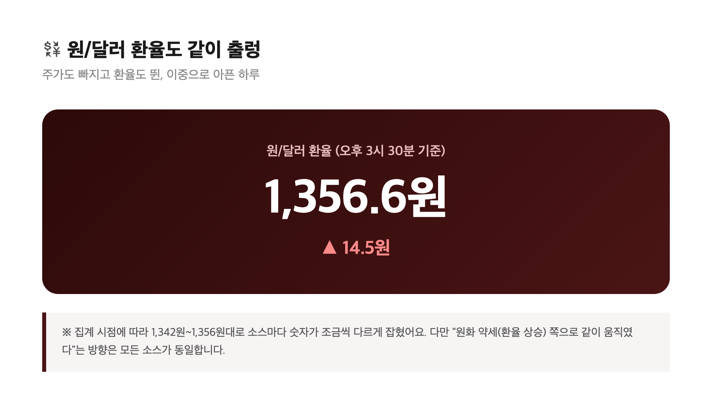

# [내일도 주린이] 코스피 서킷브레이커에 6% 급락, 5000선 겨우 지켜낸 하루…오늘 국장 정리 (11/6)

장 시작하자마자 코스피가 8% 넘게 꽂히는 걸 보고 "이거 실화냐" 했는데요, 알고 보니 서킷브레이커까지 발동된 날이었습니다. 제가 들고 있는 삼성전자도 장중에 한참 깨졌다가 겨우 반등해서 마감했어요. 오늘은 숨 가빴던 하루, 차근차근 정리해볼게요.

---

## 🚨 개장 3분 만에 서킷브레이커 – 8%대 폭락에서 6%대로 겨우 수습

> **코스피 5,059.69 (-324.11포인트, -6.02%) / 코스닥 644.27 (-34.14포인트, -5.03%)**

| 시점 | 코스피 | 등락률 |
|---|---|---|
| 개장 직후(오전 9시 2~3분) | 4,924.61 | -8.52% |
| 정규장 마감 | 5,059.69 | -6.02% |

개장하고 딱 3분 만에 코스피가 5000선 밑으로 꺼지면서 유가증권시장 1단계 서킷브레이커가 떴어요. 20분간 모든 매매가 정지됐고, 코스닥에서도 비슷한 시각 매도 사이드카가 발동됐습니다. 올해 들어 벌써 11번째, 역대로는 17번째 서킷브레이커라고 하니 이게 얼마나 잦아졌는지도 체감이 되네요. 오후 들어 기관·개인 저가 매수가 들어오면서 낙폭을 8%대에서 6%대로 줄이긴 했는데, "줄인 게 6%"라는 게 웃픈 포인트죠.

---

## 🌏 왜 이렇게 빠졌나 – 미국 중간선거 이후 터진 'AI 데이터센터 규제' 공포

간밤 미국 증시부터 난리였어요. 나스닥이 5.5% 급락했고, 필라델피아 반도체지수는 12%대 폭락. 샌디스크 -21.8%, AMD -17.4%, 마이크론 -17.3%, 엔비디아 -9.2%까지 AI·반도체 관련주가 통째로 무너졌습니다.

발단은 중간선거였어요. 이번에 당선된 미국 주지사 36명 중 34명이 데이터센터 규제를 한 가지 이상 지지했고, 10개 주에서 치러진 관련 주민투표 41건 중 40건이 시설 건설을 제한하는 방향으로 통과됐다고 해요. "AI 투자 붐이 꺾이는 거 아니냐"는 공포가 하루아침에 시장을 덮친 셈이죠.

재밌는 건, 일부에서는 이 공포가 좀 과하다는 지적도 나와요. 내년 미국 데이터센터 신규 용량의 4분의 3은 이미 공사 중이라 당장 멈출 수 있는 물량이 아니고, 2028년 예정 물량도 취소보다는 지연 쪽이 현실적이라는 분석이거든요. "구체적인 법안도 아직 없는데" 선반영된 패닉이라는 거예요. 저도 이 대목 읽으면서 "그럼 오늘 떨어진 건 좀 오버였던 건가" 싶었습니다.

---

## 📉 '18만전자'까지 밀렸던 삼성전자, SK하이닉스는 더 아팠어요

> **삼성전자 장중 한때 10%대 급락 → 종가 –4~6%대 / SK하이닉스 장중 한때 –12%대 → 종가 –7%대**

| 종목 | 장중 저점 | 종가 등락률(보도 기준) |
|---|---|---|
| 삼성전자 | 18만 200원대(-10.57%) | -4.81%~-6.45% (소스별 차이) |
| SK하이닉스 | 110만 6,000원대(-12.50%) | -7.59%~-7.91% (소스별 차이) |

솔직히 이 부분 숫자 정리하면서 저도 좀 헷갈렸어요. 기사마다 "장중 수치"와 "종가 수치"를 섞어서 쓴 게 있어서, 삼성전자 종가만 봐도 보도에 따라 -4.81%(19만 1,800원)부터 -6.45%(18만 8,500원)까지 갈리더라고요. SK하이닉스도 -7.59%(116만 8,000원), -7.91%(116만 4,000원)로 소스마다 조금씩 달랐습니다. 공통적인 건 "장중에 10%대까지 꽂혔다가 종가는 그보다는 덜 빠진 채 마감했다"는 흐름이에요.

저는 삼성전자를 들고 있는 입장이라 아침에 호가창 보면서 "와 이거 반토막 되는 거 아니냐" 했는데, 오후 들어 좀 회복해줘서 그나마 다행이었습니다. 그래도 하루 만에 계좌가 이렇게 흔들리는 걸 보니 AI 반도체 랠리가 얼마나 과열됐었는지 역으로 체감되네요.

---

## 💰 외국인은 2조 넘게 던지고, 기관·개인이 받아낸 하루

| 투자자 | 금액 |
|---|---|
| 외국인 | -2조 7,691억원 (순매도) |
| 기관 | +1조 7,042억원 (순매수) |
| 개인 | +6,010억원 (순매수) |

외국인이 유가증권시장에서 하루에 2조 7천억원 넘게 팔았는데, 그 물량을 기관과 개인이 거의 다 받아냈어요. 오후에 낙폭을 줄인 것도 이 저가 매수세 덕분이었다고 하고요. 환율도 같이 흔들렸는데, 원/달러가 오후 3시 30분 기준 전 거래일보다 14.5원 오른 1,356.6원까지 뛰었다는 보도가 있었습니다(소스마다 1,342원~1,356원대로 조금씩 다르게 잡혔는데, "원화 약세 쪽으로 같이 움직였다"는 방향은 동일해요). 주가도 빠지고 환율도 오르니 이중으로 체감 손실이 크게 느껴지는 날이었죠.

---

## 🏛 정부도 급했는지 'F4' 긴급회동 + 반대매매 유예 카드

상황이 심각하다 보니 이형일 경제부총리, 이억원 금융위원장, 이찬진 금감원장, 권민수 한은 부총재 — 이른바 'F4'가 긴급 회동을 가졌다고 해요. 금융당국은 증권사의 신용융자 담보비율(140%) 유지 의무를 3개월간 면제하기로 했고, 11월 9일부터 시행한다고 합니다. 주가가 급락하면 담보가치가 떨어져서 반대매매(강제 매도)가 늘고, 이게 다시 주가를 끌어내리는 악순환이 생기는데 이걸 일단 끊겠다는 조치예요.

다만 이 조치로 급한 불은 껐어도 "깡통계좌 경고"도 같이 나왔다고 하니, 빚내서 투자하신 분들은 오늘 같은 날 마음이 많이 복잡하셨을 것 같아요. 저는 빚투는 안 하고 있어서 그 부분은 한숨 돌렸는데, 그래도 계좌 전체가 빨간 날인 건 똑같았습니다.

---

## 마무리하며

정리하면 코스피 -6.02%(5,059.69), 코스닥 -5.03%(644.27), 장중엔 서킷브레이커까지 뜬 날이었어요. 원인은 미국 중간선거 이후 불거진 AI 데이터센터 규제 공포였고, 정부가 반대매매 유예 카드까지 꺼내 든 걸 보면 다들 꽤 긴장했던 것 같습니다.

저는 오늘 같은 날은 괜히 호가창 들여다보는 게 더 손해라는 걸 다시 배웠어요. 어차피 오후에 좀 회복했는데 아침부터 패닉에 휩쓸렸으면 괜히 한 번 더 손절했을지도 모르거든요. 다음 주 월요일 미국 증시가 어떻게 열리는지, 그리고 이 '규제 공포'가 실제 법안으로 이어지는지가 다음 체크포인트일 것 같습니다 😮‍💨
