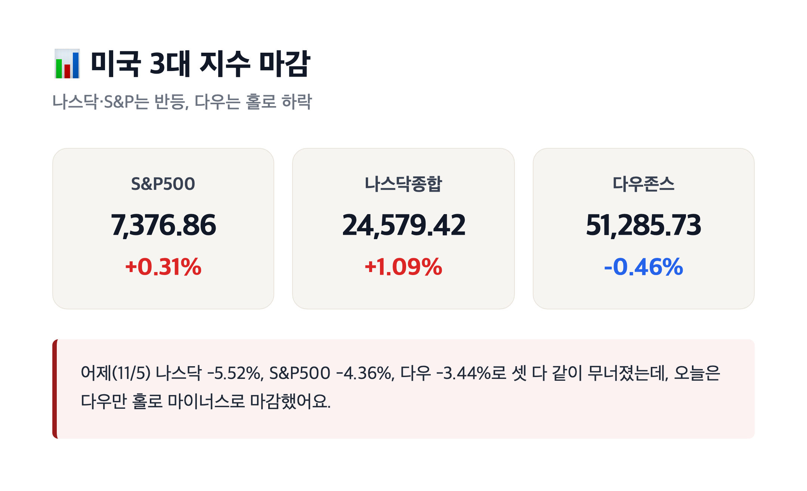
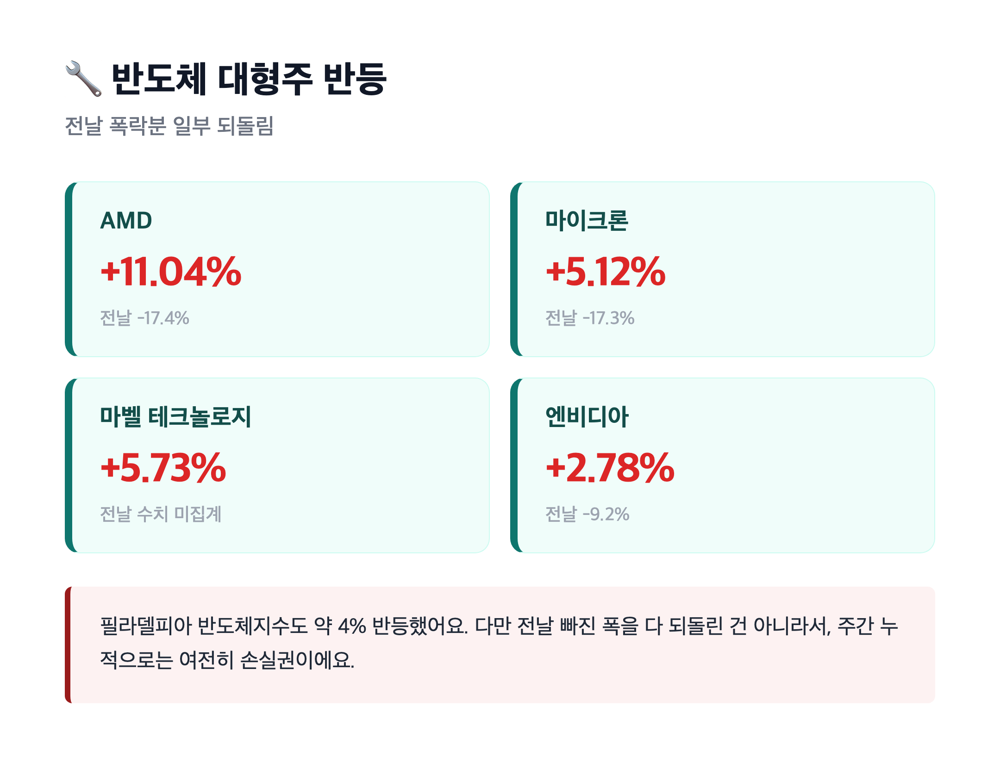
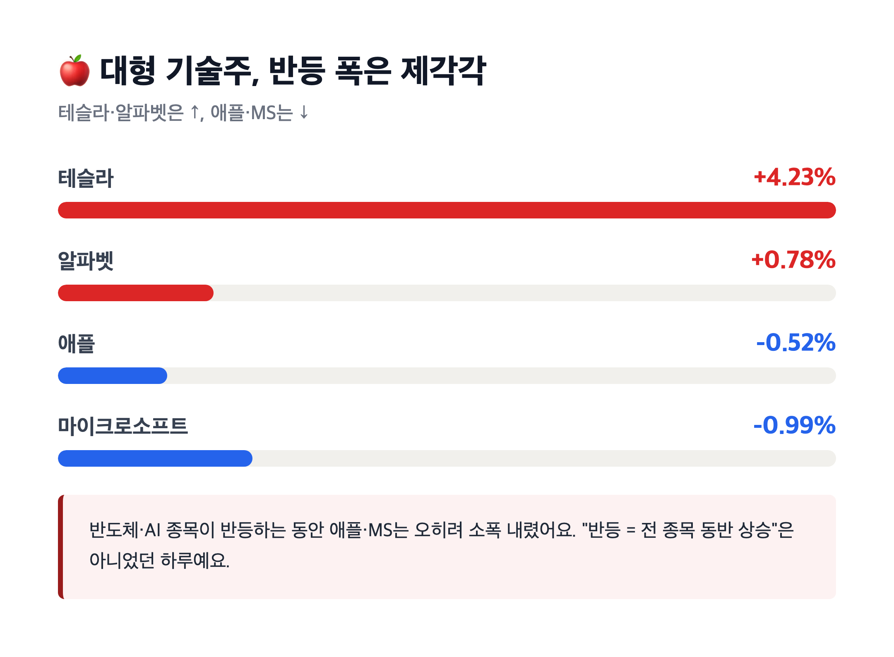
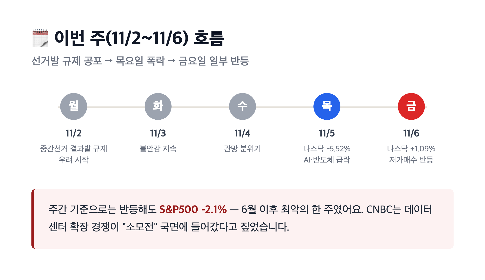

# [내일도 주린이] 반도체 저가매수에 나스닥 반등, 다우는 홀로 하락…오늘 미장 정리 (11/6)

나스닥 +1.09%. 어제 -5.52% 꽂힌 걸 생각하면 숫자만 보면 반가운데, 계산기 두드려보니 반토막도 못 되돌린 반등이더라고요. 오늘 미국 정규장 끝난 거 종목별로 하나씩 짚어볼게요.

---

## 📊 3대 지수 마감 – 나스닥·S&P는 웃고 다우는 혼자 울고

> **S&P500 7,376.86 (+23.13포인트, +0.31%) / 나스닥종합 24,579.42 (+264.43포인트, +1.09%) / 다우존스 51,285.73 (-237.33포인트, -0.46%)**

| 지수 | 종가 | 등락 |
|---|---|---|
| S&P500 | 7,376.86 | +0.31% |
| 나스닥종합 | 24,579.42 | +1.09% |
| 다우존스 | 51,285.73 | -0.46% |

어제(11/5) 나스닥이 -5.52%, S&P500이 -4.36%, 다우가 -3.44%씩 한꺼번에 무너졌던 거 기억나시죠. 거기 비하면 오늘은 셋 다 같이 올랐어야 할 것 같은데, 다우는 끝까지 마이너스로 마감했어요. 기술주·반도체 쪽엔 저가 매수가 들어왔지만 전통 산업주 비중이 큰 다우는 그 수혜를 못 받은 느낌이에요. "지수가 다 같이 움직이는 날도 있고 이렇게 갈리는 날도 있구나" 싶었습니다.

---

## 🔧 반도체주 반격 – AMD 11% 넘게 뛰었어요

> **AMD +11.04% / 마이크론 +5.12% / 마벨 테크놀로지 +5.73% / 엔비디아 +2.78%**

| 종목 | 11/6 등락률 | 참고 |
|---|---|---|
| AMD | +11.04% | 전날 -17.4% |
| 마이크론 | +5.12% | 전날 -17.3% |
| 마벨 테크놀로지 | +5.73% | — |
| 엔비디아 | +2.78% | 전날 -9.2% |

전날 샌디스크 -21.8%, AMD -17.4%, 마이크론 -17.3%, 엔비디아 -9.2%로 AI·반도체주가 통째로 무너졌었는데, 오늘은 그 중 일부를 되돌리는 흐름이었어요. 필라델피아 반도체지수도 약 4% 반등했다고 하고요. 다만 어제 깨진 폭을 전부 만회한 건 아니라서, 순누적으로 보면 이번 주는 여전히 손실권이에요. (엔비디아 등락률은 소스별로 좀 갈렸어요 — 일부에서는 +5.6%라는 숫자도 나왔는데, 다수 언론이 공통으로 확인한 +2.78% 기준으로 정리했습니다.) 저가 매수세가 들어온 건 반가운데, "이게 추세 반전이다"라고 단정하기엔 아직 이르다는 느낌이었습니다.

---

## 👔 고용은 좋았는데… 오히려 금리 부담으로 돌아온 날

> **10월 비농업 고용 +16만 5,000명 (예상치 상회) / 실업률 4.1% (전월 4.2%)**

미 노동부가 발표한 10월 비농업 부문 신규 고용이 16만 5,000명 늘었어요. 시장 예상치(약 5만 9,000명~6만 5,000명)를 크게 웃돈 수치고, 실업률도 4.1%로 전월보다 낮아졌습니다. 숫자만 보면 "경기 괜찮네" 싶은데, 증시 반응은 좀 묘했어요. 고용이 너무 좋게 나오니 "연준이 금리 내리기 부담스러워지는 거 아니냐"는 해석이 나오면서, CME FedWatch 기준 12월 FOMC(12/8~9)에서의 긴축 관련 확률이 전일 67~69%에서 76~80%까지 올라갔다는 보도가 여럿 있었어요. 좋은 고용지표가 오히려 시장에는 부담으로 읽히는, 흔히 말하는 "good news is bad news" 하루였던 셈이죠.

---

## 🍎 애플·MS는 소폭 하락, 테슬라·알파벳은 반등

| 종목 | 11/6 종가 | 등락률 |
|---|---|---|
| 테슬라 | 358.22달러 | +4.23% |
| 알파벳 | 284.78달러 | +0.78% |
| 애플 | 342.37달러 | -0.52% |
| 마이크로소프트 | 530.61달러 | -0.99% |

반도체·AI 종목들이 반등하는 동안 애플·마이크로소프트는 오히려 소폭 내렸어요. 테슬라·알파벳은 반대로 올랐고요. 오늘 하루만 봐도 "AI 반등 = 전 종목 동반 상승"은 아니었다는 게 재밌었습니다. 종목별로 어제 빠진 정도도 다르고 오늘 회복하는 정도도 다르니, 그냥 지수만 보고 "오늘은 다 좋았네"라고 뭉뚱그리면 안 되겠다 싶더라고요.

---

## 🗓 이번 주 결산 – 반등해도 6월 이후 최악의 주간

이번 주(11/2~11/6)는 월요일 선거 이후 터진 AI 데이터센터 규제 공포로 시작해서, 목요일(11/5) 폭락 — 금요일(11/6) 일부 반등으로 마무리된 흐름이었어요. 그래도 주간 기준으로는 S&P500이 -2.1%를 기록하면서 6월 이후 최악의 한 주였다고 하고요. CNBC는 이번 사태로 데이터센터 확장 경쟁이 이제 "소모전(war of attrition)" 국면에 들어갔다고 짚었습니다. 새로 당선된 미국 주지사 36명 중 34명이 데이터센터 규제를 한 가지 이상 지지했고, 관련 주민투표 41건 중 40건이 제한 쪽으로 통과됐다는 걸 생각하면, 이게 하루 이틀 만에 끝날 이슈는 아닌 것 같아요.

---

## 마무리하며

오늘 미장은 나스닥 +1.09%, S&P500 +0.31%로 웃었지만 다우는 -0.46%로 혼자 내렸고, 반도체주가 반등을 이끌었지만 어제 빠진 걸 다 되돌리진 못한 하루였어요. 고용지표가 좋게 나왔는데 오히려 금리 부담으로 해석된 것도 아이러니한 포인트였고요.

다음 주 월요일 개장이 이 반등을 이어받을지, 아니면 다시 데이터센터 규제 얘기로 흔들릴지가 궁금해요. 저는 일단 이번 주 숫자만 복기하면서 주말 보내보려고 합니다 🫠
