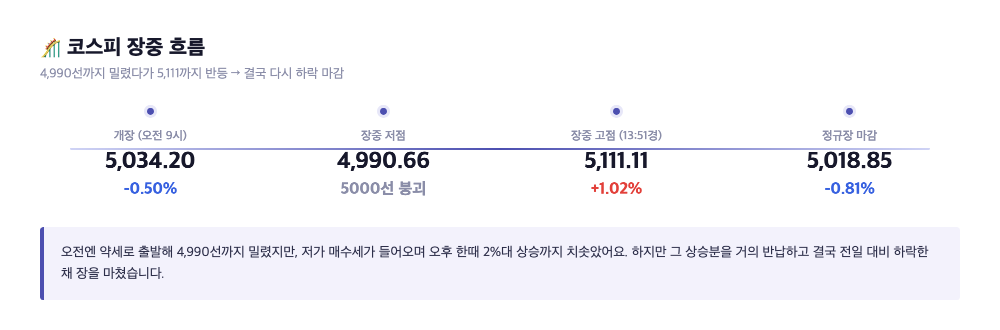
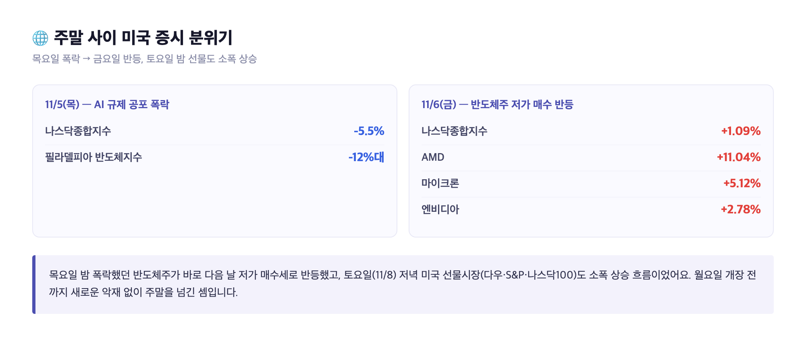
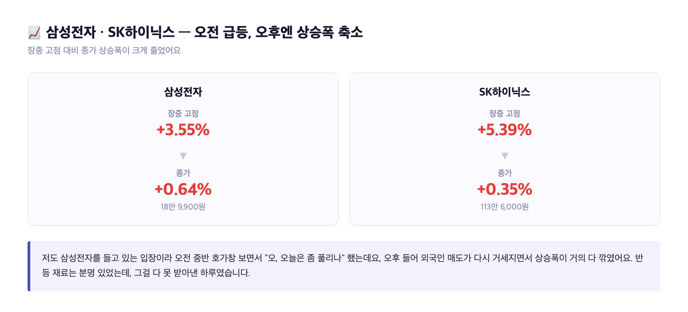
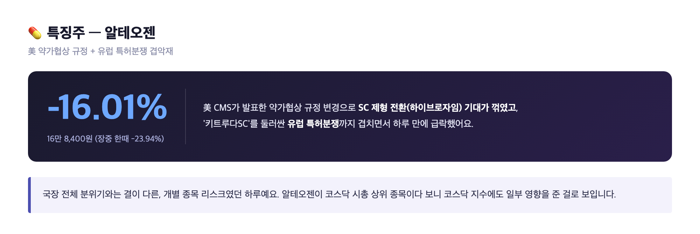
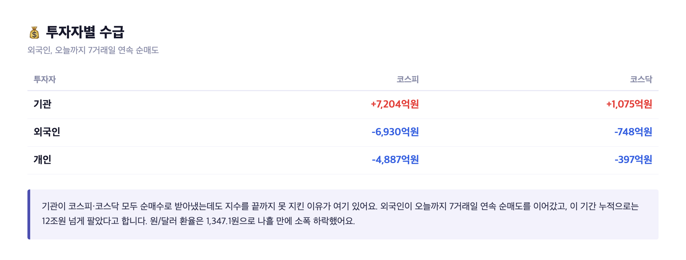

# [내일도 주린이] 코스피 장중 2%대 반등하다 결국 하락 마감, 5000선 턱걸이…오늘 국장 정리 (11/9)

코스피, 오늘 장중 한때 +2%대까지 올라갔었어요. 근데 마감은 -0.81%. 이 숫자 두 개만 놓고 봐도 오늘 하루가 어땠는지 대충 그림이 그려지시죠. 지난주 금요일 서킷브레이커까지 겪은 뒤라 다들 "월요일에 또 패닉 오는 거 아니냐" 걱정했을 텐데, 결과는 생각보다 복잡했습니다. 차근차근 풀어볼게요.

---

## 🎢 하루 종일 출렁인 코스피 – 4990 찍고 5170 찍고 결국 5018

> **코스피 5,018.85 (-40.84포인트, -0.81%) / 코스닥 638.97 (-5.30포인트, -0.82%)**

| 시점 | 코스피 | 등락률 |
|---|---|---|
| 개장 (오전 9시) | 5,034.20 | -0.50% |
| 장중 저점 | 4,990.66 | - |
| 장중 고점 (오후 1시 51분경) | 5,111.11 | +1.02% |
| 정규장 마감 | 5,018.85 | -0.81% |

흐름만 보면 거의 180포인트짜리 롤러코스터였어요. 약세로 출발해서 5000선 아래로 다시 밀렸다가, 오전 10시 반쯔음부터 저가 매수세가 들어오면서 한때 2%대까지 치솟았거든요. 근데 오후 들어 그 상승분을 거의 다 반납하고 결국 빨간 줄로 마감했습니다. 코스닥도 비슷하게 638.97로 -0.82% 마감이었고요. 저는 이 그래프 보면서 "아침에 팔았으면 손해, 오후 2시쯔음 팔았으면 수익이었겠다" 싶었는데, 그걸 실시간으로 맞추는 사람이 세상에 몇이나 될까요.

---

## 🧊 지난주 패닉은 가라앉았나 – 주말 미국장이 보낸 신호

지난주 금요일(11/6) 기억하시죠. 미국 중간선거 이후 'AI 데이터센터 규제' 공포로 코스피가 개장 3분 만에 서킷브레이커까지 맞았던 날이요. 그날 코스피는 6.02% 빠진 5,059.69로 겨우 5000선을 지키며 마감했습니다.

그런데 주말 사이 분위기가 좀 바뀌었어요. 같은 금요일(11/6) 밤 미국 증시에서는 나스닥이 1.09% 올랐고, 엔비디아 +2.78%, AMD는 무려 +11.04%, 마이크론도 +5.12% — AI 규제 공포로 하루 전 폭락했던 반도체주가 바로 저가 매수세를 받은 거예요. 토요일(11/8) 저녁 선물시장도 다우·S&P·나스닥100 전부 소폭 상승 흐름이었고요. 즉 월요일 개장 전까지 새로운 악재가 터진 건 없었던 셈이죠. 그 분위기가 오늘 오전 중반 삼성전자·SK하이닉스가 급등했던 배경이기도 해요. 다만 완전히 끝난 얘기는 아니고, 이번 주 발표될 미국 10월 CPI와 주요 AI 기업 실적이 다음 변수로 남아 있습니다.

---

## 📈 삼성전자·SK하이닉스, 오전엔 급등했는데 오후엔 왜 다시 꺾였나

> **삼성전자 +0.64% (18만 9,900원) / SK하이닉스 +0.35% (113만 6,000원)**

| 종목 | 장중 고점 | 종가 |
|---|---|---|
| 삼성전자 | +3.55% (19만 5,400원) | +0.64% (18만 9,900원) |
| SK하이닉스 | +5.39% (119만 3,000원) | +0.35% (113만 6,000원) |

저도 삼성전자를 들고 있는 입장이라 오전 중반 호가창 보면서 "오, 오늘은 좀 풀리나" 했거든요. 장중엔 거의 3%대 넘게 올랐었으니까요. 그런데 오후 들어서 외국인 매도가 다시 거세지면서 상승폭이 거의 다 깎였습니다. 결국 두 종목 다 '올랐다'고 하기도 애매한 수준으로 마감한 거죠. 반등 재료(미국 반도체주 저가 매수 분위기)는 분명 있었는데, 그걸 다 못 받아낸 하루였다고 보면 될 것 같아요.

---

## 💊 특징주 – 알테오젠, 미국 약가 규정에 16% 급락

> **알테오젠 -16.01% (16만 8,400원, 장중 한때 -23.94%)**

오늘 코스닥에서 가장 눈에 띈 종목은 알테오젠이었어요. 미국 CMS(메디케어·메디케이드서비스센터)가 지난 11월 5일 발표한 약가협상 최종 규정이 발단인데, 2029년 이후 약가협상 대상을 정할 때 일정 요건을 갖춘 피하주사(SC) 제형을 기존 정맥주사(IV) 의약품과 똑같이 취급하기로 했대요. 알테오젠이 핵심 기술로 밀던 'SC 제형 전환(하이브로자임)'을 활용해 약가협상 시점을 늦추려던 바이오사들의 기대가 한 번에 꺾인 셈이죠. 여기에 '키트루다SC'를 둘러싼 유럽 특허분쟁(네덜란드 법원이 미국 할로자임 특허를 침해했다고 판단해 8개국 제조·판매 제한 명령)까지 겹쳐서, 장중엔 -23.94%까지 빠지기도 했습니다. 국장 전체 분위기와는 결이 다른, 개별 종목 리스크였던 하루예요.

---

## 💰 외국인, 벌써 7거래일 연속 순매도

| 투자자 | 코스피 | 코스닥 |
|---|---|---|
| 기관 | +7,204억원 | +1,075억원 |
| 외국인 | -6,930억원 | -748억원 |
| 개인 | -4,887억원 | -397억원 |

기관이 코스피·코스닥 모두 순매수로 받아냈는데도 지수를 끝까지 못 지킨 이유가 여기 있어요. 외국인이 오늘까지 7거래일 연속 순매도를 이어갔거든요. 이 기간 누적으로는 12조원 넘게 팔았다고 하니, 하루짜리 반등 재료로는 이 흐름을 뒤집기 역부족이었던 거죠. 개인도 같이 팔아서 사실상 기관 혼자 버틴 하루였습니다. 원/달러 환율은 1,347.1원으로 나흘 만에 소폭 하락했어요.

---

## 마무리하며

오늘 코스피는 장중 -1%대에서 +2%대까지 왔다 갔다 하다 결국 -0.81%(5,018.85)로 마감했습니다. 지난주 서킷브레이커를 불렀던 공포 자체는 주말 사이 미국 반도체주 반등으로 한풀 꺾인 것처럼 보이는데, 외국인 매도는 7거래일째 그대로 이어지고 있다는 게 오늘의 진짜 숫자예요.

패닉은 진정됐는데 돈은 계속 빠져나가는 중, 이라고 정리하면 될 것 같습니다. 이번 주 미국 CPI 발표랑 AI 기업들 실적을 좀 더 지켜봐야겠어요.
