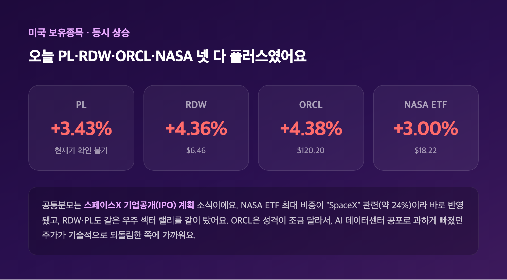
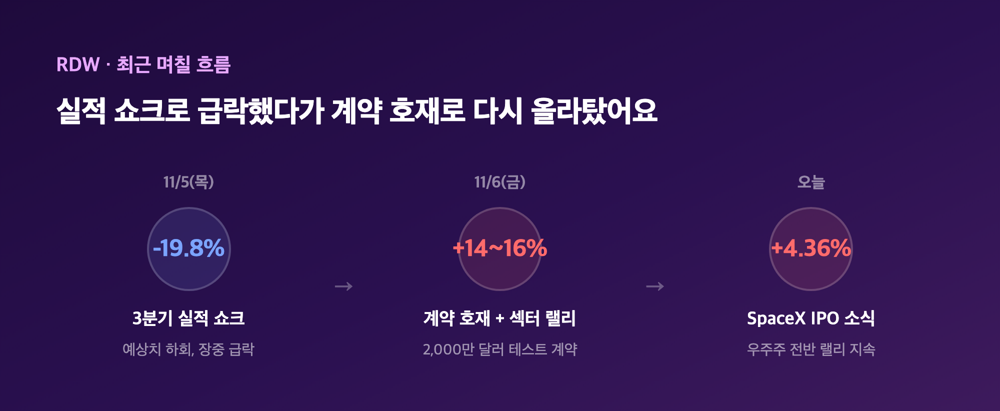
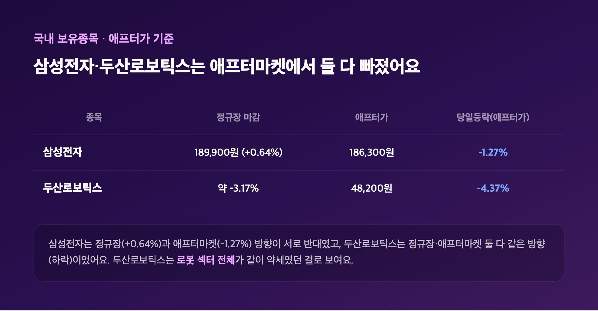
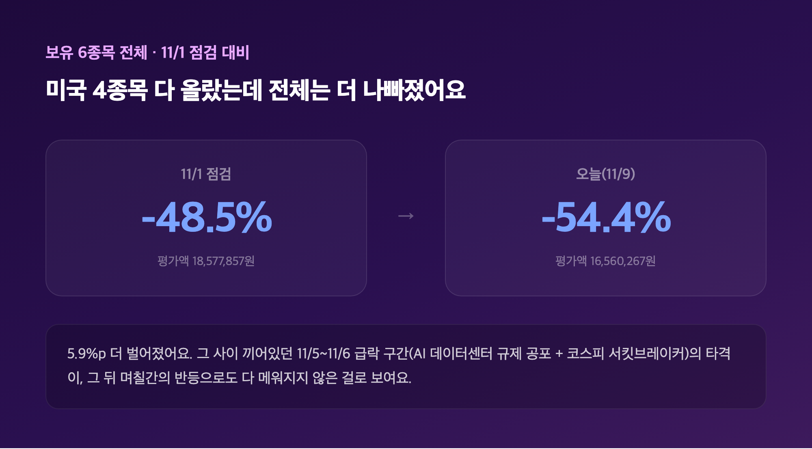

# [내일도 주린이] 포트폴리오 점검, 미국 보유종목 4개가 전부 초록불인데 손실률은 -54.4%로 더 벌어졌어요 (11/9)

오늘 포트폴리오 앱 켜자마자 뜨는 숫자부터 적어볼게요. 내 보유 6건, 평가액 16,560,267원, 수익률 -54.4%. 지난 11/1 점검 때 -48.5%였는데, 그새 6%p 가까이 더 나빠졌습니다. 그런데 화면을 내려보니 이상한 지점이 있더라고요 — 미국 보유종목 네 개가 전부 당일 플러스였거든요. 손실은 커졌는데 오늘 하루는 다들 웃는 얼굴이라니, 이게 무슨 상황인지 하나씩 풀어볼게요.

---

## 🛰️ PL·RDW·NASA·ORCL — 4종목이 동시에 초록불, 이유는 스페이스X였어요

> **PL +3.43% / RDW $6.46 (+4.36%) / NASA $18.22 (+3.00%) / ORCL $120.20 (+4.38%)**

| 종목 | 보유수량 | 평단가 | 현재가(마감 기준) | 당일등락 | 평가손익(수익률) |
|---|---|---|---|---|---|
| PL (Planet Labs PBC) | 209주 | $42.64 | 확인 불가(끝자리 "76"만 보임) | +3.43% | -$6,453.92 (-72.4%) |
| RDW (Redwire) | 5주 | $21.6...(뒷자리 잘림) | $6.46 | +4.36% | 평가액 $32.30 (-70.1%) |
| ORCL (오라클) | 42.51주 | $178.75 | $120.20 | +4.38% | -$2,488.96 (-32.8%) |
| NASA (Tema Space Innovators ETF) | 1주 | $35.11 | $18.22 | +3.00% | 평가액 $18.22 (-48.1%) |

네 종목이 동시에 오른 이유, 찾아보니 공통분모가 있었어요. 스페이스X가 기업공개(IPO) 계획을 밝히면서 우주 관련주 전반에 랠리가 번졌다고 해요. NASA ETF는 최대 보유 비중이 "SpaceX SPV Exposure"(16.49%)랑 "SpaceX"(7.35%)라서, SpaceX 얘기가 나오면 이 ETF 가격에 바로 반영되는 구조더라고요 — RDW·PL도 같은 우주 섹터 랠리를 같이 탄 걸로 보여요. ORCL은 조금 다른데, 이번 주 초(11/2) 200억 달러 자금조달 발표에 마이크로소프트의 AI 컴퓨팅 임대 축소 소식까지 겹쳐 급락했던 종목이라, 오늘 상승은 "우주주 호재"가 아니라 과하게 빠졌던 AI 관련주 전체가 기술적으로 되돌림한 성격에 가까워요.

흥미로운 점 하나 더요. PL의 현재가는 화면에서 툴팁 팝업에 가려 끝자리 "76"만 보였는데, 보유수량(209주)·평단가($42.64)·평가손익(-$6,453.92)을 역산해보니 $11.76이 딱 나오더라고요. 숫자 끝자리가 정확히 맞아떨어지는 걸 보면 이게 맞는 값일 가능성이 높아 보이는데, 이건 제가 계산해서 끼워맞춘 거라 "화면에 직접 뜬 숫자"는 아니라는 점 분명히 밝혀둘게요. RDW의 평단가도 같은 식으로 역산하면(평가액 $32.30, 손익률 -70.1%) $21.60~$21.61 선이 나오는데, 화면에서 보였던 "$21.6..."와 맞아떨어지긴 하지만 뒷자리 끝까지는 끝내 못 확인했어요.

RDW는 이번 주 롤러코스터를 탄 종목이기도 해요. 11/5(목) 3분기 실적이 예상치를 밑돌면서 장중 -19.8%까지 꽂혔다가(종가 $6.19), 바로 다음 거래일엔 2,000만 달러 규모 "Otter" 테스트 계약 체결 소식에 우주주 섹터 랠리까지 겹쳐서 다시 올라탔다고 해요.

다만 여기서 하나 밝혀야 할 게 있어요. 금융 데이터 사이트들(스톡어낼리시스 등)이 집계한 RDW의 11/6(금) 종가는 $7.21(+16.48%)인데, 제 앱에 뜬 마감가는 $6.46(+4.36%)이라 숫자 자체가 달라요. 그런데 신기하게 $6.46은 11/5(목) 종가($6.19) 대비로는 정확히 +4.36%가 맞거든요. 그러니까 "+4.36%"라는 등락률 자체는 수학적으로는 맞는데, 기준이 되는 "전일"이 어느 날짜인지가 소스마다 다른 것 같아요. ORCL도 비슷해요 — 외부 데이터의 11/6 종가는 $116.10(+0.82%)인데, 거기서 +4.38%를 더하면 제 앱의 $120.20과 거의 맞아떨어지거든요. 11/9(월) 미국장에서 추가로 오른 걸 반영한 숫자로 보이는데, 이걸 직접 보도한 기사는 못 찾았어요. 앱마다, 집계 시점마다 숫자가 조금씩 다르게 보일 수 있다는 걸 다시 한번 느꼈습니다.

---

## 🇰🇷 삼성전자·두산로보틱스 — 애프터가 기준으로는 둘 다 빠졌어요

> **삼성전자 ₩186,300 (-1.27%) / 두산로보틱스 ₩48,200 (-4.37%)**

| 종목 | 보유수량 | 평단가 | 애프터가 | 당일등락(애프터가 기준) | 평가손익(수익률) |
|---|---|---|---|---|---|
| 삼성전자 | 25주 | 371,500원 | 186,300원 | -1.27% | -4,630,000원 (-49.9%) |
| 두산로보틱스 | 34주 | 134,674원 | 48,200원 | -4.37% | -2,940,116원 (-64.2%) |

이 두 종목은 앱에 "애프터가 기준"이라고 따로 표시돼 있었어요. 한국 거래소가 정규장(9시~15시30분) 끝나고도 20시까지 애프터마켓 거래를 돌리는데, 거기서 찍힌 가격인 것 같아요. 찾아보니 삼성전자는 11/9 정규장 자체는 189,900원(+0.64%) 정도로 소폭 올랐다는 기사가 있었는데, 애프터마켓에서는 오히려 되밀려서 -1.27%로 집계된 거라 — 정규장과 애프터마켓 방향이 반대로 갈린 케이스예요. 뚜렷한 개별 재료는 안 보였고, 지난주 서킷브레이커(11/6, -6.02%)급 충격 이후라 전반적으로 조심스러운 분위기가 이어진 걸로 보여요.

두산로보틱스는 반대로 정규장(-3.17% 보도)과 애프터마켓(-4.37%) 둘 다 같은 방향으로 빠졌어요. "로봇주 일제히 급락" 식의 기사 제목도 보였는데, 휴림로봇·레인보우로보틱스·현대무벡스까지 같이 약세였다고 하니 개별 악재가 아니라 로봇 섹터 전체가 쉬어가는 흐름이었던 걸로 보여요. 34주 들고 있는 저로서는 "또 섹터가 같이 빠지는 날이구나" 싶었습니다.

---

## 📊 보유 6종목 전체 총정리 — -54.4%, 11/1보다 더 벌어졌어요

> **평가액 16,560,267원 / 전체 수익률 -54.4%**

| 종목 | 보유수량 | 평단가 | 현재가 | 당일등락 | 평가(손익/수익률) |
|---|---|---|---|---|---|
| 삼성전자 | 25주 | 371,500원 | 186,300원(애프터가) | -1.27% | -4,630,000원 (-49.9%) |
| 두산로보틱스 | 34주 | 134,674원 | 48,200원(애프터가) | -4.37% | -2,940,116원 (-64.2%) |
| PL (Planet Labs) | 209주 | $42.64 | 확인 불가(끝자리 "76") | +3.43% | -$6,453.92 (-72.4%) |
| ORCL (오라클) | 42.51주 | $178.75 | $120.20(마감) | +4.38% | -$2,488.96 (-32.8%) |
| RDW (Redwire) | 5주 | $21.6...(잘림) | $6.46(마감) | +4.36% | 평가액 $32.30 (-70.1%) |
| NASA (Tema Space Innovators ETF) | 1주 | $35.11 | $18.22(마감) | +3.00% | 평가액 $18.22 (-48.1%) |

6종목 다 더한 앱 표시값은 평가액 16,560,267원, 전체 수익률 -54.4%예요. 직전 점검(11/1, -48.5%)보다 5.9%p 더 나빠졌어요. 재밌는 건 오늘 하루만 보면 미국 보유종목 네 개가 전부 플러스였는데도 전체 그림은 더 안 좋아졌다는 거예요. 아마 11/1~11/9 사이 끼어있던 11/5~11/6 급락 구간(미국 AI 데이터센터 규제 공포 + 코스피 서킷브레이커)에서 입은 손실이, 그 뒤 며칠간의 반등으로도 다 메워지지 않은 걸로 보여요. 정확한 일별 흐름까지 전부 추적한 건 아니라 "그런 것 같다" 정도로만 적어둘게요.

---

## 마무리하며

오늘 숫자만 요약하면, 평가액 16,560,267원에 전체 수익률 -54.4%, 미국 보유종목 4개는 전부 올랐지만 삼성전자·두산로보틱스가 애프터가 기준으로 빠지면서 전체는 11/1보다 더 나빠졌어요.

손실률 숫자 자체는 계속 커지고 있는데, 오늘 처음으로 "같은 날 보유종목 전부가 한 방향으로 안 움직이는" 그림을 보니 오히려 포트폴리오가 생각보다 다양하게 걸려 있긴 하구나 싶더라고요. 다음 점검 때는 RDW·ORCL의 정확한 마감 기준 시점이 뭔지, 그리고 스페이스X IPO 얘기가 실제로 어떻게 진행되는지 좀 더 확인해보려고 합니다.

숫자는 또 나빠졌지만, 일단 계속 지켜보겠습니다 🙃

#포트폴리오점검 #내주식포트폴리오 #오라클 #레드와이어 #스페이스X
