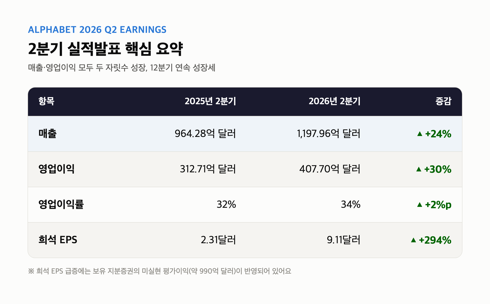
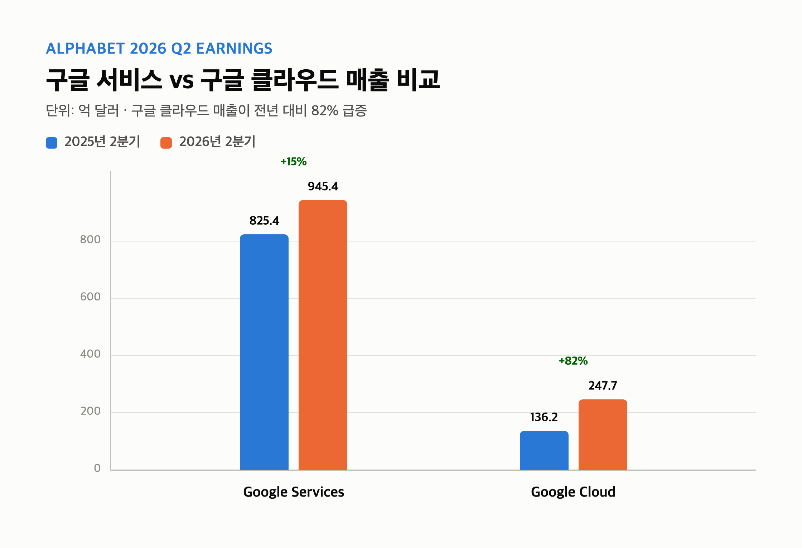
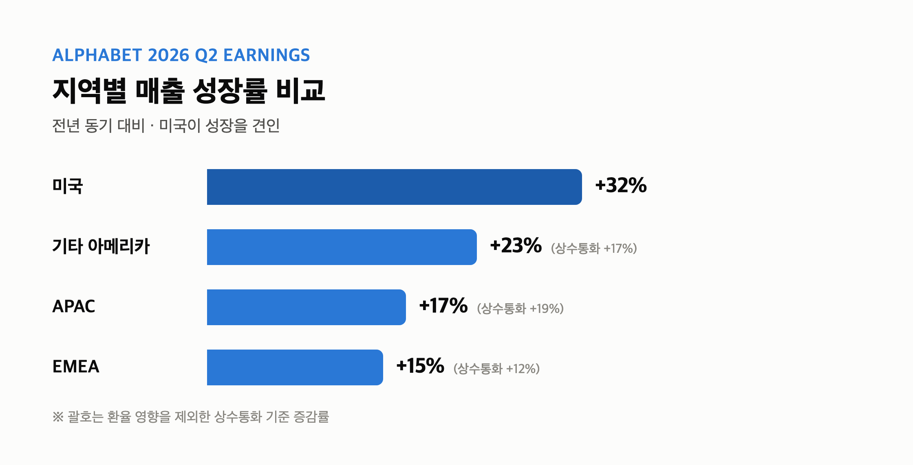
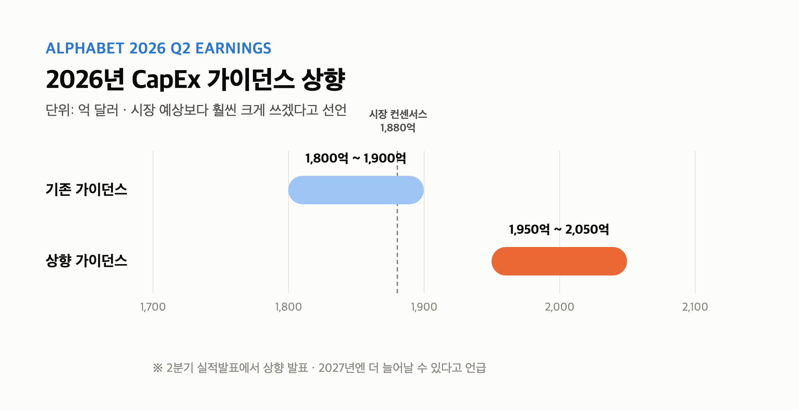
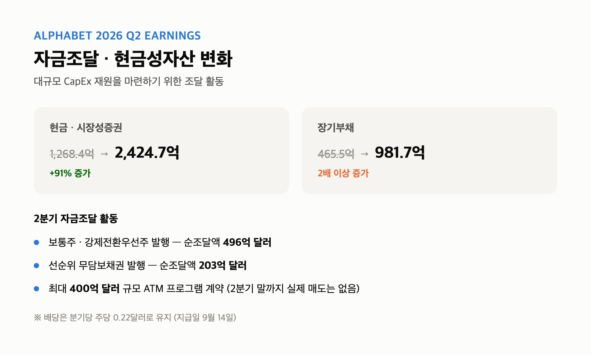
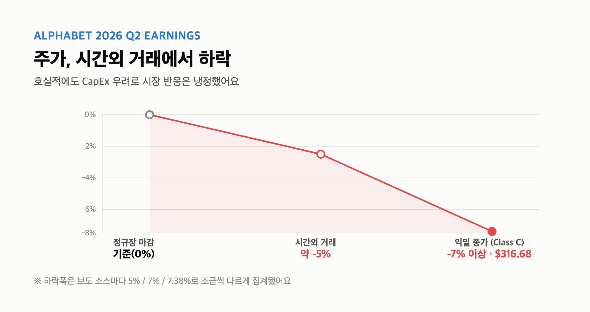

# [내일도 주린이] 구글 알파벳 2분기 실적발표 정리, 매출 24% 급증에도 주가는 왜 떨어졌나

안녕하세요, '내일도 주린이'입니다 👋

지난 7월 22일에 알파벳(구글) 2분기 실적발표가 나왔는데요, 저도 알파벳 주주라 챙겨봤습니다. 매출은 서프라이즈 수준으로 잘 나왔는데 주가는 오히려 빠졌더라고요. 오늘은 그 이유까지 숫자로 정리해볼게요.

---

## 📊 알파벳 2분기 실적발표 핵심 요약

> **2분기 매출: 1,197억 9,600만 달러 (전년 대비 +24%)**

| 항목 | 2025년 2분기 | 2026년 2분기 | 증감 |
|---|---|---|---|
| 매출 | 964.28억 달러 | 1,197.96억 달러 | +24% |
| 영업이익 | 312.71억 달러 | 407.70억 달러 | +30% |
| 영업이익률 | 32% | 34% | +2%p |
| 희석EPS | 2.31달러 | 9.11달러 | +294% |

시장 예상치(약 1,169억~1,170억 달러)를 웃도는 어닝 서프라이즈였고요, 12분기 연속 두 자릿수 매출 성장이라고 해요. 다만 순이익이 1,121억 700만 달러(+298%)까지 뛴 건 좀 함정이 있는데요, 알파벳이 보유한 지분증권에서 990억 3,100만 달러짜리 미실현 평가이익이 잡히면서 순이익이 771억 달러, EPS가 6.26달러나 뻥튀기된 거였어요. 그래서 저는 순이익보다 영업이익(+30%)을 진짜 실적으로 보는 게 맞다고 생각해요. 참고로 일회성 항목 뺀 조정 EPS는 2.85달러로 컨센서스(2.89달러)를 살짝 밑돌았다는 보도도 있었어요.

---

## 🔍 부문별 실적 - 구글 클라우드가 82% 성장

> **Google Cloud 매출: 247억 6,800만 달러 (+82%)**

| 부문 | 2025년 2분기 | 2026년 2분기 | 증감 |
|---|---|---|---|
| 검색 및 기타 광고 | 541.9억 달러 | 632.71억 달러 | +17% |
| 유튜브 광고 | 97.96억 달러 | 110.55억 달러 | +13% |
| 네트워크 광고 | 73.54억 달러 | 73.03억 달러 | 약 -0.7% |
| 구독·플랫폼·기기 | 112.03억 달러 | 129.11억 달러 | +15% |
| Google Services 합계 | 825.43억 달러 | 945.40억 달러 | +15% |
| **Google Cloud** | 136.24억 달러 | 247.68억 달러 | **+82%** |
| Other Bets | 3.73억 달러 | 3.82억 달러 | - |

이번 실적발표에서 제일 눈에 띈 건 역시 클라우드예요. 기업용 AI 솔루션이랑 AI 인프라 수요가 늘면서 매출이 82%나 뛰었거든요. 영업이익률도 20.7%에서 35.6%로 크게 개선됐고, 영업이익 규모는 3배 이상 늘었다고 해요(28.26억 → 88.14억 달러). 반면 네트워크 광고(애드센스·애드몹)는 소폭 감소했고, Other Bets 적자는 오히려 더 커졌어요(-12.46억 → -17.99억 달러). 검색 광고는 AI 오버뷰 같은 AI 기능이 쿼리 성장을 견인했다고 하니, 'AI가 검색을 죽인다'는 우려랑은 좀 다른 그림이더라고요.

---

## 🌎 지역별 매출 - 미국이 성장 견인

> **미국 매출: 608억 4,600만 달러 (+32%)**

| 지역 | 2025년 2분기 | 2026년 2분기 | 증감(상수통화) |
|---|---|---|---|
| 미국 | 460.63억 달러 | 608.46억 달러 | +32% |
| EMEA | 282.62억 달러 | 325.01억 달러 | +15%(+12%) |
| APAC | 164.80억 달러 | 193.17억 달러 | +17%(+19%) |
| 기타 아메리카 | 57.35억 달러 | 70.26억 달러 | +23%(+17%) |

지역별로 보면 미국이 압도적으로 잘 나왔어요. 저는 이 부분 보면서 'AI 인프라 투자가 결국 미국 본토 클라우드 수요부터 채우고 있구나' 싶었는데요, 실제로 미국 매출 증가율(+32%)이 다른 지역보다 확실히 높더라고요.

---

## 💰 설비투자(CapEx) 상향 - 주가 하락의 핵심 원인

> **2026년 연간 CapEx 가이던스: 1,800억~1,900억 달러 → 1,950억~2,050억 달러로 상향**

2분기 설비투자는 449억 2,400만 달러로 전년 대비 딱 2배(+100%) 늘었어요. 이 여파로 이번 분기 잉여현금흐름(FCF)이 마이너스 58억 5,500만 달러를 찍었고요(직전 4개 분기 합산으로 보면 여전히 플러스 532억 7,300만 달러긴 해요). 그런데 진짜 시장이 놀란 포인트는 따로 있었어요. 알파벳이 2026년 연간 capex 전망을 기존 1,800억~1,900억 달러에서 1,950억~2,050억 달러로 올려버린 거예요. 시장 컨센서스가 1,880억 달러 정도였으니 예상보다 훨씬 크게 쓰겠다고 선언한 셈이죠. CFO 아나트 아쉬케나지는 "투자 대비 매력적인 수익률이 확인되는 한" 계속 투자하겠다고 했고, 2027년엔 더 늘어날 거라고도 했어요. 구겐하임증권은 2027년 capex가 최대 3,500억 달러까지 갈 수 있다고 봤는데, 시장 컨센서스(약 2,650억 달러)보다 훨씬 공격적인 수치예요. 저는 이 대목에서 '와 이건 좀...' 싶었어요. 매출은 서프라이즈였는데 다들 이 capex 숫자만 보고 있더라고요.

---

## 🏦 재무구조 변화와 배당

알파벳은 이 어마어마한 투자금을 마련하려고 2분기에 대규모 자금 조달도 했어요.

- 보통주·강제전환우선주 발행으로 순조달액 496억 달러 확보
- 선순위 무담보채권 발행으로 순조달액 203억 달러 확보
- 최대 400억 달러 규모 ATM 프로그램 계약(2분기 말까지 실제 매도는 없었음)

그 결과 현금·시장성증권 합계가 1,268억 4,300만 달러에서 2,424억 7,400만 달러로 늘었고, 장기부채도 465억 4,700만 달러에서 981억 6,500만 달러로 두 배 넘게 늘었어요. 배당은 보통주 기준 분기당 주당 0.22달러로 유지됐고(지급일 9월 14일), 임직원 수는 187,103명에서 198,933명으로 늘었더라고요.

---

## 🗣 경영진이 말한 AI, 그리고 주가 반응

> **시간외 거래에서 주가 약 5% 하락**

CEO 순다르 피차이는 "우리의 AI 투자는 비즈니스 전 영역에서 가능성을 재정의하고 있다"고 했는데요, Gemini Enterprise가 포춘 100대 기업의 약 90%에 도입됐고, Gemini 모델이 분당 220억 개 토큰을 처리 중이며, Gemini 앱 MAU가 9억 5,000만 명이라고 밝혔어요. 신형 보안 모델 "Gemini 3.5 Flash Cyber"도 출시했고, 2026 월드컵 관련 유튜브 콘텐츠 순시청자가 17억 명을 넘었다고 하네요. CFO는 "TPU 시스템 매출 대부분은 2027년에 인식될 것"이라며, 3분기엔 서드파티 데이터센터 사용 확대로 마진 압박이 있을 수 있고 Wiz 인수 통합 비용도 역풍이 될 거라고 했어요. 구글 클라우드 수주잔고는 5,140억 달러라고 하고요.

이런 호실적에도 불구하고 시간외 거래에서 주가는 약 5% 빠졌고, 다음 거래일엔 Class C 기준으로 7% 넘게 하락(316.68달러)했다는 보도도 있었어요(낙폭은 소스마다 5%, 7%, 7.38%로 조금씩 다르게 나왔어요). 매출·클라우드는 서프라이즈였는데 정작 capex 가이던스 상향 때문에 주가가 빠진 거 보면서, 저는 "네, 알고 있었습니다" 하는 마음이 들더라고요. 요즘 시장은 성장보다 '얼마나 쓰는지'에 더 민감하게 반응하는 것 같아요.

7월 24일 기준 애널리스트 41명 컨센서스는 여전히 '매수'였고 평균 목표주가는 397.20달러였어요. BofA 저스틴 포스트는 목표주가를 370.90달러에서 430달러로 올리며 매수 의견을 유지했고요. 다만 capex 규모를 두고는 애널리스트들 사이에서도 반응이 엇갈렸어요.

---

## 마무리하며

정리하면, 알파벳 2분기는 매출·영업이익 다 잘 나왔고 특히 구글 클라우드가 82% 성장하며 주인공이었어요. 근데 순이익 급증은 일회성 평가이익 영향이 커서 걸러서 봐야 하고, 시장은 늘어난 capex 가이던스(1,950억~2,050억 달러)에 더 민감하게 반응하면서 주가는 오히려 하락했어요.

저는 이번 실적 보면서 'AI 투자가 실적으로 증명되고 있긴 한데, 그 비용을 시장이 어디까지 참아줄지'가 앞으로 관전 포인트라는 생각이 들었어요. 저도 알파벳 들고 있는 입장이라 당분간은 클라우드 성장세랑 capex 지출 속도, 둘 다 계속 지켜봐야 할 것 같아요.

오늘도 손절, 내일은 익절. 무럭무럭 자라볼게요 🌱

---

*※ 사진 자리 표시된 곳에 준비하신 스크린샷(또는 자료 이미지) 넣어주세요.*

#구글실적발표 #알파벳2분기실적 #구글클라우드 #미국주식투자
