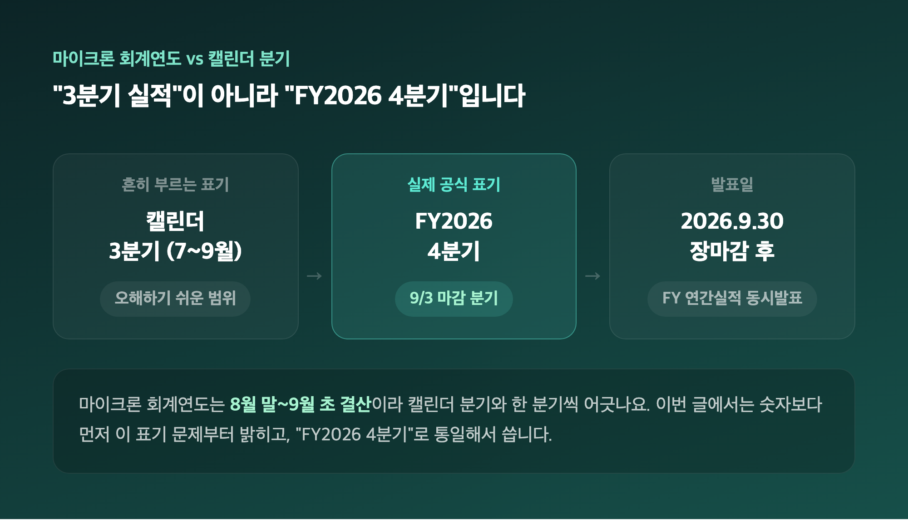
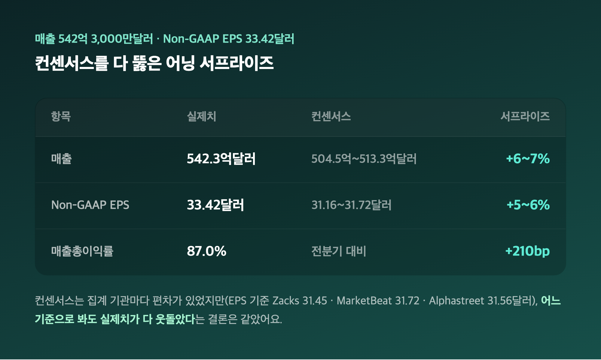
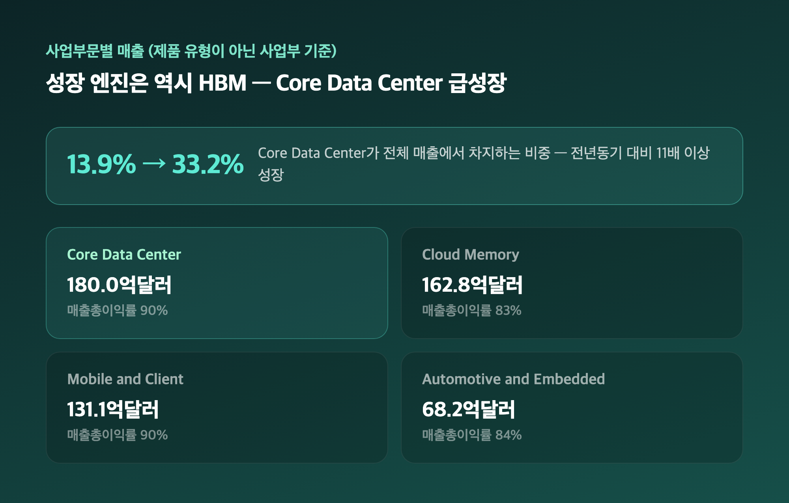
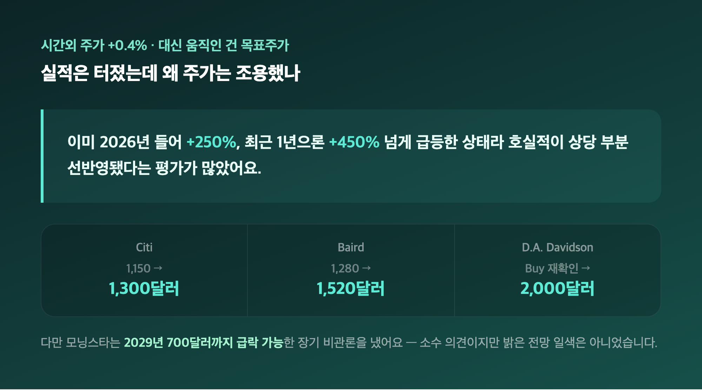
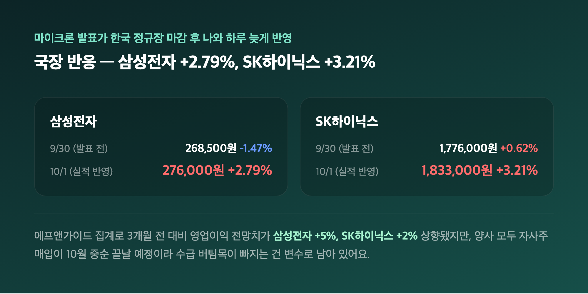

# [내일도 주린이] 마이크론 FY2026 4분기 실적 서프라이즈, 매출 379% 폭증…국장 반도체도 들썩 (10/5)

"마이크론 3분기 실적 정리해야지" 하고 자료부터 열었는데요, 보다 보니 "어, 이거 3분기가 아니네" 싶더라고요. 마이크론은 회계연도가 9월 초에 끝나서, 이번에 나온 건 캘린더 기준 3분기가 아니라 FY2026 4분기(2026 회계연도 4분기)였습니다. 그래서 오늘은 이 표기부터 정확히 짚고, 매출 379% 폭증이 국장 반도체 대형주까지 어떻게 번졌는지 정리해볼게요.

---

## 🗓️ 정정부터 — "3분기"가 아니라 "FY2026 4분기"입니다

> **발표일 2026년 9월 30일 / 공식 명칭 "Fiscal Fourth-Quarter and Full Year 2026 Results"**

| 구분 | 내용 |
|---|---|
| 흔히 부르는 표기 | "3분기 실적" (캘린더 7~9월 기준으로 오해하기 쉬움) |
| 실제 공식 표기 | FY2026 4분기 (2026년 9월 3일 마감 분기) |
| 발표일 | 2026년 9월 30일 (미국 동부시간 장마감 후) |
| 비고 | 같은 날 FY2026 연간(Full Year) 실적도 함께 발표 |

저도 처음엔 "3분기니까 7~9월 얘기겠지" 하고 리서치를 시작했는데, 마이크론 회계연도는 8월 말~9월 초 결산이라 캘린더 분기와 한 분기씩 어긋나요. 이런 회계분기 착시는 메모리 반도체 기사에서 꽤 자주 나오는 함정이라, 이번 글에서는 "FY2026 4분기"로 통일해서 쓸게요. 국내 언론 일부도 이 부분을 섞어 쓰는 경우가 있어서, 숫자 자체보다 먼저 이 표기 문제를 밝히고 가는 게 맞다고 봤습니다.

---

## 💰 매출 542억 3,000만달러 — 컨센서스를 다 뚫은 어닝 서프라이즈

> **매출 542억 3,000만달러 (전년比 +379%) / Non-GAAP EPS 33.42달러**

| 항목 | 실제치 | 시장 컨센서스 | 서프라이즈 |
|---|---|---|---|
| 매출 | 542억 3,000만달러 | 약 504억 5,000만~513억 3,000만달러 | 약 +6~7% 상회 |
| Non-GAAP EPS | 33.42달러 | 약 31.16~31.72달러 | 약 +5~6% 상회 |
| Non-GAAP 매출총이익률 | 87.0% | - | 전분기 대비 +210bp |

컨센서스 수치는 소스마다 좀 달랐어요. 매출 컨센서스는 504억대~513억대로 집계 기관별 편차가 있었고, EPS도 Zacks는 31.45달러, MarketBeat는 31.72달러, Alphastreet(애널리스트 33명 집계)는 31.56달러로 제각각이었습니다. 그래도 어느 기준으로 봐도 실제치가 다 웃돌았다는 결론은 같아서, 다수 소스가 겹치는 범위로 표에 정리했어요. 전분기(414억 6,000만달러) 대비로도 +31% 성장이었고, FY2026 연간으로는 매출 1,332억달러(전년 대비 +256%), 연간 EPS는 Non-GAAP 기준 75.52달러(전년 대비 +811%)까지 뛰었다고 하니 "분기 하나만 잘한 게 아니라 1년 내내 이랬다"는 쪽에 가깝더라고요.

---

## 🤖 성장 엔진은 역시 HBM — Core Data Center 비중 13.9%→33.2%

> **Core Data Center 매출 180억달러(매출총이익률 90%) — 전년동기 대비 11배 이상**

| 사업부 | 매출 | 매출총이익률 |
|---|---|---|
| Cloud Memory | 162억 8,000만달러 | 83% |
| Core Data Center | 180억달러 | 90% |
| Mobile and Client | 131억 1,000만달러 | 90% |
| Automotive and Embedded | 68억 2,000만달러 | 84% |

이번 분기부터 마이크론이 전통적인 D램/낸드 구분 대신 사업부 기준으로 실적을 공개했는데, Core Data Center가 전체 매출에서 차지하는 비중이 전년 13.9%에서 33.2%로 뛴 게 핵심이었어요. (일부 외신은 "D램 398억달러·낸드 141억달러" 식으로 제품 유형 기준 수치를 쓰기도 했는데, 이건 공식 보도자료의 사업부 분류와는 다른 집계라 혼동하지 않으려고 사업부 기준으로만 정리했습니다.) HBM 매출 증가율이 회사 전체 매출 증가율보다 빠르다고 회사 측이 직접 밝혔고, 데이터센터 SSD 매출도 100억달러를 돌파해 전년 대비 10배 넘게 늘었다고 해요. "성장의 절반 이상이 결국 AI 데이터센터 쪽에서 나왔구나" 싶은 숫자였습니다.

---

## 😐 그런데 정작 주가는 왜 안 움직였나 — 시간외 +0.4%, 대신 목표주가가 움직였다

> **시간외 주가 +0.4% / Citi 1,300달러, Baird 1,520달러, D.A. Davidson 2,000달러**

| 증권사 | 기존 목표주가 | 변경 목표주가 | 비고 |
|---|---|---|---|
| Citi (Atif Malik) | 1,150달러 | 1,300달러 | D램 가격 강세·AI 공급 타이트 근거 |
| Baird | 1,280달러 | 1,520달러 | Outperform 등급 유지 |
| D.A. Davidson | - | 2,000달러 | Buy 등급 재확인, 목표가 유지 |

실적이 이렇게 좋았는데 시간외 주가는 딱 +0.4%에 그쳤어요. "어닝 서프라이즈인데 왜 이렇게 조용하지" 했는데, 이미 마이크론 주가가 2026년 들어 250% 넘게, 최근 1년으로는 450% 넘게 급등한 상태라 호실적이 상당 부분 선반영됐다는 평가가 많더라고요. 대신 애널리스트들의 12개월 목표주가는 1,100달러에서 최고 2,100달러까지 대거 상향됐고요. 다만 모닝스타는 반대 의견을 냈어요 — 2028년 고점을 찍은 뒤 2029년엔 주가가 700달러까지 급락할 수 있다는 장기 비관론인데, 이건 소수 의견이지만 밝은 전망 일색은 아니라는 점에서 같이 적어둡니다. 다음 분기(FY2027 1분기) 가이던스도 매출 615억달러(±15억달러)로 컨센서스 대비 +7.9% 높게 제시됐고, CEO 산제이 메흐로트라는 "2026 회계연도에 기록적 실적을 냈고, 2027 회계연도는 더 강할 것"이라고 자신감을 드러냈습니다.

---

## 🇰🇷 국장 반응 — 삼성전자 +2.79%, SK하이닉스 +3.21%

> **삼성전자 276,000원(+2.79%) / SK하이닉스 1,833,000원(+3.21%) — 10/1, 실적 반영 후**

| 날짜 | 삼성전자 | SK하이닉스 | 비고 |
|---|---|---|---|
| 9/30 (발표 전 마감) | 268,500원 (-1.47%) | 1,776,000원 (+0.62%) | 마이크론 실적 미반영 |
| 10/1 (실적 반영) | 276,000원 (+2.79%) | 1,833,000원 (+3.21%) | 마이크론 서프라이즈 반영 |

저도 25주 들고 있는 삼성전자가 10/1 하루 만에 +2.79% 뛴 걸 보고 "오, 이게 마이크론 효과구나" 싶었습니다. 마이크론 발표가 한국 정규장 마감 이후 나와서 9/30 수치엔 반영이 안 됐다가, 다음날 한꺼번에 반응이 나온 거예요. 에프앤가이드 집계로는 3개월 전 대비 영업이익 전망치가 삼성전자 +5%, SK하이닉스 +2% 상향됐고, 삼성전자는 10/8 발표 예정인 3분기(캘린더 기준) 실적에서 분기 영업이익이 처음으로 100조원을 넘을 거란 전망(104조 9,000억원, 이 중 반도체 부문만 106조 9,000억원)까지 나오고 있어요. 양사 합산으로는 190조원에 육박하는 수준이라고 하니 기대감이 꽤 큰 셈인데, 지난 국장 정리 때도 짚었듯 삼성전자·SK하이닉스 둘 다 자사주 매입이 10월 중순이면 끝날 예정이라 그 수급 버팀목이 빠지는 건 여전히 변수로 남아 있습니다.

---

## 마무리하며

정리하면 마이크론은 매출 +379%, EPS 컨센서스 상회라는 화려한 숫자를 냈는데 정작 자기 주가는 시간외 +0.4%로 덤덤했고, 오히려 다음날 국장이 삼성전자 +2.79%·SK하이닉스 +3.21%로 더 크게 반응했어요.

솔직히 "실적 좋은 회사 주가는 안 움직이고 관련 종목이 더 뛴다"는 이 비대칭이 재밌었습니다. 저는 일단 25주 그대로 들고, 10/8 삼성전자 잠정실적이랑 자사주 매입 종료 시점 근처 반응부터 챙겨볼 생각이에요.

매출은 역대급, 제 계좌는 아직 그대로. 그래도 오늘은 숫자가 좋은 쪽이었으니 이걸로 만족할게요 🌱
