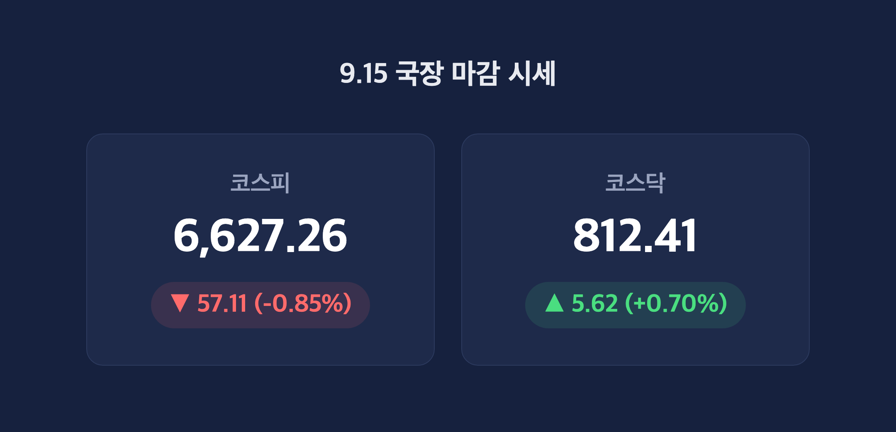
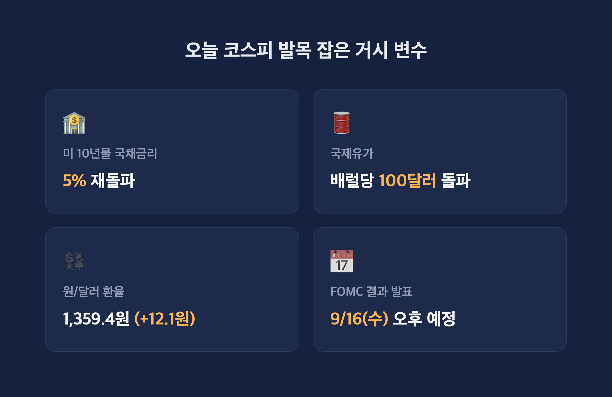
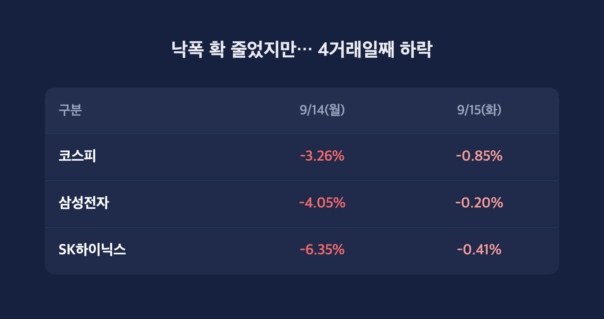
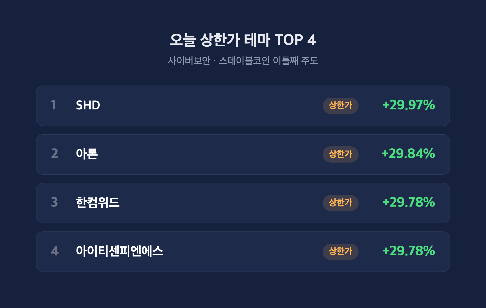

# [내일도 주린이] 코스피 4거래일째 하락 6627선…코스닥은 나홀로 반등, 9.15 국장 정리 (9/15)

안녕하세요, '내일도 주린이'입니다 👋

어제 반도체 대형주가 -3~6%대로 널브러지는 거 보고 "내일은 진짜 좀 쉬어가겠지" 했는데요, 오늘도 코스피는 결국 빨간불(하락) 마감입니다. 다만 어제랑 결이 좀 다르긴 해요. 오늘 국장 정리, 바로 가보겠습니다.

---

## 🇰🇷 오늘 국장 마감 시황 (코스피·코스닥 동시 체크)

> **코스피 6,627.26 (-57.11포인트, -0.85%) / 코스닥 812.41 (+5.62포인트, +0.70%)**

| 지수 | 종가 | 등락 | 등락률 | 거래대금 |
|---|---|---|---|---|
| 코스피 | 6,627.26 | -57.11P | -0.85% | 16조 2,453억원 |
| 코스닥 | 812.41 | +5.62P | +0.70% | - |

코스피는 하락 종목이 623개, 상승 종목이 254개로 확실히 파는 쪽이 많았던 하루였어요. 장중 변동폭도 133포인트나 될 만큼 심했는데요, 오전 한때는 반도체 대형주가 반등하면서 +0.12%까지 순간적으로 플러스 전환하는 'V자 반등'도 나왔습니다. "오 오늘은 다르네" 싶었는데, 오후 들어 다시 밀리면서 결국 -0.85%로 마감했어요. 이걸로 코스피는 4거래일 연속 하락(9/10, 9/11, 9/14, 9/15)이에요. 반대로 코스닥은 개인 저가매수와 바이오·소부장 개별 종목 강세에 힘입어 3거래일 만에 반등하면서 코스피랑 다른 흐름을 보였습니다.

---

## 📉 코스피, 왜 또 밀렸나 – 미 국채금리 5%·유가 100달러 겹악재

> **미 10년물 국채금리 5% 재돌파 / 국제유가 100달러 돌파 / 원·달러 환율 1,359.4원(+12.1원)**

| 항목 | 내용 |
|---|---|
| 미 10년물 국채금리 | 5% 재돌파 |
| 국제유가 | 배럴당 100달러 돌파 (사우디 동서 송유관 드론 공격, 가동 잠정 중단) |
| 원/달러 환율 | 1,359.4원 (전일比 +12.1원 급등) |
| FOMC 결과 발표 | 9/16(수) 오후 예정 |

오늘 코스피 발목을 잡은 건 결국 거시 변수였어요. 미 10년물 국채금리가 5%를 다시 뚫었고, 호르무즈 해협 불안에 더해 우회로였던 사우디 동서 송유관까지 드론 공격으로 가동이 멈추면서 국제유가가 배럴당 100달러를 넘어섰습니다. 여기에 원/달러 환율이 하루 만에 12.1원이나 급등한 1,359.4원으로 마감하면서 외국인 투자자 입장에서도 부담이 커졌고요.

그리고 진짜 흥미로운 건 9/16(수) 오후로 예정된 FOMC예요. 로이터 등 설문에서는 이코노미스트 93명 중 70%가 '동결'을 예상하는데, 정작 선물시장 가격에는 0.25%p '인상' 가능성이 87%나 반영돼 있거든요. "동결이 대세라며" 하다가도 시장 가격만 보면 완전히 딴 얘기인 거죠. 8월 근원CPI가 전월대비 +0.3%로 서프라이즈를 낸 게 이 인상 경계심리를 자극한 배경으로 꼽히는데요, 골드만삭스는 아예 이번 회의 0.25%p 인상으로 전망을 수정했고 JP모건은 9월에 이어 12월 추가 인상 가능성까지 언급했어요. 이 '설문 vs 시장가격' 괴리 때문에 외국인·기관이 코스피에서만 합산 약 2조 4,000억원을 동반 순매도했습니다(외국인 -1조 5,711억원, 기관 -9,044억원, 개인은 +8,324억원 순매수로 나홀로 방어).

---

## 💻 어제 -3.26% 폭락 vs 오늘 낙폭 축소 – 그래도 지수는 4거래일째 하락

> **삼성전자 -0.20% / SK하이닉스 -0.41% (전일 각각 -4.05%·-6.35%)**

| 구분 | 9/14(월) | 9/15(화) |
|---|---|---|
| 코스피 | -3.26% (6,684.37) | -0.85% (6,627.26) |
| 삼성전자 | -4.05% | -0.20% (248,500원) |
| SK하이닉스 | -6.35% | -0.41% (1,690,000원) |

어제(9/14)는 앤트로픽 CEO의 'AI 속도조절론' 여파로 삼성전자 -4.05%, SK하이닉스 -6.35%까지 밀리면서 코스피가 하루 만에 -3.26% 급락했었거든요. "이거 반도체 랠리 끝난 거 아니야" 싶을 정도였는데, 오늘은 두 종목 낙폭이 -0.20%, -0.41% 수준으로 확 줄었어요. 삼성전자우선주는 오히려 +2.02%로 상승 마감했고요. 장중엔 반도체 반등에 힘입어 코스피가 플러스 전환까지 했으니 충격이 어느 정도는 진정된 셈이죠.

근데 아이러니한 게, 반도체가 이 정도로 숨통이 트였는데도 코스피는 결국 다시 밀리면서 4거래일 연속 하락을 이어갔다는 거예요. 국채금리·유가·FOMC라는 새 악재가 반도체 회복분을 그대로 잡아먹은 셈인데, 저는 이 부분 보면서 "지수는 한 가지 이유로만 움직이는 게 아니구나" 싶었습니다.

---

## 🔥 사이버보안·스테이블코인 이틀째 주도, 방산은 혼조

> **아톤 +29.84% / 한컴위드 +29.78% (상한가) / 한화에어로스페이스 -6.51%**

| 종목/테마 | 등락률 | 비고 |
|---|---|---|
| 아톤 | +29.84% (상한가) | 사이버보안·스테이블코인 |
| 한컴위드 | +29.78% (상한가) | 사이버보안·스테이블코인 |
| 아이티센피엔에스 | +29.78% (상한가) | 사이버보안 |
| SHD | +29.97% (상한가) | 코스피 상승률 1위, 정보보안·양자통신 |
| LG에너지솔루션 | +3.98% | 2차전지, 중국산 배터리 견제 반사이익 기대 |
| 한화에어로스페이스 | -6.51% | 방산, 전일과 달리 약세 전환 |
| 한화시스템 | +4.94% | 방산 내 차별화 |
| KB금융 | -3.19% | 금융주 약세 |

오늘도 사이버보안·스테이블코인 테마가 시장을 이끌었어요. 아톤, 한컴위드, 아이티센피엔에스가 나란히 상한가를 찍었고 라온시큐어(+14.51%), 한국정보인증(+7.23%)도 동반 강세였는데요, 미 상원의 디지털자산 시장구조법(일명 '클래리티법') 토론종결 표결을 앞두고 관련 뉴스가 나오면서 전일(9/14)에 이어 이틀 연속 주도 테마 자리를 지켰습니다. 2차전지 쪽은 LG에너지솔루션이 미국의 중국산 배터리 견제에 따른 반사이익 기대감으로 +3.98% 올랐고요.

다만 방산은 전일과 온도차가 있었어요. 한화에어로스페이스가 -6.51%로 약세 전환했는데(일부 시점 기준으로는 -6.86%까지 낙폭이 더 컸다는 보도도 있어요, 장중 시점 차이로 추정), 대신 한화시스템(+4.94%)과 LIG넥스원 계열(+3.98%)은 견조한 흐름을 보이면서 종목별 차별화가 뚜렷했습니다. KB금융은 -3.19%로 장 초반 강세(오전 한때 +2.08%까지 보도된 자료도 있었어요)와는 다르게 결국 약세로 마감했고요, 소스마다 숫자가 좀 갈려서 저도 정리하면서 헷갈렸는데 마감 기준 수치로 통일해서 적었습니다.

---

## 마무리하며

오늘 국장 정리하면, 코스피는 6,627.26으로 -0.85% 하락해 4거래일 연속 약세를 이어갔고, 코스닥은 812.41로 +0.70% 오르며 3거래일 만에 반등했어요. 삼성전자·SK하이닉스 낙폭이 확 줄어든 건 분명 반가운 신호인데, 그럼에도 지수 자체는 계속 밀리고 있다는 게 지금 국장 분위기를 잘 보여주는 것 같아요.

솔직히 내일(9/16) FOMC 결과 나오기 전까진 다들 눈치 보기 장세일 것 같은데요, 설문(70% 동결)이랑 시장 가격(87% 인상 반영)이 이렇게 엇갈리는 것도 처음 보는 것 같아서 저는 일단 무리한 베팅 없이 지켜보려고요.

오늘도 손절, 내일은 익절. 무럭무럭 자라볼게요 🌱

#코스피 #코스닥 #국장정리 #FOMC
