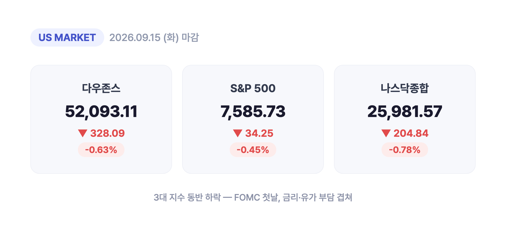
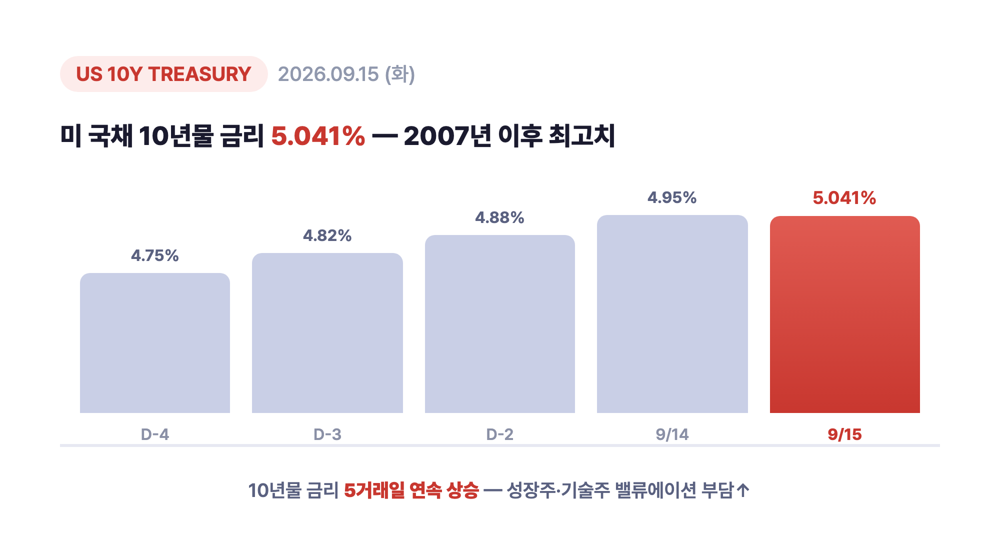
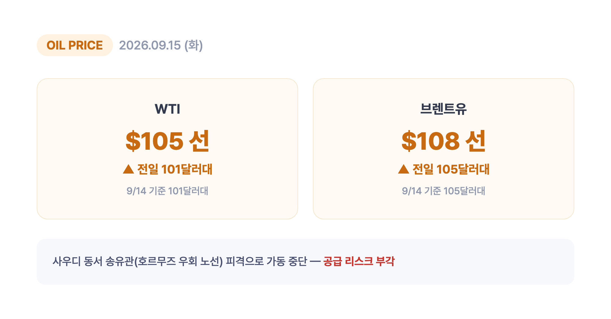
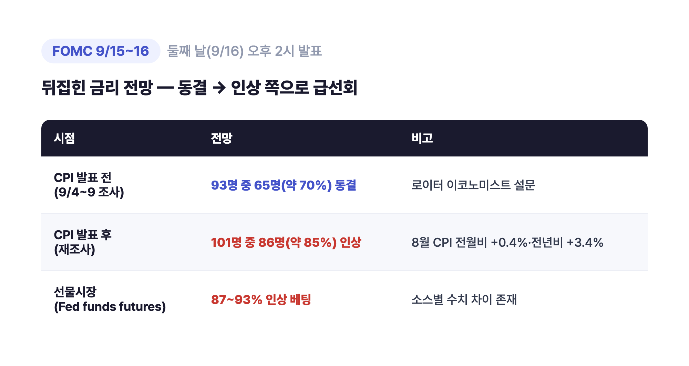
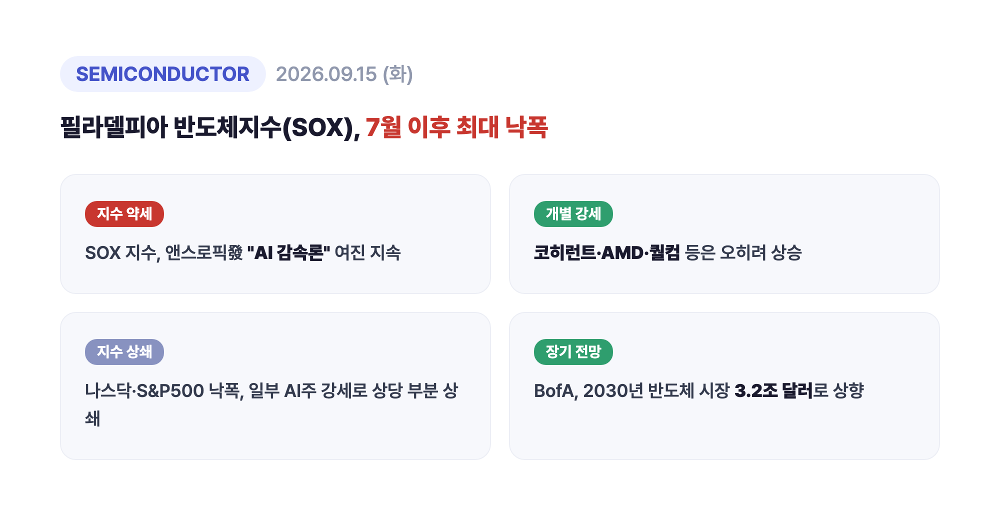
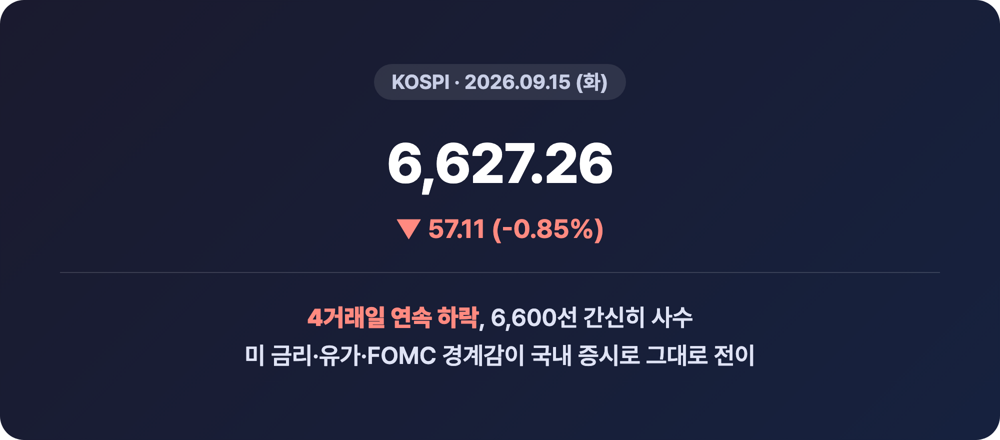

# [내일도 주린이] 국채금리 2007년 이후 최고, 뉴욕증시 일제히 하락…FOMC 개막에 유가도 급등 (9/15)

안녕하세요, '내일도 주린이'입니다 👋

어제(9/14)는 앤스로픽發 "AI 감속론"에 반도체주가 우르르 무너지더니, 9/15엔 아예 국채금리에 유가까지 한꺼번에 시장을 눌렀어요. "어제 하루 쉬어가나" 했는데요, 하루 더 빨간불이었습니다. 오늘은 9/15(화) 뉴욕증시 마감 시황, 국채금리·국제유가 급등 배경, 그리고 하루 앞으로 다가온 FOMC 전망까지 한번에 정리해볼게요.

---

## 🇺🇸 뉴욕증시 마감 시황 (3대 지수 동반 하락)

> **다우존스 52,093.11 (-328.09포인트, -0.63%) / S&P500 7,585.73 (-34.25포인트, -0.45%) / 나스닥 25,981.57 (-204.84포인트, -0.78%)**

| 지수 | 종가 | 전일 대비 | 등락률 |
|---|---|---|---|
| 다우존스 | 52,093.11 | -328.09포인트 | -0.63% |
| S&P500 | 7,585.73 | -34.25포인트 | -0.45% |
| 나스닥종합 | 25,981.57 | -204.84포인트 | -0.78% |

3대 지수가 나란히 하락 마감했어요. 미 연준(Fed)의 9월 FOMC 정례회의가 9/15~16 이틀 일정으로 이날 막을 올렸는데요, 정책 발표는 둘째 날인 9/16(수)이라 시장은 하루 종일 결과를 기다리며 눈치를 봤습니다. 여기에 국채금리 급등과 국제유가 상승까지 겹치면서 투자심리가 위축된 하루였어요. 저는 개인적으로 "FOMC 앞두고 조용히 숨죽이려나" 싶었는데, 실제로는 금리·유가 뉴스에 더 크게 흔들리는 장이었습니다.

---

## 💵 미 국채금리, 2007년 이후 최고치

> **미 국채 10년물 금리 5.041% (2007년 이후 최고치)**

10년물 국채금리가 9/15 장중 5.041%까지 올라 2007년 이후 최고치를 찍었어요. 10년물 금리는 이날까지 5거래일 연속 상승세였다고 합니다. 사실 전날(9/14)에도 장중 한때 5%를 살짝 넘었다가 종가는 다시 4%대로 내려온 적이 있었는데요, 9/15엔 아예 다시 뚫고 올라가면서 종가 기준으로도 5%대에 바짝 붙은 셈이에요. "또 5%야?" 했는데 이번엔 진짜였습니다.

국채금리가 이렇게 오르면 주식 밸류에이션에는 당연히 부담이에요. 특히 성장주·기술주 쪽이 금리에 민감하게 반응하는데, 이날 나스닥 낙폭이 다우·S&P500보다 컸던 것도 이 영향으로 볼 수 있어요.

---

## 🛢 국제유가 급등 - 사우디 우회 송유관 피격 여파

> **WTI 배럴당 105달러 선 / 브렌트유 108달러 선**

국제유가도 계속 오르면서 WTI가 배럴당 105달러 선, 브렌트유는 108달러 선까지 올라섰어요. 사우디아라비아가 호르무즈 해협을 거치지 않고 원유를 홍해 얀부항으로 실어나르는 핵심 우회 송유관(동서 송유관)이 공격을 받아 가동이 중단된 게 배경이에요. 이라크 내 친이란 성향 민병대가 지난 9월 10일 이 송유관을 공격한 것으로 전해집니다.

전날(9/14) 기준으로는 WTI가 101달러대, 브렌트유가 105달러대였는데요, 9/15엔 여기서 더 올라선 거예요. 호르무즈 해협을 아예 거치지 않는 우회 노선까지 타격을 입었다는 점에서 "이번엔 진짜 공급 리스크네" 싶은 뉴스였습니다.

---

## 🏦 FOMC 첫날 개막 - 뒤집힌 금리 전망

> **로이터 이코노미스트 설문: CPI 발표 전 70% 동결 → CPI 발표 후 85% 인상 예상 / 선물시장은 줄곧 87~93% 인상 베팅**

9/15~16 이틀 일정으로 열리는 9월 FOMC 정례회의 첫날이었어요. 실제 정책 결정 발표는 둘째 날인 9/16(수) 오후 2시(미 동부시간 기준, 한국시간으로는 9/17 새벽)에 나올 예정입니다.

| 시점 | 전망 | 비고 |
|---|---|---|
| CPI 발표 전 (9/4~9 조사) | 93명 중 65명(약 70%) 동결 전망 | 로이터 이코노미스트 설문 |
| CPI 발표 후 (재조사) | 101명 중 86명(약 85%) 인상 전망 | 8월 CPI 전월비 +0.4%·전년비 +3.4% 서프라이즈 |
| 선물시장(Fed funds futures) | 87~93% 인상 베팅 | 소스별로 수치는 조금씩 다름 |

흥미로운 건 이코노미스트 설문과 선물시장의 온도차예요. 로이터 설문은 CPI 발표 전까지만 해도 "동결"에 무게가 실려 있었는데, 8월 CPI가 예상보다 높게 나오면서 순식간에 "인상" 쪽으로 뒤집혔어요. 반면 선물시장은 그 전부터 쭉 인상 쪽에 더 강하게 베팅해왔다고 하니, 시장이 이코노미스트들보다 한발 먼저 움직인 셈이죠. (선물시장 반영 확률은 소스마다 87%~93%로 조금씩 다르게 나오는데, 이건 집계 시점 차이로 보여요. 저도 정리하면서 수치가 다 달라서 헷갈렸는데, 여러 소스 공통으로 "인상 쪽이 훨씬 우세하다"는 방향성은 같았습니다.)

---

## 💻 반도체·AI 관련주 - SOX 낙폭 지속, 개별 종목은 온도차

필라델피아 반도체지수(SOX)는 9/15에도 큰 폭으로 밀리면서 7월 이후 최대 하루 낙폭을 기록했다는 평가가 나왔어요. 전날(9/14)엔 앤스로픽 CEO 다리오 아모데이가 "AI 프런티어 모델 개발 속도를 늦춰야 한다"는 취지의 에세이를 내놓으면서 반도체·AI 관련주 전반이 크게 흔들렸었는데요, 그 여진이 9/15까지 이어진 모습이에요.

다만 종목별로는 온도차가 뚜렷했습니다. 나스닥·S&P500 전체 낙폭은 일부 AI 관련주 강세로 상당 부분 상쇄됐는데, 코히런트(Coherent)·AMD·퀄컴(Qualcomm) 같은 종목은 오히려 개별 강세를 보였다고 해요. "반도체가 다 같이 빠지는 건 아니구나" 싶었던 대목입니다. 한편 BofA는 2030년 글로벌 반도체(칩) 시장 규모 전망치를 3.2조 달러로 상향 조정했다는 소식도 같이 전해졌어요, 단기 조정과 별개로 장기 전망은 여전히 밝게 본다는 신호로 볼 수 있겠습니다.

---

## 🇰🇷 같은 날 코스피도 4거래일 연속 하락

> **코스피 6,627.26 (-57.11포인트, -0.85%)**

같은 날 국내 코스피도 전 거래일 대비 0.85% 내린 6,627.26으로 마감하며 4거래일 연속 하락, 6,600선을 간신히 지켰어요. 미 국채금리 재상승, 국제유가의 배럴당 100달러대 돌파, FOMC 경계감이 한꺼번에 국내 증시에도 부담으로 작용한 걸로 보입니다. 미장이 흔들리니 국장도 같이 흔들리는, 요즘 익숙한 패턴이죠.

---

## 마무리하며

9/15 뉴욕증시는 다우 -0.63%, S&P500 -0.45%, 나스닥 -0.78%로 3대 지수 모두 하락 마감했어요. 국채 10년물 금리는 2007년 이후 최고치인 5.041%, 국제유가는 WTI 105달러·브렌트유 108달러까지 올라섰고요. FOMC 발표는 하루 남았습니다.

솔직히 이렇게 금리·유가·FOMC가 한꺼번에 겹치는 날은 뭘 어떻게 해야 할지 감이 잘 안 와요. 저는 일단 내일 새벽 FOMC 발표 전까지는 무리하게 움직이지 않고 지켜보려고 합니다. 인상이든 동결이든 발표 나오는 순간 변동성이 확 커질 테니, 다들 무리한 베팅은 조심하시길요.

오늘도 손절, 내일은 익절. 무럭무럭 자라볼게요 🌱