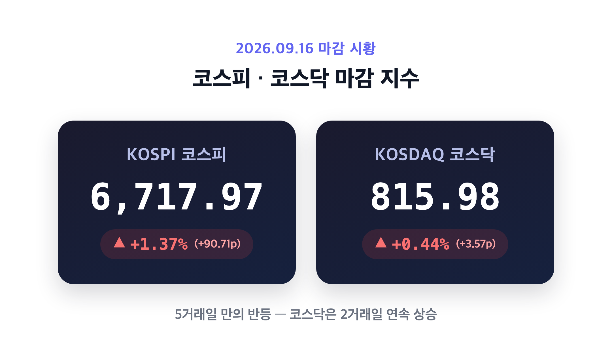
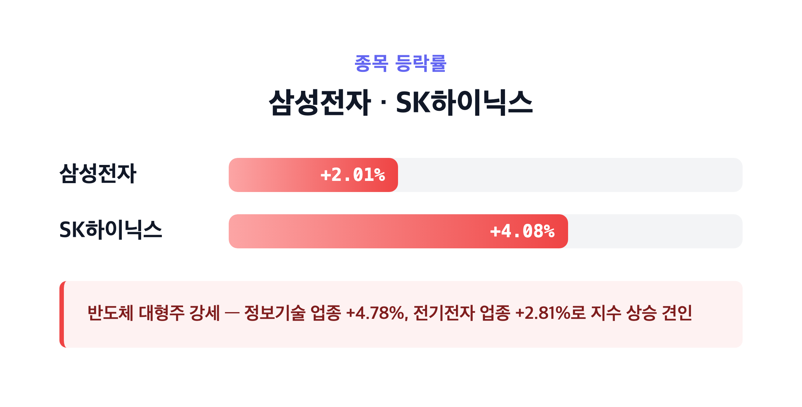
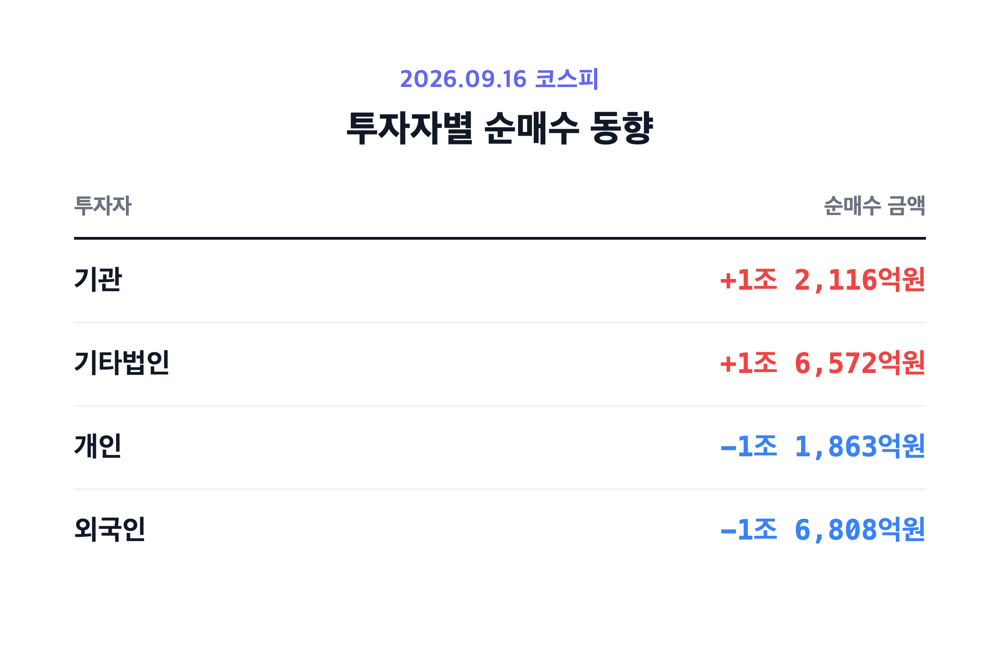
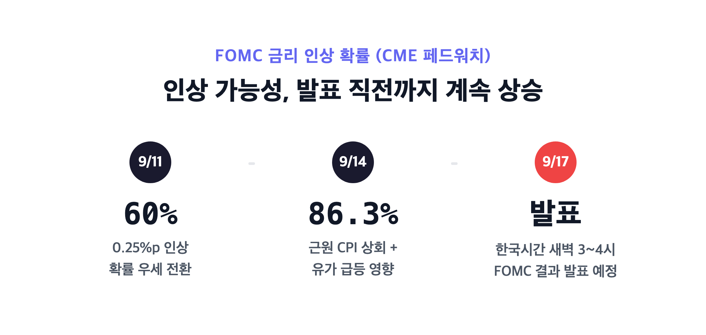

# 코스피 5거래일만에 반등, 6717선 회복…반도체가 살렸다 (9/16)

안녕하세요, '내일도 주린이'입니다 👋

어제 코스피 4거래일 연속 하락에 미국 국채금리 5%대, 유가 100달러 돌파까지 겹쳐서 "이러다 6600선도 위태롭겠는데" 했었는데요, 오늘은 반대로 코스피가 1%대 반등에 성공했습니다. 그것도 장중엔 6,598선까지 밀렸다가 반도체 저가 매수세로 확 뒤집힌 롤러코스터였어요. 오늘 국장 마감 시황, 꼼꼼히 정리해볼게요.

---

## 🇰🇷 코스피·코스닥 마감 시황 (5거래일만의 반등)

> **코스피 6,717.97 (+90.71포인트, +1.37%) / 코스닥 815.98 (+3.57포인트, +0.44%)**

| 지수 | 종가 | 전일비 | 등락률 |
|---|---|---|---|
| 코스피 | 6,717.97 | +90.71p | +1.37% |
| 코스닥 | 815.98 | +3.57p | +0.44% |

코스피는 5거래일 만에 반등했고, 코스닥은 2거래일 연속 상승 마감했습니다. 근데 오늘 장, 시작부터 순탄하진 않았어요. 6,611.24로 약보합 출발하더니 한때 6,598.87까지 밀리면서 "어 이러다 6,600 깨지는 거 아니야" 싶은 순간이 있었거든요. 그런데 오후 들어 반도체 대형주 쪽으로 저가 매수세가 확 들어오면서 지수가 순식간에 상승 전환했습니다. 저는 장중 이 흐름 보면서 "아 오늘도 그냥 흘러가나 보다" 했다가 뒤통수 맞은 기분이었어요. 원/달러 환율은 전일보다 9.2원 오른 1,368.6원으로 마감했습니다.

---

## 📈 반도체가 이끈 상승 – 삼성전자·SK하이닉스 강세

> **삼성전자 +2.01% / SK하이닉스 +4.08%**

| 업종 | 등락률 |
|---|---|
| 정보기술 | +4.78% |
| 전기전자 | +2.81% |
| 의료정밀 | +1.75% |
| 건설 | -2.37% |
| 전기가스 | -1.60% |

오늘 코스피 반등, 사실상 반도체 대형주가 다 했다고 봐도 될 정도예요. 삼성전자가 +2.01%, SK하이닉스가 +4.08% 올랐고 업종별로도 정보기술(+4.78%)·전기전자(+2.81%)가 지수를 끌어올렸습니다(일부 매체는 두 종목을 묶어서 "3%대 강세"로만 언급하기도 했는데, 정확한 수치는 세계일보 기준으로 정리했어요). 반대로 건설(-2.37%), 전기가스(-1.60%) 업종은 약세였고요. 장 초반엔 빛과전자·대한광통신 같은 광통신 관련주가 먼저 급등하면서 분위기를 띄웠는데, 결국 지수를 실제로 끌어올린 건 반도체 대형주였습니다.

---

## 💰 수급 동향 – 기관·기타법인 매수 vs 외국인 6거래일 연속 매도

> **기관 +1조 2,116억원 / 기타법인 +1조 6,572억원 / 개인 -1조 1,863억원 / 외국인 -1조 6,808억원**

| 투자자 | 순매수(코스피) |
|---|---|
| 기관 | +1조 2,116억원 |
| 기타법인 | +1조 6,572억원 |
| 개인 | -1조 1,863억원 |
| 외국인 | -1조 6,808억원 |

수급 구조를 보면 외국인은 오늘까지 6거래일 연속 순매도를 이어갔어요. 그런데도 지수가 오른 건 기관과 기타법인이 그만큼 강하게 받쳐줬기 때문입니다. 개인은 오늘도 순매도였고요. 저는 이 표 보면서 "외국인이 계속 파는데 지수는 오르네" 싶었는데, 결국 국내 기관·기타법인이 저가 매수로 반등을 만든 하루였던 거죠.

---

## 🔮 FOMC 변수 – 아직 발표 전, 금리 인상 가능성이 우세

> **FOMC 결과 발표 예정: 한국시간 9/17(목) 새벽 3~4시경**

오늘(9/16) 국내 정규장이 마감된 시점엔 미국 FOMC 결과가 아직 나오지 않은 상태였어요. FOMC는 미국 동부시간 기준 9월 15~16일 이틀 일정으로 진행됐고, 기준금리 발표는 한국시간으로 9월 17일 새벽에 예정돼 있었거든요. 시장에서는 이번에 0.25%포인트 금리 인상 가능성을 우세하게 보고 있었습니다. CME 페드워치 기준 인상 확률이 9월 11일 약 60%에서 9월 14일 약 86.3%까지 올라간 상태였는데, 미국 8월 근원 CPI가 예상치를 웃돌고 중동발 유가 급등까지 겹친 영향이라고 해요. 실제 발표 결과가 인상이었는지, 동결이었는지는 오늘 장 마감 시점에서는 아직 알 수 없는 부분이라 이번 글에서는 다루지 않을게요(그건 내일 글 소재로 남겨두겠습니다).

이런 경계감이 유지된 채로도 코스피는 반등했다는 게 오늘의 포인트예요. 전일(9/15) 미국 3대 지수는 다우 -0.63%(52,093.11), S&P500 -0.45%(7,585.73), 나스닥 -0.78%(25,981.57)로 동반 하락했고, 미 10년물 국채금리는 장중 5.04%를 넘어서며 2007년 이후 최고 수준을 찍었습니다. 국제유가도 WTI가 배럴당 101.39달러(+1.3%), 브렌트유가 105.68달러(+1.0%)로 100달러를 웃돌았고요. 이 여파로 어제 코스피는 0.85%(-57.11p) 내린 6,627.26에 마감하며 4거래일 연속 하락을 기록했었거든요. 그런데도 오늘은 반도체 저가 매수세가 이 모든 경계감을 이겨내고 반등을 만들어냈습니다.

---

## 마무리하며

오늘 코스피는 6,717.97(+1.37%)로 5거래일 만에 반등했고, 코스닥도 815.98(+0.44%)로 2거래일 연속 올랐습니다. 장중엔 6,598선까지 밀렸다가 반도체 저가 매수로 뒤집힌 하루였고요.

솔직히 어제까지 4거래일 연속 하락 보면서 "이거 당분간 계속 빠지겠는데" 싶었는데, 반도체가 이렇게 확 살려줄 줄은 몰랐습니다. 저는 일단 내일 새벽 FOMC 결과 나오는 거 보고, 그 결과에 따라 포트폴리오 다시 점검해보려고요.

오늘도 손절, 내일은 익절. 무럭무럭 자라볼게요 🌱

#국장정리 #코스피 #코스닥 #FOMC금리
