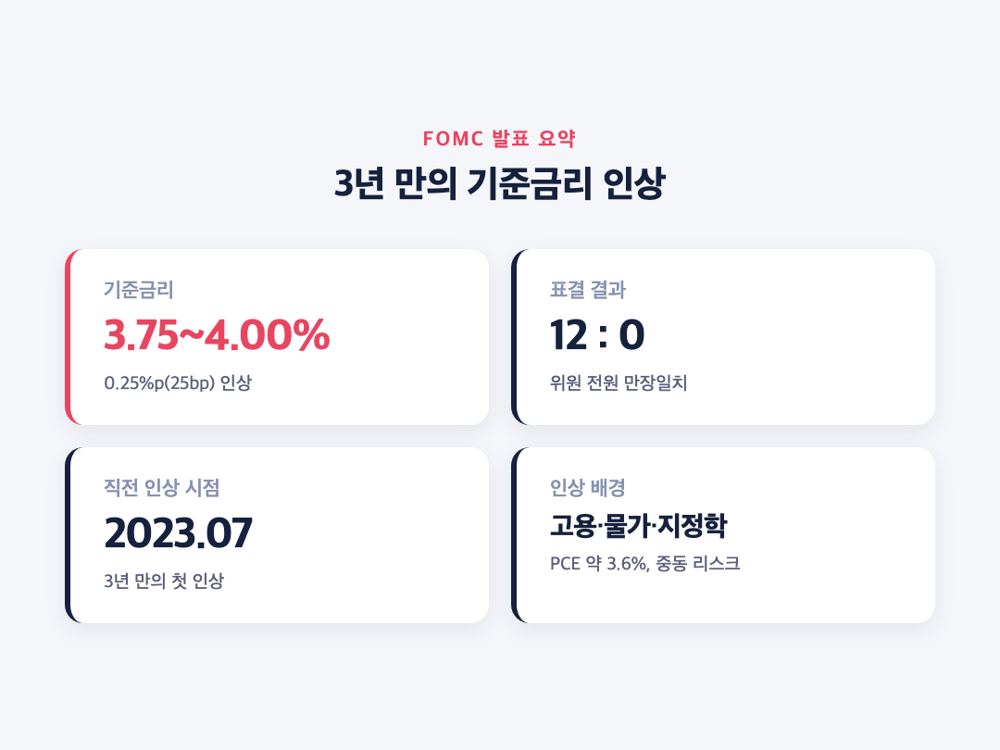
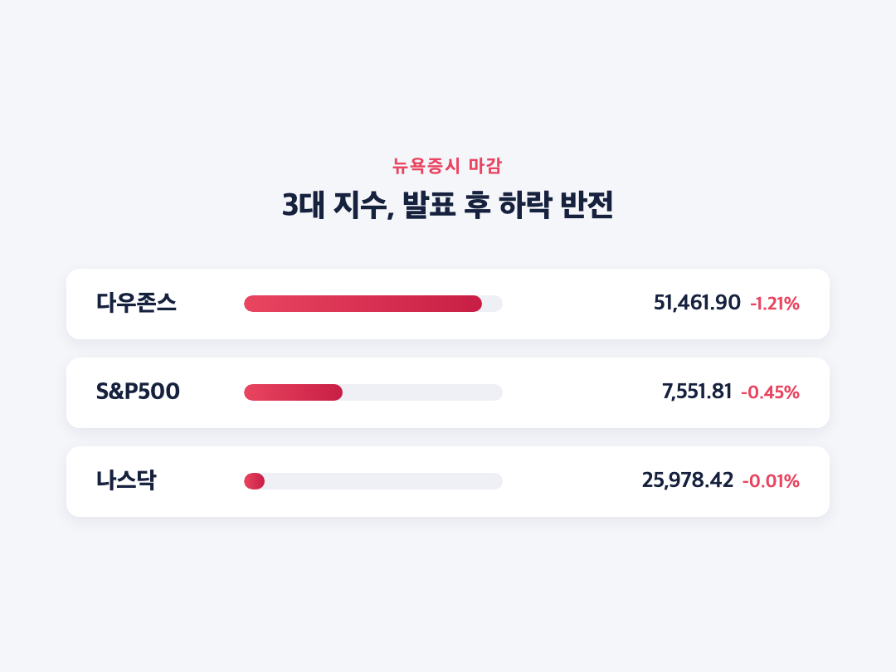
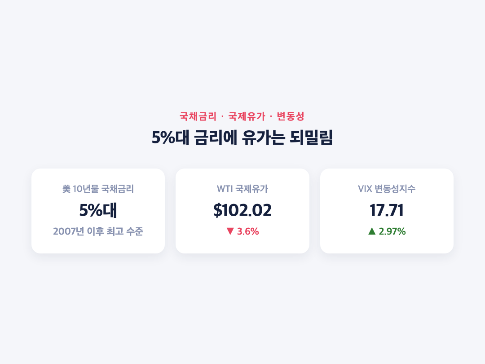
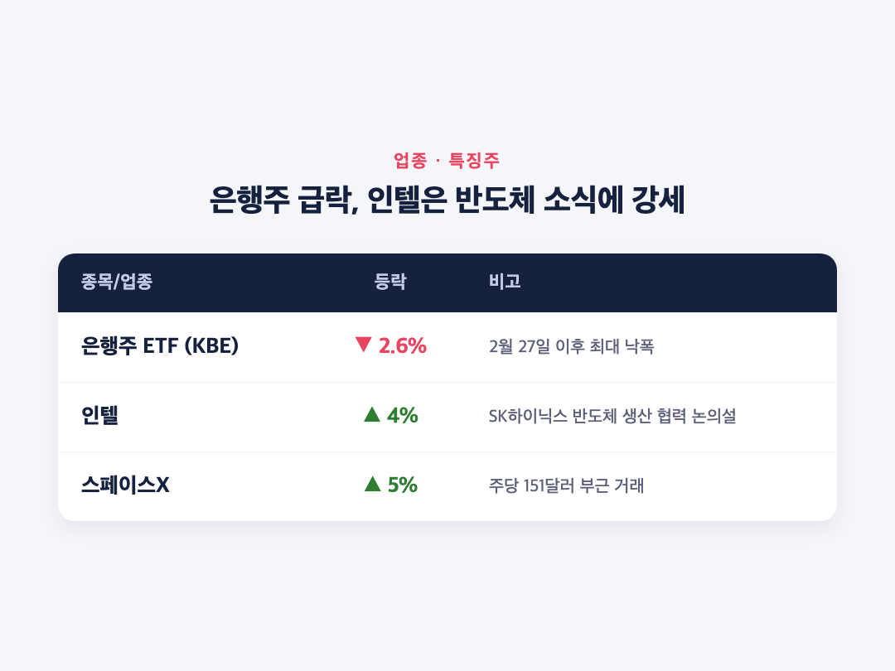

# [내일도 주린이] 3년 만의 기준금리 인상…뉴욕증시 하락 마감, 은행주 급락 (9/16)

안녕하세요, '내일도 주린이'입니다 👋

어제(9/15)까지만 해도 "이제 금리 인상은 기정사실이니까 선반영 좀 끝나겠지" 했는데요, 막상 9/16 FOMC 결과가 나오니까 시장이 또 한 번 출렁였습니다. 2023년 7월 이후 3년 만에 나온 진짜 '금리 인상'이었거든요. 오늘은 9.16 미장 정리, FOMC 금리 인상 발표부터 뉴욕증시 마감까지 정리해볼게요.

---

## 🏦 FOMC 금리 인상 – 3년 만의 첫 인상, 12대 0 만장일치

> **기준금리 3.75%~4.00% (0.25%p 인상) / 표결 12대 0 만장일치**

연방공개시장위원회(FOMC)가 기준금리를 0.25%포인트(25bp) 올려서 3.75%~4.00%로 결정했어요. 2023년 7월 이후 3년 만의 첫 금리 인상이고, 표결도 12대 0 만장일치였습니다. 그동안 시장은 계속 '인하' 얘기만 하던 분위기였는데, "어? 여기서 갑자기 올린다고?" 싶으셨을 분들 많으실 것 같아요.

인상 배경은 크게 세 가지로 꼽혔어요. 견조한 고용시장, 목표치를 크게 웃도는 인플레이션(PCE 약 3.6%), 그리고 중동 지정학적 긴장에 따른 에너지發 인플레이션 리스크입니다. 연준이 지금 시점에 물가를 더 중요하게 본 거죠.

---

## 🎤 새 연준 의장 케빈 워시 – 매파적 발언과 트럼프 압박에도 만장일치

> **"인플레이션이 너무 높고, 너무 오래 지속됐다" – 케빈 워시 연준 의장**

이번 기자회견을 이끈 건 제롬 파월이 아니라 새 연준 의장인 케빈 워시입니다. 파월 의장 임기가 지난 5월 15일 끝났고, 후임으로 지명된 워시가 상원 인준을 거쳐 5월 22일 제17대 연준 의장으로 취임했거든요. 그래서 이번 발언 주체는 '파월'이 아니라 '워시'라는 점, 헷갈리지 않게 짚고 갈게요.

워시 의장은 기자회견에서 "인플레이션이 너무 높고, 너무 오래 지속됐다"고 못 박았고, "근원 인플레이션이 목표치로 명확하고 충분히 빠르게 수렴하고 있다는 확신이 필요하다"고 밝혔어요. 물가 안정이 결국 임금 근로자를, 특히 저소득층을 가장 크게 돕는다는 점도 강조했다고 해요. 이번 결정을 두고는 "확고한 만장일치 결정(a firm unanimous decision)"이라고 표현했습니다.

눈에 띄는 건 트럼프 대통령과 백악관이 계속 금리 동결·인하를 압박해왔는데도, 워시 의장을 포함한 위원 전원이 인상에 표를 던졌다는 점이에요. 그래서 이번 결정이 연준의 독립성을 재확인한 사례로 해석되고 있습니다. 저는 이 대목 보고 "와 이건 좀..." 싶었어요. 정치적 압박이 있는데도 데이터 보고 그대로 밀어붙인 거니까요.

점도표(dot plot)도 눈여겨볼 만해요. 위원 18명 중 12명이 2026년 내 추가 25bp 인상을 예상했고, 4명은 50bp 추가 인상이 필요하다고 봤어요. 추가 인상이 필요 없다고 본 위원은 2명뿐이었습니다. 중앙값 기준으로는 연내 25bp 추가 인상 1회, 2027년은 동결로 전망됐어요. 즉 이번 한 번으로 끝이 아니라는 신호를 시장에 미리 던진 셈입니다.

---

## 🇺🇸 뉴욕증시 마감 시황 – 발표 전 상승, 발표 후 하락 반전

> **다우 51,461.90 (-631.21p, -1.21%) / S&P500 7,551.81 (-33.92p, -0.45%) / 나스닥 25,978.42 (-3.15p, -0.01%)**

FOMC 발표 전까지는 3대 지수 모두 상승세였어요. 그런데 금리 인상 발표와 워시 의장의 매파적(hawkish) 기자회견 발언이 나오자마자 낙폭이 커지면서 하락 반전 마감했습니다. "오전엔 분위기 괜찮았는데" 싶었던 투자자분들 많으셨을 거예요.

다우존스는 631.21포인트(-1.21%) 빠진 51,461.90에 마감했고, S&P500은 33.92포인트(-0.45%) 내린 7,551.81, 나스닥은 3.15포인트(-0.01%) 하락한 25,978.42로 끝났어요. 나스닥은 사실상 보합에 가까운 소폭 하락이었는데, 뒤에서 설명드릴 인텔 강세가 낙폭을 어느 정도 막아준 영향이 있습니다.

(일부 매체는 다우 -1.3%, S&P500 -0.5%, 나스닥 -0.08% 등 소폭 다른 수치를 보도했는데요, 실시간 업데이트되는 라이브 기사라 마감 반영 시점 차이에서 비롯된 걸로 보여요. 하락 방향 자체는 동일하고, 저는 이번 글에서는 아시아경제 보도로 교차 확인된 Yahoo Finance 수치를 기준으로 정리했습니다.)

---

## 💵 국채금리·국제유가 – 5%대 금리에 유가는 오히려 되밀림

> **10년물 국채금리 5%대 유지 / WTI $102.02 (-3.6%) / VIX 17.71 (+2.97%)**

FOMC 발표 후에도 10년물 미 국채금리는 5%를 웃도는 수준을 유지했어요. 2007년 이후 최고 수준대라고 하니, 금리 부담이 여전히 만만치 않은 상황입니다.

흥미로운 건 국제유가 흐름이에요. WTI(10월물)는 배럴당 102.02달러로 전장 대비 3.6% 내렸는데요, 전날인 9/15에는 105.83달러까지 올랐었거든요. 하루 만에 급등분을 상당 부분 되돌린 셈이에요. 금리 인상 결정이 달러 강세·수요 둔화 기대를 자극하면서 유가 상승분을 눌러버린 걸로 풀이됩니다. 저는 이 부분 보면서 "금리 하나로 이렇게 유가까지 움직이는구나" 싶었어요. VIX(변동성지수)도 17.71로 2.97% 올라서 불안 심리가 소폭 확대된 모습이었습니다.

---

## 📉 업종·특징주 – 은행주 급락, 인텔은 SK하이닉스 소식에 강세

> **은행주 ETF(KBE) -2.6% (2월 이후 최악) / 인텔 +4% / 스페이스X +5%**

| 종목/업종 | 등락 | 비고 |
|---|---|---|
| 은행주 ETF(KBE) | -2.6% | 2월 27일 이후 최대 낙폭 |
| 인텔 | +4% | SK하이닉스와 미국 내 반도체 생산 협력 논의설 |
| 스페이스X | +5% | 주당 151달러 부근 거래 |

추가 금리 인상 우려가 가장 직접적으로 반영된 곳은 은행주였어요. SPDR S&P 은행 ETF(KBE)가 2.6% 빠지면서 2월 27일 이후 최악의 하루를 기록했습니다. 금리가 더 오를 수 있다는 부담이 대출·자산 건전성 우려로 바로 이어진 거죠.

반대로 인텔은 한국 SK하이닉스와 미국 내 반도체 생산 협력을 논의 중이라는 보도가 나오면서 4% 올랐어요. 나스닥이 거의 보합으로 방어된 데는 인텔 강세도 한몫한 걸로 보입니다. 스페이스X도 151달러 부근에서 거래되며 5% 강세를 보였고요. 참고로 빅테크 개별 종목의 9/16 당일 구체적 등락은 신뢰할 만한 소스로 확인되지 않아서 이번 정리에서는 다루지 않았습니다.

---

## 마무리하며

오늘 미장 핵심은 결국 하나예요. 3년 만에 나온 기준금리 인상(3.75%~4.00%, 12대 0 만장일치)에 다우가 1.21% 빠지고, 은행주는 2월 이후 최악의 하루를 보냈다는 것. 워시 의장의 매파적 발언과 점도표(18명 중 12명이 연내 추가 인상 예상)까지 감안하면, 당분간 금리 부담이 시장을 계속 짓누를 가능성이 커 보여요.

솔직히 저는 "인하는 언제쯤"만 생각하고 있었는데, 이렇게 인상이 먼저 나올 줄은 몰랐습니다. 일단 오늘 흐름 잘 기록해두고, 다음 FOMC 전까지 은행주랑 국채금리 움직임 좀 더 챙겨보려고요.

오늘도 손절, 내일은 익절. 무럭무럭 자라볼게요 🌱
