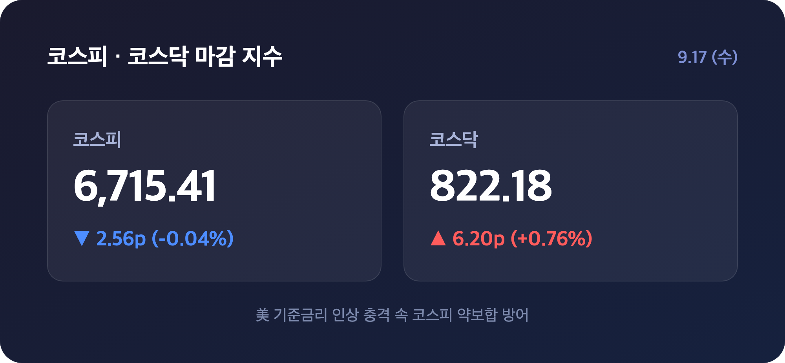
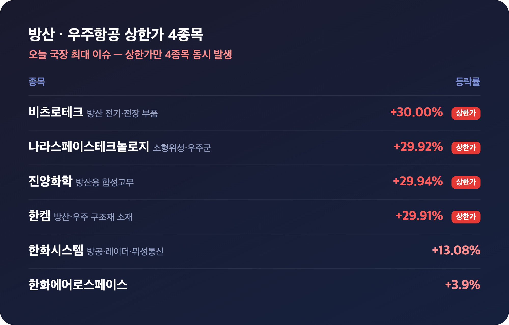
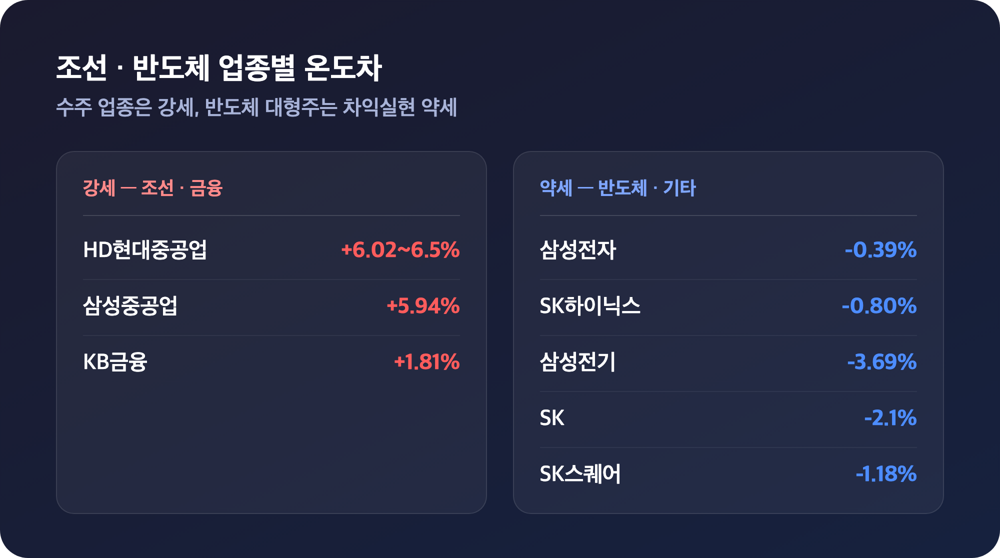
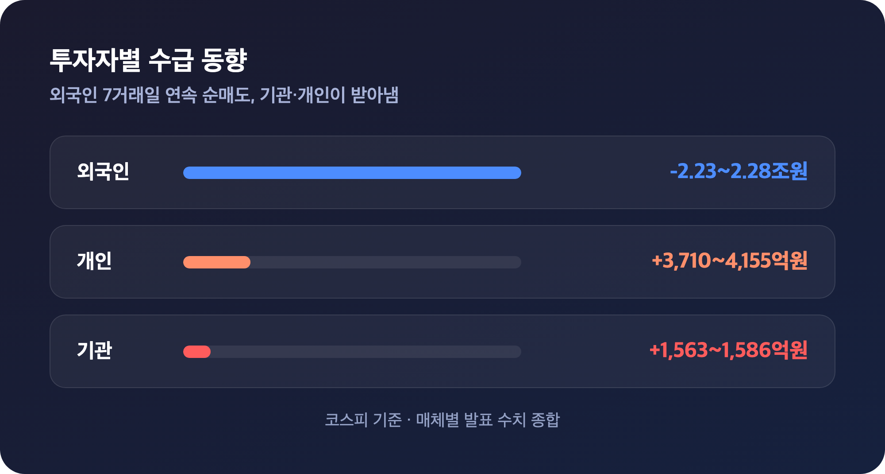

# [내일도 주린이] 코스피 6,715선 약보합 방어…방산·우주항공 상한가 4종목 폭주 (9/17)

안녕하세요, '내일도 주린이'입니다 👋

어제 미국이 3년 2개월 만에 기준금리를 올렸다는 소식에 "이거 오늘 코스피 진짜 빠지겠다" 싶었는데요, 막상 뚜껑을 열어보니 장중엔 롤러코스터를 타면서도 결국 약보합으로 버텼습니다. 대신 방산·우주항공 테마에서 상한가가 무려 4종목이나 나오면서 눈을 뗄 수가 없었어요. 오늘 국장 정리 시작합니다.

---

## 🇰🇷 코스피 마감 시황 (美 기준금리 인상 충격에도 약보합 방어)

> **코스피 6,715.41 (-2.56포인트, -0.04%) / 코스닥 822.18 (+6.20포인트, +0.76%)**

| 지수 | 종가 | 등락 | 등락률 |
|---|---|---|---|
| 코스피 | 6,715.41 | -2.56p | -0.04% |
| 코스닥 | 822.18 | +6.20p | +0.76% |

간밤 미국 연방준비제도가 기준금리를 0.25%포인트 올려 3.75~4.00%로 인상했어요. 2023년 7월 이후 3년 2개월 만의 첫 인상인 데다 위원 12명 전원 찬성이었고, 케빈 워시 연준 의장이 기자회견에서 인플레이션 위험을 강조하는 매파적 발언까지 내놓으면서 뉴욕 3대 지수가 다우 -1.21%, S&P500 -0.45%, 나스닥 -0.01%로 일제히 하락 마감했거든요. "이 정도면 오늘 코스피 최소 1%는 빠지겠다" 싶었는데, 결과는 예상 밖이었습니다.

실제로 코스피는 전장보다 0.91%(+61.05p) 오른 6,779.02로 화끈하게 출발해서 장 초반엔 6,795.53까지 상승폭을 더 키웠어요. "오 이 정도면 6,800도 가능한가" 했는데요, 그 뒤부터 오름폭을 조금씩 반납하더니 장 후반엔 아예 하락 전환해서 6,697.85까지 밀렸습니다. 그러다 막판에 낙폭을 다시 줄이면서 6,715.41로 마감했어요. 하루 동안 거의 100포인트를 오르내린 셈인데, 금리 인상이 이미 시장에 상당 부분 선반영돼 있었던 데다 국제유가 상승세도 진정된 게 낙폭을 제한한 요인으로 꼽힙니다.

| 미국 지수 | 등락률 | 종가 |
|---|---|---|
| 다우존스 | -1.21% | 51,461.90 |
| S&P500 | -0.45% | 7,551.81 |
| 나스닥 | -0.01% | 25,978.42 |

---

## 🚀 오늘의 하이라이트, 방산·우주항공 상한가 4종목 폭주

> **비츠로테크 +30.00% / 나라스페이스테크놀로지 +29.92% / 한켐 +29.91% / 진양화학 +29.94% — 나란히 상한가**

오늘 국장에서 가장 뜨거웠던 건 단연 방산·우주항공 테마였어요. 상한가만 4종목이 동시에 터졌는데, 이런 날은 흔치 않거든요.

| 종목 | 등락률 | 비고 |
|---|---|---|
| 비츠로테크 | +30.00% (상한가) | 방산 전기·전장 부품 |
| 나라스페이스테크놀로지 | +29.92% (상한가) | 소형위성·우주군 발주 기대 |
| 한켐 | +29.91% (상한가) | 방산·우주 구조재 소재 |
| 진양화학 | +29.94% (상한가) | 방산용 합성고무 |
| 한화시스템 | +13.08% | 방공·레이더·위성통신 수출 |
| 한화에어로스페이스 | +3.9% | - |

왜 이렇게 급등했나 보면요, 비츠로테크는 방산용 전기·전장 부품을, 한켐은 방산·우주 구조재 소재를, 진양화학은 방산용 합성고무를 만드는 회사라 방산 발주 확대의 직접 수혜주로 묶였고요. 나라스페이스테크놀로지는 소형위성 사업을 하는데 우주군 관련 발주 기대감이 붙으면서 단숨에 상한가로 직행했습니다. 방산 대장주 격인 한화시스템(+13.08%)과 한화에어로스페이스(+3.9%)까지 동반 강세를 보이면서 테마 전체가 하루 종일 시장을 지배했어요. 저는 이 종목들 하나도 안 들고 있었는데, 실시간으로 상한가 뜨는 거 보면서 "아... 이건 또 놓쳤네" 했습니다. 국룰이죠 뭐.

---

## 🚢 조선·반도체 등 업종별 온도차

> **HD현대중공업 +6.02%~+6.5% / 삼성중공업 +5.94% — 조선은 방산과 함께 강세, 반도체 대형주는 차익실현 약세**

방산·우주항공만큼은 아니었지만 조선주도 눈에 띄게 강했어요. 군함·LNG선 수주 랠리가 이어지면서 방산·조선 등 수주 업종으로 순환매가 나타났다는 분석이 나왔습니다.

| 구분 | 종목 | 등락률 |
|---|---|---|
| 조선 | HD현대중공업 | +6.02%~+6.5% |
| 조선 | 삼성중공업 | +5.94% |
| 금융 | KB금융 | +1.81% |
| 반도체 대형주 | 삼성전자 | -0.39% |
| 반도체 대형주 | SK하이닉스 | -0.80% |
| 기타 하락 | 삼성전기 | -3.69% |
| 기타 하락 | SK스퀘어 | -1.18% |
| 기타 하락 | SK | -2.1% |

반면 어제 각각 +2.01%, +4.08% 급등했던 삼성전자(-0.39%)와 SK하이닉스(-0.80%)는 오늘 차익실현 물량에 외국인 매도까지 겹치면서 나란히 약세로 돌아섰어요. 삼성전자우(-0.67%), SK스퀘어(-1.18%), 시총 5위 삼성전기(-3.69%)도 같이 밀렸고요. 다만 삼성전자·SK하이닉스가 자사주 매입에 나서면서 '기타법인' 순매수가 최대 1조 7,047억 원에 달했다는 점은 눈여겨볼 만합니다. 고금리 국면 수혜주로 꼽히는 KB금융(+1.81%)은 방어주 역할을 톡톡히 했고요.

코스닥에서는 방산·우주항공 열기에 더해 바이오·성장주 매수세가 상승을 뒷받침했어요. 셀트리온(+1.7%)은 올랐지만, 에코프로(-0.12%)·에코프로비엠(-1.15%) 등 2차전지 대형주는 장중 기준 약세를 보였습니다. "요즘은 진짜 테마 안 타면 손도 못 댄다" 싶은 하루였어요.

---

## 💰 수급 동향과 환율, 외국인 7거래일 연속 매도

> **외국인 순매도 약 2조 2,300억~2조 2,800억원 / 기관 순매수 약 1,563억~1,586억원 / 개인 순매수 약 3,710억~4,155억원**

| 투자자 | 코스피 수급 |
|---|---|
| 외국인 | 약 2조 2,300억~2조 2,800억원 순매도 (7거래일 연속 매도) |
| 기관 | 약 1,563억~1,586억원 순매수 |
| 개인 | 약 3,710억~4,155억원 순매수 |

장 마감 이후 보도된 매체들을 종합하면 외국인이 코스피에서 2조 원 넘게 순매도하며 7거래일 연속 매도 우위를 이어갔고, 그 물량을 기관과 개인이 나눠 받아내며 지수를 방어한 모양새예요. (수급 수치는 매체마다 발표 시점에 따라 차이가 꽤 컸는데요, 가장 늦은 시점에 보도되고 서로 근접한 세 매체 수치를 기준으로 정리했습니다.) 코스닥에서는 기관이 449억 원 순매수하며 상승을 주도했다는 분석도 있었어요.

환율도 같이 흔들렸습니다. 원/달러 환율은 전 거래일보다 13.6원(0.99%) 오른 1,382.2원에 마감하며 8월 27일(1,380.9원) 이후 약 3주 만에 다시 1,380원대에 진입했어요. 미국의 기준금리 인상과 추가 인상 가능성이 원인으로 꼽혔는데, "추세적 반등은 아니다"라는 시각도 함께 나오고 있어서 당분간은 좀 더 지켜봐야 할 것 같습니다.

---

## 마무리하며

정리하면 오늘 코스피는 미국의 3년 2개월 만의 기준금리 인상과 뉴욕 증시 급락이라는 악재 속에서도 -0.04%, 사실상 보합으로 하루를 마쳤어요. 장중엔 +0.91%까지 올랐다가 마이너스로 꺾이는 롤러코스터를 탔지만 6,715선은 지켜냈고, 그 사이 방산·우주항공 테마에서만 상한가가 4개 터지는 화끈한 장이었습니다.

솔직히 저는 오늘 방산주 상한가 행진 지켜보면서 배가 많이 아팠는데요, 그래도 지수 자체가 이 정도로 방어된 걸 보니 국장에 대한 믿음이 조금은 생기더라고요. 저는 일단 내일은 방산·조선 쪽 순환매가 더 이어지는지부터 챙겨보려고 합니다.

오늘도 손절, 내일은 익절. 무럭무럭 자라볼게요 🌱

#코스피 #코스닥 #국장정리 #방산주
