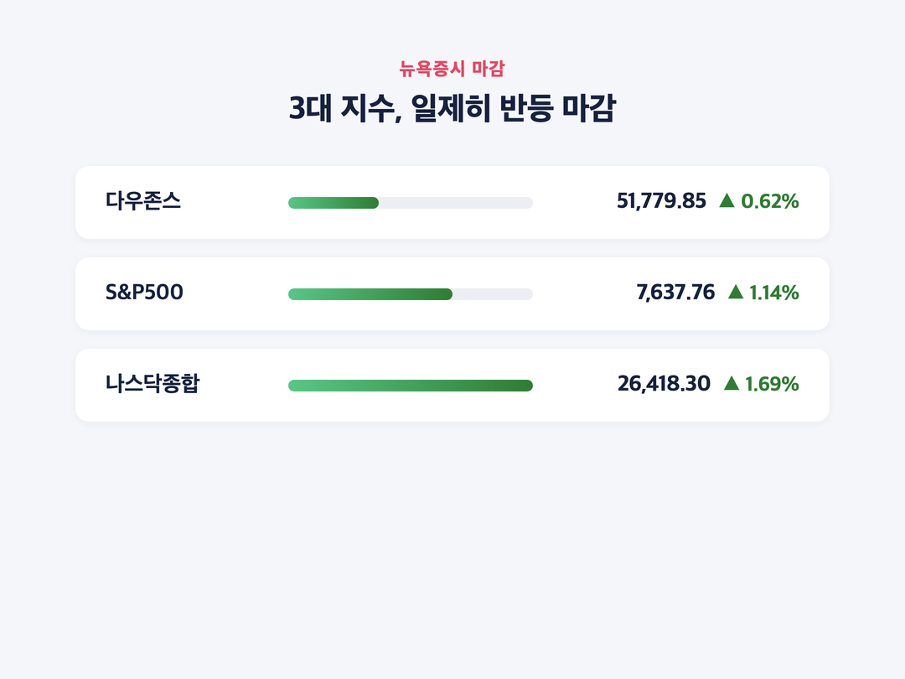
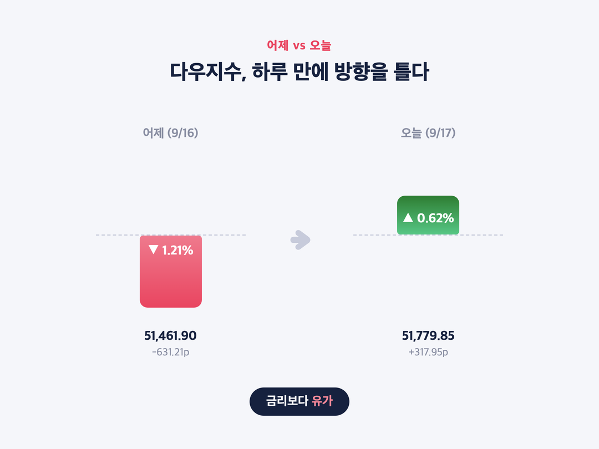
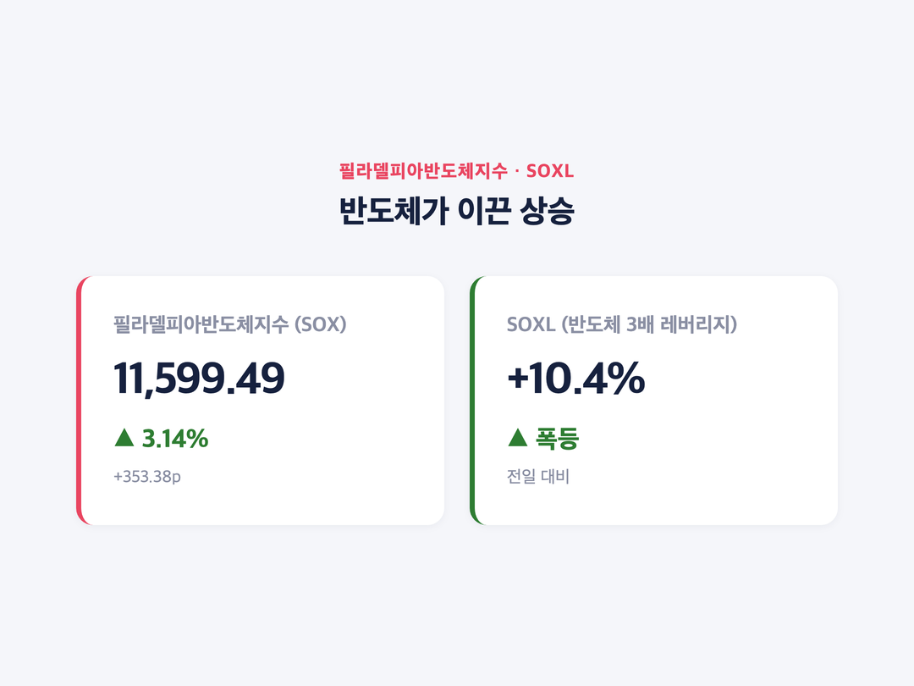
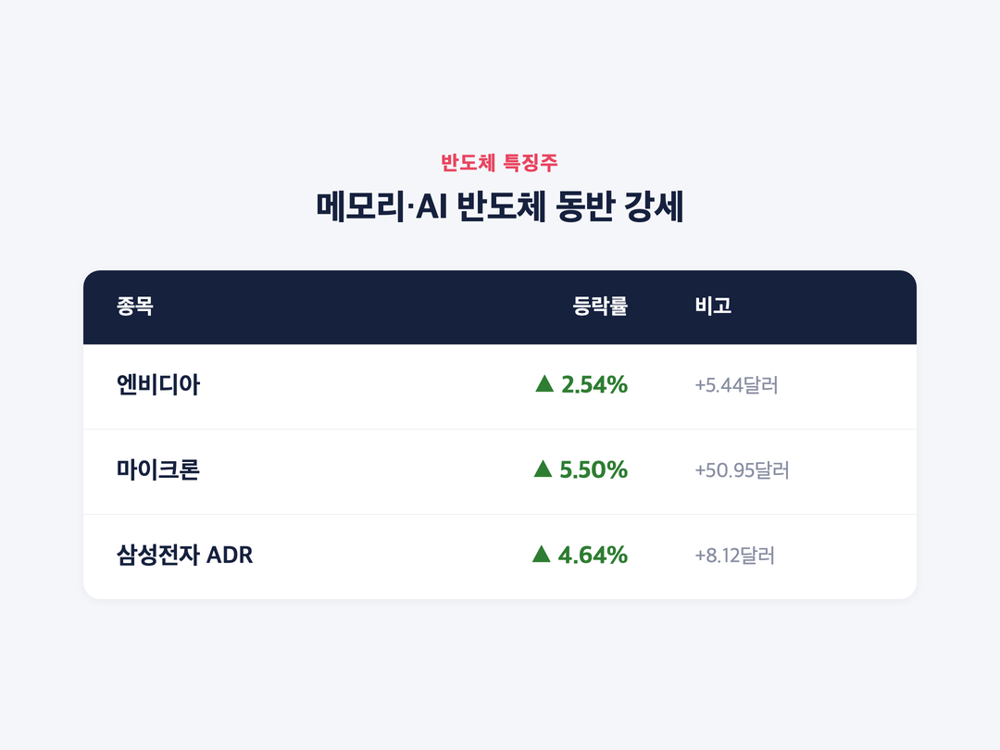
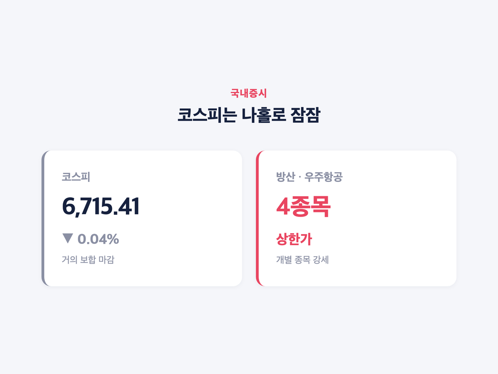

# [내일도 주린이] 금리인상 충격 하루 만에 반전…나스닥 1.69% 급등, 반도체가 이끌었다 (9/17)

안녕하세요, '내일도 주린이'입니다 👋

어제 다우 -1.21% 급락 보고 "아 이제 진짜 조정 오나" 했는데요, 하루 만에 또 이럽니다. 오늘은 미국 연준(Fed)이 금리를 올린 다음 날, 뉴욕증시가 전날 낙폭을 거의 다 되돌린 얘기 정리해볼게요. 미장이 하루 만에 이렇게 방향을 트는 것도 오랜만인 것 같아요.

---

## 🇺🇸 미장 마감 시황 – 3대 지수 일제히 반등

> **다우 51,779.85 (+317.95p, +0.62%) / S&P500 7,637.76 (+85.95p, +1.14%) / 나스닥 26,418.30 (+439.87p, +1.69%)**

| 지수 | 종가 | 등락 | 등락률 |
|---|---|---|---|
| 다우존스 | 51,779.85 | +317.95p | +0.62% |
| S&P500 | 7,637.76 | +85.95p | +1.14% |
| 나스닥종합 | 26,418.30 | +439.87p | +1.69% |

9월 17일(현지시간) 뉴욕증시 3대 지수가 나란히 반등 마감했어요. 그중에서도 나스닥이 가장 많이 올랐는데요, 전날 금리인상 발표에 휘청였던 걸 생각하면 하루 만의 온도차가 꽤 극적이었습니다. 참고로 나스닥100은 29,446.98(+501.92p, +1.73%)로 더 가파르게 올랐어요.

---

## 📉➡️📈 어제는 왜 빠졌고, 오늘은 왜 올랐나 – "금리보다 유가"

> **어제(9/16) 다우 51,461.90 (-631.21p, -1.21%) → 오늘(9/17) 다우 51,779.85 (+317.95p, +0.62%)**

어제(9/16) 연준은 3년 만에 기준금리를 0.25%p 올려 3.75~4.00%로 결정했어요. 케빈 워시 연준 의장이 기자회견에서 "인플레이션이 너무 높고 오래 지속됐다"는 식으로 매파적 발언을 내놓자 시장이 놀라면서 다우가 -1.21%까지 밀렸었죠. 10년물 국채금리도 심리적 저항선인 5%를 웃돌면서 투자심리가 확 얼어붙었었고요.

그런데 하루 만에 분위기가 바뀌었어요. 10년물 국채금리가 5%대에서 4.93%로 내려왔고, 국제유가도 함께 하락하면서 인플레이션 우려를 낮춰준 게 컸습니다. 시장에서는 이걸 두고 "금리보다 유가"라는 해석이 나왔는데요, 어제 금리인상 자체보다 유가 안정이 인플레이션 눈높이를 낮춰준 게 오늘 반등의 진짜 동력이었다는 얘기예요. 저는 이 표현 보고 "아, 그래서 이렇게 됐구나" 싶었습니다. 금리는 이미 올랐다는 걸 시장이 소화했고, 남은 변수는 결국 유가였다는 거죠.

---

## 💻 반도체가 이끈 상승 – 필라델피아반도체지수 +3.14%

> **필라델피아반도체지수(SOX) 11,599.49 (+353.38p, +3.14%) / SOXL +10.4%**

| 종목/지수 | 등락률 | 비고 |
|---|---|---|
| 필라델피아반도체지수(SOX) | +3.14% | 11,599.49 |
| SOXL(반도체 3배 레버리지) | +10.4% | - |
| 엔비디아 | +2.54% | +5.44달러 |
| 마이크론 | +5.50% | +50.95달러 |
| 삼성전자 ADR | +4.64% | +8.12달러 |

오늘 상승을 이끈 건 확실히 반도체였어요. 필라델피아반도체지수가 +3.14% 오르면서 업종 전체를 끌어올렸고, 3배 레버리지 ETF인 SOXL은 무려 10.4% 폭등했습니다. 엔비디아·마이크론·삼성전자ADR 같은 메모리·AI 반도체 관련주가 특히 강했고요.

인텔도 반도체 업종 전반의 강세 속에 동반 상승했어요. 사실 인텔은 전날(9/16) SK하이닉스와의 미국 내 메모리 생산 협력 논의설이 나오면서 이미 +4%대로 급등했던 종목인데요, 오늘은 그 여세에 업종 전체 반등까지 더해지면서 계속 강세를 이어간 모양새였습니다.

빅테크도 고르게 올랐어요. 알파벳 +1.30%, 애플 +1.38%, 마이크로소프트 +1.52%, 테슬라 +2.27%로 대형 기술주가 전반적으로 반등에 동참했습니다. 전날 급락했던 은행주도 오늘은 +0.5% 정도 오르며 낙폭을 일부 만회했고요. 투자심리를 보여주는 VIX(공포지수)는 15.51로 -12.43%나 급락하면서, 시장의 불안감이 하루 만에 꽤 누그러졌다는 걸 보여줬습니다.

---

## 🇰🇷 국장은 이미 선반영 – 코스피는 나홀로 잠잠

> **코스피 6,715.41 (-0.04%) / 방산·우주항공 상한가 4종목**

같은 날 코스피는 -0.04%로 거의 보합에 가깝게 마감했어요. 방산·우주항공 관련 종목 4개는 상한가까지 찍었고요. 재밌는 건 순서예요. 코스피는 미국 증시가 급락하기 전부터 이미 그 불확실성을 선반영하면서 버텼는데, 정작 미국은 하루 만에 반등해버렸거든요. "먼저 걱정하고 있었더니 정작 걱정할 필요가 없었네" 싶은 하루였달까요.

---

## 마무리하며

정리하면, 어제 금리인상 충격으로 다우가 -1.21%까지 빠졌던 게 오늘은 +0.62%로 반전했고, 나스닥은 +1.69%로 3대 지수 중 가장 많이 올랐어요. 국채금리가 5%대에서 4.93%로 내려오고 유가도 하락하면서 인플레이션 우려를 낮춰준 게 반등의 핵심이었습니다.

솔직히 이렇게 하루 만에 방향이 바뀌는 걸 보면 저는 좀 어지럽더라고요. 그래도 반도체 업종이 확실히 다시 힘을 보여줬다는 건 눈여겨볼 만한 것 같아요. 저는 일단 오늘 흐름 좀 더 지켜보면서 대응하려고 합니다.

오늘도 손절, 내일은 익절. 무럭무럭 자라볼게요 🌱
