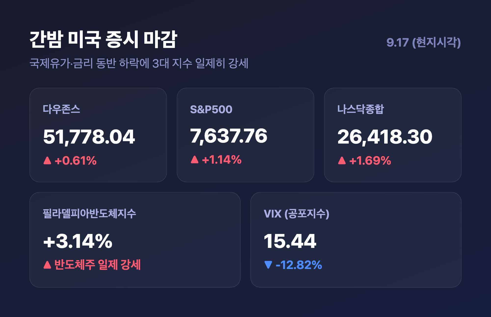
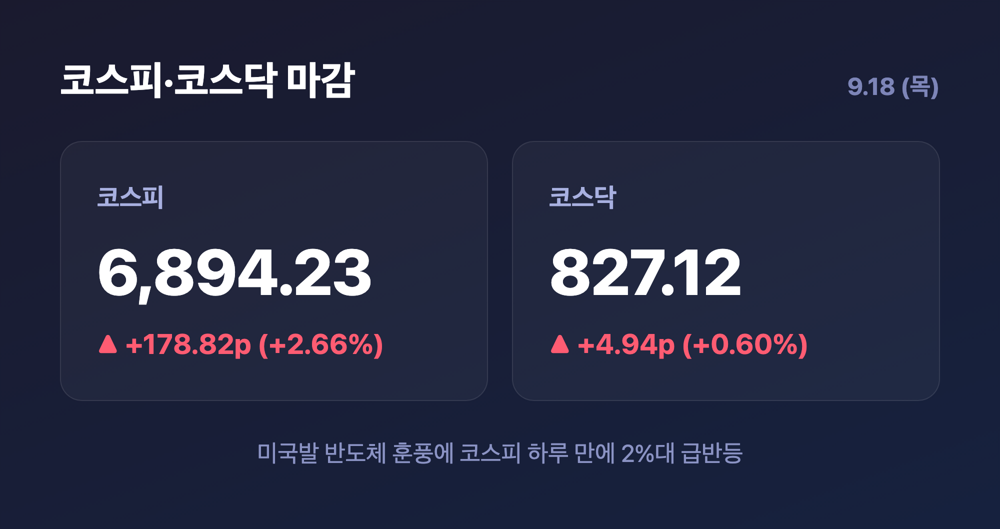
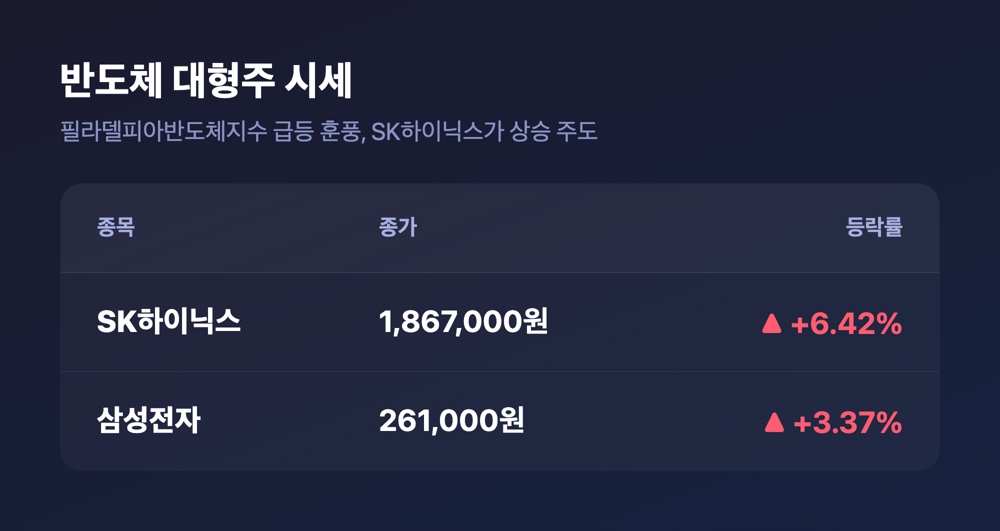
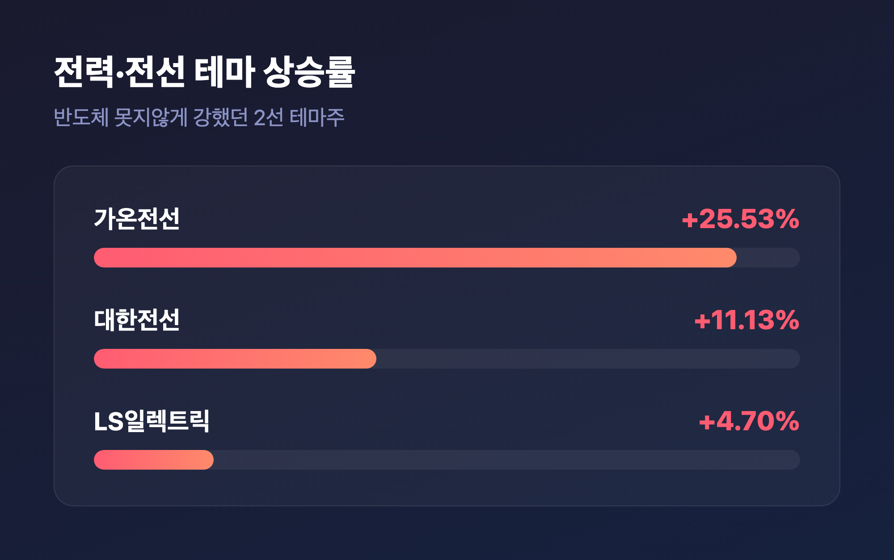
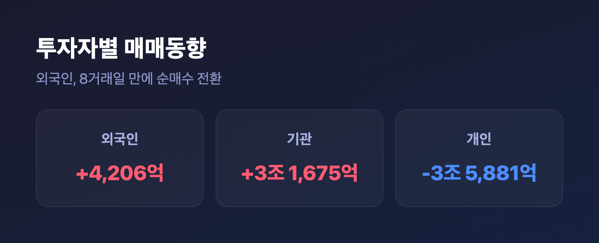

# [내일도 주린이] 코스피 2.66% 급반등 6,894선…반도체가 이끈 미국발 훈풍 (9/18)

안녕하세요, '내일도 주린이'입니다 👋

어제(9/17) 미국 증시가 3대 지수 다 오르는 거 보면서 "오 분위기 좀 풀리나" 했는데요, 하루 자고 일어나니까 그 훈풍이 그대로 국장으로 넘어왔습니다. 코스피가 하루 만에 2.66% 급반등하면서 6,894.23까지 올라왔거든요. 오늘은 이 반등이 어디서 왔는지, 뭐가 주도했는지 순서대로 정리해볼게요.

---

## 🇺🇸 어제 미국 증시 – 오늘 국장 급등의 진짜 원인

> **다우 +0.61% 51,778.04 / S&P500 +1.14% 7,637.76 / 나스닥 +1.69% 26,418.30 / 필라델피아반도체지수 +3.14%**

| 지수 | 등락률 | 종가 |
|---|---|---|
| 다우존스 | +0.61%(316.14P) | 51,778.04 |
| S&P500 | +1.14%(85.95P) | 7,637.76 |
| 나스닥종합 | +1.69%(439.87P) | 26,418.30 |
| 필라델피아반도체지수 | +3.14% | - |
| VIX(공포지수) | -12.82% | 15.44 |

9/17(현지시각) 뉴욕증시가 3대 지수 일제히 큰 폭으로 올랐어요. 국제유가와 국채금리가 동반 하락한 게 컸는데요, 사우디산 원유가 오만을 거쳐 공급된다는 소식에 공급 차질 우려가 진정되면서 브렌트유가 배럴당 104.82달러로 내려앉았고, 8거래일 연속 오르던 10년물 미 국채금리도 이날은 꺾였습니다. 신규 실업수당 청구 건수가 1969년 이후 최저 수준에 근접했다는 고용지표도 "긴축보다 경기 안정" 쪽으로 시장 해석을 밀어준 모양이에요. (참고로 연준 의장은 케빈 워시인데, 이 부분은 최근 글에서 여러 번 다뤄서 오늘은 짧게만 짚고 넘어갈게요.)

특히 눈에 띈 건 필라델피아반도체지수가 3.14%나 튄 거였는데요, 엔비디아(+2.54%)·마이크론(+5.50%)·SK하이닉스 ADR(+4.64%)까지 반도체 관련주가 일제히 강세를 보였습니다. 이 흐름이 다음 날인 오늘 국장 개장부터 그대로 이어졌어요.

---

## 🇰🇷 오늘 국장 마감 시황 (코스피 6,894 / 코스닥 827)

> **코스피 6,894.23 (+178.82포인트, +2.66%) / 코스닥 827.12 (+4.94포인트, +0.60%)**

| 지수 | 등락 | 종가 |
|---|---|---|
| 코스피 | +178.82P(+2.66%) | 6,894.23 |
| 코스닥 | +4.94P(+0.60%) | 827.12 |

코스피는 개장부터 강했어요. 전일 대비 151.45포인트(2.26%) 오른 6,866.86으로 출발하더니, 오후 한때 6,900선까지 뚫었습니다. "이대로 6,900 위에서 마감하나" 싶었는데, 마감 직전에 차익 실현 매물이 나오면서 상승폭을 살짝 반납하고 6,894.23으로 마무리됐어요. 그래도 하루 만에 2%대 후반 반등이면 확실히 강한 하루였습니다. 코스닥은 코스피만큼 화끈하진 않았지만 0.60% 오르며 827선을 지켰어요.

---

## 💾 반도체 대형주가 지수 끌어올렸다

> **SK하이닉스 +6.42% 186만7,000원 / 삼성전자 +3.37% 261,000원**

| 종목 | 등락률 | 종가 |
|---|---|---|
| SK하이닉스 | +6.42% | 1,867,000원 |
| 삼성전자 | +3.37% | 261,000원 |

오늘 코스피 반등을 사실상 반도체 대형주 둘이 끌고 갔다고 봐도 될 것 같아요. 어제 미국 필라델피아반도체지수 급등 훈풍이 국내로 그대로 이어진 건데요, 여기에 엔비디아 젠슨 황 CEO가 "내년 칩 판매량이 2배로 늘어날 것"이라는 전망을 내놓으면서 반도체주 매수 심리를 한 번 더 자극했습니다. 저는 장 초반 SK하이닉스 +4%대인 거 보고 "오늘도 이 정도면 잘한 거지" 했는데, 장 마감 무렵에 6%대까지 올라온 거 보고 좀 놀랐어요. 확실히 미국발 반도체 랠리가 하루 시차를 두고 국장에 그대로 반영된 느낌이었습니다.

---

## ⚡ 전력·전선 테마도 2선에서 폭발

> **가온전선 +25.53% / 대한전선 +11.13% / LS일렉트릭 +4.70%**

| 종목 | 등락률 |
|---|---|
| 가온전선 | +25.53% |
| 대한전선 | +11.13% |
| LS일렉트릭 | +4.70% |

반도체 못지않게 강했던 게 전력·전선 테마였어요. 가온전선은 무려 25% 넘게 급등했고, 대한전선도 두 자릿수 상승을 기록했습니다. 코스닥 쪽에서도 선도전기·대원전선 같은 전선·전기 관련주와 대한광통신·아이씨티케이 같은 광통신·보안 테마로 매수세가 몰렸다는 이야기가 나왔어요. 참고로 어제(9/17)는 스페이스X 스타십 시험비행 기대감에 우주항공·방산 테마(나라스페이스테크놀로지, 비츠로테크 등)가 크게 튀었었는데요, 오늘은 이 테마 얘기가 마감 기사들에서 딱히 이어지지 않았고 대신 반도체·전력전선 쪽으로 주도주가 확실히 넘어온 하루였습니다.

반면 KB금융(-2.40%), 삼성물산(-1.27%) 같은 금융·지주 대형주는 상승장에서 소외되며 하락 마감했어요. LG에너지솔루션, 현대차, 삼성바이오로직스, 셀트리온 등은 상승 마감에 동참했습니다.

---

## 💰 수급 동향 – 외국인 8거래일 만에 순매수 전환

> **외국인 +4,206억원 / 기관 +3조 1,675억원 / 개인 -3조 5,881억원**

| 투자주체 | 순매수·순매도 |
|---|---|
| 외국인 | +4,206억원 |
| 기관 | +3조 1,675억원 |
| 개인 | -3조 5,881억원 |

가장 눈에 띄는 건 외국인 수급이에요. 8거래일 연속 팔던 외국인이 드디어 오늘 순매수로 돌아섰습니다. 다만 장 초반까지만 해도 외국인은 204억원 매도 우위였는데요, 마감 무렵에야 순매수로 방향을 튼 흐름이었어요. 기관도 3조원 넘게 사들이면서 지수를 밀어올렸고, 반대로 개인은 3조 5,881억원어치를 팔아치우면서 상승분을 상당 부분 받아냈습니다. (일부 매체는 외국인 4,262억원, 개인 3조 5,920억원으로 살짝 다른 수치를 냈는데, 이건 기관·기타법인 집계 방식 차이로 보여요. 저는 이번 글에서는 기관·기타법인을 합산 표기한 쪽 수치로 통일해서 정리했습니다.)

환율도 같이 짚고 가면, 원/달러 환율은 1,383.3원으로 전일 대비 1.1원 올랐어요. 이걸로 7거래일 연속 상승 흐름을 이어갔습니다. 국내 증시는 강하게 반등했는데 환율은 계속 오르고 있다는 게 좀 아이러니하긴 한데요, 이 부분은 다음에 흐름 지켜보면서 따로 다뤄볼게요.

---

## 마무리하며

오늘 국장은 한마디로 "어제 미국 반등이 하루 시차 두고 그대로 흘러들어온 하루"였어요. 코스피 +2.66% 6,894.23, 반도체(SK하이닉스 +6.42%, 삼성전자 +3.37%)와 전력·전선(가온전선 +25.53%)이 주도했고, 외국인은 8거래일 만에 순매수로 돌아섰습니다.

솔직히 저는 전날까지 8거래일 연속 외국인 매도 보면서 좀 지쳐있었는데요, 오늘 하루 만에 분위기가 이렇게 확 바뀌는 거 보니까 역시 국장은 하루 앞을 예측하기 어렵다는 걸 다시 느낍니다. 일단 이 반도체·전력전선 랠리가 다음 거래일까지 이어지는지 계속 지켜보려고요.

오늘도 손절, 내일은 익절. 무럭무럭 자라볼게요 🌱
