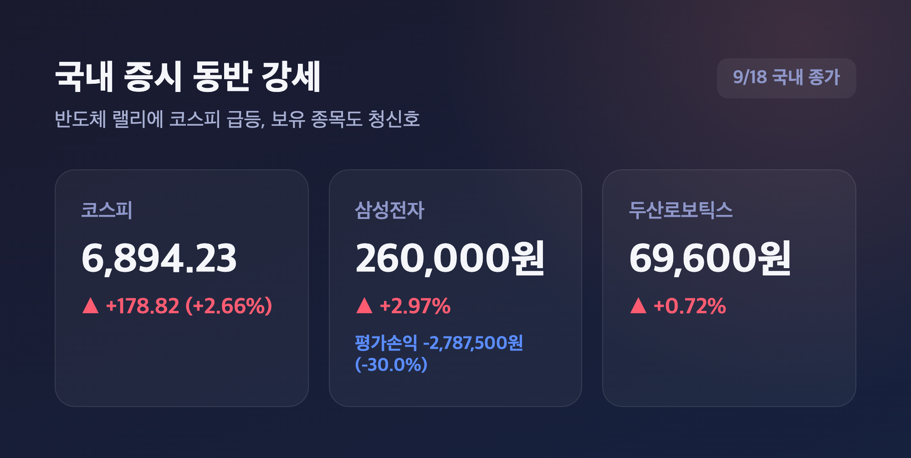
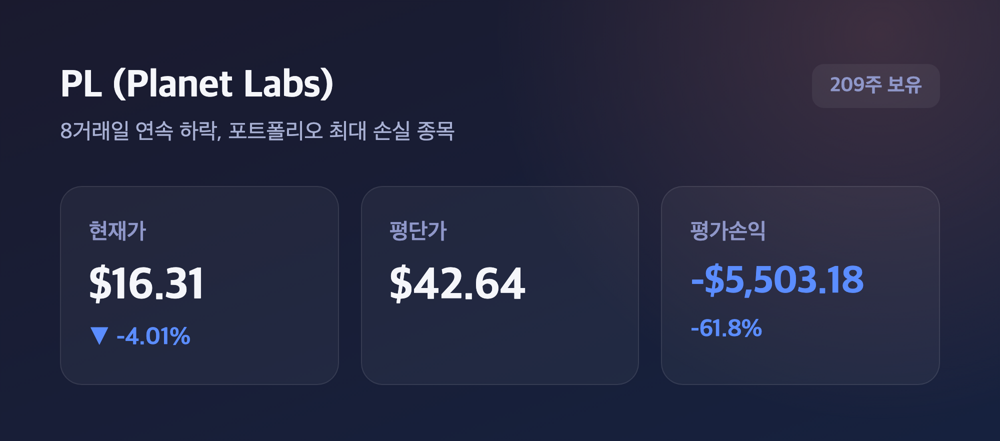
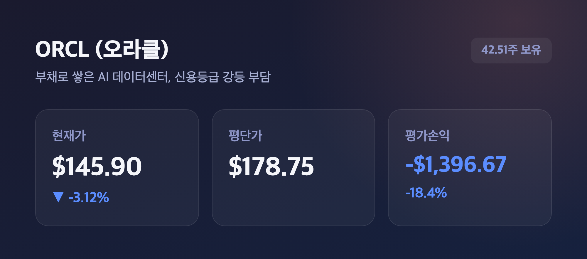
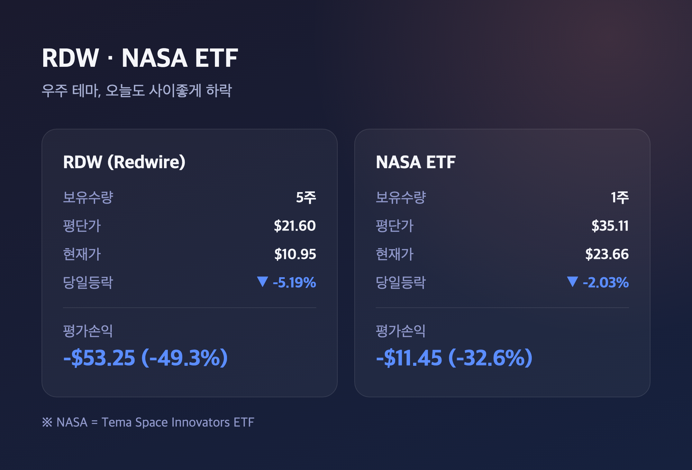
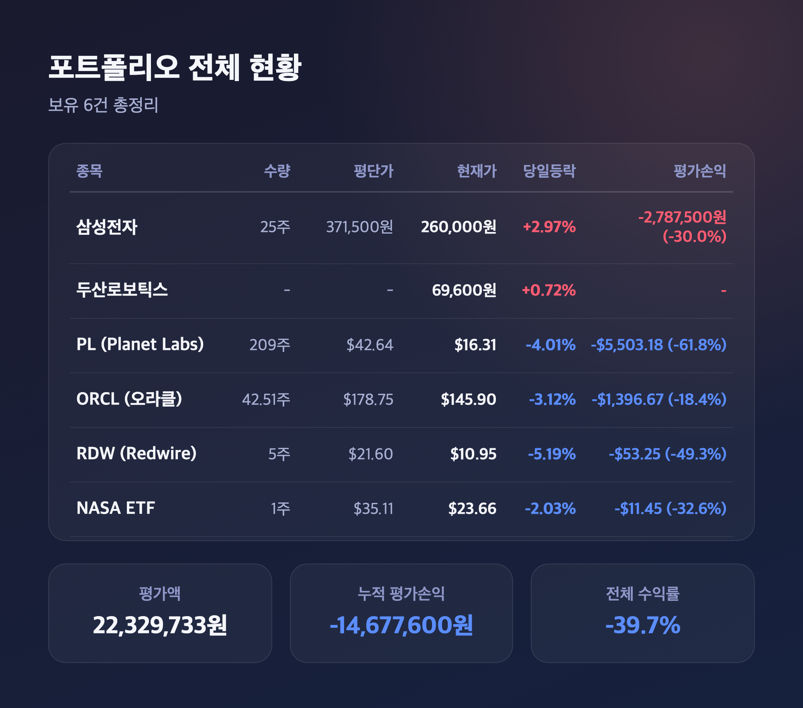

# [내일도 주린이] 포트폴리오 점검, 삼성전자 반짝 상승에도 수익률 -39.7% (9/18)

안녕하세요, '내일도 주린이'입니다 👋

지난주 포트폴리오 점검하면서 "더 나빠질 데가 있나" 싶었는데요, 있더라고요. 오늘 다시 포트폴리오 점검 시간입니다. 다행히 삼성전자는 오랜만에 초록불 켰는데, PL·ORCL·RDW·NASA는 여전히 물속에서 못 나오고 있어요. 하나씩 까보겠습니다.

---

## 🇰🇷 반도체 랠리에 올라탄 삼성전자·두산로보틱스

> **코스피 6,894.23 (+178.82포인트, +2.66%) / 삼성전자 260,000원 (+2.97%)**

오늘 코스피가 178.82포인트(+2.66%) 오른 6,894.23에 마감했어요. 반도체 대형주가 지수를 끌어올린 하루였는데요, 전날 미국에서 필라델피아반도체지수가 +3.14% 급등하면서 엔비디아·마이크론 같은 반도체주가 일제히 강세를 보인 영향이 그대로 넘어온 거였습니다. 젠슨 황 CEO가 "내년 칩 판매량이 2배로 늘어날 것"이라는 전망을 내놓은 게 매수 심리를 자극했다고 해요. SK하이닉스가 +6.42%까지 뛰면서 랠리를 주도했고요.

제 보유 종목 중엔 삼성전자(25주, 평단 371,500원)가 260,000원(+2.97%)으로 마감하면서 평가손익 -2,787,500원(-30.0%)을 기록했어요. "오, 오랜만에 플러스네" 했는데, 냉정하게 보면 여전히 평단 대비 -30%입니다. 반가움은 잠깐, 현실은 그대로예요.

두산로보틱스는 69,600원(+0.72%)으로 완만하게 올랐어요. 반도체주만큼 화끈하진 않았지만, 최근 두산로보틱스가 8월 초부터 외국인 순매수 1위 종목으로 꼽히며 "반도체 다음 주자"로 로봇 테마가 부각되는 흐름과 맞물린 상승으로 보여요. 같은 날 두산로보틱스가 1년 7개월 만에 대표이사를 권영민 신임 대표로 교체했다는 소식도 있었는데, 이게 주가에 직접 영향을 줬는지는 명확하지 않더라고요.

---

## 😭 PL(Planet Labs), 가장 뼈아픈 손실 -61.8%

> **PL $16.31 (-4.01%) / 평단 $42.64 대비 -61.8%**

PL은 209주 들고 있는데 오늘도 -4.01% 밀리면서 $16.31까지 내려왔어요. 평가손익은 -5,503.18달러(-61.8%). 네, 알고 있습니다. 제 포트폴리오 흑역사 1순위예요.

단발성 악재라기보단 장기 하락 추세의 연장이라는 게 더 정확한 설명 같아요. PL은 8거래일 연속 하락하며 최근에만 20% 가까이 빠졌고, 올해 고점 대비로는 60% 넘게 주저앉은 상태거든요. 2분기 매출이 전년 대비 58% 늘어날 만큼 실적 자체는 나쁘지 않았는데, 이 중 일부가 예상보다 이른 위성 인도에 따른 일회성 요인이라 "실적의 질"에 대한 의구심이 나온다고 해요. PL·로켓랩·AST스페이스모바일 같은 우주 관련주 전반이 5월 고점 이후 동반 급락한 것도 배경으로 꼽히고요. 저는 그냥 "언젠가는 오르겠지" 하면서 버티는 중입니다.

---

## 💳 ORCL(오라클), 빚으로 쌓아 올린 AI 데이터센터의 그림자

> **ORCL $145.90 (-3.12%) / 평단 $178.75 대비 -18.4%**

ORCL은 42.51주 보유 중인데 오늘 -3.12%로 $145.90까지 내려와서 평가손익은 -1,396.67달러(-18.4%)예요. 사실 하루 전(현지시간 9/17)엔 OpenAI 자금 조달 기대감에 5%대 급등했다는 보도도 있었는데, 그 상승분을 하루 만에 고스란히 반납한 모양새더라고요. "올랐다 싶으면 또 내려간다" 국룰이죠.

ORCL 약세의 더 구조적인 배경은 부채로 조달한 대규모 AI 데이터센터 투자 부담이에요. 오라클은 2026 회계연도에만 560억 달러 규모 설비투자를 430억 달러 부채로 충당했고, 내년엔 최대 950억 달러까지 쓸 계획이라고 해요. S&P 글로벌은 지난 7월 오라클의 신용등급을 BBB에서 BBB-(투자등급 최하단)로 낮췄는데, OpenAI 관련 리스크를 주요 사유로 짚었습니다. 그 여파로 오라클 10년물 회사채 금리가 동급 평균보다 높은 6.4%대까지 올라간 상태고요. AI 붐의 최전선에 서 있는 회사인 만큼, 이 부채 부담이 어떻게 풀리는지가 앞으로도 관전 포인트일 것 같아요.

---

## 🚀 RDW·NASA, 우주 테마는 오늘도 사이좋게 하락

> **RDW $10.95 (-5.19%) / NASA(Tema Space Innovators ETF) $23.66 (-2.03%)**

RDW(5주, 평단 $21.60)는 -5.19%로 $10.95까지 내려가면서 평가손익 -53.25달러(-49.3%), NASA ETF(1주, 평단 $35.11)는 -2.03%로 $23.66까지 밀리며 평가손익 -11.45달러(-32.6%)를 기록했어요. 둘 다 우주 테마라 이번엔 나란히 빨간불이었습니다.

배경으로는 최근 블루오리진 로켓 폭발 사고가 우주 섹터 전반의 투자심리를 위축시켰다는 보도가 있었고요, Procure Space ETF(UFO)도 이틀 만에 거의 10% 빠졌다고 해요. NASA ETF 자체가 스페이스X SPV·로켓랩·AST스페이스모바일 같은 우주·위성 관련 종목을 담고 있다 보니, 섹터 전반이 흔들리면 같이 흔들리는 구조인 거죠. RDW는 여기에 더해 밸류에이션 부담에 따른 매도세, 5억 달러 규모 유상증자(ATM) 프로그램에 따른 지분 희석 우려도 꾸준히 부담 요인으로 거론되고 있어요. "우주는 원래 멀고 험한 길"이라고 스스로를 위로하는 중입니다.

---

## 📊 전체 포트폴리오 현황 (보유 6건 총정리)

> **누적 평가손익 -14,677,600원 / 전체 수익률 -39.7%**

| 종목 | 보유수량 | 평단가 | 현재가 | 당일등락 | 평가손익(수익률) |
|---|---|---|---|---|---|
| 삼성전자 | 25주 | 371,500원 | 260,000원 | +2.97% | -2,787,500원 (-30.0%) |
| 두산로보틱스 | - | - | 69,600원 | +0.72% | - |
| PL (Planet Labs) | 209주 | $42.64 | $16.31 | -4.01% | -5,503.18달러 (-61.8%) |
| ORCL (오라클) | 42.51주 | $178.75 | $145.90 | -3.12% | -1,396.67달러 (-18.4%) |
| RDW (Redwire) | 5주 | $21.60 | $10.95 | -5.19% | -53.25달러 (-49.3%) |
| NASA (Tema Space Innovators ETF) | 1주 | $35.11 | $23.66 | -2.03% | -11.45달러 (-32.6%) |

(두산로보틱스는 수량·평단 데이터가 확인되지 않아 평가손익은 별도로 표기하지 않았어요.)

오늘 포트폴리오 점검 결과, 평가액 22,329,733원에 누적 평가손익 -14,677,600원, 전체 수익률은 -39.7%예요. 지난번 포트폴리오 점검 때보다 오히려 더 나빠졌습니다. "그래도 삼성전자는 오늘 올랐으니까" 하고 스스로 다독여봐도, 전체 그림은 여전히 시뻘겋네요.

---

## 마무리하며

오늘 포트폴리오 점검 결과는 삼성전자·두산로보틱스는 반도체·로봇 테마 랠리에 올라타며 반가운 플러스, 반면 PL·ORCL·RDW·NASA는 각자 다른 이유로 여전히 마이너스였어요. 전체 수익률은 -39.7%로 지난번보다 더 내려앉았고요.

솔직히 이 정도면 "익절"이라는 단어 자체가 어색하게 느껴지는데요, 그래도 저는 일단 버티면서 하나씩 지켜보려고요. PL·RDW·NASA 같은 우주 테마는 섹터 전체가 흔들리는 국면이라 당장 뭘 할 수 있는 것도 아니고, ORCL은 부채 이슈가 어떻게 풀리는지 지켜봐야 할 것 같아요. 삼성전자만큼은 오늘처럼 조금씩이라도 반등해줬으면 하는 바람입니다.

오늘도 손절, 내일은 익절. 무럭무럭 자라볼게요 🌱

#포트폴리오점검 #내주식포트폴리오 #삼성전자 #미국주식손실
