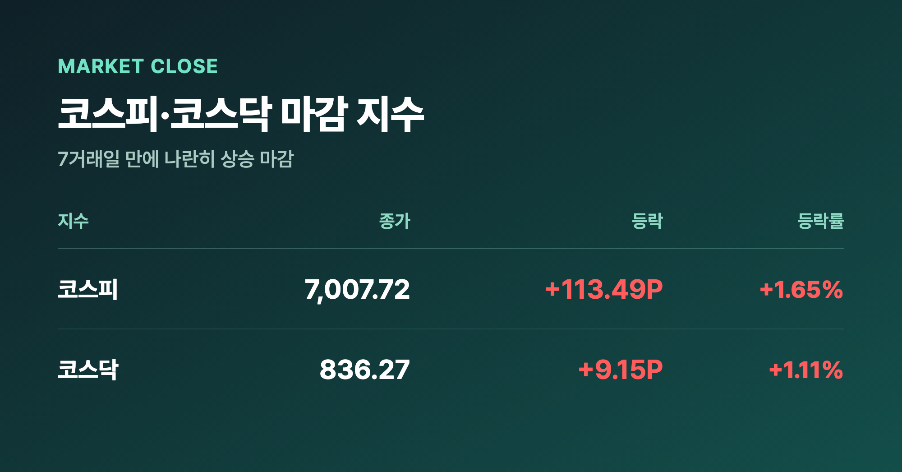
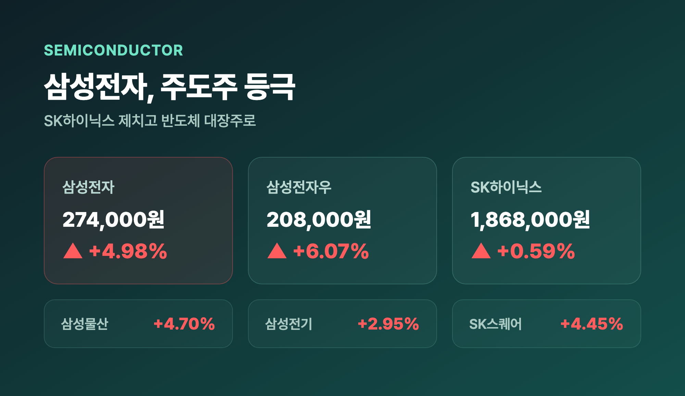
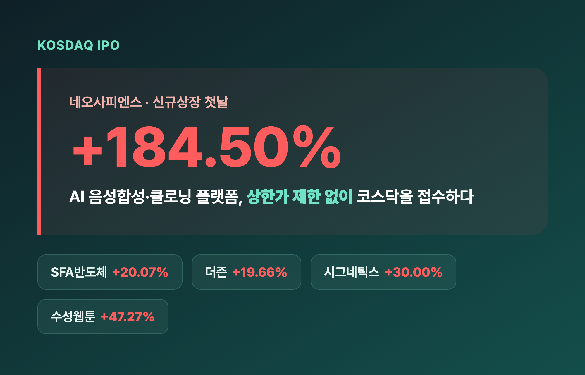
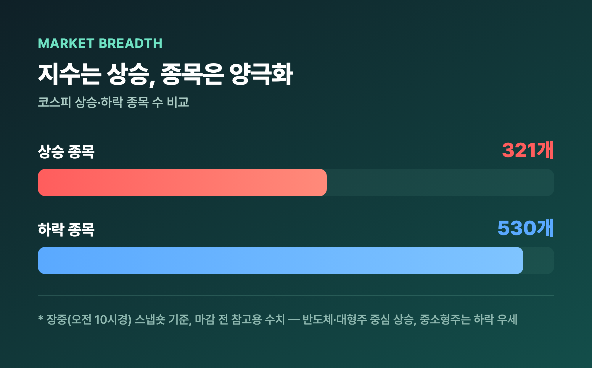
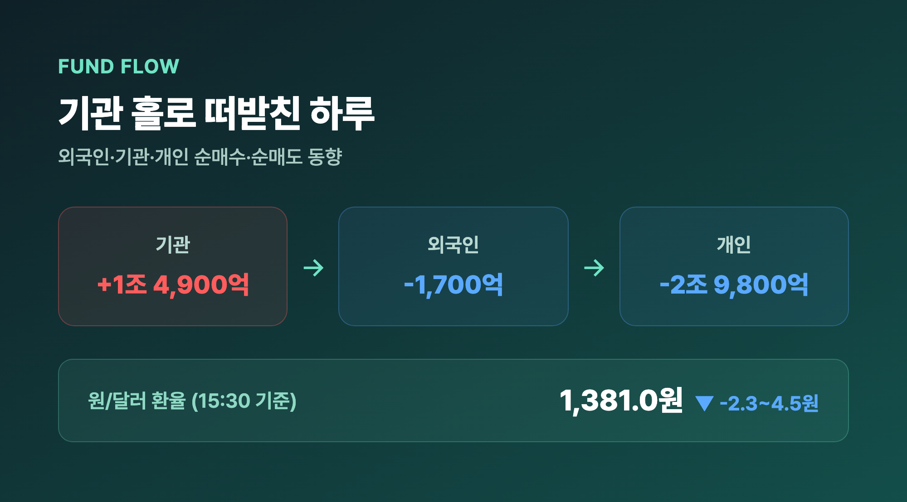

# [내일도 주린이] 코스피 7000 탈환…삼성전자 주도주 등극, 코스닥은 네오사피엔스 폭주 (9/21)

삼성전자 274,000원 찍힌 거 보고 두 번 확인했습니다. 어제까지만 해도 "그냥 이 가격대에서 오래 버티겠지" 싶었는데, 오늘 하루 만에 SK하이닉스를 제치고 코스피 주도주 자리에 올라섰더라고요. 덕분에 코스피도 7거래일 만에 다시 7,000선을 넘었습니다. 오늘 국장, 하나씩 정리해볼게요.

---

## 🇰🇷 코스피, 7거래일 만에 7000선 탈환 (2차전지·자동차는 소외)

> **코스피 7,007.72 (+113.49포인트, +1.65%) / 코스닥 836.27 (+9.15포인트, +1.11%)**

| 지수 | 종가 | 등락 | 등락률 |
|---|---|---|---|
| 코스피 | 7,007.72 | +113.49P | +1.65% |
| 코스닥 | 836.27 | +9.15P | +1.11% |

코스피는 장중 한때 6,938.34까지 밀렸다가 후반으로 갈수록 상승폭을 키워서 7,027.58까지 찍었고, 결국 7,007.72로 마감했어요. 7거래일 만에 다시 7,000선을 회복한 거라 "칠천피 탈환"이라는 말이 딱 어울리는 하루였습니다. (지난주 케빈 워시 연준 의장 취임 후 첫 FOMC에서 3년 만에 기준금리를 올린 얘기는 최근 글에서 여러 번 다뤘으니 오늘은 이 정도로만 짚고 넘어갈게요.) 반면 LG에너지솔루션(-3.30%), 현대차(-1.64%) 같은 2차전지·자동차 대형주는 오늘 상승장에서 완전히 소외됐어요. 반도체로 자금이 쏠리면서 다른 섹터는 상대적으로 밀린 느낌이었습니다.

---

## 💰 삼성전자, SK하이닉스 제치고 주도주 등극 — 제 계좌도 살짝 웃었습니다

> **삼성전자 +4.98% 274,000원 / 삼성전자우 +6.07% 208,000원 / SK하이닉스 +0.59% 1,868,000원**

| 종목 | 등락률 | 종가 |
|---|---|---|
| 삼성전자 | +4.98% | 274,000원 |
| 삼성전자우 | +6.07% | 208,000원 |
| SK하이닉스 | +0.59% | 1,868,000원 |
| 삼성물산 | +4.70% | - |
| 삼성전기 | +2.95% | - |
| SK스퀘어 | +4.45% | - |

오늘 코스피를 끌어올린 진짜 주인공은 삼성전자였어요. 거래대금만 약 5조 8,000억원에 달했고, 늘 주도주 자리를 지키던 SK하이닉스(+0.59%)를 상승률로 완전히 앞질렀습니다. 삼성전자우(+6.07%)까지 나란히 급등한 걸 보면 반도체 안에서도 확실히 삼성 쪽으로 매수세가 몰린 하루였어요. 저는 25주(평단 371,500원) 들고 있는데, 오늘 274,000원으로 마감하면서 평가손익이 -2,437,500원(-26.25%)으로 살짝 좁혀졌어요. "익절"은 아직 한참 멀었지만, -30%에서 -26%대로 줄어든 것만으로도 "오, 이런 날도 있네" 싶더라고요.

---

## 🚀 코스닥은 네오사피엔스가 접수 — 신규상장 첫날 +184.50%

> **네오사피엔스 +184.50%(신규상장) / SFA반도체 +20.07% / 더즌 +19.66%**

| 종목 | 등락률 | 비고 |
|---|---|---|
| 네오사피엔스 | +184.50% | 신규상장, AI 음성합성·클로닝 |
| SFA반도체 | +20.07% | 반도체 후공정 소부장 |
| 더즌 | +19.66% | 반도체 후공정 소부장 |
| 시그네틱스 | +30.00% | 상한가 |
| 수성웹툰 | +47.27% | 급등 |

코스닥 최대 화제는 단연 이날 신규 상장한 AI 음성합성·클로닝 플랫폼 기업 네오사피엔스였어요. 상장 첫날 2,114만주나 거래되면서 +184.50%까지 치솟았는데, 신규상장 특례로 상한가 제한이 없어서 장중엔 한때 +185%대까지 붙기도 했습니다. "상장 첫날 이 정도 변동성이면 도대체 얼마나 사고 싶었던 거지" 싶을 정도였어요. 생성형 AI 기술 확산 기대감에 소프트웨어 업종 전체가 +16.06%로 강세를 보였고, 반도체 후공정 소부장주인 SFA반도체(+20.07%)·더즌(+19.66%)도 나란히 급등했습니다. 건강관리기술(+8.29%)도 오늘 코스닥 강세 업종 중 하나였어요.

---

## 📊 지수는 웃었는데 계좌는 안 웃었다? — 반도체 빼면 하락장 착시

지수만 보면 코스피·코스닥 둘 다 올랐지만, 정작 오늘 상승 종목보다 하락 종목이 더 많았던 것도 사실이에요. 장중 한때(오전 10시경) 집계에서는 상승 321개, 하락 530개로 하락 종목이 훨씬 많았고(이건 마감 전 스냅숏이라 참고용으로만 밝혀둘게요), 장 마감 기사에서도 "반도체·핵심 대형주로 매수세가 집중되면서 지수는 올랐지만, 중소형주는 하락 종목이 더 많아 주가 양극화가 뚜렷했다"는 진단이 나왔습니다. 저는 이런 날 제일 헷갈리더라고요. 뉴스만 보면 "오늘 국장 좋았네" 싶은데, 정작 내 계좌 속 종목은 안 오른 경우가 많거든요. 오늘도 딱 그런 느낌이었어요 — 삼성전자 하나는 웃었지만, 시장 전체 분위기까지 그랬다고 보긴 어려운 하루였습니다.

---

## 💱 수급 & 환율 — 기관 홀로 떠받친 하루

> **기관 +1조 4,900억원 / 외국인 -1,700억원 / 개인 -2조 9,800억원 / 원달러 1,381.0원**

| 투자주체 | 순매수·순매도 |
|---|---|
| 기관 | 약 +1조 4,900억원 |
| 외국인 | 약 -1,700억원 |
| 개인 | 약 -2조 9,800억원 |

오늘 상승은 사실상 기관이 혼자 만들었다고 봐도 될 것 같아요. 기관이 약 1조 4,900억원 순매수하며 지수를 떠받쳤고, 외국인은 약 1,700억원 순매도, 개인은 약 2조 9,800억원이나 팔아치웠습니다. 지수는 올랐는데 개인만 대규모로 매도한 걸 보면 "오른 김에 판다"는 심리가 강했던 하루로 보여요. 원/달러 환율은 2.3~4.5원 내린 1,381.0원(15:30 기준)으로 마감하며 코스피·코스닥 강세와 함께 원화도 살짝 강세를 보였습니다.

---

## 마무리하며

오늘 코스피는 +1.65% 7,007.72로 7거래일 만에 7,000선을 되찾았고, SK하이닉스를 제친 삼성전자(+4.98%)가 그 중심에 있었어요. 코스닥에서는 네오사피엔스(+184.50%)가 상장 첫날부터 시장을 흔들었고요. 다만 하락 종목이 더 많았다는 점은 이 상승장이 생각만큼 전체적으로 고르진 않았다는 걸 보여준 것 같습니다.

솔직히 저는 오늘 삼성전자 하나로 계좌 손실이 조금 줄어든 것만으로도 기분이 나쁘지 않았어요. 물론 -26.25%면 여전히 갈 길이 멀지만, 이런 날이 쌓이면 언젠가는 플러스 구간도 오겠거니 하면서 일단 계속 버텨보려고 합니다.

손절은 어제까지, 오늘은 일단 삼성전자 덕에 한숨 돌렸습니다 🌱
