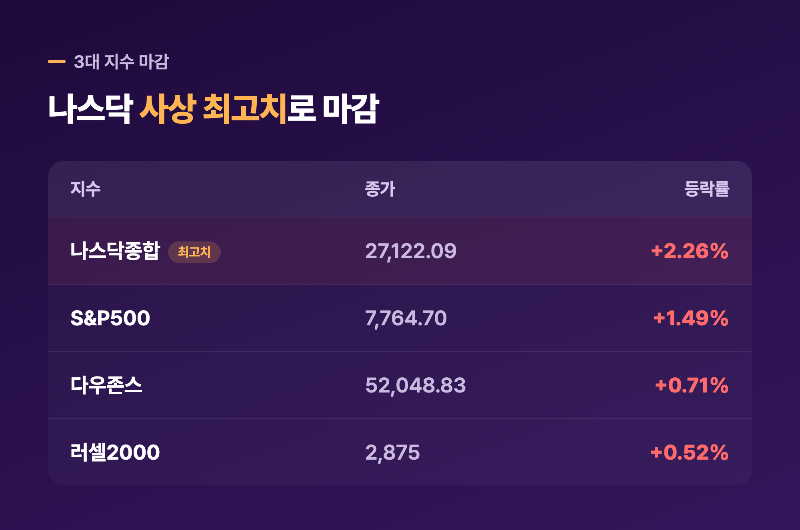
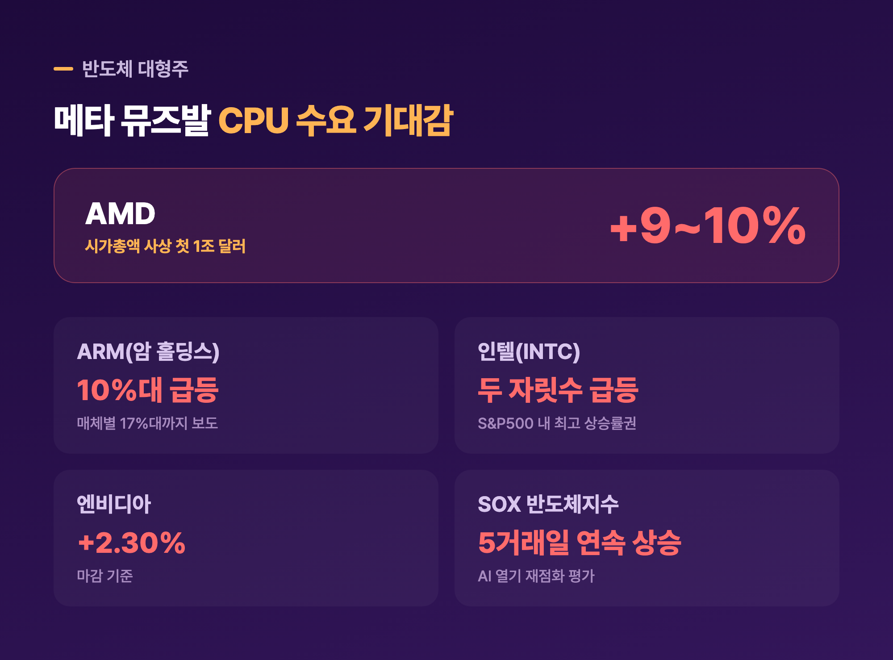
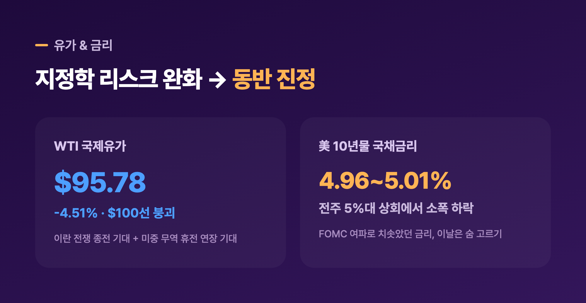
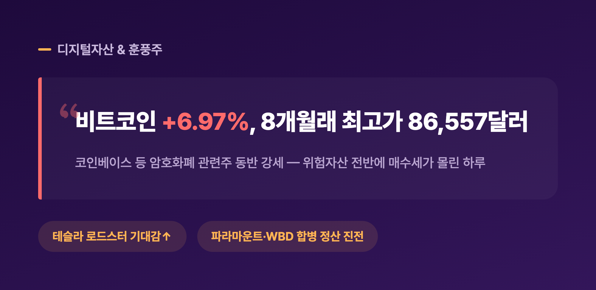
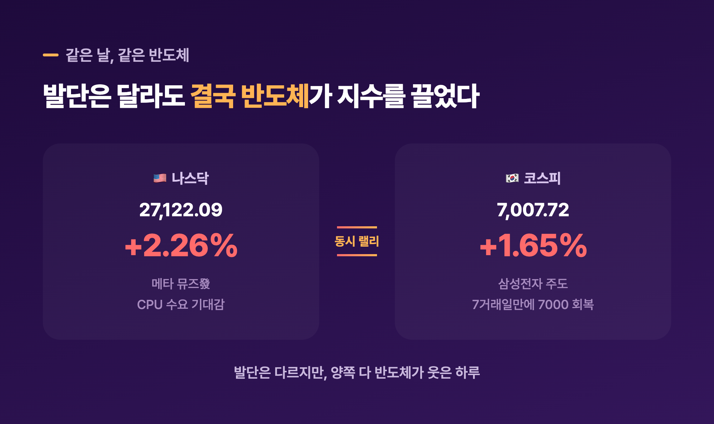

# [내일도 주린이] 나스닥 2.26% 사상 최고치, AMD 시총 첫 1조달러 돌파…메타 뮤즈발 반도체 랠리 (9/21)

AMD 시가총액이 하루 만에 1조 달러를 넘었다는 소식 보고 "어, 이게 진짜 되네" 싶었습니다. 엔비디아·애플처럼 '1조 클럽'은 늘 저 위쪽 얘기인 줄 알았는데, AMD가 그 문턱을 넘는 걸 실시간으로 지켜본 느낌이었어요. 나스닥도 덩달아 사상 최고치를 새로 썼고요. 9월 21일 미국 증시, 하나씩 정리해볼게요.

---

## 🇺🇸 나스닥 사상 최고치 – 3대 지수 동반 급등 마감

> **나스닥 27,122.09 (+2.26%, 사상 최고치) / S&P500 7,764.70 (+1.49%) / 다우 52,048.83 (+366.19p, +0.71%)**

| 지수 | 종가 | 등락률 |
|---|---|---|
| 나스닥종합 | 27,122.09 | +2.26% (사상 최고치) |
| S&P500 | 7,764.70 | +1.49% |
| 다우존스 | 52,048.83 | +0.71% |
| 러셀2000 | 2,875 | +0.52% |

3대 지수가 나란히 오른 것도 모자라 나스닥은 아예 사상 최고치를 새로 썼어요. 지난주(9/14~9/18)만 해도 다우가 3월 이후 최악의 주간 성적을 낼 정도로 분위기가 무거웠는데, 한 주 만에 이렇게 확 돌아설 줄은 몰랐습니다. 섹터별로는 커뮤니케이션서비스(+3.84%)와 기술(+2.83%)이 지수를 끌어올렸고, 필라델피아반도체지수(SOX)는 5거래일 연속 상승하며 +3%대 급등했어요. "AI 열기가 돌아왔다"는 평가가 나올 만한 하루였습니다.

---

## 🚀 이날의 진짜 주인공 – AMD, 시가총액 사상 첫 1조 달러 돌파

> **AMD +9~10% 급등, 시가총액 사상 첫 1조 달러 돌파 / ARM 10%대 급등 / 인텔도 두 자릿수 상승**

| 종목 | 등락률(대표치) | 비고 |
|---|---|---|
| AMD | +9~10% | 시가총액 최초 1조 달러 돌파 |
| ARM(암 홀딩스) | 10%대 급등 | 매체별로 17%대까지 보도 |
| 인텔(INTC) | 두 자릿수 급등 | S&P500 내 최고 상승률권 |
| 엔비디아 | +2.30% | 마감 기준 |

오늘 랠리를 만든 건 메타(Meta)의 신규 AI 에이전트 '뮤즈(Muse)'였어요. 뮤즈 초기 성과가 화제가 되면서 "에이전트형 AI 워크로드는 GPU뿐 아니라 CPU 수요도 최소 4배는 늘릴 것"이라는 기대감이 시장을 강타했고, Arm은 메타의 AGI용 CPU 공동개발 핵심 파트너라고 직접 밝히기도 했습니다. 그 여파로 ARM은 10%대 넘게, 인텔도 두 자릿수로 급등했어요(매체마다 집계 시점이 달라 수치 편차가 좀 있었는데, 여러 소스가 공통으로 확인한 두 자릿수 급등이라는 방향성 기준으로 정리했습니다).

그리고 이 모든 걸 다 제치고 오늘의 하이라이트는 역시 AMD예요. +9~10% 오르면서 시가총액이 사상 처음으로 1조 달러를 넘었거든요. 인텔·엔비디아 같은 전통 강자들에 비해 늘 한 발 뒤에 있던 회사였는데, CPU 수요 기대감 하나로 이 문턱을 넘어선 거라 저는 이 소식 보고 꽤 오래 멍했습니다. "물려 있는 반도체주 하나쯤 있었으면 오늘 좀 웃었겠다" 싶더라고요.

---

## 🛢️ 유가 4%대 급락, 국채금리는 살짝 진정 – 배경은 지정학

> **WTI $95.78/배럴 (-4.51%, $100선 붕괴) / 10년물 국채금리 4.96~5.01%**

국제유가가 하루 만에 4%대 넘게 빠지면서 배럴당 100달러 선이 무너졌어요. 배경이 흥미로운데요, 트럼프 대통령이 "이란 전쟁이 곧 끝날 것"이라 언급하고 카타르가 미·이란 메시지 교환을 중재하고 있다는 소식에 지정학 리스크가 옅어진 게 하나, 그리고 목요일 예정된 트럼프-시진핑 정상회담을 앞두고 미중 관리들이 뉴욕에서 실무 협상을 시작하며 무역 휴전 연장 기대감이 커진 게 또 하나였습니다. 호르무즈 해협 통과 물량도 6개월래 최고 수준을 회복했다고 하니, 공급 우려 자체가 여러 겹으로 걷힌 셈이에요.

국채금리도 같이 진정됐어요. 지난주(9/16) FOMC에서 3년 만에 기준금리를 올린 여파로 10년물 금리가 한때 5%를 웃돌며 2007년 7월 이후 최고 수준까지 치솟았었는데(이 얘기는 최근 글에서 여러 번 다뤘으니 오늘은 짧게만 짚을게요), 이날은 4.96~5.01% 구간으로 소폭 내려왔습니다. 워시 연준 의장이 이날 "물가 억제 의지를 재확인했다"는 보도도 일부 있었는데, 원문까지 확인은 못 해서 참고 정도로만 남겨둘게요. 유가·금리가 동시에 숨을 돌리면서 고평가 부담이 큰 기술주에도 우호적인 환경이 만들어진 하루였습니다.

---

## 💰 비트코인 8개월래 고점, 테슬라·합병주도 훈풍

> **비트코인 +6.97%, 86,557.30달러 (8개월래 고점)**

비트코인이 하루 만에 7% 가까이 뛰면서 8개월 만의 최고가를 찍었어요. 코인베이스 같은 암호화폐 관련주도 동반 강세를 보였고요. 위험자산 전반에 매수세가 몰린 날이라 그런지 디지털자산까지 같이 들썩인 느낌이었습니다. 이 외에 테슬라는 로드스터(Roadster) 출시 기대감에 올랐고, 파라마운트 스카이댄스와 워너브라더스디스커버리는 합병 관련 정산 협의가 진전됐다는 소식에 나란히 상승했어요.

---

## 🇰🇷 공교롭게 겹친 반도체 랠리 – 같은 날 코스피도 7000 탈환

> **코스피 7,007.72 (+1.65%), 7거래일 만에 7000선 회복 — 삼성전자 주도**

같은 날 국장에서도 코스피가 삼성전자 주도로 7거래일 만에 7,000선을 되찾았는데요, 이건 오늘 국장 정리 글에서 이미 자세히 다뤘으니 여기서는 짧게만 짚을게요. 미국은 메타 뮤즈발 CPU 수요 기대감으로, 한국은 삼성전자 주도로 — 발단은 다르지만 결국 양쪽 다 반도체가 지수를 끌어올렸다는 게 묘하게 겹치더라고요. 저도 삼성전자 25주를 물려서 들고 있는 입장이라, 이렇게 미장·국장이 동시에 반도체로 웃는 날은 은근히 반갑습니다.

---

## 마무리하며

오늘 미국 증시는 나스닥 +2.26%(27,122.09, 사상 최고치), S&P500 +1.49%(7,764.70), 다우 +0.71%(52,048.83)로 마감했고, 그 중심에는 메타 '뮤즈'가 쏘아올린 반도체 랠리와 시가총액 1조 달러를 처음 넘은 AMD가 있었어요.

솔직히 저는 반도체주를 직접 들고 있지 않아서 오늘 랠리는 남 얘기처럼 지켜봤는데요, 그래도 삼성전자 덕에 국장 쪽에서 조금이나마 온기를 느낀 하루였습니다. 일단 이 흐름이 다음 주까지 이어지는지 좀 더 지켜보려고요.

오늘은 반도체가 웃었고, 저는 그 옆에서 구경만 했습니다 🌱
