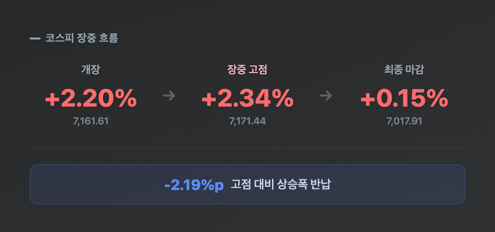
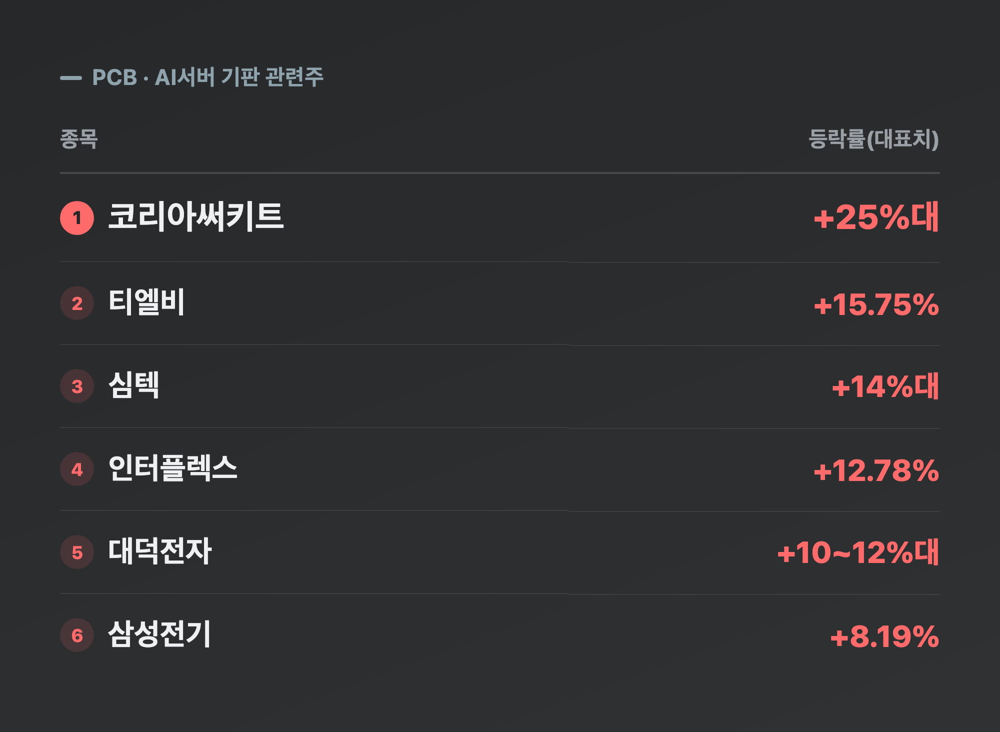
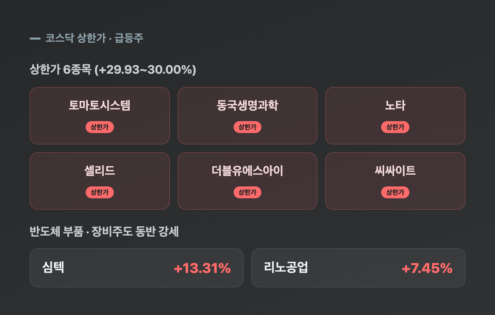
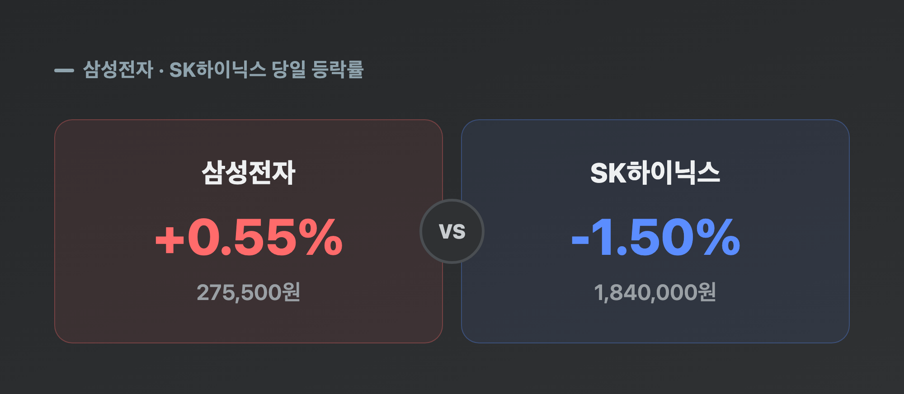
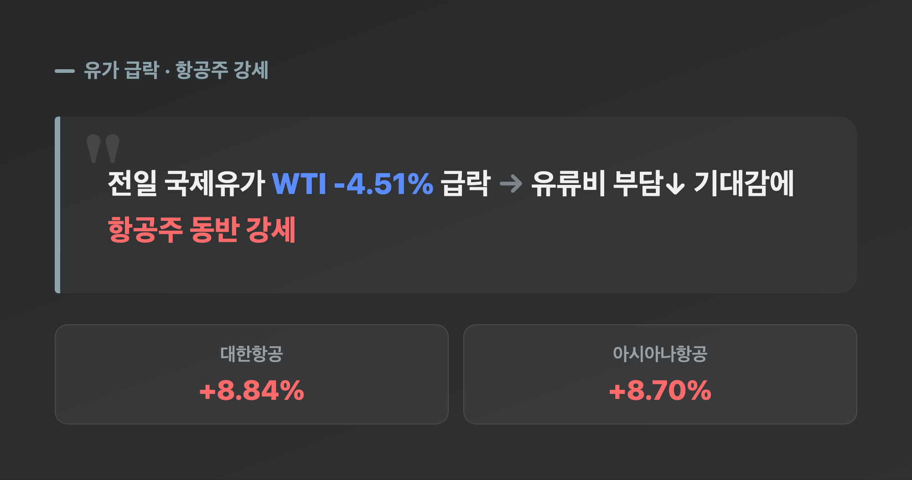
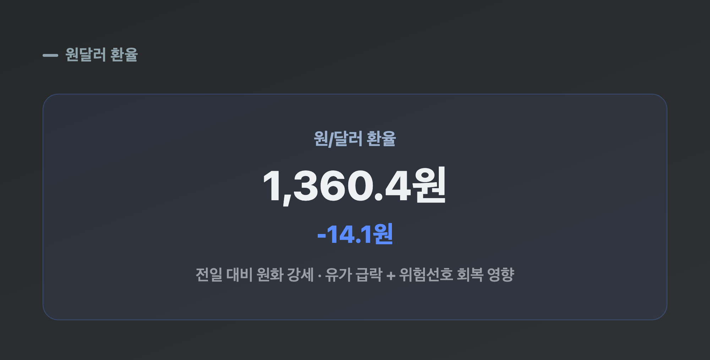

# [내일도 주린이] 코스피 장중 2%대 급등, 오후엔 반납…진짜 주인공은 코리아써키트 (9/22)

장 시작하자마자 코스피 +2.2%, 7,161선 찍힌 거 보고 "어 오늘 7,200 가는 거 아냐" 했습니다. 그런데 오후 되니까 그 상승분이 스멀스멀 사라지더라고요. 이런 날 진짜 마음이 왔다갔다하는데요, 오늘 국장 처음부터 끝까지 순서대로 풀어볼게요.

---

## 🎢 코스피, 장중 2%대 급등 후 상승폭 대부분 반납…결국 강보합

> **코스피 7,017.91 (+10.19포인트, +0.15%) / 코스닥 834.38 (-1.89포인트, -0.23%)**

| 구간 | 코스피 | 등락률 |
|---|---|---|
| 개장 | 7,161.61 | +2.20% |
| 장중 고점 | 7,171.44 | +2.34% |
| 최종 마감 | 7,017.91 | +0.15% |

개장 직후 코스피는 전일 대비 2.20% 급등한 7,161.61로 출발했어요. 간밤 미국 나스닥이 사상 최고치를 새로 쓰고 반도체주가 일제히 폭등한 훈풍이 그대로 넘어온 건데요, 장중 한때 7,171.44까지 오르면서 "이 정도면 7,200도 뚫겠는데" 싶었습니다. 오전 9시 40분경까지도 7,150선 안팎에서 2%대 상승을 유지했고요. 그런데 오후 들어 분위기가 확 바뀌었어요. 차익실현 매물이 쏟아지면서 상승폭이 야금야금 줄어들더니, 결국 전일보다 10.19포인트(+0.15%) 오른 7,017.91로 마감했습니다. "어? 아까 그 2%는 다 어디 갔지" 싶을 정도로 허무한 반납이었어요. 전문가들은 상단에서의 묵직한 매물 부담을 원인으로 짚었는데, 저는 그냥 "오르면 판다"는 국장의 국룰을 오늘도 확인한 기분이었습니다. 이날 거래대금은 약 22조 1,800억원으로, 변동성만큼은 확실히 큰 하루였어요.

코스닥도 비슷한 패턴이었어요. 장 초반엔 코스피와 함께 0.9%대 상승(843선)까지 올라갔다가, 오후 들어 힘을 잃으며 결국 전일 대비 1.89포인트(-0.23%) 내린 834.38로 약보합 마감했습니다.

---

## 🔌 오늘 진짜 하이라이트, PCB·AI서버 기판주 — 메타 '뮤즈'가 국내까지 넘어왔다

> **코리아써키트 +25%대(장중 한때 상한가권) / 대덕전자 +10%대 / 심텍 +14%대 / 티엘비 +15.75%**

| 종목 | 등락률(대표치) |
|---|---|
| 코리아써키트 | +25%대 (장중 한때 +29%대까지) |
| 심텍 | +14%대 (장중 한때 +18%대) |
| 티엘비 | +15.75% |
| 인터플렉스 | +12.78% |
| 대덕전자 | +10~12%대 |
| 삼성전기 | +8.19% (1,546,000원) |

지수는 오후에 힘이 빠졌지만, PCB·AI서버 기판 관련주는 하루 종일 독자적으로 불기둥을 뿜었어요. 코리아써키트는 장중 한때 상한가권인 +29%대까지 치솟았다가 +25%대로 마감했고, 심텍(+14%대, 장중 +18%대까지·종가 30,250원 부근), 티엘비(+15.75%), 인터플렉스(+12.78%), 대덕전자(+10%대) 등이 줄줄이 동반 급등했습니다. 대신증권 연구원은 "메타의 'MUSE' 효과로 서버 수요 확대 기대감이 커지며 기판 업종이 뚜렷한 강세를 보였다"고 짚었는데요, 저는 이 부분이 오늘 국장에서 제일 흥미로웠어요. 어젯밤 미국에서 메타 신규 AI 에이전트 '뮤즈' 하나 때문에 AMD가 시총 1조 달러를 넘었다는 얘기를 봤는데, 그 여파가 하루 만에 국내 PCB 부품주로 고스란히 옮겨붙은 거잖아요. "AI 훈풍이 이렇게 동네방네 퍼지는구나" 싶었습니다. 저는 이 종목들 하나도 안 들고 있어서 오늘도 그냥 구경만 했어요.

---

## 🇰🇷 코스닥은 지수만 약보합, 개별 종목은 상한가 6종목 잔치

> **상한가 6종목 (토마토시스템·동국생명과학·노타·셀리드·더블유에스아이·씨싸이트) / 심텍 +13%대 30,250원 / 리노공업 +7.45% 193,200원**

| 종목 | 등락률 |
|---|---|
| 토마토시스템 외 5종목 | 상한가 (+29.93~30.00%) |
| 심텍 | +13.31% (30,250원) |
| 리노공업 | +7.45% (193,200원) |

코스닥 지수 자체는 834.38로 약보합이었지만, 그 안을 들여다보면 완전히 다른 그림이었어요. 토마토시스템, 동국생명과학, 노타, 셀리드, 더블유에스아이, 씨싸이트까지 6개 종목이 나란히 상한가를 찍었고, 반도체 부품·장비주인 심텍·리노공업도 두 자릿수·한 자릿수 급등하며 힘을 보탰습니다. "지수는 죽었는데 종목은 살아있다"는 말이 딱 이럴 때 쓰는 표현 같아요. 지수만 보고 "오늘 코스닥 별로였네" 하고 넘기면 이런 개별 종목 장세를 놓치기 쉬운데, 저는 이런 날일수록 종목별 등락표를 한 번 더 들여다보게 되더라고요.

---

## ⚖️ 삼성전자는 버텼고, SK하이닉스는 밀렸다

> **삼성전자 +0.55% 275,500원 / SK하이닉스 -1.50% 1,840,000원**

| 종목 | 등락률 | 종가 |
|---|---|---|
| 삼성전자 | +0.55% | 275,500원 |
| SK하이닉스 | -1.50% | 1,840,000원 |

개장 직후엔 둘 다 화끈했어요. 삼성전자는 +2%대 중반, SK하이닉스는 +3%대로 출발하면서 간밤 미국 반도체 랠리를 그대로 반영하는 듯했습니다. 그런데 마감 무렵 둘의 운명이 갈렸어요. SK하이닉스는 장 후반 상승분을 다 반납하고 결국 하락 전환했고, 삼성전자는 소폭이나마 상승세를 지켰습니다. 저는 25주(평단 371,500원) 들고 있는 삼성전자가 275,500원으로 마감하면서 평가손익이 -2,400,000원(-25.84%)이 됐는데요, 어제(9/21) -26.25%였던 걸 감안하면 딱 그만큼만 더 좁혀진 셈이에요. "오늘도 조금은 전진했네" 하고 위안 삼아봅니다. 대장주 둘이 이렇게 엇갈린 날은 오랜만인데, 내일은 또 어느 쪽이 이길지 지켜봐야겠어요.

---

## ✈️ 유가 급락에 항공주 강세, 원전도 동반 상승

> **대한항공 +8.84% 31,400원 / 아시아나항공 +8.70% 8,370원**

전일 국제유가가 4%대 넘게 급락하면서(WTI -4.51%) 유류비 부담이 줄어들 거란 기대감에 항공주가 동반 강세를 보였어요. 대한항공(+8.84%)과 아시아나항공(+8.70%)이 나란히 8%대 급등했습니다. 대신증권 연구원은 원전 업종도 "대미 투자에 따른 수혜 기대감"으로 함께 올랐다고 분석했어요. 반도체·PCB만 보다가 항공주까지 챙기려니 오늘은 볼 게 참 많은 하루였습니다.

---

## 💱 환율은 원화 강세, 수급은 이번엔 그냥 패스합니다

> **원/달러 1,360.4원 (-14.1원)**

원/달러 환율은 장 마감 무렵 기준 1,360.4원으로, 전일 대비 14.1원 내렸어요(원화 강세). 개장 전 KB증권은 이날 예상 범위를 1,367~1,379원으로 내다봤는데, 실제 종가는 그보다도 더 낮게 형성됐습니다. 국제유가 급락과 반도체주 강세에 따른 위험선호 회복이 원화 강세를 이끈 걸로 보여요.

참고로 오늘 수급(외국인·기관·개인 순매수·순매도) 수치는 매체마다 방향 자체가 갈릴 정도로 제각각이었어요. 어떤 곳은 외국인 매수·개인 매도로, 어떤 곳은 반대로 보도했는데, 이 정도로 엇갈리면 억지로 하나로 정리하느니 그냥 패스하는 게 낫겠더라고요. 다음에 좀 더 명확한 자료 나오면 그때 짚어볼게요.

---

## 마무리하며

오늘 코스피는 장중 +2.2%(7,161선)까지 갔다가 결국 +0.15%(7,017.91)로 마감했고, 코스닥은 -0.23%(834.38)로 약보합이었어요. 지수만 보면 심심한데, 그 안에서는 코리아써키트를 필두로 한 PCB·AI서버 기판주가 폭주하고 코스닥에서 상한가만 6종목이 나오는 등 종목별로는 하루 종일 뜨거웠던 날이었습니다.

솔직히 저는 오늘 2%대 급등 소식 보고 잠깐 설렜다가 오후에 그 상승분 사라지는 거 보면서 "역시 국장이지" 싶었어요. 추석 연휴랑 하반기 정치 이벤트를 앞두고 당분간 이런 변동장세가 이어질 수 있다는 얘기도 나오던데, 일단 저는 삼성전자 손실폭이 어제보다 조금 줄어든 것에 만족하고 넘어가려고요.

오늘 급등은 반납했어도, 코리아써키트 못 산 건 두고두고 아까울 것 같습니다 🌱
