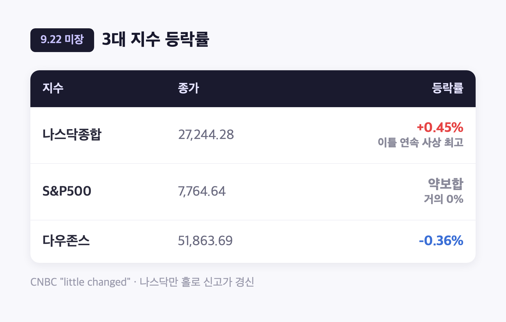
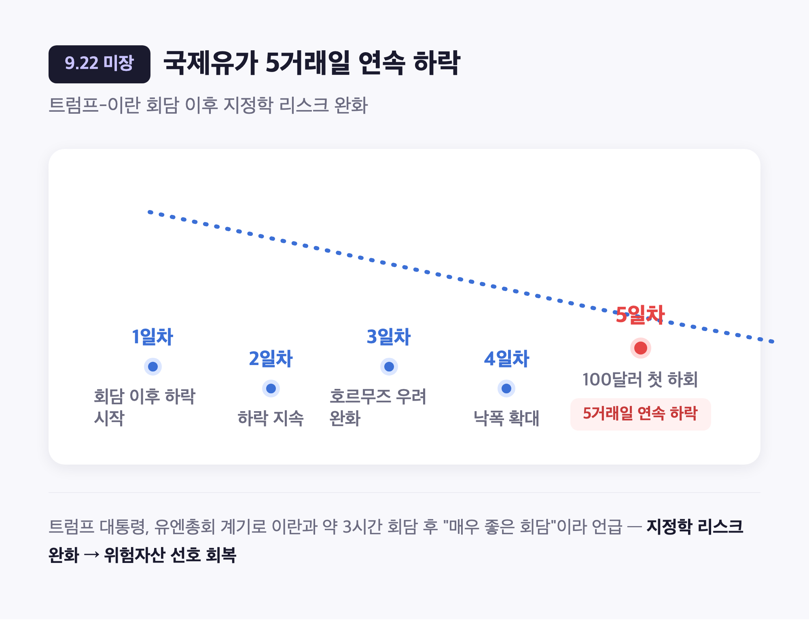
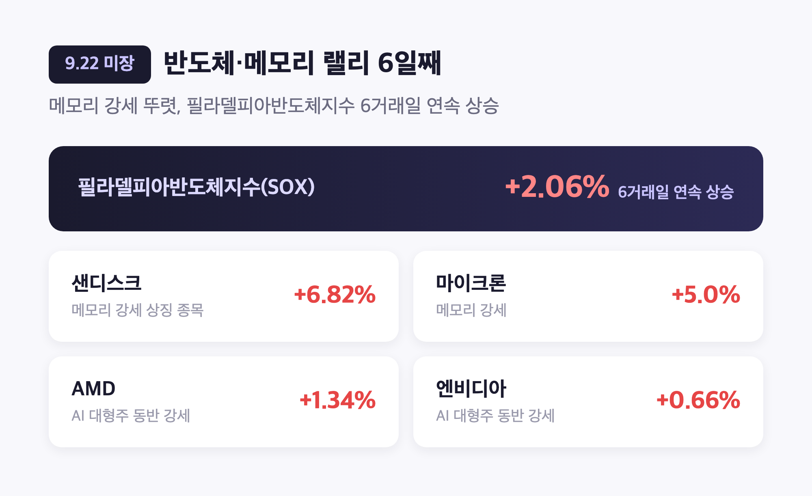
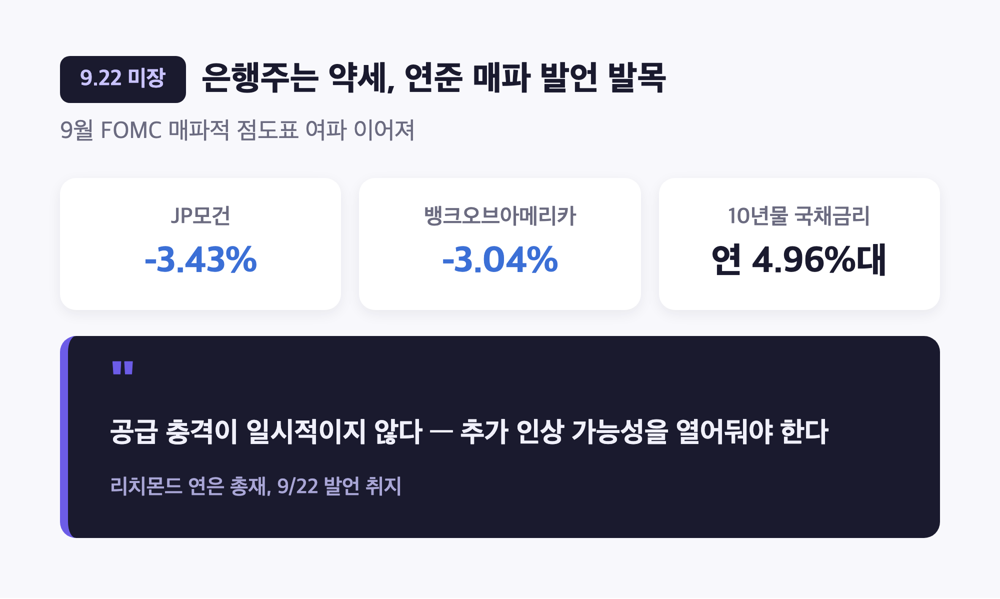
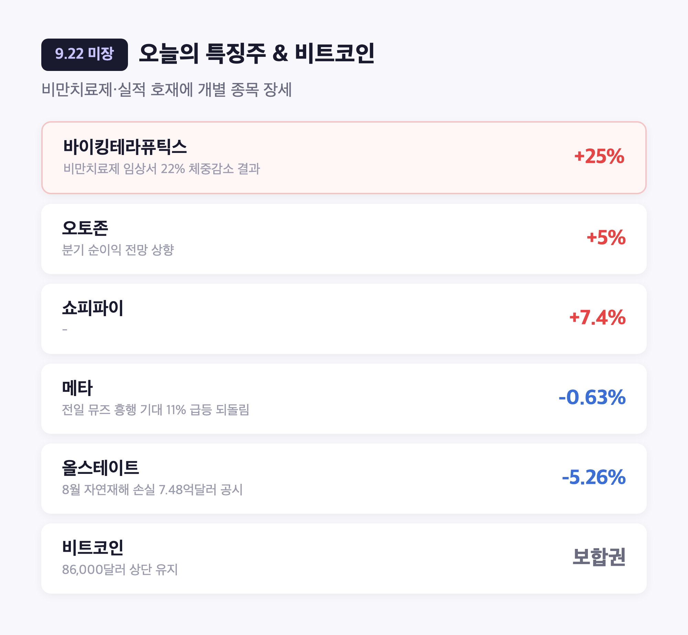

# [내일도 주린이] 나스닥 이틀 연속 최고치…국제유가 5거래일 하락, 이란과 대화 재개 훈풍 (9/22)

어제(9/21) AMD 시가총액 1조 달러 돌파에 나스닥 2.26% 급등까지 봤던지라, 오늘(9/22)도 그 열기가 그대로 이어질 줄 알았는데요, 막상 마감 확인해보니 다우·S&P500은 거의 그 자리였습니다. "어라, 오늘은 좀 조용하네" 싶었어요. 그래도 나스닥은 이틀 연속 사상 최고치를 새로 썼고, 국제유가는 트럼프-이란 회담 이후 5거래일째 미끄러지는 중이라 오늘도 짚을 거리는 꽤 많았습니다.

---

## 🇺🇸 다우·S&P는 숨고르기, 나스닥은 또 최고치 – 3대 지수 엇갈린 하루

> **다우 51,863.69 (-185.14, -0.36%) / S&P500 7,764.64 (-0.06, 약보합) / 나스닥 27,244.28 (+122.18, +0.45%, 이틀 연속 사상 최고)**

| 지수 | 종가 | 등락률 |
|---|---|---|
| 나스닥종합 | 27,244.28 | +0.45% (이틀 연속 사상 최고 종가) |
| S&P500 | 7,764.64 | 약보합 (거의 0%) |
| 다우존스 | 51,863.69 | -0.36% |

CNBC는 오늘 장을 아예 "little changed(거의 변화 없음)"라고 표현했더라고요. 나스닥은 전날 상승분을 지키면서 최고치를 하루 더 늘렸고, S&P500은 보합에 가까운 약보합, 다우는 소폭 하락. TheStreet도 "유가 하락 속에 다우·S&P500은 약세, AI 관련주 강세에 나스닥·러셀2000은 상승"이라고 오늘 하루를 요약했어요. 어제만큼 화끈하진 않았지만, 나스닥 혼자 계속 신고가를 쓰고 있다는 건 여전히 기술주 쪽 온기가 살아있다는 뜻이겠죠.

---

## 🛢️ 국제유가 5거래일 연속 하락 – 트럼프-이란 회담이 불러온 훈풍

> **국제유가 5거래일 연속 하락, 8월 이후 처음으로 100달러 밑으로 내려온 유종 등장**

트럼프 대통령이 뉴욕 유엔총회를 계기로 이란 측과 약 3시간 회담을 가졌는데, 끝나고 "매우 좋은 회담(very good meeting)"이었다며 추가 회담 가능성까지 언급했어요. 호르무즈 해협 공급 불안 심리가 옅어지면서 국제유가가 5거래일째 밀렸고, 그중 한 유종은 8월 이후 처음으로 배럴당 100달러 밑으로 내려왔다는 보도까지 나왔습니다. (다만 브렌트유·WTI 중 어느 쪽이 정확히 얼마인지는 이데일리와 글로벌이코노믹이 완전히 반대로 표기하고 있더라고요. 두 매체가 같은 두 숫자를 서로 다른 유종에 붙여놔서 저도 정리하다가 한참 헷갈렸는데, 정확한 유종 구분보다는 "국제유가가 닷새 연속 밀리며 지정학 리스크가 확실히 걷히는 중"이라는 방향성으로만 받아들이는 게 안전할 것 같아요.) 유가가 내려가니 위험자산 선호 심리도 같이 살아나는 분위기였습니다.

---

## 🔧 반도체 랠리 6거래일째 – 메모리 강세에 저도 모르게 삼성전자 생각났어요

> **필라델피아반도체지수 +2.06% (6거래일 연속 상승) / 마이크론 +5.0%, 샌디스크 +6.82%**

| 종목 | 등락률 | 비고 |
|---|---|---|
| 필라델피아반도체지수(SOX) | +2.06% | 6거래일 연속 상승 |
| 샌디스크 | +6.82% | 메모리 강세 상징 종목으로 여러 매체에 인용 |
| 마이크론 | +5.0% | 메모리 강세 |
| AMD | +1.34% | AI 대형주 동반 강세 |
| 엔비디아 | +0.66% | AI 대형주 동반 강세 |

오늘 반도체 쪽에서는 메모리 종목들이 특히 눈에 띄었어요. 샌디스크가 6.82% 뛰면서 이날 기술주 낙관론을 대표하는 종목으로 여러 매체에 인용됐고, 마이크론도 5% 올랐습니다. 저는 이거 보면서 자연스럽게 제가 물려있는 삼성전자 생각이 나더라고요. 같은 메모리 반도체 회사인데, 마이크론·샌디스크가 이렇게 오르는 걸 보면 "이 온기가 며칠 뒤엔 우리 쪽으로도 좀 넘어오지 않을까" 하고 괜히 기대하게 됩니다. 필라델피아반도체지수도 6거래일 연속 상승이라 최소한 방향성 자체는 나쁘지 않아 보여요.

---

## 🏦 은행주는 약세 – 연준 매파 발언에 발목 잡혔다

> **JP모건 -3.43% / 뱅크오브아메리카 -3.04% / 10년물 국채금리 연 4.96%대**

| 항목 | 수치 |
|---|---|
| JP모건 | -3.43% |
| 뱅크오브아메리카 | -3.04% |
| 10년물 국채금리 | 연 4.96%대 |

은행주는 오늘 분위기가 좀 달랐어요. 지난 9월 FOMC에서 연준이 기준금리를 3.75~4.00%로 0.25%p 올린 데다(12-0 만장일치), 새 점도표가 6월보다 매파적으로 나오면서 18명 위원 중 16명이 연내 추가 인상 가능성을 열어뒀거든요. 이런 흐름 속에 리치몬드 연은 총재가 오늘 "공급 충격이 일시적이지 않다"는 취지로 추가 인상 가능성을 시사했는데, 이게 JP모건·뱅크오브아메리카 같은 대형 은행주를 끌어내린 배경이 됐습니다. 반도체는 웃고 은행은 우는, 같은 시장 안에서도 업종별로 온도차가 뚜렷한 하루였어요.

---

## 💊 특징주 – 바이킹테라퓨틱스 +25% 급등, 메타는 전일 급등 되돌림

> **바이킹테라퓨틱스 +25% / 메타 -0.63% / 비트코인 86,000달러 상단 유지**

| 종목/자산 | 등락률 | 비고 |
|---|---|---|
| 바이킹테라퓨틱스 | +25% | 비만치료제 임상서 22% 체중감소 결과 |
| 오토존 | +5% | 분기 순이익 전망 상향 |
| 쇼피파이 | +7.4% | - |
| 메타 | -0.63% | 전일(9/21) 뮤즈 흥행 기대로 11% 급등한 데 따른 되돌림 |
| 올스테이트 | -5.26% | 8월 자연재해 손실 7억4,800만달러 공시 여파 |
| 비트코인 | - | 86,000달러 상단 유지 |

바이킹테라퓨틱스가 비만치료제 임상에서 22% 체중감소 결과를 내놓으며 25%나 급등한 게 눈에 띄었고, 오토존·쇼피파이도 좋은 소식에 힘입어 나란히 올랐어요. 반대로 메타는 어제 뮤즈(Muse) AI 에이전트 흥행 기대감으로 11% 급등했던 게 하루 만에 되돌림을 맞으며 -0.63%로 마감했습니다. "역시 하루 만에 11% 오른 건 좀 과했나" 싶기도 하고요. RBC 웰스매니지먼트 수석 전략가는 "시장이 10년물 금리가 5%를 웃돌 수 있다는 전망에 여전히 안일하게 대응하고 있다"고 경계감을 표했고, 반대로 UBS CIO는 AI 산업에 대한 긍정적 전망을 유지한다고 밝혔어요. 이번 주 예정된 트럼프-시진핑 정상회담도 다음 관전 포인트로 꼽히더라고요.

---

## 마무리하며

오늘 뉴욕증시는 다우 -0.36%(51,863.69), S&P500 약보합(7,764.64), 나스닥 +0.45%(27,244.28, 이틀 연속 최고)로 마감했고, 배경에는 트럼프-이란 회담發 유가 하락과 연준 매파 발언이라는 서로 다른 방향의 재료 두 개가 같이 있었어요.

솔직히 어제 AMD 1조 달러 돌파 같은 큰 뉴스 보고 나니 오늘은 좀 심심하게 느껴졌는데요, 저는 이런 조용한 날일수록 반도체지수 6거래일 연속 상승 같은 잔잔한 신호를 놓치지 않고 챙겨보려고 합니다.

오늘은 지수가 쉬어가는 날이었네요, 저도 잠깐 숨 고르고 내일 또 정리하겠습니다 🌱
