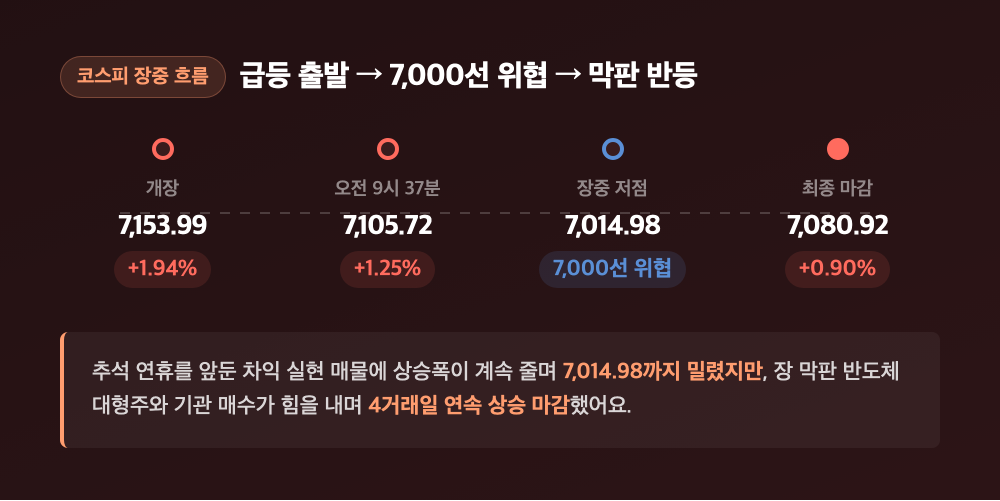
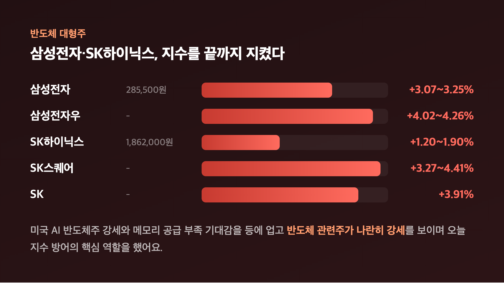
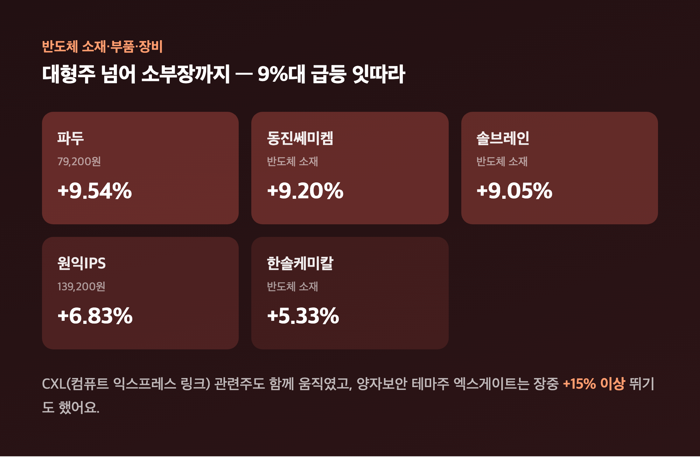
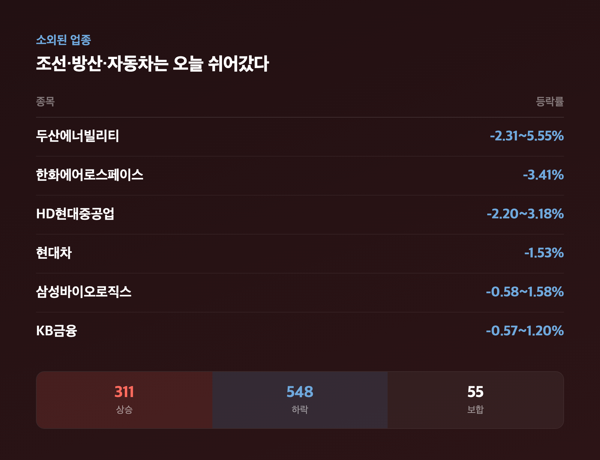
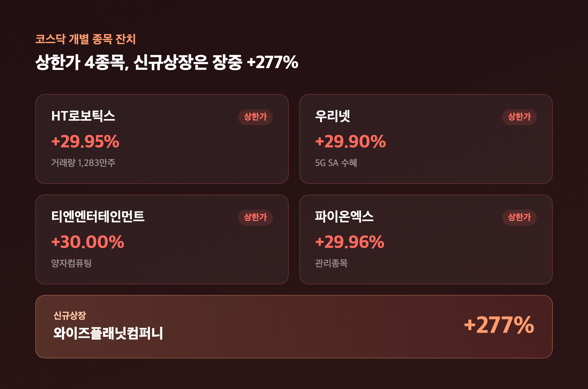
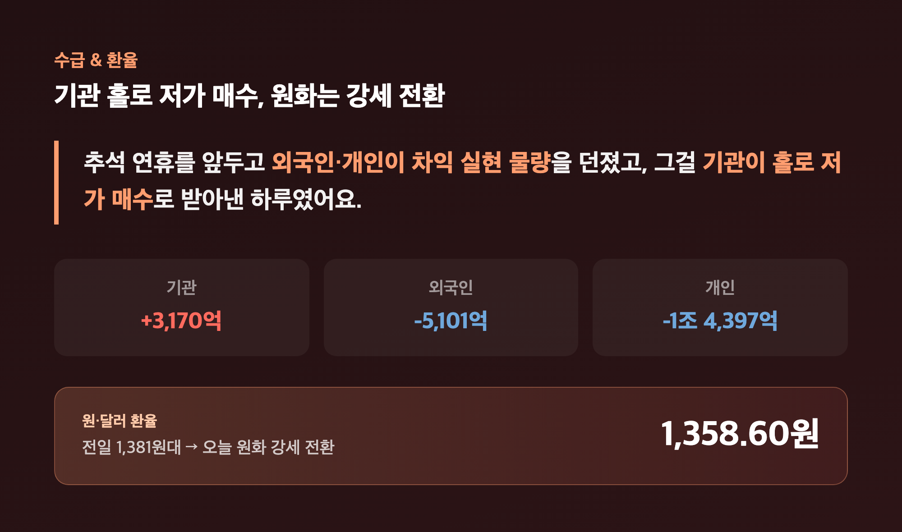

# [내일도 주린이] 코스피 7080 마감, 반도체가 지켰다…추석 연휴 앞 마지막 거래일 롤러코스터 (9/23)

내일부터 나흘 내리 장이 안 열린다고 생각하니 오늘따라 마음이 이상하게 붕 떠 있었어요. 장 초반 코스피가 2% 가까이 튀어 오르는 거 보고 "오, 이대로 연휴 가나" 싶었는데, 오후엔 또 7,000선이 휘청이더라고요. 삼성전자 물려있는 저로서는 오늘 하루가 유독 길게 느껴졌는데, 추석 연휴 앞 마지막 거래일 국장 정리 시작해볼게요.

---

## 🎏 추석 연휴 앞 마지막 거래일 — 코스피, 2% 급등 출발했다가 7,000선까지 흔들

> **코스피 7,080.92 (+63.01포인트, +0.90%) / 코스닥 844.48 (+10.10포인트, +1.21%)**

| 구간 | 코스피 | 등락률 |
|---|---|---|
| 개장 | 7,153.99 | +1.94% |
| 오전 9시 37분 | 7,105.72 | +1.25% |
| 장중 저점 | 7,014.98 | 7,000선 위협 |
| 최종 마감 | 7,080.92 | +0.90% |

간밤 나스닥이 2거래일 연속 사상 최고치를 새로 쓰고 인텔·마이크론 같은 반도체주가 일제히 강세를 보인 훈풍이 그대로 넘어오면서, 코스피는 전일 대비 1.94% 급등한 7,153.99로 출발했어요. 그런데 추석 연휴(4거래일) 공백을 앞둔 차익 실현 매물이 쏟아지면서 상승폭이 계속 줄었고, 장중 한때 7,014.98까지 밀리며 "어, 이러다 7,000 깨지는 거 아냐" 싶은 순간도 있었습니다. 다행히 장 막판 반도체 대형주가 다시 힘을 내고 기관이 저가 매수에 나서면서 낙폭을 만회, 결국 +0.90% 오른 7,080.92로 4거래일 연속 상승 마감했어요. 코스닥도 841.73으로 출발해 847.35까지 오른 뒤 소폭 반납하며 +1.21%(844.48)로 마무리됐고요. 거래대금은 코스피 약 20.9조원, 코스닥 약 7.6조원으로 둘 다 전일보다 줄었는데, 연휴 앞두고 다들 포지션 정리에 들어간 느낌이었습니다.

---

## 💾 반도체 대형주가 지수를 지켰다 — 제 삼성전자도 오랜만에 웃었습니다

> **삼성전자 +3.07~3.25% 285,500원 / SK하이닉스 +1.20~1.90% 1,862,000원**

| 종목 | 등락률 | 종가 |
|---|---|---|
| 삼성전자 | +3.07~3.25% | 285,500원 |
| 삼성전자우 | +4.02~4.26% | - |
| SK하이닉스 | +1.20~1.90% | 1,862,000원 |
| SK스퀘어 | +3.27~4.41% | - |
| SK | +3.91% | - |

오늘 지수를 끝까지 지켜낸 건 결국 반도체 대형주였어요. 삼성전자가 3%대 강세로 285,500원에 마감하며 지수 방어의 핵심 역할을 했고, 삼성전자우(+4%대)·SK하이닉스(+1~2%대)·SK스퀘어·SK까지 반도체 관련주가 나란히 올랐습니다. 미국 AI 반도체주 강세와 메모리 공급 부족 기대감이 배경으로 꼽혔어요. 저는 25주(평단 371,500원) 들고 있는데, 285,500원으로 마감하면서 평가손익이 -2,150,000원(-23.15%)이 됐어요. 어제(9/22) -25.84%, 그제(9/21) -26.25%였던 걸 감안하면 사흘 연속 손실폭이 줄어든 셈인데요, "익절"은 여전히 멀었지만 연휴 앞두고 이 정도 흐름이면 마음 편히 쉴 수 있겠다 싶었습니다.

---

## ⚙️ 반도체 소재·부품·장비도 동반 강세 — 솔브레인·동진쎄미켐 9%대

> **솔브레인 +9.05% / 동진쎄미켐 +9.20% / 원익IPS +6.83% / 파두 +9.54%**

| 종목 | 등락률 | 비고 |
|---|---|---|
| 솔브레인 | +9.05% | 반도체 소재 |
| 동진쎄미켐 | +9.20% | 반도체 소재 |
| 한솔케미칼 | +5.33% | 반도체 소재 |
| 원익IPS | +6.83% | 139,200원 |
| 파두 | +9.54% | 79,200원 |

대형주뿐 아니라 소재·부품·장비주까지 오늘은 반도체가 완전히 판을 깔았어요. 솔브레인·동진쎄미켐이 9%대로 급등했고, 원익IPS·파두도 오전 중 6~9%대 강세를 보였습니다. CXL(컴퓨트 익스프레스 링크) 관련주도 함께 움직였고, 양자보안 테마주인 엑스게이트는 장중 +15% 이상 뛰기도 했어요. 저는 이 종목들은 하나도 안 들고 있어서 오늘도 그냥 표만 보고 부러워했는데, "반도체 사이클 하나 타는 게 이렇게 크구나" 싶었습니다.

---

## 📉 조선·방산·자동차는 소외 — 오르는 종목보다 내리는 종목이 더 많았다

> **두산에너빌리티 -2.31~5.55% / 한화에어로스페이스 -3.41% / 현대차 -1.53%**

| 종목 | 등락률 |
|---|---|
| 두산에너빌리티 | -2.31~5.55% |
| 한화에어로스페이스 | -3.41% |
| HD현대중공업 | -2.20~3.18% |
| KB금융 | -0.57~1.20% |
| 현대차 | -1.53% |
| 삼성바이오로직스 | -0.58~1.58% |

반도체가 화려했던 만큼, 그동안 시장을 이끌던 조선·방산주는 오늘 확실히 쉬어갔어요. 두산에너빌리티·한화에어로스페이스·HD현대중공업이 나란히 내렸고, KB금융 같은 금융주와 현대차·삼성바이오로직스도 약세였습니다. 실제로 유가증권시장 전체로 보면 상승 311개, 하락 548개, 보합 55개로 하락 종목이 훨씬 많았어요. 코스피 지수만 보면 "오늘 좋았네" 싶지만, 반도체 몇 종목이 지수를 끌고 나머지는 오히려 눌린 하루였던 거죠. 저는 이런 날 지수 헤드라인만 보고 넘어가면 꼭 놓치는 게 있더라고요.

---

## 🚀 코스닥은 상한가 4종목 잔치 — 신규상장 종목은 장중 +277%

> **HT로보틱스 +29.95% / 우리넷 +29.90% / 티엔엔터테인먼트 +30.00% / 파이온엑스 +29.96%**

| 종목 | 등락률 | 테마 |
|---|---|---|
| HT로보틱스 | +29.95% | 거래량 1,283만주 |
| 우리넷 | +29.90% | 5G SA 수혜 |
| 티엔엔터테인먼트 | +30.00% | 양자컴퓨팅 |
| 파이온엑스 | +29.96% | 관리종목 |
| 와이즈플래닛컴퍼니 | 장중 +277% | 신규상장 |

코스닥 지수 자체는 +1.21%로 무난했지만, 안을 들여다보면 오늘도 개별 종목 잔치였어요. HT로보틱스·우리넷·티엔엔터테인먼트·파이온엑스까지 4개 종목이 나란히 상한가를 찍었고, 신규 상장한 와이즈플래닛컴퍼니는 장중 +277%까지 폭등했습니다. "코스닥은 지수보다 개별 종목표를 봐야 진짜 그림이 보인다"는 걸 오늘도 새삼 느꼈어요.

---

## 💰 수급 & 환율 — 기관 홀로 매수, 다음 개장일(9/28)은 삼성전자 특별배당이 변수

> **기관 +3,170억원 순매수 / 외국인 -5,101억원 / 개인 -1조 4,397억원 / 원·달러 1,358.60원**

| 투자주체 | 순매수·순매도 |
|---|---|
| 기관 | +3,170억원 |
| 외국인 | -5,101억원 |
| 개인 | -1조 4,397억원 |
| 프로그램 매매 | -7,196억원 |

추석 연휴를 앞두고 외국인·개인이 차익 실현 물량을 던졌고, 그걸 기관이 홀로 저가 매수로 받아낸 구도였어요. (일부 매체는 정반대로 "개인 매수·외국인 최대 매도"로 보도하기도 했는데, 다수 매체가 일치한 "기관 매수·개인 최대 매도" 기준으로 정리했습니다.) 원/달러 환율은 1,358.60원으로, 전일 1,381원대에서 원화가 꽤 강세로 돌아섰어요. 다음 개장일인 9/28은 삼성전자 특별배당(주당 4,604원) 매수 수요와 마이크론 실적이 핵심 변수로 꼽히는데요, 증권가에서는 강세면 7,200선, 약세면 7,000선 재시험을 전망하면서 연휴 기간 포지션을 평소보다 10~15% 낮춰 운영하라는 조언도 나왔어요. 저는 이 말 보고 "그래, 연휴 동안은 계좌 좀 안 보고 살자" 다짐했습니다.

---

## 마무리하며

오늘 코스피는 장중 7,014.98까지 밀렸다가 결국 +0.90% 오른 7,080.92로 4거래일 연속 상승 마감했고, 코스닥도 +1.21%(844.48)로 상한가 4종목이 나오며 뜨거웠어요. 삼성전자가 3%대 강세를 보이면서 제 평가손실도 -23.15%까지 줄어든, 저한테는 나름 기분 좋은 하루였습니다.

솔직히 추석 연휴 동안 미·중 정상회담 결과가 어떻게 나올지, 마이크론 실적이 어떨지 전혀 감이 안 오는데요, 저는 일단 연휴 기간만큼은 계좌 앱을 좀 덜 켜보려고 합니다. 4일 동안 못 보는 만큼, 9/28에 여러분과 저 둘 다 웃는 얼굴로 만났으면 좋겠네요.

연휴 잘 보내시고, 다음 개장일에 또 손절할지 익절할지는 그때 가서 정리하겠습니다 🌱
