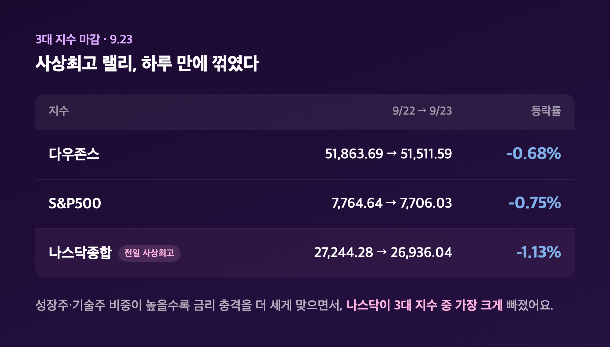
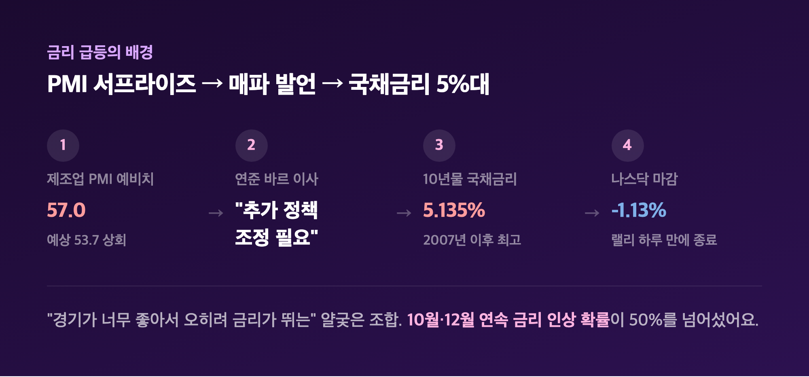
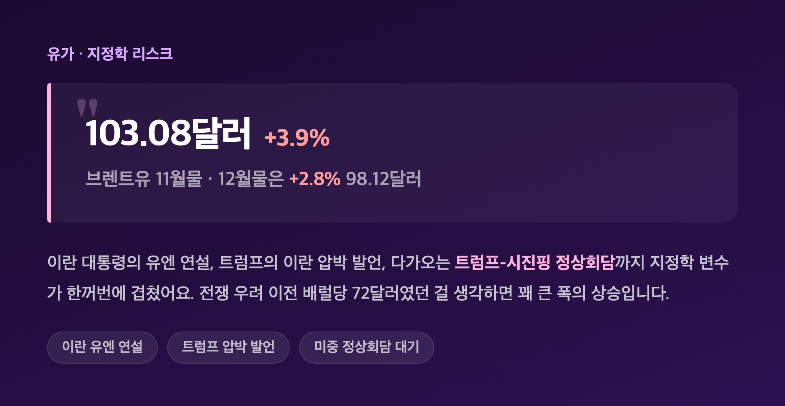
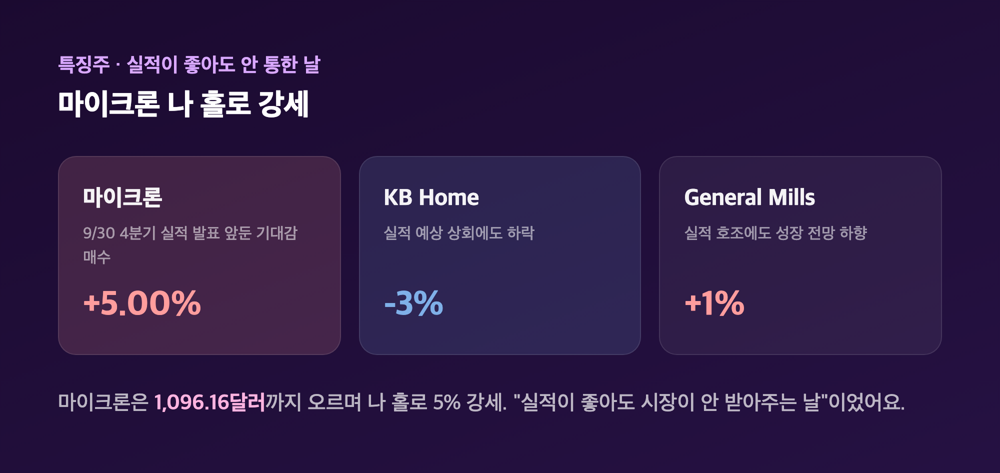
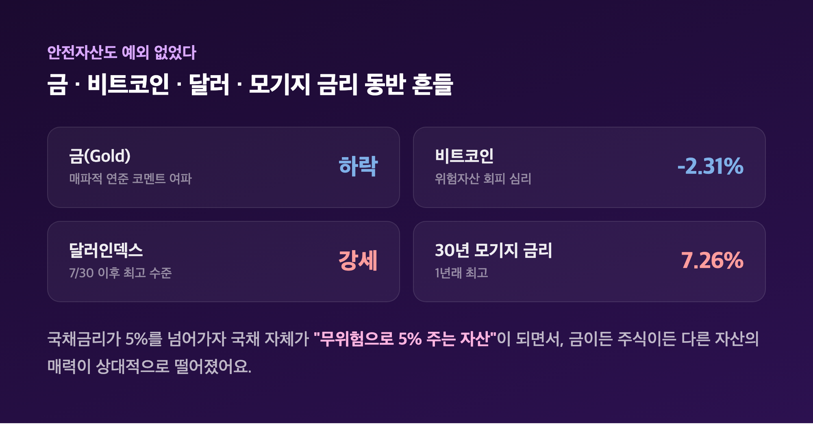

# [내일도 주린이] 국채금리 2007년 이후 최고치…나스닥 사상최고 랠리 하루 만에 꺾였다 (9/23)

10년물 국채금리 5.135%. 2007년 7월 이후 최고치입니다. 어제(9/22)만 해도 나스닥이 메타 '뮤즈' 훈풍 타고 사상 최고치를 새로 썼다는 소식에 저도 살짝 들떴었는데요, 하루 만에 완전히 다른 얘기를 써야 하게 생겼습니다. 오늘(9/23, 현지시간 기준) 미장 정리, 금리 얘기부터 풀어볼게요.

---

## 📉 3대 지수 일제히 하락 – 사상 최고치 랠리, 하루 만에 꺾였다

> **다우 51,511.59 (-352.10, -0.68%) / S&P500 7,706.03 (-58.61, -0.75%) / 나스닥 26,936.04 (-308.24, -1.13%)**

| 지수 | 9/22 종가 | 9/23 종가 | 등락률 |
|---|---|---|---|
| 다우존스 | 51,863.69 | 51,511.59 | -0.68% |
| S&P500 | 7,764.64 | 7,706.03 | -0.75% |
| 나스닥종합 | 27,244.28 (사상 최고) | 26,936.04 | -1.13% |

어제까지만 해도 나스닥은 메타 AI 에이전트 '뮤즈' 기대감에 반도체주가 급등하면서 2거래일 연속 사상 최고 종가를 썼거든요. 그런데 오늘은 그 랠리가 하루도 못 가고 꺾였습니다. 특히 나스닥이 -1.13%로 3대 지수 중 가장 크게 빠졌는데, 성장주·기술주 비중이 높은 지수일수록 금리 충격을 더 세게 맞는다는 걸 보여주는 대목이었어요. CNBC는 유틸리티·임의소비재 업종이 각각 1% 이상 빠지며 지수 하락을 주도했다고 짚었습니다. 참고로 국내 코스피는 어제(9/22) 반도체 강세에 힘입어 7,080선(+0.90%)까지 올랐었는데, 정작 그 훈풍의 진원지인 미국 시장은 하루 만에 조정 국면으로 돌아선 셈이라 아이러니하다는 생각이 들었어요.

---

## 🏦 범인은 국채금리 – PMI 서프라이즈에 연준 매파 발언까지 겹쳤다

> **10년물 국채금리 5.135% (2007년 7월 이후 최고) / 5년물 국채금리 5% 돌파 (2007년 이후 최초)**

| 항목 | 수치 | 비고 |
|---|---|---|
| 10년물 국채금리 | 5.135% (장중) | 전일 4.96%→5.10%로 급등 |
| 5년물 국채금리 | 5% 돌파 | 2007년 이후 처음 |
| 제조업 PMI(예비치) | 57 | 예상 53.7 상회 |
| 서비스업 PMI(예비치) | 58.7 | 예상 55.8 상회 |

오늘 하락의 진짜 원인은 여기 있었어요. 9월 S&P 글로벌 PMI 예비치가 예상을 크게 웃돌면서 5년여 만에 가장 강한 기업활동 성장세를 보였는데, 기업 비용도 4년래 최고 수준으로 치솟았다고 해요. "경기가 너무 좋아서 오히려 금리가 뛴다"는, 주식시장 입장에서는 참 얄궂은 조합이었던 거죠. 여기에 연준 마이클 바르 이사가 이날 연설에서 "인플레이션을 목표 수준으로 끌어내리려면 추가 정책 조정이 필요할 가능성이 높다"고 매파적 발언을 더하면서, 트레이더들이 반영하는 10월·12월 FOMC 연속 금리 인상 확률이 50%를 넘어섰다고 합니다. 지난 9월 중순 연준이 3년 만에 처음 기준금리를 올린 지 얼마 되지도 않았는데 벌써 다음 인상 얘기가 나오는 셈이라, 저는 "이러다 진짜 금리가 안 멈추는 거 아닌가" 싶더라고요.

---

## 🛢️ 유가도 같이 뛰었다 – 이란발 지정학 리스크

> **브렌트유 11월물 103.08달러(+3.9%) / 12월물 98.12달러(+2.8%)**

| 항목 | 가격 | 등락률 |
|---|---|---|
| 브렌트유 11월물 | 103.08달러 | +3.9% |
| 브렌트유 12월물 | 98.12달러 | +2.8% |

이란 대통령의 유엔 연설, 트럼프 대통령의 전날 유엔 연설에서 나온 이란 압박 발언(동시에 실무급 대화 가능성도 언급), 다가오는 트럼프-시진핑 정상회담까지 지정학 변수가 한꺼번에 겹치면서 유가가 뛰었어요. 전쟁 우려 이전 배럴당 72달러 수준이었던 걸 생각하면 꽤 큰 폭의 상승입니다. 유가가 오르면 인플레이션 우려가 자극돼서 국채금리 상승을 더 부추기는 구조인데, 오늘은 딱 그 조합이 그대로 나왔던 하루였어요.

---

## 💾 특징주 – 마이크론 나 홀로 강세, 실적 좋아도 웃지 못한 종목들

> **마이크론 +5.00% 1,096.16달러 / KB Home -3% / General Mills +1%**

| 종목 | 등락률 | 비고 |
|---|---|---|
| 마이크론 | +5.00% (1,096.16달러) | 9/30 실적 발표 앞둔 기대감 |
| KB Home | -3% | 실적 예상 상회에도 하락 |
| General Mills | +1% | 실적 호조에도 성장 전망 하향 |

오늘 개별 종목 중에서는 마이크론이 유독 눈에 띄었어요. 9월 30일 4분기 실적 발표를 앞두고 사전 기대감 매수가 붙으면서 나 홀로 5% 강세를 보였거든요. 반면 KB Home은 예상치를 웃도는 실적을 내고도 -3% 빠졌고, General Mills도 실적은 좋았지만 성장 전망을 낮추면서 겨우 +1%에 그쳤습니다. "실적이 좋아도 시장이 안 받아주는 날"이라는 게 딱 오늘이었던 것 같아요. 참고로 오늘은 반도체 대형주나 빅테크 개별 종목의 등락률을 여러 소스로 교차검증했는데 신뢰할 만한 단일 수치를 확정하지 못해서 이번 글엔 넣지 않았어요. 다만 나스닥이 가장 크게 빠진 걸 보면 기술주·성장주 전반이 금리 직격탄을 맞았다고 보는 게 맞을 것 같습니다. 저도 물려있는 삼성전자가 마이크론과 같은 메모리 반도체 회사라, 9/30 마이크론 실적 발표를 앞두고 이 금리발 조정 분위기가 어떻게 넘어올지 괜히 신경 쓰이더라고요.

---

## 💰 금·비트코인도 흔들 – 안전자산까지 예외는 없었다

> **금(gold) 하락 / 비트코인 -2.31% / 30년 모기지 금리 7.26%(1년래 최고)**

| 자산 | 동향 |
|---|---|
| 금(gold) | 매파적 연준 코멘트 여파로 하락 |
| 달러인덱스 | 7월 30일 이후 최고 수준 |
| 비트코인 | -2.31% |
| 30년 모기지 금리 | 7.26% (1년래 최고) |

금값은 매파적 연준 코멘트에 하락했는데, 낙폭은 소스마다 -0.81%~-1.28%로 조금씩 엇갈려서 정확한 숫자보다는 "하락했다"는 방향성 위주로 보시는 게 안전할 것 같아요. 비트코인도 -2.31% 내렸고, 30년 만기 모기지 금리는 7.26%로 1년 만의 최고치를 찍었습니다. 안전자산이라고 불리는 금까지 밀렸다는 게 오늘 시장 분위기를 제일 잘 보여주는 대목 같아요. 국채금리가 5%를 넘어가니까 오히려 국채 자체가 "무위험으로 5% 주는 자산"이 돼버려서, 금이든 주식이든 다른 자산의 매력이 상대적으로 떨어지는 그림이었습니다.

---

## 🔮 전망 – "후기 단계 버블"이라는 경고까지 나왔다

> **캐피털 이코노믹스: S&P500 연말 8,250 → 2027년 말 6,500(-21%) 전망**

Capital Economics의 제임스 라일리 수석 시장 이코노미스트는 (9월 13일 기준 코멘트) S&P500이 연말 8,250까지 오른 뒤 2027년 말까지 21% 폭락해 6,500까지 밀릴 것이라는 전망을 유지한다고 밝히면서 "현재 데이터는 후기 단계 버블과 부합하는 모습"이라고 진단했어요. 다만 이건 9/23 마감 직후 나온 코멘트가 아니라 9월 중순 시점의 코멘트라는 점은 참고하셔야 할 것 같아요. 그래도 논리 자체는 납득이 가는 게, 국채가 5% 수익률을 주는 상황에서 성장주에 30배 넘는 밸류에이션을 계속 지불하는 게 기관투자자 입장에서도 점점 부담스러워진다는 얘기거든요. 고금리는 미래 이익을 지금 가치로 할인하는 비율을 높이니까, 특히 기술주 같은 장기 성장주가 제일 먼저 흔들리는 구조라고 해요. 10년물이 5%를 넘은 게 2007년 금융위기 직전 수준과 겹친다는 점도 시장에서는 계속 경계하는 분위기고요.

---

## 마무리하며

오늘 뉴욕증시는 다우 -0.68%, S&P500 -0.75%, 나스닥 -1.13%로 3대 지수가 일제히 하락했고, 배경에는 10년물 국채금리가 2007년 이후 최고치인 5.135%까지 뛴 게 있었습니다. 어제 사상 최고치를 찍었던 나스닥이 하루 만에 1% 넘게 빠진 걸 보면서, "역시 랠리는 하루짜리일 수도 있구나" 싶었어요.

솔직히 저는 금리가 5%를 넘었다는 숫자 자체보다, 그게 마이크론 실적 발표를 앞둔 메모리 반도체 업종 전반에 어떤 영향을 줄지가 더 신경 쓰입니다. 일단 내일 국장 반응부터 지켜보고, 다음 개장일까지는 계좌 너무 자주 열어보지 않으려고요.

국채금리가 오늘 승자였고, 저는 오늘도 그냥 지켜보는 쪽이었습니다. 내일은 또 어떤 숫자가 시장을 흔들지, 저도 계속 따라가 보겠습니다 🌱
