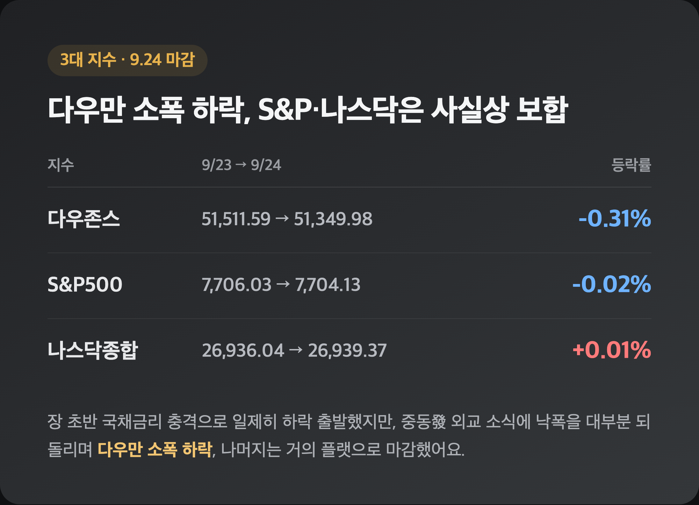
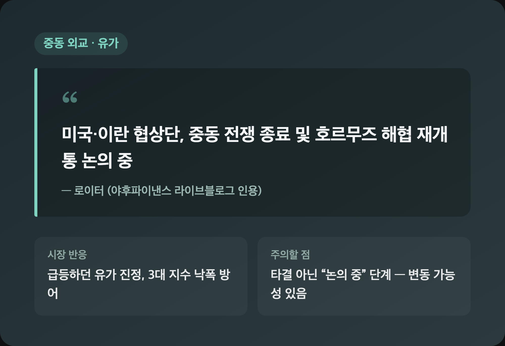
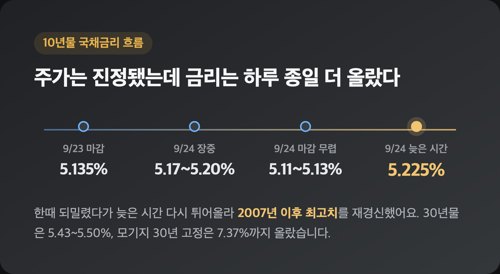
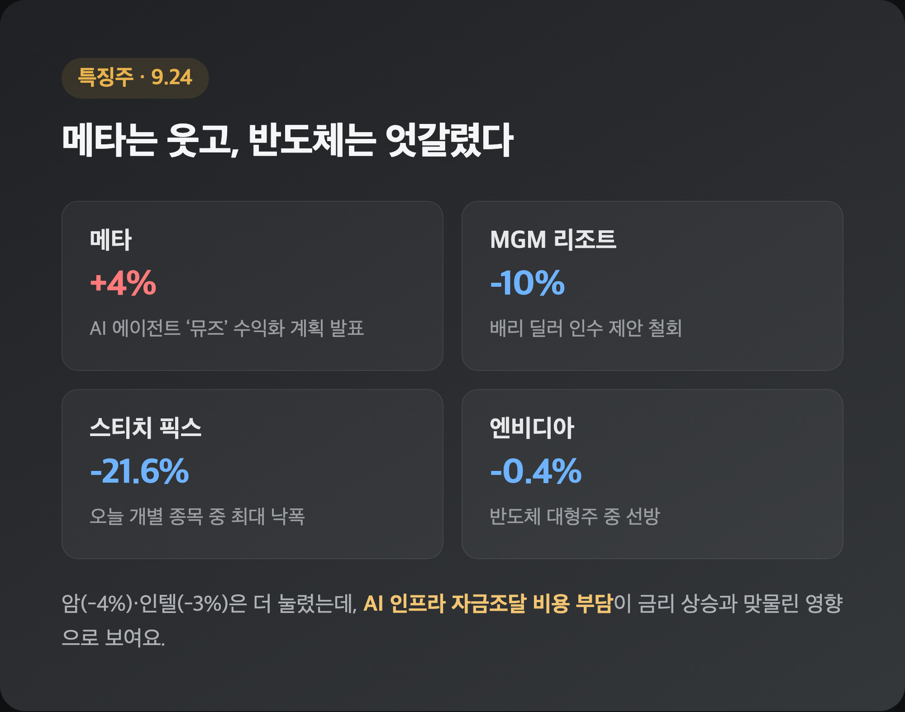
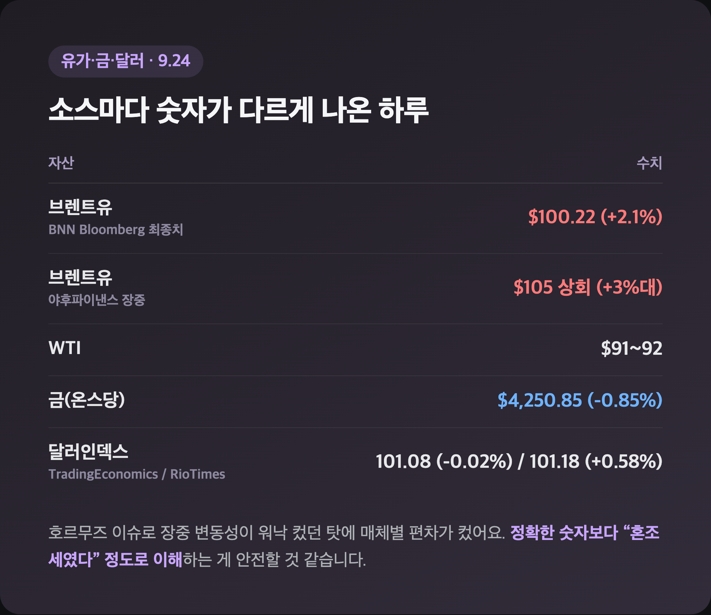
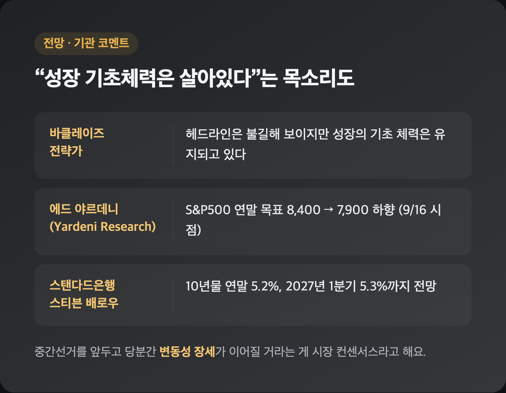

# [내일도 주린이] 호르무즈 기대감에 낙폭 축소…국채금리는 오히려 5.2%대로 더 뛰었다 (9/24)

장 초반 선물 빨간불 보고 "오늘도 또 밀리겠구나" 했는데요, 마감 직전에 갑자기 분위기가 바뀌더라고요. 9/24(목) 미장 정리, 오늘은 국채금리 얘기 못지않게 '호르무즈 해협'이라는 생소한 단어가 시장을 움직였습니다.

---

## 📊 3대 지수, 다우만 소폭 하락 – S&P·나스닥은 사실상 보합

> **다우 51,349.98 (-161.61, -0.31%) / S&P500 7,704.13 (-1.90, -0.02%) / 나스닥 26,939.37 (+3.34, +0.01%)**

| 지수 | 9/23 종가 | 9/24 종가 | 등락률 |
|---|---|---|---|
| 다우존스 | 51,511.59 | 51,349.98 | -0.31% |
| S&P500 | 7,706.03 | 7,704.13 | -0.02% |
| 나스닥종합 | 26,936.04 | 26,939.37 | +0.01% |

장 초반엔 3대 지수가 전날(9/23) 국채금리 급등 충격의 연장선에서 일제히 하락 출발했어요. 그런데 장중에 중동發 외교 진전 소식이 흘러나오면서 낙폭을 대부분 되돌렸고, 결국 다우만 소폭(-0.31%) 밀리고 S&P500·나스닥은 거의 플랫으로 마감했습니다. CNBC는 이날을 두고 "다우가 4주 연속 주간 하락 흐름으로 향하고 있다"고 짚었는데요, 저는 이 문구 보고 "어, 이번 주도 결국 빨간 주였구나" 싶어서 살짝 씁쓸했어요. 숫자만 보면 어제(9/23, 나스닥 -1.13%)보다는 훨씬 잠잠한 하루였지만, 그 속을 들여다보면 딱히 안심할 상황은 아니었습니다.

---

## 🕊️ 호르무즈 해협 기대감이 낙폭을 줄였다

> **로이터: 미국·이란 협상단, 중동 전쟁 종료 및 호르무즈 해협 재개통 논의 중**

| 구분 | 내용 |
|---|---|
| 소식 | 로이터 보도 인용, 美·이란 협상단이 중동 전쟁 종료·호르무즈 해협 재개통 방안 논의 |
| 시장 반응 | 급등하던 유가 진정, 장중 하락폭 축소로 3대 지수 낙폭 방어 |

야후파이낸스 라이브블로그가 전한 이 소식이 오늘 장 후반 분위기를 완전히 바꿔놨어요. 호르무즈 해협은 세계 원유 수송량의 상당 부분이 지나가는 길목이라, "여기가 뚫린다"는 얘기만으로도 유가 상승 압력이 확 꺾이고 덩달아 주가도 숨통이 트인 거죠. 다만 협상이 실제로 타결된 건 아니고 "논의 중"이라는 단계라서, 저는 "이거 며칠 뒤에 없던 일 되는 거 아니야" 하는 의심도 살짝 들었습니다. 그래도 오늘 하루만큼은 지수 낙폭을 줄여준 확실한 재료였어요.

---

## 🏦 국채금리는 오히려 더 뛰었다 – 2007년 이후 최고치 재경신

> **10년물 늦은 시간 기준 5.225% (2007년 이후 최고) / 30년물 5.43~5.50% / 모기지 30년 고정 7.37%**

| 구분 | 수치 | 비고 |
|---|---|---|
| 10년물(9/23 마감) | 5.135% | 19년래 최고 |
| 10년물(9/24 장중) | 5.17~5.20% | 추가 상승 |
| 10년물(9/24 마감 무렵) | 5.11~5.13% | 소폭 되밀림 |
| 10년물(9/24 늦은 시간~9/25) | 5.225% | 2007년 이후 최고 재경신 |
| 30년물 | 5.43~5.50% | 2004년 이후 최고 |
| 모기지 30년 고정 | 7.37% | 2024년 5월 이후 최고 |

주가 낙폭은 줄었는데 정작 금리는 하루 종일 오르락내리락하다가 늦은 시간엔 더 높은 곳까지 올라갔어요. "주식은 진정됐는데 채권은 왜 더 난리지" 싶었는데, 이번 주 동안 연준 인사들의 매파적 발언이 계속 쌓인 영향이 커 보입니다. 필라델피아 연은 총재는 "인플레이션 완화를 위해 추가 인상이 필요할 수 있다"고 했고, 뉴욕 연은 총재 존 윌리엄스도 "연내 추가 한 차례 인상이 합리적"이라는 취지로 언급했다고 해요. CME FedWatch 기준 10월 추가 인상 확률은 시점에 따라 50%대 초반부터 69%까지 다르게 나왔는데, 이 정도로 편차가 크다는 것 자체가 시장이 아직 확신을 못 하고 있다는 신호 같습니다. 모기지 금리 7.37%면 내 집 마련 계획 있는 분들한테는 진짜 체감이 클 것 같아요.

---

## 💾 특징주 – 메타는 웃고, 반도체는 엇갈렸다

> **메타 +4% / MGM 리조트 약 -10% / 스티치 픽스 -21.6% / 엔비디아 -0.4%**

| 종목 | 등락률 | 배경 |
|---|---|---|
| 메타 | +4% | 자체 AI 에이전트 '뮤즈' 수익화 계획 발표 |
| 오라클 | 급락 | 포스 마쥬어(불가항력) 공시 |
| 다든 레스토랑츠 | -3% | 실적 부진 |
| MGM 리조트 | 약 -10% | 배리 딜러 인수 제안 철회 |
| 스티치 픽스 | -21.6% | - |
| 에버퓨어(일부 소스 Evercore 표기) | +11.2% | 사명 표기 소스 간 엇갈림 |
| 엔비디아 | -0.4% | 반도체 대형주 중 선방 |
| 암(Arm Holdings) | -4% | AI 인프라 자금조달 비용 부담 |
| 인텔 | -3% | AI 인프라 자금조달 비용 부담 |

메타는 CEO가 직접 AI 에이전트 '뮤즈' 수익화 계획을 발표하면서 +4%로 오늘 개별 종목 중 제일 눈에 띄었어요. 반대로 오라클은 포스 마쥬어 공시라는 낯선 이슈로 크게 밀렸고, MGM은 인수 제안이 철회됐다는 소식에 하루 만에 두 자릿수 급락을 맞았습니다. 반도체는 종목별로 온도차가 꽤 컸는데, 엔비디아는 -0.4%로 선방한 반면 암·인텔은 각각 -4%, -3%로 더 눌렸어요. AI 데이터센터 투자용 회사채 발행이 늘어나는 국면에서 금리까지 오르니까 "AI 붐 자금조달 비용이 비싸진다"는 우려가 반도체주 전반에 부담을 준 걸로 보여요. 삼성전자 25주 들고 있는 입장에서는, 메모리 반도체도 결국 이 자금조달 비용 이슈에서 자유롭지 않을 텐데 하고 괜히 신경이 쓰이더라고요.

---

## 🛢️ 유가·달러·금 – 소스마다 숫자가 다 다르게 나왔다

> **브렌트유 $100.22(+2.1%, BNN 최종치) vs 장중 $105대(+3%대, 야후파이낸스) / 금 온스당 $4,250.85(-0.85%)**

| 자산 | 수치 | 비고 |
|---|---|---|
| 브렌트유(BNN Bloomberg) | $100.22 | +2.1% |
| 브렌트유(야후파이낸스 장중) | $105 상회 | +3%대 |
| WTI | $91~92 | - |
| 금(온스당) | $4,250.85 | -0.85% |
| 달러인덱스(TradingEconomics) | 101.0764 | -0.02% |
| 달러인덱스(RioTimesOnline) | 101.184 | +0.58% |

오늘은 유독 매체마다 숫자가 다르게 나온 항목이 많았어요. 브렌트유만 해도 BNN Bloomberg는 $100.22 최종 마감으로, 야후파이낸스 라이브블로그는 장중 $105 상회로 각각 보도해서 저도 정리하면서 살짝 헷갈렸습니다(호르무즈 이슈로 장중 변동성이 워낙 컸던 탓으로 보여요). 달러인덱스도 소스별로 방향 자체가 갈려서, 정확한 숫자보다는 "혼조세였다" 정도로 이해하시는 게 안전할 것 같아요. 금은 매파적 분위기 속에 -0.85%로 밀렸는데, 국채금리가 이렇게 높으면 이자를 안 주는 금 같은 자산은 계속 밀릴 수밖에 없겠다 싶었습니다.

---

## 🔮 전망 – "성장 기초체력은 살아있다"는 목소리도

> **에드 야르데니: S&P500 연말 목표 8,400→7,900 하향 / 스탠다드은행: 10년물 연말 5.2%, 2027년 1분기 5.3% 전망**

| 전망 주체 | 내용 |
|---|---|
| 바클레이즈 전략가 | "헤드라인은 불길해 보이지만 성장의 기초 체력은 유지되고 있다" |
| 에드 야르데니(Yardeni Research) | S&P500 연말 목표 8,400 → 7,900 하향 (9/16 시점 코멘트) |
| 스탠다드은행 스티븐 배로우 | 10년물 연말 5.2%, 2027년 1분기 5.3%까지 전망 |

바클레이즈 전략가는 요즘 헤드라인만 보면 무서워 보이지만 실제 성장 동력은 살아있다고 선을 그었다고 해요. 반면 야르데니는 국채금리 상승과 지정학 리스크를 근거로 연말 목표치를 8,400에서 7,900으로 낮췄고요(이건 9/16 시점 코멘트라 당시 S&P500이 7,600선 근처였던 걸 감안해야 해요). 스탠다드은행은 아예 10년물이 연말 5.2%, 2027년 1분기엔 5.3%까지 갈 수 있다고 봤는데, 이 전망대로면 지금의 5%대 금리도 "적응 구간"의 시작일 뿐일 수도 있겠다는 생각이 들었습니다. 중간선거를 앞두고 당분간 변동성 장세가 이어질 거라는 게 시장 컨센서스라고 하니, 저도 마음의 준비는 미리 해두려고요.

---

## 마무리하며

오늘 뉴욕증시는 다우 -0.31%, S&P500 -0.02%, 나스닥 +0.01%로 낙폭을 크게 줄이며 마감했지만, 10년물 국채금리는 늦은 시간 기준 5.225%까지 오르며 2007년 이후 최고치를 다시 썼습니다. 겉보기엔 조용한 하루였는데 속은 전혀 조용하지 않았던 셈이에요.

솔직히 저는 호르무즈 해협 소식 하나로 이렇게 분위기가 바뀔 수 있다는 게 신기하면서도, 동시에 "그만큼 지금 시장이 작은 뉴스 하나에도 휘청일 만큼 예민한 상태구나" 싶어 불안하기도 했어요. 일단 저는 반도체주 흐름부터 계속 챙겨보려고 합니다.

낙폭은 줄었어도 금리는 그대로 5%대 위에 있으니, 오늘을 완전한 승리라고 부르기는 아직 이른 것 같습니다. 내일은 또 어떤 변수가 튀어나올지, 저도 같이 지켜볼게요 🌱
