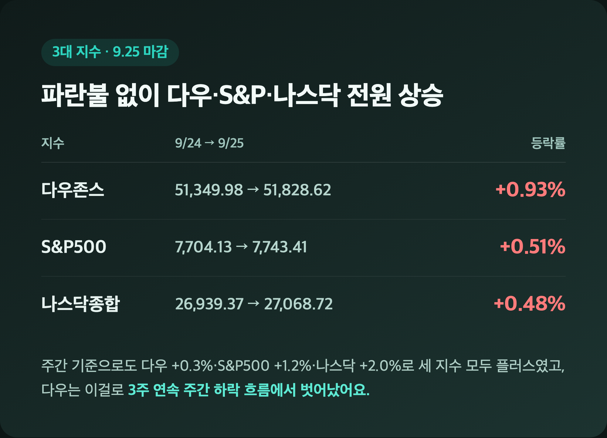
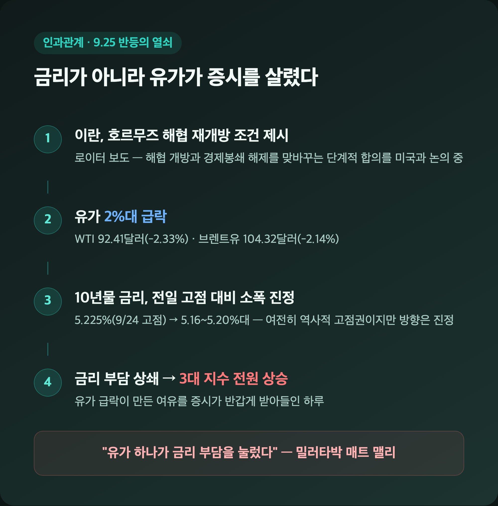
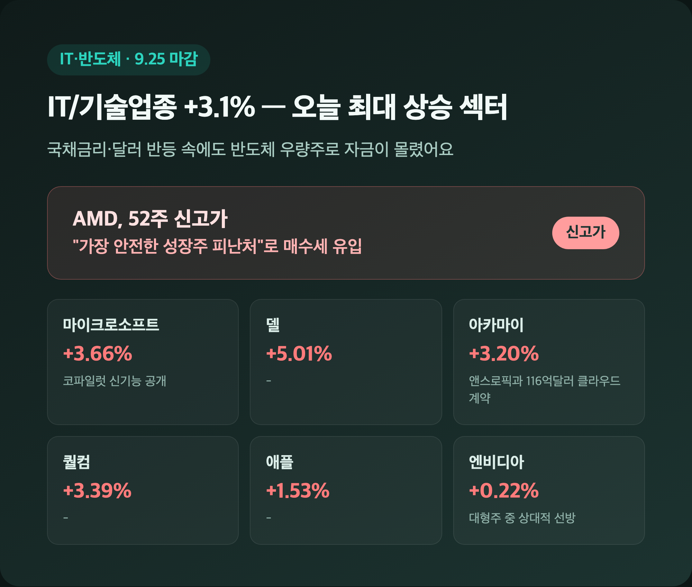
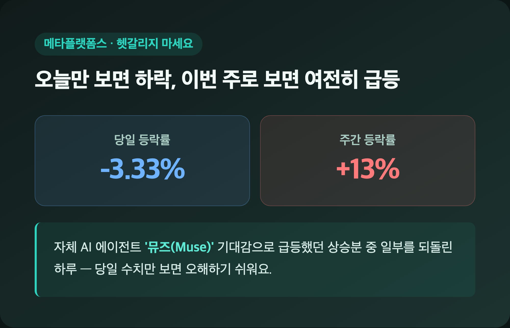
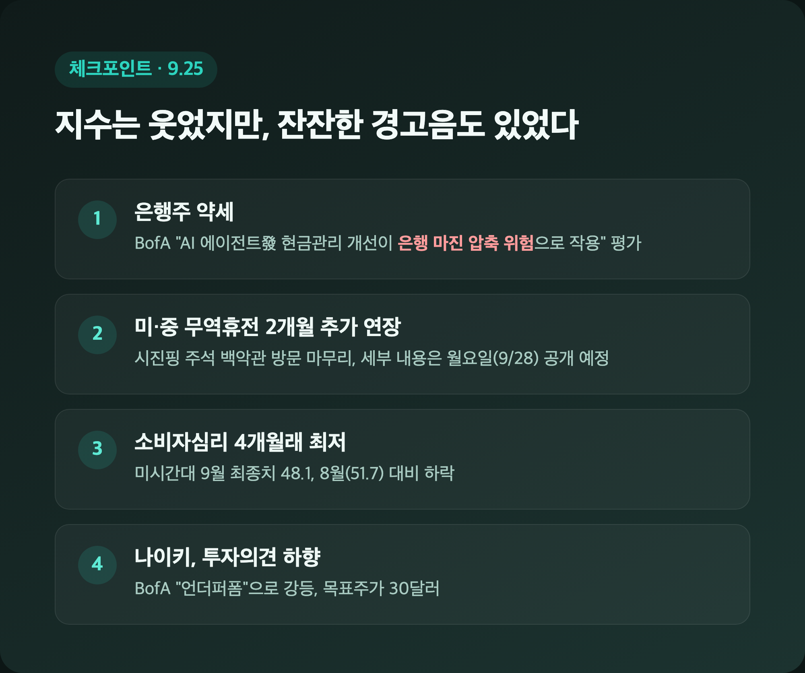
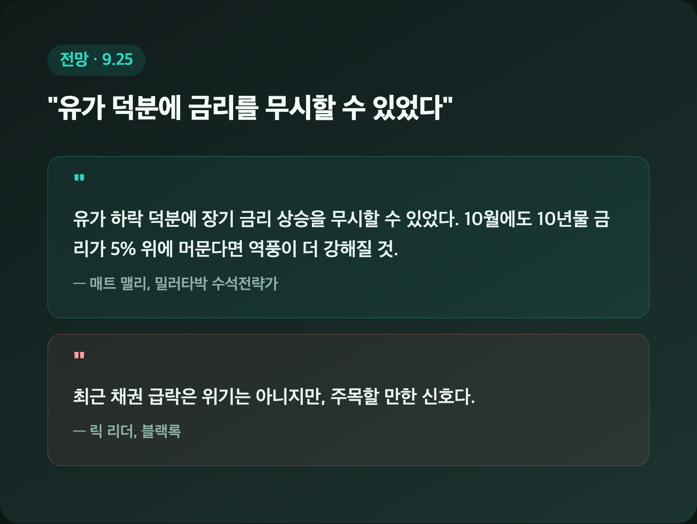

# [내일도 주린이] 국채금리 부담 딛고 3대지수 전원 상승…유가 급락이 살렸다 (9/25)

삼성전자 25주 들고 있는 입장에서 요즘 미장 체크할 때마다 마음의 준비부터 하게 되는데요, 오랜만에 오늘은 파란불 하나 없이 3대 지수가 싹 다 오른 채로 마감했습니다. 어제(9/24)까지만 해도 국채금리가 5.225%까지 치솟으며 부담을 키웠는데, 하루 만에 분위기가 확 바뀌었더라고요. 9/25(금) 미장 정리 시작해볼게요.

---

## 📈 3대지수 전원 상승 – 다우, 3주 연속 하락 흐름에서 벗어났다

> **다우 51,828.62 (+478.64, +0.93%) / S&P500 7,743.41 (+39.28, +0.51%) / 나스닥 27,068.72 (+129.34, +0.48%)**

| 지수 | 9/24 종가 | 9/25 종가 | 등락률 |
|---|---|---|---|
| 다우존스 | 51,349.98 | 51,828.62 | +0.93% |
| S&P500 | 7,704.13 | 7,743.41 | +0.51% |
| 나스닥종합 | 26,939.37 | 27,068.72 | +0.48% |

주간 기준으로도 다우 +0.3%, S&P500 +1.2%, 나스닥 +2.0%로 세 지수 모두 플러스를 기록했는데요, 특히 다우는 이걸로 3주 연속 이어지던 주간 하락 흐름에서 벗어났습니다. 전날(9/24)만 해도 다우는 -0.31%로 소폭 밀렸고 10년물 국채금리는 5.225%까지 뛰면서 19년래 최고치를 새로 썼었거든요. "이러다 또 금리에 발목 잡히나" 싶었는데, 오늘은 그 부담을 다른 재료가 상쇄해준 하루였습니다.

---

## 🛢️ 반등의 진짜 이유 – 유가 급락이 국채금리 부담을 눌렀다

> **WTI 92.41달러 (-2.33%) / 브렌트유 104.32달러 (-2.14%) / 10년물 국채금리 5.16~5.20%대 (전일 5.225% 대비 소폭 진정)**

| 구분 | 수치 | 비고 |
|---|---|---|
| WTI(11월물) | 92.41달러 | -2.33% |
| 브렌트유(11월물) | 104.32달러 | -2.14% |
| 10년물 국채금리(9/24 고점) | 5.225% | 19년래 최고치 |
| 10년물 국채금리(9/25) | 5.16~5.20%대 | 소폭 진정, 여전히 역사적 고점권 |
| 30년물 국채금리 | 5.488~5.502% | 2004년 이후 최고 유지 |

오늘 반등의 열쇠는 국채금리가 아니라 유가였어요. 로이터 보도를 인용해 이란이 호르무즈 해협 재개방 조건을 미국에 제시했고, 양국 협상단이 "해협 개방과 경제봉쇄 해제를 맞바꾸는 단계적 합의"를 논의 중이라는 소식이 전해지면서 유가가 2%대로 급락했습니다. 10년물 금리는 5.16~5.20%대로 여전히 부담스러운 수준이긴 한데, 전일 고점(5.225%) 대비로는 소폭 진정된 거라 증시가 그 여유를 유가 급락과 함께 반갑게 받아들인 모양새예요(소스별로 5.163%~5.196%까지 수치가 조금씩 다르게 나왔는데, "진정 흐름"이라는 방향성에는 이견이 없었습니다). 저는 이 조합 보면서 "금리 하나만 보면 안 되는구나" 싶었어요.

---

## 💾 IT·반도체가 지수를 끌어올렸다 – AMD는 52주 신고가

> **IT/기술업종 +3.1% (최대 상승 섹터) / MS +3.66% / 델 +5.01% / 퀄컴 +3.39% / AMD 52주 신고가**

| 종목 | 등락률 | 배경 |
|---|---|---|
| 마이크로소프트 | +3.66% | 코파일럿 앱 신기능 공개 |
| 아카마이 | +3.20% | 앤스로픽과 116억 달러 규모 클라우드 계약 |
| 퀄컴 | +3.39% | - |
| 델 | +5.01% | - |
| 애플 | +1.53% | - |
| 엔비디아 | +0.22% | 대형주 중 상대적 선방 |
| 테슬라 | -1.54% | - |

IT/기술업종이 +3.1%로 오늘 최대 상승 섹터를 기록했어요. 마이크로소프트는 코파일럿 신기능 공개로, 아카마이는 앤스로픽과의 대형 클라우드 계약 소식으로 각각 3%대 강세를 보였고요. 반도체 쪽은 특히 인상적이었는데, AMD가 52주 신고가를 새로 썼습니다. 국채금리가 여전히 높고 달러도 반등한 국면에서 기관투자자들이 AMD 같은 우량 반도체주를 "가장 안전한 성장주 피난처"로 사들였다는 분석이 나왔더라고요. 저는 이거 보면서 제가 물려있는 삼성전자도 결국 같은 반도체 업종이니까, 이런 "반도체=안전자산" 취급이 국내 대형주에도 조금씩 스며들면 좋겠다는 생각이 들었습니다.

---

## 🎭 메타, 오늘은 -3.33%인데 이번 주는 +13% – 헷갈리지 마세요

> **메타 당일 -3.33% / 메타 주간 +13%**

오늘 하루로만 보면 메타는 -3.33%로 눈에 띄게 빠졌는데요, 이걸 "메타가 요즘 안 좋구나"로 오해하면 안 됩니다. 이번 주 초 공개한 자체 AI 에이전트 '뮤즈(Muse)'에 대한 기대감으로 메타는 주간 기준으로는 여전히 약 +13% 급등한 상태거든요. 그러니까 오늘 하루 조정은 그 급등분 중 일부를 되돌린 정도로 보는 게 맞을 것 같아요. 저도 처음 기사 훑을 때 당일 수치만 보고 "어, 메타 왜 이래" 했다가, 주간 수치까지 챙겨보고서야 상황이 이해가 됐습니다.

---

## 🏦 은행주는 약세, 미·중은 무역휴전 연장 – 소비자심리는 4개월래 최저

> **미시간대 소비자심리지수 48.1 (8월 51.7→4개월래 최저) / 미·중 무역휴전 2개월 추가 연장**

| 이슈 | 내용 |
|---|---|
| 은행주 | 약세 흐름, BofA 애널리스트 "AI 에이전트發 현금관리 개선이 은행 마진 압축 위험" 평가 |
| 나이키 | BofA가 투자의견 '언더퍼폼'으로 강등, 목표주가 30달러 (발표 시점은 참고 수준) |
| 미·중 관계 | 시진핑 주석 백악관 방문 마무리, 무역휴전 2개월 추가 연장 합의, 세부 내용은 월요일(9/28) 공개 예정 |
| 소비자심리 | 미시간대 9월 최종치 48.1, 8월(51.7) 대비 하락, 4개월래 최저 |

오늘은 지수 상승 뒤에 잔잔한 경고음도 같이 있었어요. 은행주는 AI 에이전트가 고객 현금관리를 더 똑똑하게 만들면 은행 마진이 오히려 눌릴 수 있다는 우려로 약세였고요, 소비자심리지수도 4개월 만에 최저치로 떨어졌습니다. 반면 미·중은 무역휴전을 2개월 더 연장하기로 하면서 큰 불확실성 하나는 일단 미뤄둔 셈인데, 세부 내용이 월요일(9/28)에 나온다니 다음 주 초반 변수로 챙겨봐야 할 것 같아요.

---

## 🔮 전망 – "유가 덕분에 금리를 무시할 수 있었다"

> **밀러타박 매트 맬리: "유가 하락 덕분에 장기 금리 상승 무시 가능" / 블랙록 릭 리더: "위기는 아니지만 주목할 신호"**

밀러타박의 수석전략가 매트 맬리는 "유가 하락 덕분에 장기 금리 상승을 무시할 수 있었다"면서도 "10월에도 10년물 금리가 5% 위에 계속 머문다면 주식시장에 대한 역풍이 더 강해질 것"이라고 경고했어요. 블랙록의 릭 리더도 전날(9/24) 인터뷰에서 최근 채권 급락을 두고 "위기는 아니지만 주목할 만한 신호"라고 평가했다고 하고요. 오늘 하루 반등에 마음이 놓이긴 하는데, 두 사람 코멘트를 보면 결국 "금리가 5% 밑으로 내려와야 진짜 안심"이라는 얘기 같아서 저는 아직 섣불리 좋아하기는 이른 것 같더라고요.

---

## 마무리하며

오늘 뉴욕증시는 다우 +0.93%, S&P500 +0.51%, 나스닥 +0.48%로 3대 지수가 전원 상승했고, 배경에는 유가 급락이 여전히 5%대 위에 머문 국채금리 부담을 상쇄해준 흐름이 있었습니다.

솔직히 저는 오늘 같은 반등이 유가 하나에 기대고 있다는 게 살짝 불안하긴 한데요, 그래도 오랜만에 파란불 없는 마감을 봤으니 일단 오늘 하루는 편하게 넘어가려고요. AMD 신고가 보면서 반도체 업종 전반에 대한 기대는 계속 챙겨볼 생각입니다.

오늘만큼은 손절 걱정 없이 하루 마무리합니다. 내일은 또 어떻게 바뀔지 모르겠지만, 그래도 무럭무럭 자라볼게요 🌱
