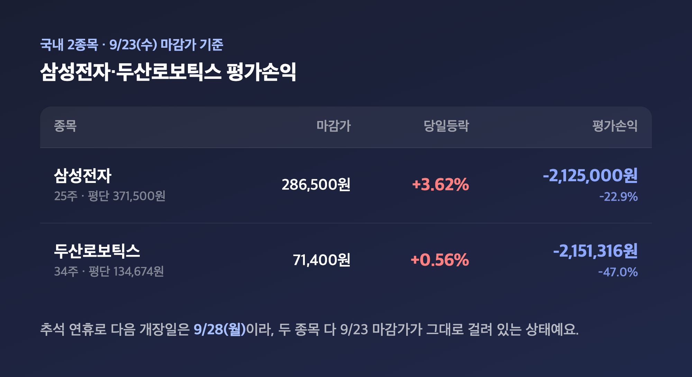
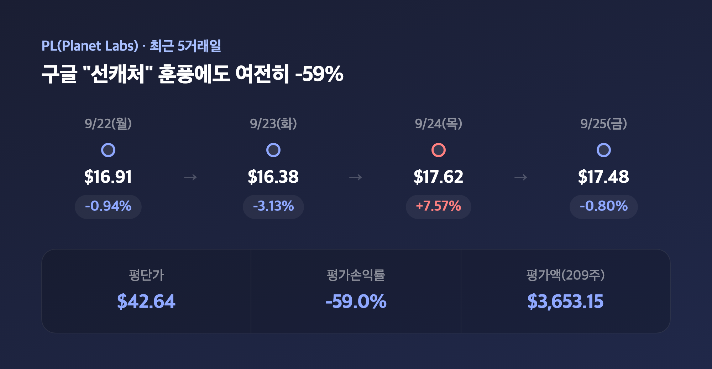
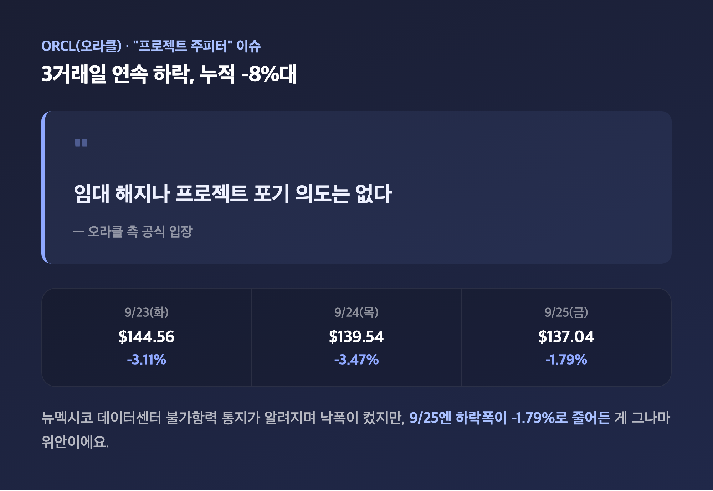
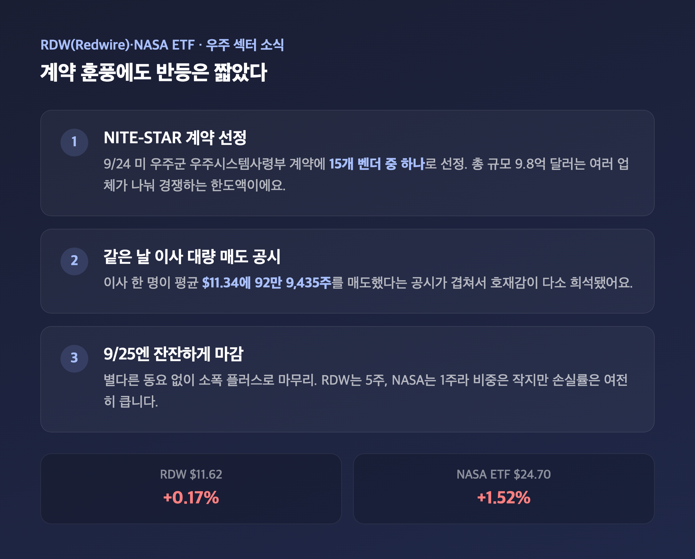
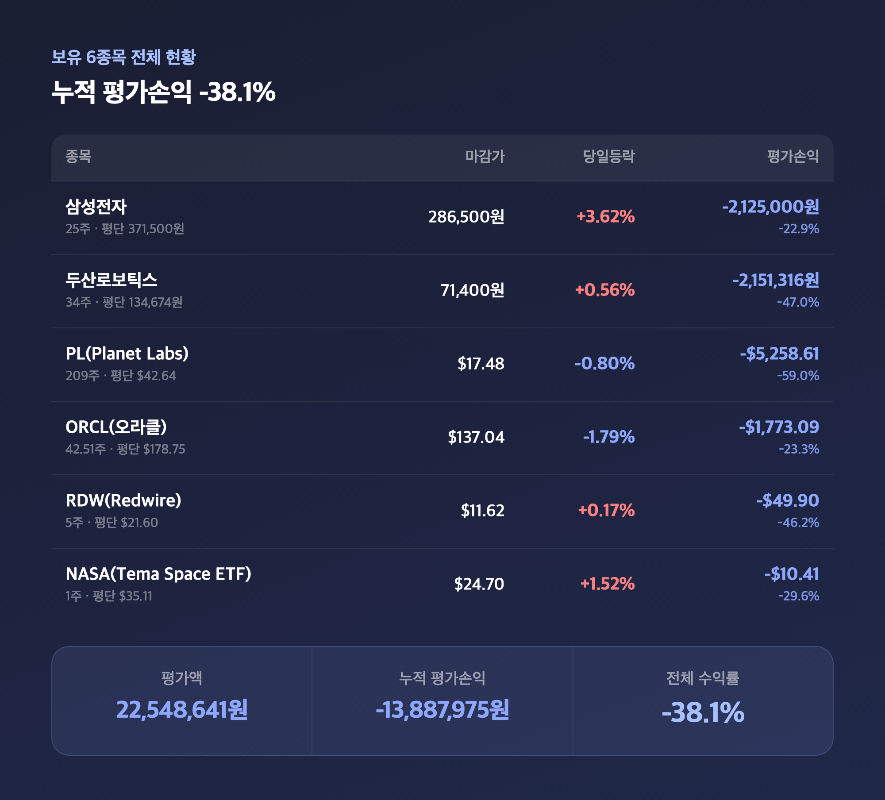

# [내일도 주린이] 포트폴리오 점검, 손실률 -38.1%…추석 연휴 겹친 마감일 정리 (9/27)

포트폴리오 캡처해놓고 리서치를 돌려봤더니 뜻밖의 사실이 나왔어요. 삼성전자·두산로보틱스 마감가가 사실은 9/25이 아니라 9/23 걸로 나온 상태였더라고요. 이유는 간단한데, 추석 연휴 때문에 국내 증시랑 미국 증시의 마지막 거래일이 어긋나 있었습니다. 그래서 오늘은 날짜부터 짚고, 실보유 중인 6종목을 하나씩 점검해볼게요.

---

## 🎏 국내 2종목 — "마감"이라 쓰지만 실은 9/23 기준입니다

> **삼성전자 ₩286,500 (+3.62%) / 두산로보틱스 ₩71,400 (+0.56%) — 둘 다 9/23(수) 마감가**

| 종목 | 보유수량 | 평단가 | 마감가 | 당일등락 | 평가손익(수익률) |
|---|---|---|---|---|---|
| 삼성전자 | 25주 | 371,500원 | 286,500원 | +3.62% | -2,125,000원 (-22.9%) |
| 두산로보틱스 | 34주 | 134,674원 | 71,400원 | +0.56% | -2,151,316원 (-47.0%) |

코스피 쪽은 추석 연휴로 아직 9/23 마감가 그대로예요. 알고 보니 올해 추석 연휴가 9/24(목)부터 9/27(일)까지 나흘이나 이어져서 국내 증시가 통째로 쉬었고, 다음 개장일은 9/28(월)이더라고요. "어제(9/25) 장 열렸을 텐데 왜 숫자가 그대로지" 했는데, 애초에 9/25이 거래일이 아니었던 겁니다. 삼성전자는 9/23 하루 전 미국에서 마이크론(+5.00%), 샌디스크(+6.82%) 등 반도체주가 강세를 보이며 필라델피아반도체지수가 +2.06% 오른 훈풍을 그대로 이어받아 3%대 급등했고요, 메모리 수요가 공급을 웃돈다는 전망과 LPDDR6 검증 소식도 겹쳤다고 해요. 두산로보틱스는 로봇 테마 전반이 차익실현 매물에 숨 고르는 와중에도 소폭 플러스로 버텼는데, 같은 날짜를 다룬 언론 보도끼리도 종가가 조금씩 엇갈려서 어느 쪽이 정확한 숫자인지는 저도 확신은 못 하겠더라고요. 어쨌든 -22.9%, -47.0%, 여전히 크게 물려 있는 건 변함없습니다.

---

## 😮‍💨 PL(Planet Labs) — 구글 "프로젝트 선캐처" 훈풍에도 여전히 -59%

> **PL $17.48 (-0.80%) / 평단 $42.64 대비 -59.0% (평가액 $3,653.15)**

| 날짜 | 종가 | 등락률 |
|---|---|---|
| 9/22(월) | $16.91 | -0.94% |
| 9/23(화) | $16.38 | -3.13% |
| 9/24(목) | $17.62 | +7.57% |
| 9/25(금) | $17.48 | -0.80% |

미국 종목들은 9/25(금)이 진짜 마지막 거래일이 맞아요. PL은 9/24 하루 만에 +7.57% 급등했는데, 배경이 좀 특이했습니다. 구글이 TPU(텐서처리장치)를 우주 궤도에서 실증하는 "프로젝트 선캐처" 첫 테스트를 스페이스X 미션에 실어 보낼 예정이라는 소식이 나왔고, Planet Labs가 이 프로젝트의 우주선 설계·운영을 지원하는 파트너로 언급됐거든요. 9/25 장전엔 한때 $18대까지 오르며 급등분을 더 키우나 싶었는데, 정규장은 결국 소폭 하락으로 마감했어요. Trefis는 12개월 목표주가 $33.4를 제시하며 여전히 매수 우위로 봤지만, 같은 리포트에서 "한 달 새 변동성이 컸다"는 점도 같이 짚더라고요. 209주나 들고 있다 보니 이런 개별 호재 하나에 하루하루 기분이 왔다 갔다 하는데, 그래도 아직 -59%는 그대로입니다.

---

## 💣 ORCL(오라클) — "프로젝트 주피터" 불가항력 통지 후폭풍

> **ORCL $137.04 (-1.79%) / 평단 $178.75 대비 -23.3%**

| 날짜 | 종가 | 등락률 |
|---|---|---|
| 9/23(화) | $144.56 | -3.11% |
| 9/24(목) | $139.54 | -3.47% |
| 9/25(금) | $137.04 | -1.79% |

오라클은 3거래일 연속 하락하며 이 구간에서만 누적 -8% 넘게 빠졌어요. 원인은 "프로젝트 주피터"라는 낯선 이름의 데이터센터였습니다. 오라클이 블루오울 캐피털 자회사에 뉴멕시코주 소재 대형 데이터센터(스타게이트 AI 인프라의 핵심 시설) 관련 불가항력 통지를 보낸 사실이 알려지면서, 이 시설이 계획대로 가동되지 못할 가능성이 불거졌거든요. 오라클 측은 "임대 해지나 프로젝트 포기 의도는 없다"고 선을 그었지만, 매체마다 9/24 낙폭을 3.5%부터 7%까지 다르게 보도할 만큼 시장 반응은 꽤 컸어요. 42.51주 들고 있는 입장에서 사흘 내내 빨간 숫자만 보고 있으려니 마음이 편치는 않았는데, 그나마 9/25엔 낙폭이 -1.79%로 줄어든 걸 위안 삼고 있습니다.

---

## 🛰️ RDW·NASA — 우주 계약 훈풍에도 반등은 짧았다

> **RDW $11.62 (+0.17%) / NASA(Tema Space Innovators ETF) $24.70 (+1.52%)**

| 종목 | 보유수량 | 평단가 | 마감가 | 당일등락 | 평가손익(수익률) |
|---|---|---|---|---|---|
| RDW (Redwire) | 5주 | $21.60 | $11.62 | +0.17% | -$49.90 (-46.2%) |
| NASA (Tema Space Innovators ETF) | 1주 | $35.11 | $24.70 | +1.52% | -$10.41 (-29.6%) |

RDW는 9/24에 미 우주군 우주시스템사령부의 "NITE-STAR" 계약에 15개 벤더 중 하나로 선정되며 크게 반등했었는데, 총 규모 9.8억 달러는 여러 업체가 나눠 경쟁하는 계약 한도일 뿐이라 실제 매출로 이어질지는 미지수라고 해요. 공교롭게도 같은 날 회사 이사 한 명이 평균 $11.34에 92만 9,435주를 매도했다는 공시도 있었고요. 호재와 대량 매도가 겹친 게 좀 아이러니했는데, 9/25엔 별다른 동요 없이 +0.17%로 마무리됐습니다. NASA ETF는 개별 뉴스는 딱히 안 보였지만 우주 섹터 전반의 훈풍이 조금은 묻어간 걸로 보여요. 5주, 1주라 비중은 작아도 둘 다 -46.2%, -29.6%씩 물려 있는 건 매한가지네요.

---

## 📊 보유 6종목 전체 총정리 — 누적 -38.1%

> **누적 평가손익 -13,887,975원 / 평가액 22,548,641원 / 전체 수익률 -38.1%**

| 종목 | 보유수량 | 평단가 | 마감가 | 당일등락 | 평가손익(수익률) |
|---|---|---|---|---|---|
| 삼성전자 | 25주 | 371,500원 | 286,500원 | +3.62% | -2,125,000원 (-22.9%) |
| 두산로보틱스 | 34주 | 134,674원 | 71,400원 | +0.56% | -2,151,316원 (-47.0%) |
| PL (Planet Labs) | 209주 | $42.64 | $17.48 | -0.80% | -$5,258.61 (-59.0%) |
| ORCL (오라클) | 42.51주 | $178.75 | $137.04 | -1.79% | -$1,773.09 (-23.3%) |
| RDW (Redwire) | 5주 | $21.60 | $11.62 | +0.17% | -$49.90 (-46.2%) |
| NASA (Tema Space Innovators ETF) | 1주 | $35.11 | $24.70 | +1.52% | -$10.41 (-29.6%) |

여섯 종목 다 더해보면 평가액 22,548,641원에 누적 평가손익 -13,887,975원, 전체 수익률은 -38.1%예요. 지난 9/18 점검 때가 -39.7%였으니 1.6%p 정도는 회복된 셈인데, 냉정히 보면 여전히 원금의 3분의 1 넘게 날아간 상태라 "많이 나아졌다"고 말하기는 좀 민망하네요. 그래도 여섯 종목 중 절반(삼성전자·두산로보틱스·RDW·NASA)이 당일 기준으로는 플러스였다는 점은 기록해두려고요.

---

## 마무리하며

정리하면 국내는 추석 연휴로 9/23 마감가가 그대로 걸려 있고, 미국 4종목은 9/25 마감 기준으로 각자 다른 이유(구글 파트너십, 데이터센터 불가항력, 우주군 계약)에 흔들린 한 주였어요. 전체 손실률은 -38.1%로 지난번보다 소폭 줄었고요.

솔직히 이 정도 숫자면 "회복"이라는 단어를 쓰기엔 아직 이르지만, 그렇다고 다 팔고 도망갈 상황도 아닌 것 같아서 일단은 계속 지켜보려고 해요. 9/28 국내 재개장 때 삼성전자·두산로보틱스가 어떻게 움직이는지부터 다시 체크해볼 생각입니다.

손실률이 -39.7%에서 -38.1%로 준 것만으로 오늘은 만족하려고요. 무럭무럭까지는 아니어도, 조금씩은 자라는 중입니다 🌱

#포트폴리오점검 #내주식포트폴리오 #오라클주가 #플래닛랩스
