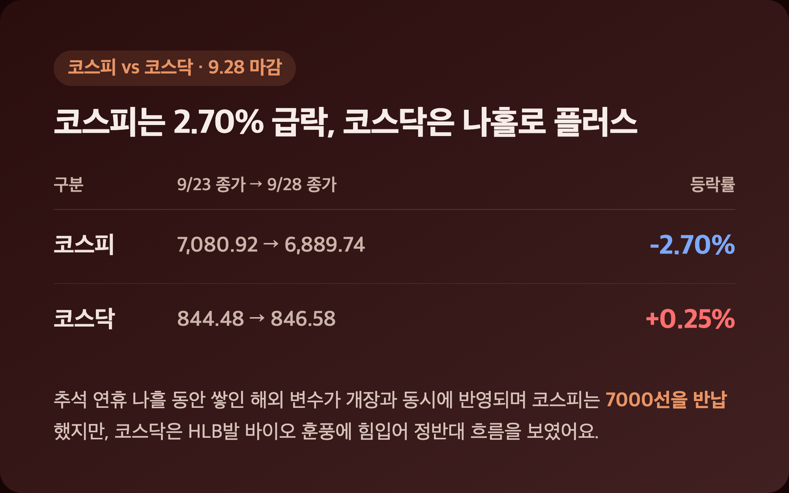
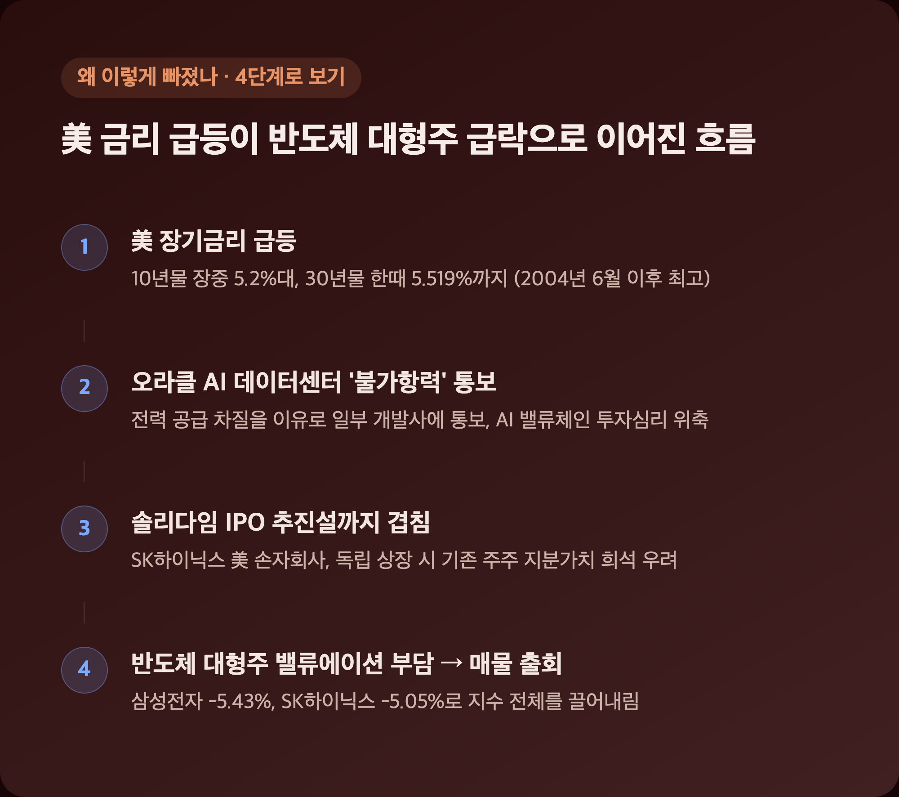
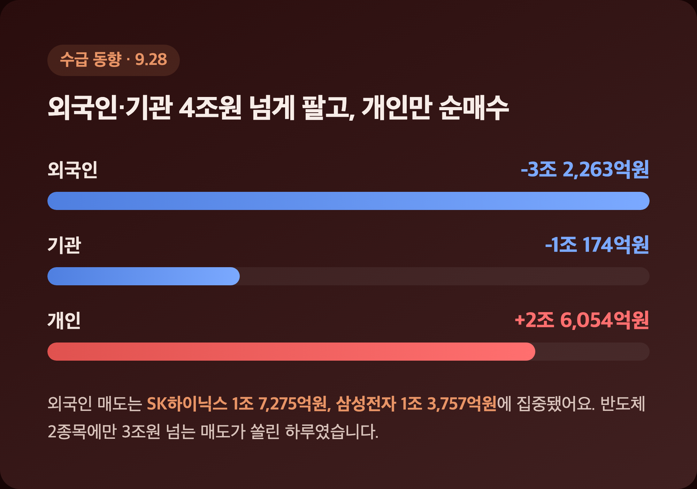
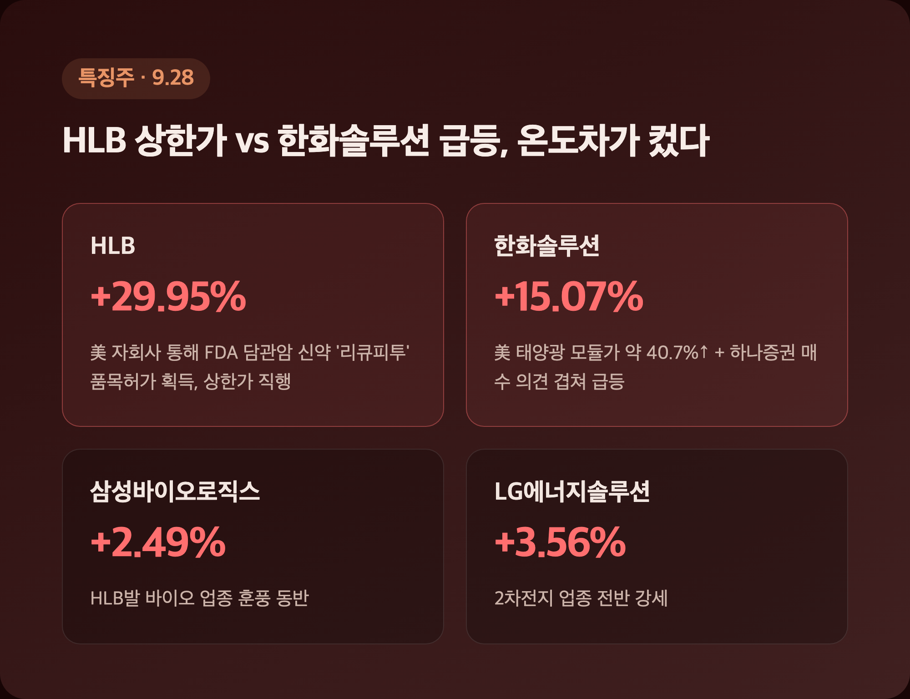

# [내일도 주린이] 코스피 2.70% 급락 7000선 반납…삼성전자 -5.43%, 추석 복귀 첫날 정리 (9/28)

어제 포트폴리오 점검 글 쓰면서 삼성전자 +3.62%라고 신나게 적었는데요, 알고 보니 그건 추석 연휴 전인 9/23 마감가였더라고요. 오늘(9/28) 진짜 재개장일 뚜껑을 열어보니 상황이 완전히 달랐습니다. "어제 그거 다 착시였구나" 싶었던 국장 정리, 시작해볼게요.

---

## 🇰🇷 코스피 2.70% 급락, 코스닥은 나홀로 플러스 – 4일 만에 열린 장이 무거웠다

> **코스피 6,889.74 (-191.18, -2.70%) / 코스닥 846.58 (+2.10, +0.25%)**

| 구분 | 9/23 종가(휴장 전) | 9/28 종가 | 등락률 |
|---|---|---|---|
| 코스피 | 7,080.92 | 6,889.74 | -2.70% |
| 코스닥 | 844.48 | 846.58 | +0.25% |

추석 연휴가 9/24(목)부터 9/27(일)까지 나흘이나 이어지면서, 그동안 쌓인 해외 변수가 오늘 개장과 동시에 한꺼번에 반영됐어요. 코스피는 7,057선으로 출발해 장중 7,065선까지 잠깐 오르기도 했는데, 이후 매물이 쏟아지며 6,889선까지 밀렸고 결국 7000선을 반납했습니다. 거래대금은 21조 8,070억원으로 집계됐고요. 반도체 대형주가 유독 심하게 빠졌는데, 삼성전자 -5.43%, 삼성전자우 -5.91%, SK하이닉스 -5.05%, SK스퀘어는 -7.56%까지 밀렸어요.

| 종목 | 등락률 |
|---|---|
| 삼성전자 | -5.43% |
| 삼성전자우 | -5.91% |
| SK하이닉스 | -5.05% |
| SK스퀘어 | -7.56% |

저는 어제 포트폴리오 글에서 삼성전자 286,500원, +3.62%라고 분명히 적었는데요, 그게 9/23 마감가였을 뿐 오늘 실제로는 -5.43%까지 밀리면서 다시 한번 물렸습니다. 25주 들고 있는 입장에서 하루 만에 이렇게 뒤집힐 줄은 몰랐어요. 반면 코스닥은 바이오주에 매수세가 몰리며 장중 2% 가까이 오르는 등 코스피와 정반대 흐름을 보였습니다.

---

## 📉 왜 이렇게 빠졌나 – 美 장기금리 급등 + 오라클 AI 우려 + 솔리다임 IPO 이슈

> **美 10년물 국채금리 장중 5.2%대 / 30년물 한때 5.519% (2004년 6월 이후 최고)**

| 구분 | 수치 |
|---|---|
| 美 10년물 국채금리 | 장중 5.2%대 |
| 美 30년물 국채금리 | 한때 5.519% (2004년 6월 이후 최고) |
| 국내 국고채 3년물 | 2022년 11월 이후 최고 수준 |

연휴 기간 미국 국채금리가 급등한 게 가장 큰 배경으로 꼽혀요. 헤럴드경제는 미국 9월 PMI가 예상치를 웃돈 게 금리 상승 트리거였다고 봤는데, 글로벌이코노믹·EBN 등은 국채 입찰 수요 부진과 중동(이란) 지정학 리스크를 더 강조했습니다(금리가 급등했다는 방향성은 같은데, '왜'에 대해서는 매체마다 좀 다르게 짚더라고요). 여기에 오라클이 전력 공급 차질을 이유로 일부 AI 데이터센터 개발사에 '불가항력'을 통보했다는 소식까지 겹치면서 메모리를 포함한 AI 밸류체인 전반의 투자심리가 얼어붙었고요. SK하이닉스 쪽은 미국 손자회사 솔리다임의 IPO 추진설도 부담으로 작용했는데, 독립 상장 시 기존 주주 지분가치가 희석될 수 있다는 우려 때문이었대요. 신한투자증권 김기백 연구원은 "고금리 환경에서 밸류에이션 부담이 큰 반도체 대형주 중심으로 매물이 출회됐다"고 평가했습니다.

---

## 💰 수급 동향 – 외국인·기관 4조원 넘게 팔고, 개인만 순매수

> **외국인 -3조 2,263억원 / 기관 -1조 174억원 / 개인 +2조 6,054억원**

| 투자자 | 순매매 |
|---|---|
| 외국인 | -3조 2,263억원 |
| 기관 | -1조 174억원 |
| 개인 | +2조 6,054억원 |

외국인과 기관이 합쳐서 4조원 넘게 팔아치우는 동안 개인 홀로 적극 매수에 나서 낙폭을 일부 방어한 모양새예요(외국인 매도 규모는 헤럴드경제 기준 3조 2,427억원으로 소폭 다르게 나왔는데, 3조원대 순매도라는 방향성 자체는 동일했습니다). 그런데 종목별로 뜯어보면 외국인 매도가 어디에 쏠렸는지가 더 눈에 띄어요.

| 종목 | 외국인 순매도 |
|---|---|
| SK하이닉스 | 1조 7,275억원 |
| 삼성전자 | 1조 3,757억원 |
| 삼성전자우 | 421억원 |

반도체 2종목에만 3조원 넘는 매도가 쏠렸더라고요. 제가 물려있는 삼성전자에서만 외국인이 1조 3,757억원어치를 팔았다고 하니, 오늘 -5.43%가 그냥 나온 숫자가 아니었구나 싶었습니다. 참고로 오전 한때는 상승 종목이 하락 종목보다 훨씬 많았는데도 지수는 시총 상위주 낙폭에 눌려 내렸다는 "지수 착시" 얘기도 나왔어요.

---

## 🔥 특징주 – HLB 상한가 vs 한화솔루션 급등, 온도차가 컸다

> **HLB +29.95% (상한가) / 한화솔루션 +15.07%**

| 종목 | 등락률 | 배경 |
|---|---|---|
| HLB | +29.95% | 美 자회사 통해 FDA 담관암 신약 '리큐피투' 품목허가 획득 |
| 한화솔루션 | +15.07% | 美 태양광 모듈가 약 40.7%↑ + 하나증권 매수 의견 |
| 삼성바이오로직스 | +2.49% | HLB발 바이오 업종 훈풍 |
| LG에너지솔루션 | +3.56% | 2차전지 업종 강세 |

HLB는 국내 제약·바이오 기업이 항암 신약을 FDA에 직접 신청해 승인받은 첫 사례로 평가되면서 개장 직후 상한가로 직행했고, HLB글로벌·HLB바이오스텝 등 그룹주 여럿이 동반 상한가를 기록했어요. 코스닥이 나홀로 플러스였던 데는 이 HLB 훈풍 영향이 컸습니다. 한화솔루션은 미국 태양광 모듈 가격이 재조정되며 40% 넘게 뛰었다는 소식과, 12월 미국 무역확장법 232조 시행 전 저가 매수해야 한다는 증권가 조언이 겹쳐 급등했고요. 코스피가 전체적으로 얻어맞는 와중에도 이렇게 개별 종목 단위로는 완전히 다른 그림이 그려지는 게 국장의 묘미이자 어려운 점인 것 같아요.

---

## 💱 원/달러 환율 – 반도체주 급락에 원화도 약세

> **원/달러 1,365.10원 (+7.6원)**

원/달러 환율은 오후 3시30분 기준 전일 대비 7.6원 오른 1,365.10원으로 마감했어요. 오전 9시경 1,359원대에서 출발해 점차 상승 압력을 받았는데, 미국 장기금리 급등에 따른 달러 강세와 외국인의 대규모 주식 순매도에 따른 자금 유출 우려가 겹친 걸로 풀이됩니다. 지수도 빠지고 환율도 오르니, 오늘은 여러모로 원화 자산 쪽엔 힘든 하루였네요.

---

## 🔮 다음 변수 – 9/30 마이크론 실적, USTR 무역휴전 세부 발표

> **9/30 마이크론 FY4분기 실적 발표 / 9/28 USTR 미중 무역휴전 연장 세부 내용 공개**

이번 주 최대 이벤트는 9월 30일 장 마감 후 나올 마이크론 실적이에요. "반도체·AI 모멘텀의 가늠자"로 지목되는 만큼, 부진하면 삼성전자·SK하이닉스에 추가 충격을 줄 수 있다는 우려가 나옵니다. 또 오늘 미무역대표부(USTR)가 미중 무역휴전 2개월 연장의 세부 내용을 공개할 예정이어서, 내용에 따라 IT·반도체·소재 섹터가 한 번 더 흔들릴 수 있어요. 참고로 8월말 나온 국내 증권사들 9월 코스피 전망은 6500~8000선 박스권을 제시했었는데, 오늘 같은 급락이 나온 걸 보면 그 밴드 하단 쪽 시나리오가 좀 더 현실적으로 느껴지네요.

---

## 마무리하며

오늘 코스피는 -2.70%(6,889.74)로 7000선을 반납했고, 그 중심엔 삼성전자 -5.43%, SK하이닉스 -5.05%로 대표되는 반도체 대형주 급락이 있었어요. 코스닥은 HLB 상한가 덕에 +0.25%로 나홀로 선방했고요.

솔직히 어제까지만 해도 삼성전자가 3%대 올랐다고 좋아했는데, 하루 만에 이렇게 반전될 줄은 몰랐습니다. 그래도 이게 연휴 동안 쌓인 해외 변수가 한꺼번에 반영된 거라, 마이크론 실적이랑 USTR 발표 나올 때까지는 일단 좀 더 지켜보려고요.

삼성전자 -5.43%, 오늘도 확실하게 손절 각을 봤습니다. 내일은 반등까지는 아니어도 숨 고르기 정도는 해줬으면 좋겠네요 🌱
