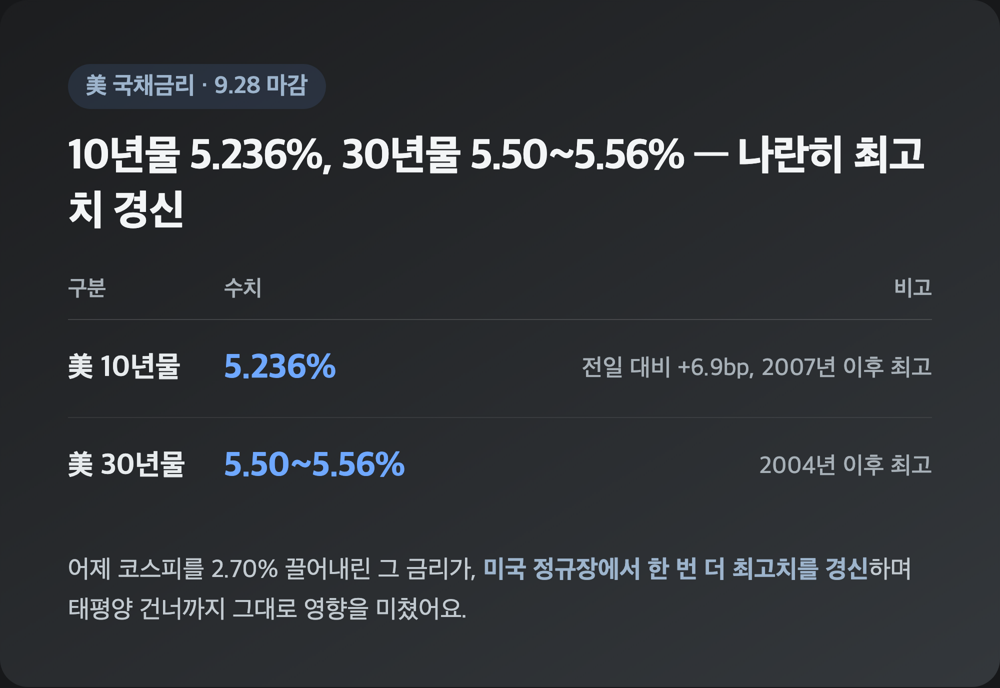
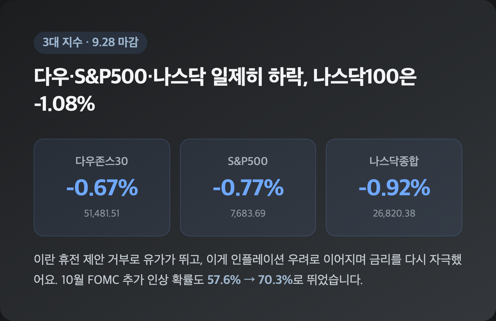
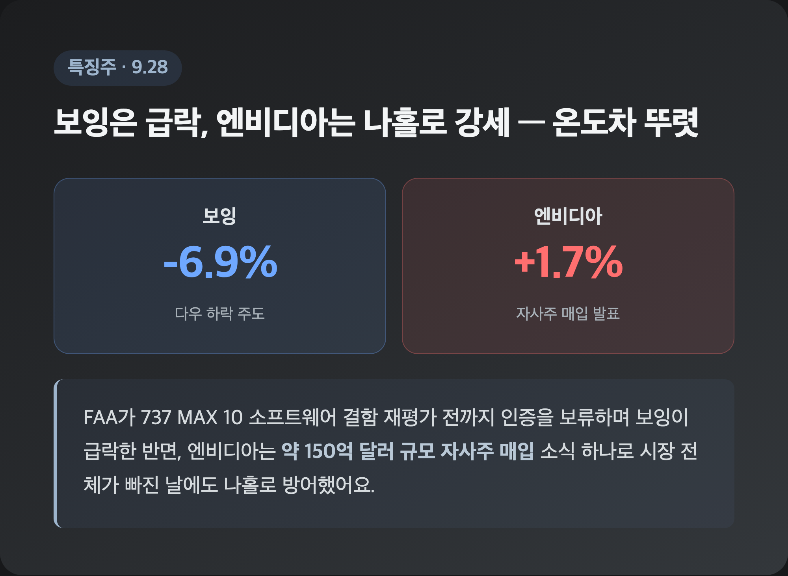
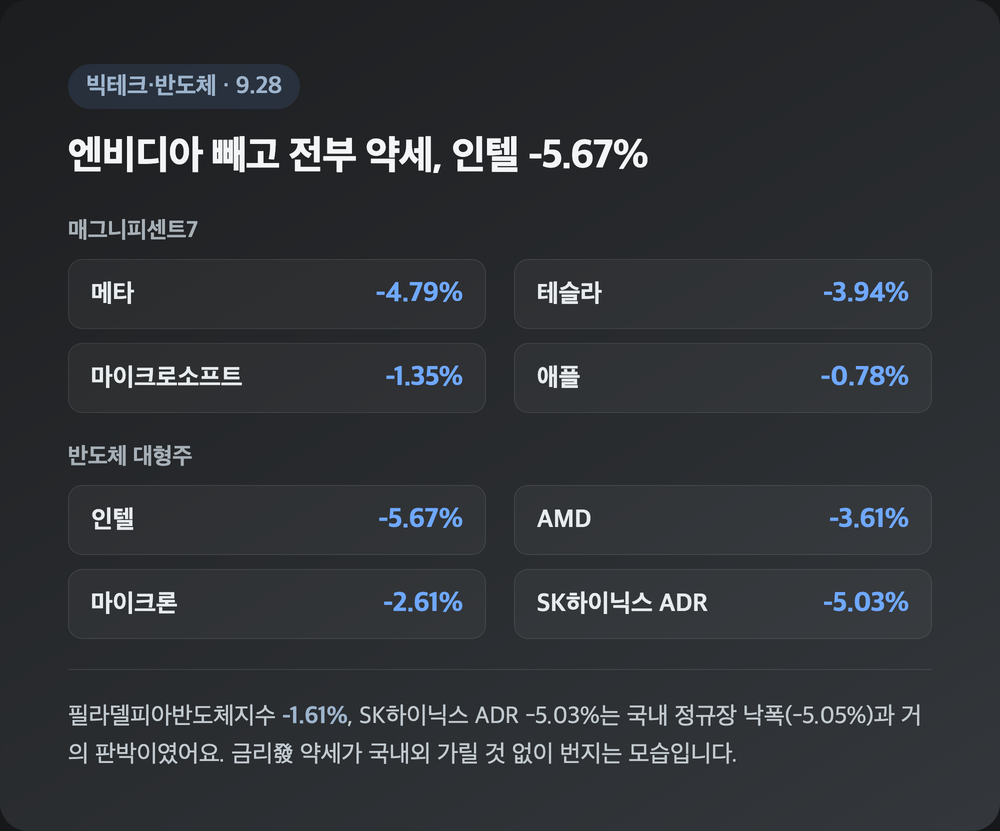
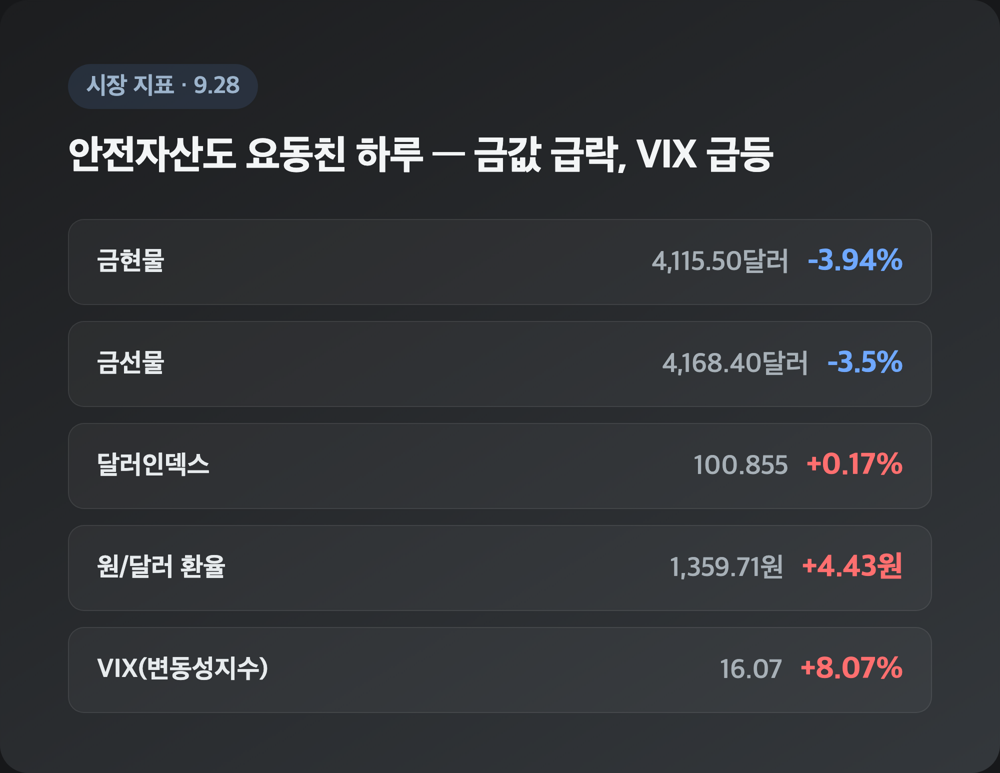

# [내일도 주린이] 다우·나스닥 동반 하락…5.2% 국채금리, 어제 국장 이어 미국도 강타 (9/28)

어제 국장 정리 글에 "삼성전자 -5.43%, 이게 다 미 국채금리 때문"이라고 적었는데요, 오늘 미장 리서치를 열어보니 그 금리가 태평양 건너 미국 본토에서도 그대로 사고를 쳤더라고요. "어라, 남 얘기가 아니었네" 싶었던 9/28 뉴욕증시, 정리해볼게요.

---

## 💵 미 10년물 국채금리 5.2%대 – 어제 국장 뒤흔든 그 금리, 미국장도 피하지 못했다

> **美 10년물 국채금리 5.236% (2007년 이후 최고) / 30년물 5.50~5.56% (2004년 이후 최고)**

| 구분 | 수치 | 비고 |
|---|---|---|
| 美 10년물 국채금리 | 5.236% | 전일 대비 +6.9bp, 2007년 이후 최고 |
| 美 30년물 국채금리 | 5.50~5.56% | 2004년 이후 최고 |

어제 코스피가 2.70% 급락하고 제가 물려있는 삼성전자가 -5.43%까지 밀렸을 때만 해도 "이건 국내 반도체주 수급 문제인가" 했는데요, 알고 보니 진짜 원인은 미국 장기금리였습니다. 그리고 그 금리가 정작 같은 날 미국 본토 증시에서도 재차 뚫고 올라갔더라고요. 10년물이 2007년 이후 최고, 30년물이 2004년 이후 최고 수준까지 치솟았으니, 코스피를 흔든 재료가 소화된 게 아니라 오히려 미국 정규장에서 한 번 더 심해진 셈이었습니다.

---

## 🇺🇸 3대지수 동반 하락 마감 – 다우 -0.67%, S&P500 -0.77%, 나스닥 -0.92%

> **다우 51,481.51 (-0.67%) / S&P500 7,683.69 (-0.77%) / 나스닥 26,820.38 (-0.92%)**

| 지수 | 종가 | 등락률 |
|---|---|---|
| 다우존스30 | 51,481.51 | -0.67% |
| S&P500 | 7,683.69 | -0.77% |
| 나스닥종합 | 26,820.38 | -0.92% |
| 나스닥100 | 30,276.81 | -1.08% |

9/25(금)엔 3대 지수가 전원 플러스로 마감하며 모처럼 파란불 없는 하루였는데요, 주말 휴장을 딱 하루 건너뛰고 열린 첫 거래일에 이렇게 뒤집힐 줄은 몰랐습니다. 배경엔 트럼프 대통령이 이란 측의 '7일 계획' 휴전 제안을 거부했다는 소식이 있었어요. 중동發 원유 공급 차질 우려가 유가를 밀어올렸고, 이게 인플레이션 재가속 우려로 이어지면서 국채금리를 다시 자극한 겁니다. 여기에 연준 인사들의 매파적 발언까지 겹치면서, CME 페드워치 기준 10월 FOMC 추가 인상(0.25%p 이상) 확률이 일주일 전 57.6%에서 70.3%로 뛰었어요. "금리 걱정 좀 덜었나" 했던 금요일이 무색해진 하루였습니다.

---

## ✈️ 보잉 -6.9% vs 엔비디아 나홀로 +1.7% – 특징주 온도차

> **보잉 -6.9% (다우 하락 주도) / 엔비디아 +1.7% (자사주 매입 발표)**

| 종목 | 등락률 | 배경 |
|---|---|---|
| 보잉 | -6.9% | FAA, 737 MAX 10 소프트웨어 결함 재평가 전까지 인증 보류 |
| 엔비디아 | +1.7% | 약 150억 달러(원화 환산 약 204조원 추정) 규모 자사주 매입 발표 |

보잉은 미 연방항공청(FAA)이 새로운 소프트웨어 결함을 평가할 때까지 737 MAX 10 기종 인증을 내주지 않겠다고 밝히면서 다우지수 하락을 사실상 혼자 이끌었어요. 반면 엔비디아는 3대 지수가 다 빠진 날에도 자사주 매입 소식 하나로 나홀로 상승했는데요(매입 규모가 언론마다 "150억 달러"·"204조원"으로 다르게 표기됐는데, 환율 적용하면 얼추 맞아떨어지는 수치라 같은 발표를 다르게 환산한 걸로 보여요). 시장 전체가 하락하는 날에도 개별 호재 하나로 이 정도 방어가 되는 걸 보면, 역시 AI 대장주 프리미엄은 여전하구나 싶었습니다.

---

## 💾 반도체·빅테크 – 인텔 -5.67%, 메타 -4.79%, SK하이닉스 ADR도 -5.03%

> **필라델피아반도체지수 -1.61% / 매그니피센트7 중 엔비디아만 상승**

| 종목 | 등락률 |
|---|---|
| 메타 | -4.79% |
| 테슬라 | -3.94% |
| 마이크로소프트 | -1.35% |
| 애플 | -0.78% |
| 스페이스X | -2.16% |

| 종목 | 등락률 |
|---|---|
| 인텔 | -5.67% |
| AMD | -3.61% |
| 마이크론 | -2.61% |
| 샌디스크 | -3.65% |
| SK하이닉스 ADR | -5.03% |

빅테크는 엔비디아 빼고 전부 약세였고, 반도체 섹터는 필라델피아반도체지수가 -1.61%로 밀리며 인텔(-5.67%), AMD(-3.61%)가 특히 크게 빠졌어요. 눈에 띈 건 SK하이닉스 ADR이 -5.03%로 국내 정규장 낙폭(-5.05%)이랑 거의 판박이였다는 점인데요, 제가 물려있는 삼성전자도 어제 -5.43% 맞은 걸 생각하면 이 금리發 반도체 약세가 국내외 가릴 것 없이 번지고 있다는 게 체감됐습니다. 고금리 국면에서 밸류에이션 부담이 큰 성장주·반도체주부터 매물이 나오는 흐름, 당분간은 계속 지켜봐야 할 것 같아요.

---

## 🥇 금·달러·유가·VIX – 안전자산도 요동쳤다

> **금현물 4,115.50달러 (-3.94%) / VIX 16.07 (+8.07%) / 달러인덱스 100.855 (+0.17%)**

| 지표 | 수치 |
|---|---|
| 금현물 | 4,115.50달러 (-3.94%) |
| 금선물 | 4,168.40달러 (-3.5%) |
| 달러인덱스 | 100.855 (+0.17%) |
| 원/달러 환율 | 1,359.71원 (+4.43원) |
| VIX(변동성지수) | 16.07 (+8.07%) |

금리·달러가 동시에 강세를 보이면서 안전자산 취급받던 금값이 오히려 -3.94%나 급락했어요. VIX도 8% 넘게 뛰면서 시장 불안 심리를 그대로 보여줬고요. 유가는 소스마다 온도차가 좀 있었는데, 블록미디어는 브렌트유가 배럴당 105달러를 넘었다고 봤고 Yahoo Finance는 브렌트유 98달러·WTI 선물 93.46달러(+0.93%)로 보도했습니다. 브렌트유 구체적인 수준을 두고 소스 간 차이가 있어서 양쪽을 그대로 남겨둡니다. 방향성(유가 상승)만큼은 두 소스가 공통이었어요.

---

## 🔮 이번 주 전망 – PCE·고용지표, 10월 FOMC 추가 인상 확률 70%

> **8월 PCE 물가지표 + 9월 고용지표 발표 예정 / 10월 FOMC 추가 인상 확률 70.3%**

배녹번글로벌포렉스 마크 챈들러 수석 시장전략가는 미국의 이란 제안 거부로 유가가 오르고, 이게 국채금리 상승과 달러 강세로 이어졌다고 짚었어요. 스코샤뱅크 분석진도 지금 시장의 핵심 관심은 국제유가에 있고, 에너지 가격 상승이 주요국 중앙은행의 긴축 기대를 키우고 있다고 진단했습니다. "이란이 유가를 올리고, 유가가 인플레를 자극하고, 인플레가 금리를 밀어올린다"는 연쇄 구도를 지적한 분석도 있었고요. 이번 주엔 8월 PCE 물가지표와 9월 고용지표가 줄줄이 발표될 예정이라, 이 숫자들이 이 연쇄 고리를 끊어줄지 아니면 더 굳힐지가 관건일 것 같습니다.

---

## 마무리하며

오늘 뉴욕증시는 다우 -0.67%, S&P500 -0.77%, 나스닥 -0.92%로 3대 지수가 동반 하락했고, 배경엔 5.2%대까지 오른 국채금리와 유가 급등 우려가 있었어요. 어제 코스피를 2.70% 끌어내린 그 금리 재료가, 하루도 안 지나 미국 본토 증시까지 덮친 셈입니다.

솔직히 국장이랑 미장이 이렇게 같은 재료로 나란히 빠지는 걸 보니 "어디로 도망가야 하나" 싶긴 한데요, 저는 일단 이번 주 PCE·고용지표부터 확인하고 다음 스텝을 정하려고요.

국장도 미장도 같은 금리에 발목 잡힌 하루였네요. 오늘은 여기까지 손절, 내일은 지표 보고 다시 익절 각 재볼게요 🌱
